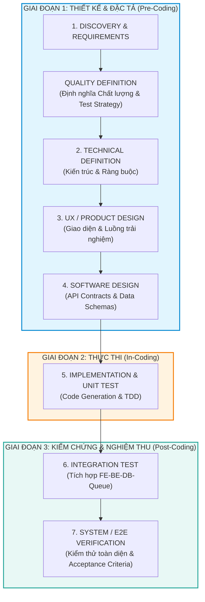

# QUY TRÌNH KỸ THUẬT PHÁT TRIỂN PHẦN MỀM CHUẨN AI (AI-ASSISTED SDLC)
> **Phiên bản:** 1.0 (Quy tắc kỹ thuật tổng quát - Dành cho mọi dự án phần mềm & AI)  
> **Phương pháp luận:** Spec-Driven Development + AI Agent-Assisted Engineering

---

## I. TỔNG QUAN VÀ TRIẾT LÝ CỐT LÕI

### 1. Triết lý "Spec-Driven Development" (Phát triển theo Đặc tả)
Trong kỷ nguyên lập trình cùng AI (Claude, Cursor, Copilot, Antigravity), **quy tắc số 1** là:
> **"Không bao giờ code khi chưa có bản đặc tả hoàn chỉnh."**  
> AI Agent có tốc độ sinh mã cực nhanh, nhưng nếu đầu vào mơ hồ, AI sẽ tạo ra "rác kỹ thuật" (technical debt), vỡ kiến trúc và gây lãng phí hàng trăm giờ đập đi xây lại.

### 2. Sơ đồ toàn cảnh 7 bước chuẩn mực (V-Model Hiện đại)

---

## II. CHI TIẾT 7 BƯỚC QUY TRÌNH CHUẨN

---

### BƯỚC 1: DISCOVERY / REQUIREMENTS (Khám phá & Yêu cầu bài toán)

* **Vai trò tham gia:** Product Owner (PO) / Khách hàng / Kỹ sư chính (Lead Engineer) + AI Research Agent.
* **Mục tiêu:** Hiểu chính xác bài toán nghiệp vụ, giá trị mang lại và ai là người dùng cuối.

#### 1. Nội dung thực hiện:
* **Business Requirements:** Xác định mục tiêu kinh doanh, bài toán cần giải quyết, ROI, các chỉ số thành công (KPIs).
* **User Scenarios / Workflows:** Xây dựng User Persona, các kịch bản người dùng thao tác thực tế (User Stories).
* **Functional Requirements (FR):** Liệt kê chi tiết từng tính năng hệ thống phải thực hiện (FR-1, FR-2, ...).

#### 2. Đầu ra bắt buộc (OUTPUT):
* **Bản Yêu cầu Chức năng (Functional Requirements):** Danh sách tính năng kèm độ ưu tiên (Must/Should/Could).
* **Tiêu chí nghiệm thu (Acceptance Criteria - AC):** Bộ điều kiện cụ thể để xác nhận một tính năng là hoàn thành (theo cấu trúc Given - When - Then).

---

### [KÈM THEO BƯỚC 1] QUALITY DEFINITION (Định nghĩa Chất lượng & Chiến lược Kiểm thử)

* **Vai trò tham gia:** QA Lead / Kỹ sư kiểm thử + Lead Architect.
* **Mục tiêu:** Xác lập "thế nào là một sản phẩm đạt chuẩn" TRƯỚC KHI viết code.

#### 1. Nội dung thực hiện:
* **Test Strategy:** Xác định các cấp độ kiểm thử (Unit, Integration, E2E, Regression, Stress test).
* **Quality Criteria:** Các chỉ số chất lượng định lượng (ví dụ: Độ chính xác AI $\ge 85\%$, Thời gian phản hồi API $< 200$ms, Test Coverage $\ge 80\%$).
* **Test Scenarios:** Xây dựng danh mục các kịch bản thử nghiệm từ trường hợp lý tưởng (Happy Path) đến trường hợp lỗi/biên (Edge Cases).

#### 2. Đầu ra bắt buộc (OUTPUT):
* **Tài liệu Chiến lược Đánh giá & Kiểm thử (Evaluation/Test Protocol).**

---

### BƯỚC 2: TECHNICAL DEFINITION (Định nghĩa Kỹ thuật & Kiến trúc)

* **Vai trò tham gia:** Human Architect + Coding/Research Agent.
* **Mục tiêu:** Chọn nền tảng công nghệ và dựng khung xương kiến trúc bền vững.

#### 1. Nội dung thực hiện:
* **Tech Stack:** Lựa chọn ngôn ngữ, framework, cơ sở dữ liệu, message queue, hạ tầng triển khai (On-premise, Edge hay Cloud).
* **System Architecture:** Vẽ sơ đồ kiến trúc tổng thể, phân rã hệ thống thành các layer/services (Microservices, Monolith hay Event-Driven).
* **Non-Functional Requirements (NFR):** Ràng buộc về hiệu năng (Performance), bảo mật (Security), độ tin cậy (Availability, SLA 99.9%), khả năng mở rộng (Scalability).
* **Coding Rules / Repository Structure:** Định nghĩa cấu trúc thư mục, quy ước đặt tên, branching strategy (Git Flow), linting/formatting rules.

#### 2. Đầu ra bắt buộc (OUTPUT):
* **Architecture Diagram & Architecture Decision Records (ADR):** Ghi rõ lý do tại sao chọn công nghệ A thay vì công nghệ B.
* **Tài liệu NFR & Ràng buộc Kỹ thuật (Engineering Constraints).**

---

### BƯỚC 3: UX / PRODUCT DESIGN (Thiết kế Trải nghiệm & Giao diện)

* **Vai trò tham gia:** UI/UX Designer + AI Visual Generator / Prototype Agent.
* **Mục tiêu:** Trực quan hóa sản phẩm, định hình trải nghiệm người dùng trước khi code Frontend.

#### 1. Nội dung thực hiện:
* **Branding DNA:** Định vị phong cách thiết kế, tone giọng sản phẩm, bảng màu chủ đạo (Color Palette), Typography (phông chữ).
* **Design Tokens:** Quy chuẩn kích thước khoảng cách (spacing), bo góc (radius), màu sắc, shadow dưới dạng biến chuẩn.
* **UX Flow:** Luồng di chuyển giữa các màn hình, sơ đồ trạng thái tương tác của người dùng.
* **Wireframe / Prototype:** Dựng khung giao diện từ mức độ thô (Low-fidelity) đến chi tiết có thể tương tác (High-fidelity/Clickable Prototype).

#### 2. Đầu ra bắt buộc (OUTPUT):
* **Design System:** Thư viện thành phần UI tái sử dụng (Buttons, Cards, Inputs, Modals...).
* **UX Requirements & Screen Mockups:** Bản vẽ đầy đủ các màn hình và trạng thái (Loading, Error, Empty, Success).

---

### BƯỚC 4: SOFTWARE DESIGN (Thiết kế Chi tiết Phần mềm)

* **Vai trò tham gia:** Human Engineer (Lead/Senior Dev) + Coding Agent.
* **Mục tiêu:** Chuyển hóa kiến trúc thành "hợp đồng kỹ thuật" chi tiết tới từng trường dữ liệu.

#### 1. Nội dung thực hiện:
* **Component / Module Design:** Thiết kế hướng đối tượng (OOP) hoặc module hóa: Input, Output, Method của từng Class/Service.
* **API Contracts:** Định nghĩa tường minh các API endpoints, Request/Response payload (sử dụng OpenAPI/Swagger, Pydantic hoặc TypeScript interfaces).
* **Data Model / DB Schema:** Thiết kế lược đồ cơ sở dữ liệu (Tables, Columns, Data Types, Primary/Foreign Keys, Indexes, Constraints).
* **State / Error Handling:** Thiết kế máy trạng thái (State Machine), mã lỗi chuẩn hóa (HTTP status codes, custom error codes), cơ chế Retry/Fallback.
* **External Integration:** Thiết kế luồng kết nối dịch vụ bên thứ ba (Webhooks, OAuth2, Payment Gateway, Cloud Sync).

#### 2. Đầu ra bắt buộc (OUTPUT):
* **Basic Design (Thiết kế cơ bản) & Detailed Design (Thiết kế chi tiết).**
* **API / DB Specification:** File đặc tả kỹ thuật (Swagger/OpenAPI/Schema SQL).

---

### BƯỚC 5: IMPLEMENTATION / CODE GENERATION & UNIT TEST (Thực thi Mã nguồn & Unit Test)

* **Vai trò tham gia:** Human Engineer + Coding Agent (Claude Code / Antigravity / Cursor).
* **Mục tiêu:** Hiện thực hóa các thiết kế ở Bước 4 thành mã nguồn hoạt động được và có kiểm thử bảo vệ.

#### 1. Nội dung thực hiện:
* **Spec-Driven Code Generation:** Cung cấp tài liệu thiết kế từ Bước 4 vào Prompt của AI Agent để sinh mã nguồn chuẩn xác từng hàm.
* **Test-Driven Development (TDD) / Unit Testing:** Viết mã kiểm thử đơn vị cho từng hàm, từng class. Sử dụng mock/stub cho các dịch vụ phụ thuộc bên ngoài.
* **Static Code Analysis & Linting:** Quét lỗi cú pháp, typing, bảo mật và chuẩn hóa định dạng code tự động (Ruff, ESLint, SonarQube).
* **Code Review:** Đánh giá mã nguồn giữa thành viên trong nhóm và AI (Review PR).

#### 2. Đầu ra bắt buộc (OUTPUT):
* **Mã nguồn ứng dụng (Source Code)** sạch, tuân thủ kiến trúc.
* **Bộ Unit Tests tự động:** Đạt độ bao phủ (Coverage) theo quy định trong Quality Definition (thường $\ge 80\%$).

---

### BƯỚC 6: INTEGRATION TEST (Kiểm thử Tích hợp Liên Module)

* **Vai trò tham gia:** Engineer + Test Automation Agent.
* **Mục tiêu:** Đảm bảo khi các module độc lập ghép lại với nhau thì toàn bộ hệ thống vẫn chạy ăn khớp.

#### 1. Nội dung thực hiện:
* **FE $\leftrightarrow$ BE Integration:** Kết nối giao diện người dùng với Backend API thật, đảm bảo hiển thị đúng dữ liệu thực tế.
* **API Integration:** Kiểm tra các luồng gọi API chuỗi (Chained APIs), WebSocket real-time, xác thực Token JWT.
* **DB / Queue / Storage Integration:** Kiểm tra việc lưu trữ dữ liệu thật vào DB, đẩy và nhận thông điệp qua Queue, upload/download file từ Storage.
* **External Systems Integration:** Kiểm tra tích hợp với các hệ thống bên thứ ba trong môi trường Staging/Sandbox.

#### 2. Đầu ra bắt buộc (OUTPUT):
* **Integration Test Results:** Báo cáo kiểm thử tích hợp tự động, không còn xung đột hợp đồng dữ liệu giữa các bên.

---

### BƯỚC 7: SYSTEM / E2E VERIFICATION (Kiểm chứng Toàn diện & Nghiệm thu Hệ thống)

* **Vai trò tham gia:** QA / Browser Agent / Playwright / Computer Use / PO.
* **Mục tiêu:** Xác thực sản phẩm từ góc nhìn người dùng thực tế trước khi xuất xưởng/Release.

#### 1. Nội dung thực hiện:
* **End-to-End (E2E) Test:** Tự động hóa luồng trải nghiệm trọn vẹn từ lúc người dùng bắt đầu đến khi kết thúc (sử dụng Playwright, Cypress, Browser Agent).
* **UI / Visual Test:** Kiểm tra giao diện xem có bị vỡ font, lệch vị trí, responsive trên các thiết bị/độ phân giải khác nhau.
* **Acceptance Criteria Verification:** Đối chiếu 1-đối-1 với danh sách AC ở Bước 1 để nghiệm thu sản phẩm.
* **Regression Test:** Đảm bảo các tính năng mới không làm hỏng các tính năng cũ.
* **Performance / Stress Test:** Bắn tải mô phỏng lượng người dùng cao (JMeter, Locust, k6) để đo độ trễ (Latency), lượng thông lượng (Throughput) và điểm gãy của hệ thống.
* **Security Test:** Quét lỗ hổng OWASP, kiểm tra rò rỉ dữ liệu, quyền truy cập API.

#### 2. Đầu ra bắt buộc (OUTPUT):
* **Evidence / Test Results:** Video chạy kiểm thử tự động, bảng số liệu hiệu năng, biên bản nghiệm thu đạt tiêu chí AC.
* **Release Readiness Approval:** Chữ ký chấp thuận đóng gói và bàn giao sản phẩm.

---

## III. MA TRẬN TRÁCH NHIỆM: CON NGƯỜI (HUMAN) VS AI AGENT (RACI)

| Bước | Tên Bước | Vai trò Con người (Human) | Vai trò AI Agent |
| :---: | :--- | :--- | :--- |
| **1** | **Discovery / Requirements** | **Chủ trì (Accountable):** Định hình bài toán, phỏng vấn khách hàng, chốt bài toán nghiệp vụ. | **Hỗ trợ (Consulted):** Nghiên cứu thị trường, tổng hợp tài liệu, gợi ý kịch bản người dùng. |
| **QD**| **Quality Definition** | **Chủ trì (Accountable):** Đặt ngưỡng chấp nhận (Thresholds), quyết định tiêu chuẩn chất lượng. | **Soạn thảo (Responsible):** Tạo ma trận kiểm thử, sinh các kịch bản edge cases giả định. |
| **2** | **Technical Definition** | **Quyết định (Accountable):** Chốt công nghệ, cân bằng bài toán chi phí/ràng buộc. | **Tư vấn (Consulted):** So sánh ưu nhược điểm các kiến trúc, sinh tài liệu ADR mẫu. |
| **3** | **UX / Product Design** | **Chủ trì (Accountable):** Trải nghiệm người dùng, thẩm mỹ thương hiệu. | **Sinh tài nguyên (Responsible):** Sinh moodboard, mockups, gợi ý design tokens. |
| **4** | **Software Design** | **Review & Duyệt (Accountable):** Phê duyệt logic nghiệp vụ, tính nhất quán dữ liệu. | **Chắp bút (Responsible):** Sinh OpenAPI schema, DB migration DDL, Pydantic models. |
| **5** | **Implementation & Unit Test** | **Giám sát (Consulted):** Cung cấp ngữ cảnh, review code, gỡ vướng thuật toán khó. | **Sinh mã (Responsible):** Gõ code, viết unit tests, chạy linter, tự sửa lỗi cú pháp. |
| **6** | **Integration Test** | **Cấu hình (Accountable):** Thiết lập môi trường staging, tài khoản kiểm thử. | **Chạy tự động (Responsible):** Chạy test suite tích hợp, phát hiện lỗi đứt gãy luồng. |
| **7** | **System / E2E Verification** | **Nghiệm thu (Accountable):** Quyết định Release hay không Release. | **Thực thi (Responsible):** Đóng vai người dùng (Browser Agent) click test, bắn tải stress test. |

---

## IV. 5 NGUYÊN TẮC VÀNG CHO KỸ SƯ KHI LÀM VIỆC CÙNG AI

1. **Nguyên tắc "Garbage In, Garbage Out":**  
   Chất lượng mã nguồn AI viết ra tỷ lệ thuận 100% với độ chi tiết của bản thiết kế ở Bước 4. Nếu không thể diễn đạt logic bằng văn bản rõ ràng, AI chắc chắn sẽ code sai.

2. **Nguyên tắc "Single Source of Truth" (Nguồn chân lý duy nhất):**  
   Tất cả tài liệu từ Bước 1 đến Bước 4 phải luôn đồng bộ. Khi có thay đổi yêu cầu, phải sửa tài liệu thiết kế trước, sau đó mới yêu cầu AI sửa code.

3. **Nguyên tắc "Verify, Don't Trust" (Kiểm chứng, không tin mù quáng):**  
   AI Agent có thể tạo ra đoạn code trông rất logic nhưng chạy thực tế lại có bug ngầm. Phải luôn có Unit Test (Bước 5) và Integration Test (Bước 6) để bảo vệ.

4. **Nguyên tắc "Small Batches" (Chia nhỏ từng tác vụ):**  
   Đừng bao giờ yêu cầu AI "Hãy code toàn bộ hệ thống này". Hãy giao việc theo từng module nhỏ độc lập: Định nghĩa Schema $\rightarrow$ Viết Model $\rightarrow$ Viết Service $\rightarrow$ Viết Endpoint $\rightarrow$ Viết Unit Test.

5. **Nguyên tắc "Design Once, Code Many":**  
   Thời gian dành cho Giai đoạn 1 (Bước 1 $\rightarrow$ 4) nên chiếm khoảng **40% - 50%** tổng thời gian dự án. Khi thiết kế đã chuẩn, giai đoạn gõ code cùng AI chỉ mất **20% - 30%** thời gian mà không bao giờ lo bị vỡ nợ kỹ thuật.
