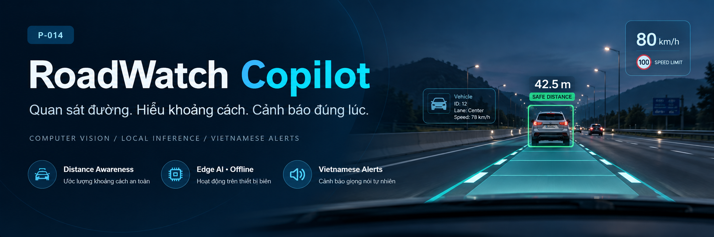
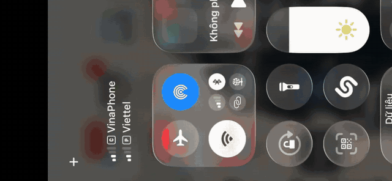
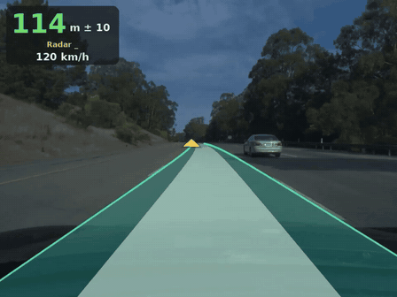
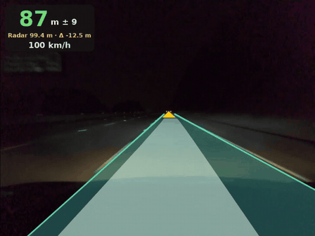
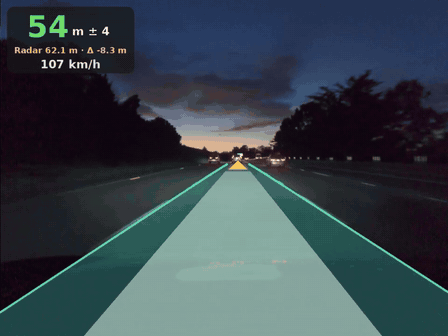
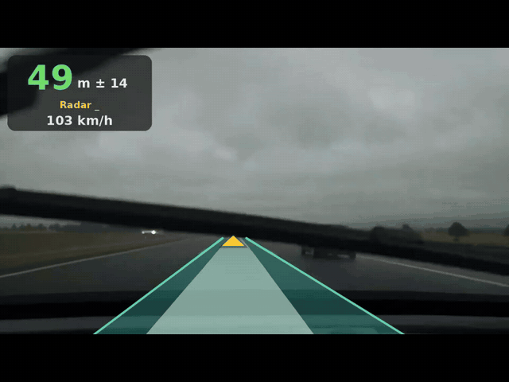
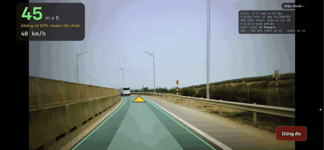
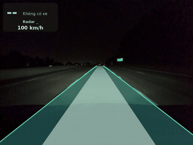
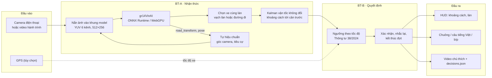
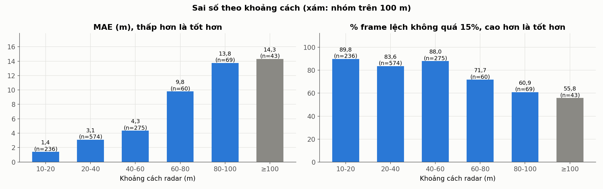

<p align="center">
  
</p>

<h1 align="center">RoadWatch Copilot</h1>

<p align="center">
  <strong>Trợ lý ảo hỗ trợ lái xe trên thiết bị biên</strong><br/>
  <em>Your Edge AI Copilot for Safer Highway Driving.</em>
</p>

<p align="center">
  <a href="LICENSE"></a>
  
  
  
  
  
  
</p>

RoadWatch Copilot biến chiếc điện thoại gắn trên kính lái thành một **trợ lý giữ khoảng cách**: camera nhìn đường, model thị giác máy tính ước lượng khoảng cách tới xe phía trước **cùng làn**, và hệ thống nhắc bằng **tiếng Việt** khi khoảng cách thấp hơn mức an toàn theo **Thông tư 38/2024/TT-BGTVT**. Toàn bộ xử lý chạy **ngay trên máy, không cần Internet**, không đi dây và không can thiệp vào xe.

> **Kết quả nổi bật (VERIFIED):** trên **1.257 frame thực địa tại Việt Nam** (Vinhomes Ocean Park 2 và cao tốc Hà Nội – Hải Phòng), **83,0%** số đo khoảng cách lệch không quá 15% so với radar xe VinFast VF8; ở cự ly 10–20 m sai số trung vị chỉ **0,70 m**. Cùng pipeline chạy **offline trên điện thoại, khoảng 70 ms/frame (12–15 FPS)**.
> Nguồn: [`eval/radar_vinhomeocp/field_metrics.json`](eval/radar_vinhomeocp/field_metrics.json) · [`eval/evaluation_protocol.md`](eval/evaluation_protocol.md)

| | |
|---|---|
| **Live URL** | [c4-app-014.vercel.app](https://c4-app-014.vercel.app/) · health check: [`/health`](https://c4-app-014.vercel.app/health) |
| **Video demo** | [YouTube](https://youtu.be/Su2nJbZoxnE) |

**Mục lục:** [Tổng quan](#overview) · [Demo](#demo-offline) · [Kiến trúc](#c1) · [Pipeline & cảnh báo](#c2) · [Model & dữ liệu](#c5) · [Đánh giá](#c6) · [Edge](#c7) · [Cài đặt](#c8) · [Giới hạn](#c10) · [Nhóm](#c11)

---

<a id="overview"></a>
# Phần A — Executive Overview

<a id="pain-points"></a>
## Vấn đề

1. **Tài xế mới khó ước lượng khoảng cách an toàn trên cao tốc.** Thông tư 38/2024/TT-BGTVT (Điều 11, khoản 1) yêu cầu khoảng cách tối thiểu tăng theo tốc độ — tới 100 m ở dải trên 100 km/h. Ước lượng 55–100 m bằng mắt khi đang chạy nhanh là việc khó với người mới lái.
2. **ADAS lắp thêm thường phải đi dây, tích hợp phức tạp**, gắn chặt vào một chiếc xe và khó chuyển sang xe khác.
3. **Giải pháp phụ thuộc cloud** bị giới hạn bởi kết nối và độ trễ — đúng ở những đoạn cao tốc sóng yếu, nơi cần cảnh báo nhất.

<details>
<summary>Bảng khoảng cách an toàn tối thiểu theo Thông tư 38/2024/TT-BGTVT</summary>

Điều 11 khoản 1, hiệu lực 01/01/2025; áp dụng khi mặt đường khô ráo, không sương mù, tầm nhìn bảo đảm.

| Tốc độ lưu hành | Khoảng cách an toàn tối thiểu |
|---|---:|
| V = 60 km/h | 35 m |
| 60 < V ≤ 80 km/h | 55 m |
| 80 < V ≤ 100 km/h | 70 m |
| 100 < V ≤ 120 km/h | 100 m |

Dưới 60 km/h, thông tư không quy định trị số; người lái chủ động giữ khoảng cách phù hợp. Bảng được mã hóa trong `LEGAL` của [`src/roadwatch/decide.py`](src/roadwatch/decide.py) và [`config/proposals/v0.yaml`](config/proposals/v0.yaml).

</details>

<a id="target-users"></a>
**Người dùng mục tiêu:** tài xế mới cần "người kèm lái" · người thường xuyên chạy cao tốc · người thích nâng cấp công nghệ cho ô tô, muốn lắp đặt đơn giản và mang sang xe khác.

<a id="our-approach"></a>
**Giải pháp:**

```
Camera ─► gr14VinAI (ONNX) ─► Chọn xe cùng làn ─► Kalman + khoảng cách tới cản ─► Luật TT 38/2024 ─► Cảnh báo tiếng Việt
```

<details>
<summary><strong>Giải pháp</strong></summary>

- **Nhận thức (BT-A):** model end-to-end **gr14VinAI** (~30M tham số, FP16) dự đoán trực tiếp xe dẫn đầu, vạch làn, mép đường và chuyển động — không cần detector bounding box riêng. Xe được chọn khi nằm trong làn của mình, kể cả khi vào cua.
- **Quyết định (BT-B):** bộ luật thuần (không LLM) so khoảng cách với ngưỡng theo tốc độ và Thông tư 38, xác nhận theo thời gian để tránh báo giả.
- **Edge-first:** cùng pipeline chạy trên **GPU điện thoại qua WebGPU**; ảnh không rời khỏi máy.

</details>

<a id="benchmark-highlights"></a>
<details>
<summary><strong>Benchmark Highlights</strong></summary>

| Hạng mục | Kết quả | Điều kiện đo | 
|---|---|---|
| Thực địa Việt Nam | 83,0% lệch ≤ 15% · trung vị 2,70 m · MAE 4,35 m | 1.257 frame, Ocean Park 2 + cao tốc HN–HP, radar VF8 đọc qua OCR |
| Cự ly gần 10–20 m | Trung vị 0,70 m · 89,8% lệch ≤ 15% | 236 frame thực địa |
| Chạy offline trên điện thoại | ~70 ms/frame toàn pipeline · 15 FPS (máy mát) / 12 FPS (máy nóng) · < 90 MB | Không mạng; nhóm đo 1 lần ngày 17/10/2026 |
| Model trên iPhone 13 | Trung vị 37 ms, p95 50 ms | WebGPU, đầu ra khớp ONNX Runtime CPU |
| Comma2k19 — phát hiện xe cùng làn | F1 0,946 vs 0,407 · đạt 83,7% vs 32,7% ca golden | Cùng 3.778 frame / cùng 300 ca golden |
| Comma2k19 — khoảng cách | MAE 2,73 m, RMSE 4,98 m (baseline đoán trung vị: 16,23 m) | 2.226 frame có xe theo radar |
| Toàn pipeline đạt 20 FPS (≤ 50 ms/frame) | Chưa đạt | Spec RoadWatch | 


</details>

<a id="user-value"></a>
<details>
<summary><strong>Giá trị cho người dùng</strong></summary>

- **Distance Awareness** — biết mình cách xe trước bao xa và mức tối thiểu theo luật ở tốc độ hiện tại; nhắc sớm, nhắc gấp khi khoảng cách giảm nhanh.
- **Portable & Accessible ADAS** — chỉ cần điện thoại và giá đỡ; không đi dây, không đọc dữ liệu từ xe, chuyển xe trong vài giây.
- **Offline Edge Intelligence** — model chạy trên GPU điện thoại; không cần mạng, không gửi hình ảnh đi đâu.

</details>

<p align="center"><strong>Giữ khoảng cách đúng luật — chỉ với chiếc điện thoại trong túi bạn.</strong><br/>
<sub>RoadWatch chỉ cảnh báo; tài xế luôn là người điều khiển xe.</sub></p>

---

# Phần B — Demo Showcase

<a id="demo-offline"></a>
## Demo offline trên điện thoại

<p align="center">
  <a href="video/offline.mp4"></a><br/>
  <sub>App <code>/phone</code> chạy trên điện thoại <strong>không có kết nối mạng</strong>. Bấm vào hình để mở video gốc (<code>video/offline.mp4</code>, 12 giây).</sub>
</p>

<a id="demo-grid"></a>
## Sáu tình huống lái

<table>
  <tr>
    <td align="center" width="33%">
      <br/>
      <sub><strong>Ban ngày</strong></sub>
    </td>
    <td align="center" width="33%">
      <br/>
      <sub><strong>Ban đêm</strong></sub>
    </td>
    <td align="center" width="33%">
      <br/>
      <sub><strong>Chạng vạng</strong></sub>
    </td>
  </tr>
  <tr>
    <td align="center" width="33%">
      <br/>
      <sub><strong>Trời mưa</strong></sub>
    </td>
    <td align="center" width="33%">
      <br/>
      <sub><strong>Đường cong</strong></sub>
    </td>
    <td align="center" width="33%">
      <br/>
      <sub><strong>Không có xe phía trước</strong></sub>
    </td>
  </tr>
</table>

<sub>HUD hiển thị khoảng cách tới xe dẫn đầu (± độ bất định), tốc độ và thảm làn; dòng <code>Radar · Δ</code> xuất hiện khi chạy trên dữ liệu có nhãn radar. Chạng vạng và trời mưa chỉ là minh họa định tính, chưa có trong bộ đánh giá định lượng.</sub>

---

# Phần C — Technical Deep Dive

<a id="c1"></a>
## 1. System Architecture

Hai đường chạy dùng chung một thiết kế: **laptop/server** (Python) và **điện thoại** (JavaScript, chạy offline). Bản JS được kiểm khớp với Python bằng dữ liệu chuẩn xuất từ Python.



<details>
<summary>Thành phần theo nền tảng (laptop / điện thoại)</summary>

| Thành phần | Laptop / server | Điện thoại (`/phone`) |
|---|---|---|
| Suy luận | ONNX Runtime CPU ([`model.py`](src/roadwatch/model.py)) | onnxruntime-web 1.20.1, WebGPU + graph capture ([`captured.mjs`](src/roadwatch/ui/onphone/captured.mjs)); dự phòng WASM CPU |
| Tiền xử lý | FFmpeg + OpenCV `warpPerspective` | Compute shader WebGPU ([`gpuprep.mjs`](src/roadwatch/ui/onphone/gpuprep.mjs)) |
| BT-A | [`pipeline.py`](src/roadwatch/pipeline.py), [`calibration.py`](src/roadwatch/calibration.py), [`temporal.py`](src/roadwatch/temporal.py) | [`track.mjs`](src/roadwatch/ui/onphone/track.mjs), [`lanes.mjs`](src/roadwatch/ui/onphone/lanes.mjs), [`geometry.mjs`](src/roadwatch/ui/onphone/geometry.mjs) |
| BT-B | [`decide.py`](src/roadwatch/decide.py) | [`decide.mjs`](src/roadwatch/ui/onphone/decide.mjs) |
| Giao diện / API | FastAPI, WebSocket/SSE, WebRTC ([`web.py`](src/roadwatch/web.py)) | PWA có service worker ([`sw.js`](src/roadwatch/ui/sw.js)) |

Kiến trúc đầy đủ, hợp đồng dữ liệu và ADR: [`docs/specs/roadwatch-architecture.md`](docs/specs/roadwatch-architecture.md) · sơ đồ: [`docs/architecture_diagram.md`](docs/architecture_diagram.md).

</details>

<a id="c2"></a>
<details>
<summary><strong>2. Computer Vision Pipeline & Distance Estimation</strong></summary>

Mỗi tick (~20 Hz): **nắn ảnh** vào camera ảo của model → **tự hiệu chuẩn** góc camera → **gr14VinAI** dự đoán xe dẫn đầu và vạch làn → **chọn xe cùng làn** (`lead_prob ≥ 0,5`, lệch ≤ 2,0 m so với tâm làn tại đúng khoảng cách của xe) → **Kalman** làm mượt → `gap = khoảng cách đã lọc − khoảng cách camera tới cản trước`. Trên đường cong, tâm làn đi theo đường xe sẽ đi, nên xe được tìm theo hướng làn chứ không thẳng trước camera.

1. **Giải mã & nhịp model.** FFmpeg giải mã; model nhận mỗi frame thứ *n* sao cho nhịp gần 20 Hz, vận tốc đầu ra được co giãn theo nhịp thật ([`model.tick`](src/roadwatch/model.py)).
2. **Nắn ảnh.** Biến đổi phối cảnh sang camera ảo 512×256, tách YUV 4:2:0 thành 6 kênh; đầu vào góc rộng dùng ảnh hẹp nhân đôi khi ống kính hẹp hơn 60°. Frame có độ phủ khung model < 95% bị đánh dấu không tin cậy.
3. **Tự hiệu chuẩn.** Pitch/yaw học từ `road_transform` của model và hướng chuyển động; tiêu cự nhập tay, tự học từ video, hoặc tự chỉnh theo tốc độ GPS ([`calibration.py`](src/roadwatch/calibration.py)). Khi chưa hiệu chuẩn xong, cảnh báo khoảng cách bị tắt.
4. **Suy luận.** Model giữ trạng thái theo thời gian (hàng đợi frame và feature) và trả 1.961 giá trị: `lead`, `lead_prob`, `lane_lines`, `road_edges`, `pose`, `plan`… ([kiến trúc](models/architechture_model.md)).
5. **Chọn xe cùng làn.** Tâm làn lấy từ hai vạch làn khi cả hai có xác suất ≥ 0,4; nếu không, lấy đường xe sẽ đi từ độ cong (yaw rate / tốc độ). Khi xe chạy đè vạch, cửa sổ chọn mở rộng ra hai làn.
6. **Theo dõi.** Kalman vận tốc không đổi, nối các lần mất dấu tới 0,5 s.

**Ước lượng khoảng cách**

- **Đại lượng đo:** khoảng cách dọc từ camera tới xe dẫn đầu do head `lead` dự đoán (trung bình và độ lệch chuẩn) trong hệ toạ độ camera ảo đã hiệu chuẩn.
- **Độ bất định:** HUD hiển thị `± σ` từ độ lệch chuẩn của chính model, vì σ của Kalman quá tự tin (độ phủ 2σ 56% so với 93% trên Comma2k19, ghi trong [`pipeline.py`](src/roadwatch/pipeline.py)).
- **Tốc độ xe mình:** từ GPS khi log GPS đã đồng bộ, nếu không thì ước lượng từ `pose` của model (làm mượt EMA).
- **Tầm đo:** tới 100 m (`MAX_RANGE_M`); ngoài tầm này sai số tăng rõ.

</details>

<a id="c4"></a>
<details>
<summary><strong>3. Safety Warning Logic</strong></summary>

BT-B chỉ dựa trên **khoảng cách và xu hướng khoảng cách** — không tuyên bố "sắp va chạm". Ví dụ ở **90 km/h**: nhắc sớm dưới 88 m, **cảnh báo dưới 70 m (đúng mức luật)**, khẩn cấp dưới 35 m hoặc khi khoảng cách giảm nhanh. Mức nào cũng phải giữ đủ lâu mới phát, để tránh báo giả.

| Tốc độ | Nhắc sớm (`info`) | Cảnh báo (`warning`) | Khẩn cấp (`emergency`) |
|---|---|---|---|
| < 20 km/h | Im lặng (chưa kiểm chứng cự ly gần) | — | — |
| 20 – < 60 km/h | Quãng đường đi trong 3 s | Quãng đường đi trong 2 s | ½ ngưỡng cảnh báo, hoặc khoảng cách giảm ≥ 5 m/s trong 0,5 s |
| 60 – 100 km/h | Mức luật × 1,15 + quãng đường trong 0,3 s | Mức luật TT 38 | như trên |
| > 100 km/h | Vượt tầm đo 100 m → **chuông** khi lần đầu xác nhận xe | Quãng đường trong 2 s | như trên |

**Chống báo giả:** xe phải được thấy liên tục 0,5 s; mỗi mức giữ 0,5 s (khẩn cấp 0,2 s) mới phát; mức cao hơn phát ngay; nhắc lại sau 3 s rồi 10 s; không nhắc khi khoảng cách đang giãn ra; một đợt kết thúc khi xe ra khỏi vùng nhắc 3 s (trễ 3 m) hoặc mất dấu 3 s.

| Mức | Âm thanh |
|---|---|
| `chime` | Tiếng chuông |
| `info` | "Xe phía trước đang gần lại" |
| `warning` | "Chú ý giữ khoảng cách xe phía trước" |
| `emergency` | Ba tiếng bíp |

Python ([`decide.py`](src/roadwatch/decide.py)) và JS ([`decide.mjs`](src/roadwatch/ui/onphone/decide.mjs)) cho kết quả trùng từng frame trên 2.400 frame, kể cả câu lý do. Kế hoạch: [`docs/warning_to_do.md`](docs/warning_to_do.md).

> Mọi tham số của BT-B là **giá trị thử nghiệm**, chưa được xác nhận an toàn. RoadWatch chỉ cảnh báo; tài xế luôn là người điều khiển xe.

</details>

<a id="c5"></a>
<details>
<summary><strong>4. Model & Dataset</strong></summary>

| | |
|---|---|
| Kiến trúc | Backbone CNN (block depthwise + residual, Squeeze-and-Excitation) → 3 nhánh MLP → Transformer 1 khối cho temporal aggregation; ONNX opset 20 ([chi tiết](models/architechture_model.md)) |
| Đầu vào | 2 frame × 2 camera, YUV 6 kênh 128×256, kèm hàng đợi trạng thái |
| Bản cho điện thoại | `gr14VinAI.mixed.onnx` / `.capture.onnx` (FP16, ReduceL2 tính FP32 để không tràn số trên GPU iPhone) và `.fp32.onnx` cho CPU, dựng bằng [`make_phone_models.py`](scripts/roadwatch/make_phone_models.py) và kiểm khớp với bản gốc |

**Comma2k19** ([dataset](https://github.com/commaai/comma2k19): `video.hevc`, `global_pose`, radar trong `processed_log`):

- **Đánh giá:** 34 video test, 3.778 frame có nhãn radar (2.226 frame có xe). Nhãn: xe gần nhất trong 100 m, lệch tâm làn ≤ 1,5 m, tâm làn theo đường đi thật của xe. Đã loại 24 video chạng vạng; 6 video test cùng chuyến xe với video train ([`evaluation_protocol.md`](eval/evaluation_protocol.md)).
- **Phát triển model qua nhiều vòng:** MAE trên tập test giảm từ 8,05 m (vòng 1) xuống 3,87 m (vòng 5) ([`model_iteration_history.json`](eval/inputs/model_iteration_history.json)). Code huấn luyện được lưu trong lịch sử Git (`models/src_train/`, commit `13d23a5`).

</details>

<a id="c6"></a>
<details>
<summary><strong>5. Evaluation & Benchmark</strong></summary>

Thực địa tại Việt Nam là bằng chứng chính cho model trong app: sai số **thấp ở cự ly gần (trung vị 0,70 m ở 10–20 m)** và tăng rõ trên 60 m; model có xu hướng báo **gần hơn** radar (Δ trung bình −2,62 m). Dữ liệu, script và quy tắc chấm: [`eval/README.md`](eval/README.md) · [`eval/evaluation_protocol.md`](eval/evaluation_protocol.md).

**Thực địa tại Việt Nam theo dải khoảng cách** (VERIFIED)

Video ~28 phút tại Vinhomes Ocean Park 2 và cao tốc Hà Nội – Hải Phòng (iPhone 14 Pro Max, radar VF8 theo nhóm). HUD của app hiện khoảng cách model, radar và Δ; lấy 2 frame/s, đọc ba số bằng OCR, lọc frame đọc sai theo quy tắc cố định: 3.355 → **1.257 frame được chấm**. Số đo gián tiếp qua OCR, không phải log radar đồng bộ.

| Khoảng cách radar | Frame | MAE | Trung vị | Lệch ≤ 2 m | Lệch ≤ 15% |
|---|---:|---:|---:|---:|---:|
| 10–20 m | 236 | **1,41 m** | **0,70 m** | 86,9% | 89,8% |
| 20–40 m | 574 | 3,10 m | 2,70 m | 39,4% | 83,6% |
| 40–60 m | 275 | 4,35 m | 3,50 m | 29,8% | 88,0% |
| 60–80 m | 60 | 9,79 m | 6,75 m | 13,3% | 71,7% |
| 80–100 m | 69 | 13,76 m | 11,00 m | 7,2% | 60,9% |
| ≥ 100 m (ngoài tầm) | 43 | 14,30 m | 15,30 m | 20,9% | 55,8% |
| **Tất cả** | **1.257** | **4,35 m** | **2,70 m** | 42,6% | **83,0%** |

<p align="center"></p>

Nguồn: [`field_metrics.json`](eval/radar_vinhomeocp/field_metrics.json).

**Comma2k19 so với baseline** (CHƯA KIỂM CHỨNG trên model hiện tại)

| Phương pháp | F1 xe cùng làn | Đạt (300 ca golden) | MAE |
|---|---:|---:|---:|
| Đoán trung vị (không nhìn ảnh) | 0,742 | 17,0% | 16,23 m ² |
| Hình học: bounding box + pinhole | 0,407 | 32,7% | — ³ |
| **gr14VinAI (số đo cũ)** | **0,946** | **83,7%** | **2,73 m** ² |

² Trên cùng 2.226 frame radar có xe. ³ Baseline hình học chỉ có số đo ở 594 frame (MAE 8,91 m), không cùng tập frame nên không so trực tiếp. "Đạt" = báo đúng không có xe, hoặc có xe và lệch ≤ 15% so với radar. Hai lần chấm cho cùng kết quả ([tái lập](eval/results/deterministic_rerun_report.md)). Ban ngày / ban đêm: F1 0,957 / 0,921, MAE 2,52 / 3,16 m. Nguồn: [`model_benchmark_metrics.json`](eval/results/model_benchmark_metrics.json), [`golden_dataset_metrics.json`](eval/results/golden_dataset_metrics.json).

**Human baseline**

30 ảnh đường Việt Nam, không có radar: model và người đánh giá khớp có/không có xe ở 30/30 ảnh; khoảng cách lệch trung vị 5,90 m ([`comparison_30_images.csv`](eval/human_baseline/comparison_30_images.csv)). Chỉ đo mức đồng thuận, không xác định ai đúng hơn.

</details>

<a id="c7"></a>
<details>
<summary><strong>6. Edge Deployment & Runtime Performance</strong></summary>

Trên điện thoại, toàn pipeline chạy **offline khoảng 70 ms/frame (15 FPS khi máy mát, 12 FPS khi máy nóng)**, tải về dưới 90 MB; riêng model trên iPhone 13 đạt trung vị 37 ms, p95 50 ms. Điểm mấu chốt là **graph capture trên WebGPU**: ghi chuỗi lệnh GPU một lần rồi phát lại mỗi frame, giúp model ~30M tham số chạy liên tục 12.000 lần mà Safari không đóng tab.

| Thiết bị | Cấu hình | Kết quả | Nguồn |
|---|---|---|---|
| Điện thoại, offline | `/phone` thêm vào màn hình chính, mất mạng, Safari WebGPU | ~70 ms/frame; 15 / 12 FPS (máy mát / nóng); < 90 MB — đo 1 lần, 17/10/2026 | [`evaluation_protocol.md`](eval/evaluation_protocol.md) |
| iPhone 13 | Safari, WebGPU, model FP16 hỗn hợp | Model trung vị 37 ms, p95 50 ms; đầu ra khớp ONNX Runtime CPU | [`roadwatch-operations.md`](docs/roadwatch-operations.md) |
| iPhone 13 | Graph capture, onnxruntime-web 1.20.1 | 12.000 lần liên tục không bị đóng tab | [`captured.mjs`](src/roadwatch/ui/onphone/captured.mjs) |

- **Nắn ảnh trên GPU:** compute shader thay cho `getImageData` (45–60 ms/frame trên CPU).
- **Mixed precision:** ReduceL2 tính FP32 để tổng bình phương (~81 nghìn) không tràn FP16.
- **Tải một lần, dùng offline:** model tải từng đoạn 2 MB qua HTTP Range, lưu Cache Storage; service worker phục vụ app khi không có mạng.
- **Bản JS khớp Python:** pipeline 400 frame Comma2k19 và quyết định 2.400 frame khớp dữ liệu chuẩn xuất từ Python ([`tests/roadwatch/js/`](tests/roadwatch/js/)).

</details>

<a id="c8"></a>
<details>
<summary><strong>7. Installation & Quick Start</strong></summary>

Yêu cầu Python ≥ 3.11 và FFmpeg trong `PATH`. Trọng số model không được commit: đặt `models/gr14VinAI.onnx` theo [`models/README.md`](models/README.md).

```bash
git clone https://github.com/AI20K-Build-Phase-Cohort-4/P-014.git
cd P-014
python -m venv .venv
source .venv/bin/activate          # Windows PowerShell: .venv\Scripts\Activate.ps1
python -m pip install -r requirements.txt
python -m src.roadwatch.web        # mở http://127.0.0.1:8765
```

Bản đã triển khai: [c4-app-014.vercel.app](https://c4-app-014.vercel.app/). Chạy local thì thay bằng `http://127.0.0.1:8765`.

| URL | Nội dung |
|---|---|
| `http://127.0.0.1:8765` | Màn buồng lái mở đầu |
| `/health`, `/health/live`, `/health/ready` | Health check (không cần đăng nhập) |
| `/app` | Chạy video, Lái thử, Lịch sử (xem lại video chú thích) |
| `/phone` | Đo trực tiếp bằng camera điện thoại (cần HTTPS để Safari cho dùng camera) |
| `/docs` | Tài liệu API tương tác (OpenAPI) |

**Dòng lệnh, một video:**

```bash
python -m src.roadwatch dashcam.mp4 --fps 30 --d-cam-bumper 1.5 --focal-mm 26 --out annotated.mp4
```

**Chạy model trên điện thoại:** dựng các bản model cho trình duyệt, đặt onnxruntime-web 1.20.1 vào `models/ort-web/1.20.1/` ([hướng dẫn](docs/roadwatch-operations.md)):

```bash
python -m scripts.roadwatch.make_phone_models
```

**Docker:**

```bash
docker compose up --build roadwatch
```

**Kiểm thử** (test JS cần Node.js):

```bash
python -m pytest tests/roadwatch --confcutdir=tests/roadwatch -q
```

```bash
node --test "tests/roadwatch/js/*.test.mjs"
```

**Dựng lại số liệu thực địa và hình đánh giá** (cần thêm `pandas`, `matplotlib`, `openpyxl`):

```bash
python eval/report/scripts/make_readme_figures.py
```

Mỗi lần chạy lưu trong `runs/demo/<run_id>/`: `annotated.mp4`, `decisions.json`, `run.json`. Biến môi trường xem [`.env.example`](.env.example); triển khai qua mạng, HTTPS và API xem [`docs/roadwatch-operations.md`](docs/roadwatch-operations.md). Bộ âm thanh cảnh báo có sẵn trong [`models/phrases-demo/`](models/phrases-demo/).

**Cấu trúc thư mục**

```
P-014/
├── src/roadwatch/            # Ứng dụng
│   ├── model.py              # gr14VinAI trên ONNX Runtime CPU, nắn ảnh, nhịp 20 Hz
│   ├── pipeline.py           # BT-A: chọn xe cùng làn, Kalman, khoảng cách tới cản
│   ├── calibration.py        # Tự hiệu chuẩn góc camera và tiêu cự
│   ├── decide.py             # BT-B: ngưỡng theo Thông tư 38, mức cảnh báo
│   ├── web.py                # FastAPI server, WebSocket/SSE, WebRTC
│   ├── __main__.py           # CLI xử lý một video
│   ├── ui/                   # Giao diện web; ui/onphone/ là pipeline JS chạy trên điện thoại
├── models/                   # README, kiến trúc model, âm thanh cảnh báo (trọng số không commit)
├── eval/                     # Dữ liệu, kết quả và quy tắc đánh giá
├── scripts/roadwatch/        # Dựng model điện thoại, đánh giá, xuất schema
├── tests/roadwatch/          # pytest và test JS so với dữ liệu chuẩn từ Python
├── docs/                     # Spec kiến trúc, API, vận hành
├── presentation/             # Web demo tĩnh cho thuyết trình (dữ liệu giả lập)
├── video/                    # GIF demo và video chạy offline
└── docker/, docker-compose.yml
```

</details>

<a id="c10"></a>
<details>
<summary><strong>8. Limitations & Roadmap</strong></summary>

**Giới hạn**

- **Số Comma2k19 chưa được kiểm chứng lại** trên model đang chạy trong app.
- **Thực địa** đo qua OCR màn hình; sai số tăng rõ trên 60 m (MAE 9,79 m ở 60–80 m).
- **Trời mưa chưa được kiểm chứng**; chạng vạng đã bị loại khỏi tập test.
- **Hiệu năng điện thoại** mới đo một lần; tham số cảnh báo là giá trị thử nghiệm.
- Toàn pipeline laptop chưa đạt 20 FPS (TARGET).
- BT-B là bản demo rút gọn của spec (chưa có debounce năng lực, phân xử audio).
- Dưới 20 km/h không cảnh báo vì chưa kiểm chứng khả năng đo ở cự ly gần.
- Bản điện thoại chưa lưu phiên và chưa tự chỉnh tiêu cự theo GPS.

**Lộ trình** (TARGET — chưa thực hiện)

1. Chạy lại benchmark Comma2k19 (cùng 34 video test, 300 ca golden) trên model đang chạy trong app để kiểm chứng số đo cũ.
2. Log radar đồng bộ thay cho OCR; bổ sung dữ liệu mưa, chạng vạng tại Việt Nam.
3. Đo lặp lại hiệu năng điện thoại; chế độ tiết kiệm pin (ví dụ 10 FPS) và đánh giá ảnh hưởng tới độ chính xác.
4. Hoàn thiện BT-B theo spec, thu giọng câu nhắc mới ([kế hoạch](docs/warning_to_do.md)).
5. Lưu phiên và tự chỉnh tiêu cự theo GPS trên điện thoại.

</details>

<a id="c11"></a>
<details>
<summary><strong>9. Team & References</strong></summary>

**Nhóm P-014** — **VinUni AI20K Build Phase**, mã đề **DEV-04 · AI Thiết bị (VinFast)**: Cương (model, đánh giá, định hướng kỹ thuật) · Khánh (tự hiệu chuẩn camera, video demo) · Tuấn (triển khai server, chạy model trên điện thoại) · Linh (thiết kế giao diện).

**Tài liệu tham khảo**

- Bộ Giao thông vận tải, *Thông tư 38/2024/TT-BGTVT quy định về tốc độ và khoảng cách an toàn của xe cơ giới, xe máy chuyên dùng tham gia giao thông trên đường bộ*, Điều 11.
- H. Schafer, E. Santana, A. Haden, R. Biasini, *A Commute in Data: The comma2k19 Dataset*, arXiv:1812.05752, 2018 — [github.com/commaai/comma2k19](https://github.com/commaai/comma2k19).
- [ONNX Runtime](https://onnxruntime.ai/) và onnxruntime-web (WebGPU, JSEP).

**AI log:** prompt từ các công cụ AI được hook ghi lại (`.ai-log/`, không commit) và đã nộp lên server AI log của chương trình. Sản phẩm không dùng LLM hay RAG (chỉ dùng model thị giác chạy offline), nên không có trace LangSmith.

Hành trình phát triển: [`docs/JOURNAL.md`](docs/JOURNAL.md) · nhật ký kỹ thuật: [`docs/WORKLOG.md`](docs/WORKLOG.md) · quy tắc đóng góp: [`AGENTS.md`](AGENTS.md), [`docs/development/code-rules.md`](docs/development/code-rules.md).

**License:** mã nguồn của nhóm dùng [MIT License](LICENSE); giấy phép MIT của comma.ai.

</details>
