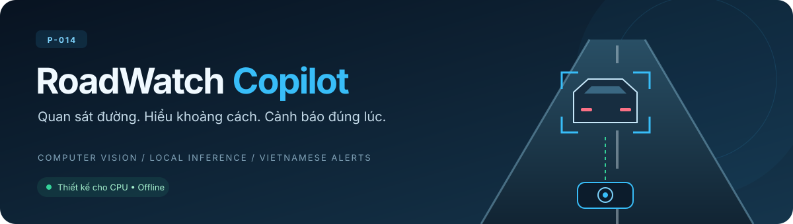

<p align="center">
  
</p>

# RoadWatch Copilot

<p align="center">
  <strong>Trợ lý kèm lái bằng thị giác máy tính, dành cho tài xế mới trên cao tốc.</strong><br/>
  Từ video hành trình đến khoảng cách, nguy cơ va chạm và cảnh báo bằng tiếng Việt — xử lý ngay trên máy.
</p>

<p align="center">
  <a href="LICENSE"></a>
  
  
  
  
</p>

<p align="center">
  <a href="#trải-nghiệm">Trải nghiệm</a> ·
  <a href="#luồng-xử-lý">Luồng xử lý</a> ·
  <a href="#công-nghệ">Công nghệ</a> ·
  <a href="#chạy-trên-máy-của-bạn">Bắt đầu</a> ·
  <a href="#tài-liệu">Tài liệu</a>
</p>

## Vì sao RoadWatch?

Trên cao tốc, tài xế mới phải cùng lúc theo dõi xe phía trước, giữ khoảng cách và nhận biết tình huống đang thay đổi. RoadWatch dùng hình ảnh từ camera hành trình để bổ sung một lớp quan sát: ước lượng khoảng cách tới xe dẫn đầu và đưa ra lời nhắc ngắn khi cần.

Dự án hướng tới cảnh báo có thể giải thích, chạy trên CPU laptop và không cần dịch vụ suy luận bên ngoài. RoadWatch chỉ đưa ra cảnh báo; tài xế luôn là người điều khiển xe.

## Trải nghiệm

| Khả năng | Bạn nhận được gì |
|---|---|
| 🎥 Phân tích video hành trình | Tải video lên giao diện và theo dõi từng khung đang được xử lý. |
| 📐 Hiệu chuẩn camera | Nhập tiêu cự đã biết hoặc để hệ thống ước lượng từ video. |
| 🚗 Theo dõi xe phía trước | Quan sát xe dẫn đầu và khoảng cách từ cản trước khi số đo dùng được. |
| 🔔 Cảnh báo theo tình huống | Các mức thông tin, cảnh báo và khẩn cấp, với cơ chế xác nhận và hạn chế lặp lại. |
| 🗣️ Phản hồi tiếng Việt | Giao diện phát câu thu sẵn khi bộ âm thanh được cung cấp. |
| 📊 Theo dõi và xem lại | Xem trạng thái, biểu đồ, lý do quyết định; tải video có chú thích và dữ liệu lần chạy. |
| 💻 Xử lý tại máy | Video và kết quả lưu cục bộ; luồng suy luận không cần Internet sau khi cài đặt. |

## Luồng xử lý

Một lần chạy đi từ video đầu vào đến kết quả có thể xem lại:

1. **Nhận video và thông số lắp đặt.** Người dùng cung cấp tốc độ khung hình thực, khoảng cách từ camera tới cản trước và tiêu cự nếu đã biết.
2. **Chuẩn hóa hình ảnh.** FFmpeg giải mã video về nhịp đầu vào của model; hệ thống hiệu chuẩn và biến đổi ảnh sang góc nhìn phù hợp.
3. **Ước lượng tình huống phía trước.** Model gr14VinAI chạy bằng ONNX Runtime trên CPU, cung cấp dữ liệu để tính khoảng cách và trạng thái quan sát.
4. **Quyết định cảnh báo.** Bộ luật xét số đo, độ tin cậy và diễn biến theo thời gian để chọn mức cảnh báo cùng lý do.
5. **Hiển thị và phát lời nhắc.** Server gửi trạng thái lên giao diện; hình ảnh được vẽ chú thích và lời nhắc tiếng Việt được phát khi có tài nguyên âm thanh.
6. **Lưu kết quả.** Mỗi lần chạy giữ video có chú thích, quyết định và thông tin phiên để xem lại hoặc phục vụ đánh giá.

Bản web hiện tại dùng bộ quyết định rút gọn cho demo. Thiết kế đầy đủ, hợp đồng dữ liệu và yêu cầu kiểm chứng nằm trong [spec kiến trúc](docs/specs/roadwatch-architecture.md); chi tiết đường chạy demo nằm trong [hướng dẫn vận hành](docs/roadwatch-operations.md).

## Công nghệ

<p align="center">
  
  
  
  
  
  
</p>

| Thành phần | Công nghệ và vai trò |
|---|---|
| Thị giác máy tính | Model gr14VinAI, ONNX Runtime FP32 trên CPU; OpenCV và NumPy cho hình ảnh, hình học camera. |
| Video | FFmpeg giải mã và mã hóa video kết quả. |
| Quyết định | Bộ luật Python dựa trên số đo và thời gian của video. |
| Giao diện | HTML, CSS và JavaScript; xem video, biểu đồ và cập nhật trạng thái. |
| API | FastAPI, model Pydantic, WebSocket/SSE và luồng ảnh MJPEG. |
| Đóng gói và kiểm tra | Docker Compose, pytest, Ruff và GitHub Actions. |

Model dùng trong runtime là bản tỉa `models/gr14VinAI.onnx`, được chuẩn bị từ nguồn có commit cố định trong script tải model. Script kiểm SHA-256 của bản gốc trước khi tỉa. RoadWatch không dùng LLM, RAG hay vector database trong luồng sản phẩm.

## Chạy trên máy của bạn

### 1. Chuẩn bị

Cần **Python 3.11 trở lên**, **FFmpeg** có trong `PATH` và máy có CPU để chạy ONNX Runtime. Internet cần cho bước cài dependency và tải model lần đầu.

```bash
git clone https://github.com/AI20K-Build-Phase-Cohort-4/P-014.git
cd P-014
python -m venv .venv
source .venv/bin/activate
python -m pip install -r requirements.txt
```

Trên Windows PowerShell, kích hoạt môi trường bằng `.venv\Scripts\Activate.ps1`. `requirements.txt` là file dependency duy nhất của RoadWatch, dùng cho cài đặt, kiểm tra và build Docker.

### 2. Tải model

```bash
python scripts/roadwatch/download_model.py
```

Script tạo `models/gr14VinAI.onnx`. Nếu model đã có, có thể bỏ qua bước này.

### 3. Mở ứng dụng

```bash
python -m src.roadwatch.web
```

Mở **http://127.0.0.1:8765** để vào màn buồng lái (bấm hoặc kéo vô lăng để đánh lái; chạm chữ V để khởi động), rồi vào giao diện demo ở **/app**, tập trung vào phát hiện xe phía trước, đo khoảng cách và cảnh báo: Chạy video, Lái thử (khoảng cách so với ngưỡng luật, cảnh báo kèm lý do, bản đồ 3D quanh xe) và Lịch sử (xem lại video đã chú thích). Trang cũ vẫn còn ở **/judge** và **/engineer**. Chọn video và nhập thông số thực của clip/camera. Tiêu cự `fy` mặc định nhập tay (mm, góc nhìn hoặc pixel); chọn "Tự học từ video" hoặc bật "Tự hiệu chỉnh tiêu cự theo GPS" (kèm log GPS) nếu muốn hệ thống tự tìm. Tài liệu API tương tác có tại **http://127.0.0.1:8765/docs**.

Bộ câu nói tiếng Việt cần được cung cấp riêng trong `models/phrases-demo/`; model tải ở bước trên không bao gồm các file WAV. Nếu chưa có bộ âm thanh, vẫn có thể xem cảnh báo và kết quả trên giao diện.

### Chạy bằng Docker

Sau khi đã tải model:

```bash
docker compose up --build roadwatch
```

Ứng dụng mở ở cùng địa chỉ `http://127.0.0.1:8765`. Compose gắn model ở chế độ chỉ đọc và lưu kết quả trên máy chủ.

## Dữ liệu đầu ra

Server demo lưu từng phiên trong `runs/demo/<run_id>/` theo mặc định:

| File | Nội dung |
|---|---|
| `annotated.mp4` | Video có chú thích để xem lại tình huống và số đo. |
| `decisions.json` | Số đo từng khung, quyết định và thông tin tổng hợp của lần chạy. |
| `run.json` | Thông số đầu vào, thông tin phiên và trạng thái hoàn tất hoặc lỗi. |

Giao diện cho phép xem lại, tải kết quả và xóa phiên. Các thư mục `models/`, `runs/`, `data/` và `configs/` không được commit.

## Cấu hình vận hành

| Biến môi trường | Công dụng |
|---|---|
| `RW_HOST`, `RW_PORT` | Địa chỉ và cổng server; mặc định `127.0.0.1:8765`. |
| `RW_RUNS_DIR` | Thư mục lưu kết quả của server. |
| `RW_SAMPLES_DIR` | Thư mục video mẫu cho demo; mỗi mẫu gồm file MP4 và JSON cùng tên. |
| `RW_KEEP_RUNS` | Số lần chạy gần nhất được giữ. |
| `RW_MAX_UPLOAD_MB` | Giới hạn dung lượng video tải lên. |
| `RW_USER`, `RW_PASSWORD` | Thông tin đăng nhập HTTP Basic khi bật bảo vệ truy cập. |

Để mở ứng dụng qua mạng, cấu hình mật khẩu và HTTPS theo [hướng dẫn vận hành](docs/roadwatch-operations.md). Mặc định server chỉ nghe trên máy cục bộ. Thay đổi ngưỡng cảnh báo tuân theo quy trình cấu hình có người duyệt trong spec mục 3.10.

## Phạm vi và giới hạn

RoadWatch hiện là **bản demo nghiên cứu trên video hành trình**. Dự án không điều khiển xe và không đọc dữ liệu từ xe. Khả năng hoạt động của bản demo không thay thế việc kiểm chứng trên dữ liệu thực địa hoặc nghiệm thu theo spec.

Chất lượng số đo phụ thuộc góc lắp camera, độ phủ ảnh, ánh sáng và tính liên tục của video. Khi tự học hoặc tự hiệu chỉnh tiêu cự theo GPS chưa hoàn tất, cảnh báo khoảng cách được tắt. Thời điểm hoàn tất có thể khác giữa các lần chạy, nên cần tiêu cự cố định khi đối chiếu tính tái lập của quyết định. Chi tiết giới hạn và cách đánh giá xem trong [hướng dẫn vận hành](docs/roadwatch-operations.md).

## Tài liệu

- [Kiến trúc và hợp đồng dữ liệu](docs/specs/roadwatch-architecture.md)
- [Sơ đồ hệ thống](docs/architecture_diagram.md)
- [Vận hành, API và triển khai](docs/roadwatch-operations.md)
- [Schema OpenAPI của bản core](src/roadwatch/openapi.json)
- [Quy tắc phát triển và lệnh kiểm tra](docs/development/code-rules.md)

## Đóng góp

Đọc [AGENTS.md](AGENTS.md) trước khi thay đổi code hoặc tài liệu. Mỗi thay đổi đi qua nhánh làm việc và pull request, kèm kiểm chứng theo [quy tắc phát triển](docs/development/code-rules.md).

Repo có hook ghi log AI phục vụ quy trình phát triển của nhóm. Hướng dẫn cài đặt ở [scripts/setup_hooks.sh](scripts/setup_hooks.sh) và [scripts/setup_hooks.ps1](scripts/setup_hooks.ps1); với công cụ web, xem [workflow ghi log](.agents/workflows/log.md). Mở công cụ AI tại gốc repo và giữ nguyên `.ai-log/`.

## Dự án

RoadWatch Copilot được phát triển bởi **nhóm P-014**, trong chương trình **VinUni AI20K Build Phase**, mã đề **DEV-04 · AI Thiết bị (VinFast)**.

Mã nguồn repo dùng [MIT License](LICENSE).
