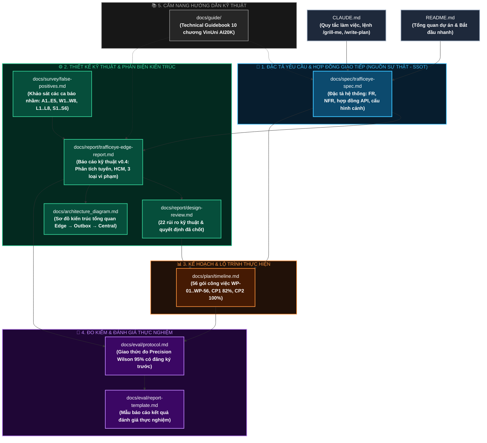

# BẢN ĐỒ TÀI LIỆU & KIẾN TRÚC TỔNG THỂ HỆ THỐNG — TRAFFICEYE EDGE

> **Mục đích tài liệu:** Bản đồ hóa toàn bộ hệ thống tài liệu chuẩn mực trong `docs/`, dựa trên đúng **nguồn sự thật duy nhất (Single Source of Truth - SSOT)** của dự án TrafficEye Edge:
> 1. Mối quan hệ và luồng phụ thuộc giữa các tài liệu kỹ thuật thực tế.
> 2. Kiến trúc kỹ thuật tổng thể từ Edge (Biên) đến Cloud/Backend và Dashboard.
> 3. Bảng tra cứu nhanh: *"Đang thắc mắc vấn đề X thì mở chính xác file nào?"*

---

## 1. BẢN ĐỒ QUAN HỆ GIỮA CÁC TÀI LIỆU (DOCUMENT MAP)

Hệ thống tài liệu được tổ chức theo luồng kỹ thuật chuẩn mực: **Đặc tả yêu cầu (SSOT) $\rightarrow$ Kiến trúc kỹ thuật $\rightarrow$ Kế hoạch thực hiện $\rightarrow$ Phương pháp đo kiểm $\rightarrow$ Triển khai thực tế.**

---

## 2. KIẾN TRÚC TỔNG THỂ HỆ THỐNG TRAFFICEYE EDGE

Căn cứ theo đặc tả [trafficeye-spec.md](file:///c:/Users/cuong/OneDrive/Documents/PH%C3%81T%20TRI%E1%BB%82N%20B%E1%BA%A2N%20TH%C3%82N/PROJECT__CODE/PJVinAIGr14/P-014/docs/spec/trafficeye-spec.md) và báo cáo kỹ thuật [trafficeye-edge-report.md](file:///c:/Users/cuong/OneDrive/Documents/PH%C3%81T%20TRI%E1%BB%82N%20B%E1%BA%A2N%20TH%C3%82N/PROJECT__CODE/PJVinAIGr14/P-014/docs/report/trafficeye-edge-report.md):

```mermaid
graph TB
    %% Định nghĩa các lớp màu tương phản cao (High Contrast Classes)
    classDef hwNode fill:#1e293b,stroke:#94a3b8,stroke-width:2px,color:#ffffff;
    classDef aiNode fill:#0c4a6e,stroke:#38bdf8,stroke-width:2px,color:#ffffff;
    classDef ruleNode fill:#1e1b4b,stroke:#818cf8,stroke-width:2px,color:#ffffff;
    classDef secNode fill:#451a03,stroke:#fb923c,stroke-width:2px,color:#ffffff;
    classDef dbNode fill:#134e4a,stroke:#2dd4bf,stroke-width:2px,color:#ffffff;
    classDef beNode fill:#064e3b,stroke:#34d399,stroke-width:2px,color:#ffffff;
    classDef hitlNode fill:#4c0519,stroke:#fb7185,stroke-width:2px,color:#ffffff;
    classDef netNode fill:#292524,stroke:#facc15,stroke-width:2px,color:#ffffff;

    subgraph S1 ["📹 1. PHẦN CỨNG THU NHẬN TẠI NÚT GIAO"]
        CAM["<b>Camera Nút Giao</b><br/>(Góc nhìn từ sau đuôi xe)"]:::hwNode
        RTSP["<b>Luồng RTSP H.264/H.265</b><br/>(1080p @ 15-20 FPS)"]:::hwNode
        CAM --> RTSP
    end

    subgraph S2 ["⚡ 2. THIẾT BỊ BIÊN (EDGE NODE: LAPTOP / JETSON ORIN)"]
        subgraph S2_1 ["A. Vision Pipeline (Thị giác máy tính)"]
            DEC["<b>YOLO Vehicle Detector</b><br/>(Xe máy, Ô tô, Buýt, Tải)"]:::aiNode
            TRK["<b>ByteTrack Tracker</b><br/>(Gán & duy trì Track ID)"]:::aiNode
            CNT["<b>Virtual Counting Line</b><br/>(Đếm xe theo làn & hướng)"]:::aiNode
            RTSP --> DEC --> TRK --> CNT
        end

        subgraph S2_2 ["B. Rule Engine & Phân tích giao thông"]
            TLSM["<b>Traffic Light State Machine</b><br/>(Đèn ĐỎ / VÀNG / XANH / NHẤP NHÁY)"]:::ruleNode
            CYCLE["<b>Signal Cycle Estimator</b><br/>(Đo chu kỳ đèn, thời gian xanh, thoát bão hòa)"]:::ruleNode
            V_GATE{"<b>Cổng quy tắc vi phạm (Plugin)</b><br/>- Vượt đèn đỏ RL (6 điều kiện, A1-E5)<br/>- Đi ngược chiều WW (W1-W8)<br/>- Sai làn LN đủ 3 kiểu (L1-L8)"}:::ruleNode
            RTSP --> TLSM --> CYCLE
            TRK --> V_GATE
            TLSM --> V_GATE
        end

        subgraph S2_3 ["C. Privacy & Security (Bảo mật & Ký số)"]
            BLUR["<b>Privacy Masker</b><br/>(Làm mờ biển số & mặt người)"]:::secNode
            SEAL["<b>Evidence Packaging & Sealer</b><br/>(3 ảnh + clip JPEG | Ký Ed25519 + SHA-256)"]:::secNode
            V_GATE -->|Ứng viên vi phạm| BLUR --> SEAL
        end

        subgraph S2_4 ["D. Outbox Storage (Chống mất mạng)"]
            OUTBOX[("<b>SQLite Outbox Cục Bộ</b><br/>- Metadata số đếm xe<br/>- Sự kiện signal_cycle v1<br/>- Gói bằng chứng đã ký")]:::dbNode
            CNT -->|Metadata số đếm| OUTBOX
            CYCLE -->|Sự kiện signal_cycle| OUTBOX
            SEAL -->|Gói bằng chứng| OUTBOX
        end
    end

    subgraph S3 ["🌐 3. ĐƯỜNG TRUYỀN BẢO MẬT (ZERO RAW VIDEO)"]
        SYNC["<b>Background Sync Worker</b><br/>(HTTPS REST API / TLS; MQTT từ CP2)"]:::netNode
        OUTBOX --> SYNC
    end

    subgraph S4 ["🏢 4. HẠ TẦNG TRUNG TÂM (CENTRAL BACKEND)"]
        API["<b>FastAPI Gateway</b><br/>(/api/v1/events, /intersections, /corridors)"]:::beNode
        CORRIDOR["<b>Corridor & HCM Analyzer</b><br/>(v/c, độ trễ d1+d2, LOS A-F, tràn hàng chờ, bottleneck)"]:::beNode
        VERIFY["<b>Cryptographic Verifier</b><br/>(Kiểm tra chữ ký Ed25519)"]:::beNode
        AUDIT["<b>Audit Trail Logger</b><br/>(Ghi nhật ký 100% lần mở xem)"]:::beNode
        DB[("<b>PostgreSQL Database</b><br/>+ Kho lưu trữ bằng chứng")]:::dbNode
        
        SYNC -->|Chỉ gửi metadata, chu kỳ & bằng chứng| API
        API --> CORRIDOR --> DB
        API --> VERIFY --> DB
        API --> AUDIT
    end

    subgraph S5 ["👥 5. GIAO DIỆN & CON NGƯỜI (HITL APPLICATION)"]
        DASH["<b>Live Traffic & Corridor Dashboard</b><br/>(Đếm xe, mật độ, màn hình Tuyến 3 nút, heatmap)"]:::hitlNode
        STEP1["<b>Màn hình Sơ duyệt Bước 1</b><br/>(Điều hành viên: Xem bản che 100% biển số)"]:::hitlNode
        STEP2["<b>Màn hình Thẩm định Bước 2</b><br/>(Cán bộ CSGT: Xem bản hiện biển số xe vi phạm)"]:::hitlNode
        PORTAL["<b>Cổng Tra Cứu Công Khai</b><br/>(Người dân kiểm tra chữ ký số bằng chứng)"]:::hitlNode
        AGENT["<b>AI Reporting Assistant</b><br/>(LangGraph Agent tổng hợp báo cáo ca trực & sự cố)"]:::aiNode

        DB --> DASH
        DB --> STEP1
        STEP1 -->|Xác nhận hợp lệ| STEP2
        STEP2 -->|Phê duyệt phạt nguội| DB
        DB --> PORTAL
        DB --> AGENT
    end

    %% Tùy biến màu nền và viền cho Subgraphs (Đậm, nổi bật, chữ tiêu đề cực rõ)
    style S1 fill:#0f172a,stroke:#64748b,stroke-width:2px,color:#cbd5e1
    style S2 fill:#022c44,stroke:#0288d1,stroke-width:2.5px,color:#38bdf8
    style S2_1 fill:#081c2f,stroke:#38bdf8,stroke-width:1.5px,color:#7dd3fc
    style S2_2 fill:#0f172a,stroke:#818cf8,stroke-width:1.5px,color:#a5b4fc
    style S2_3 fill:#211108,stroke:#fb923c,stroke-width:1.5px,color:#fdba74
    style S2_4 fill:#062621,stroke:#2dd4bf,stroke-width:1.5px,color:#5eead4
    style S3 fill:#1c1917,stroke:#facc15,stroke-width:2px,color:#fde047
    style S4 fill:#03291f,stroke:#22c55e,stroke-width:2.5px,color:#4ade80
    style S5 fill:#2a0818,stroke:#fb7185,stroke-width:2.5px,color:#f472b6
```

---

## 3. LUỒNG DỮ LIỆU ĐẦU–CUỐI (END-TO-END DATA FLOW)

### 🟢 Luồng 1: Phương tiện lưu thông bình thường (Đếm xe & đo mật độ)
1. Xe di chuyển qua góc nhìn camera $\rightarrow$ YOLO phát hiện bounding box.
2. ByteTrack gán `track_id` duy nhất $\rightarrow$ Xe cắt qua vạch đếm ảo (Counting Line).
3. Edge cộng dồn số lượng xe theo phân loại (xe máy, ô tô con, xe tải, xe buýt) cho từng làn.
4. Cứ mỗi **60 giây**, Edge ghi 1 dòng metadata số đếm vào **SQLite Outbox**.
5. Background Worker đẩy JSON số đếm về **FastAPI** $\rightarrow$ Lưu vào **PostgreSQL** $\rightarrow$ Cập nhật biểu đồ lưu lượng trên **Dashboard**.
6. **Băng thông tiêu thụ:** $< 2 \text{ KB/phút}$ (tiết kiệm $>99.9\%$ so với stream video liên tục).

---

### 🔴 Luồng 2: Phương tiện vượt đèn đỏ (Phát hiện $\rightarrow$ Bằng chứng $\rightarrow$ Duyệt 2 bước)
1. **Phân tích đèn:** Máy trạng thái xác định đèn chuyển `RED` ổn định ($> 3$ frames).
2. **Kích hoạt cổng kiểm tra 6 điều kiện:**
   - Đèn làn tương ứng đang đỏ.
   - Xe còn ở trước vạch dừng sau thời gian ân hạn $T_g$ (1.0s).
   - Xe vượt vạch và **đi sâu vào lòng giao lộ** (loại trừ xe dừng đè vạch - B1).
   - Track ID duy nhất, không bị mất dấu hay nhảy ID.
   - Không có xe ưu tiên đi kèm (loại trừ nhường đường xe ưu tiên - B2).
   - Đủ điều kiện bằng chứng nhận diện.
3. **Đóng gói tại Edge:**
   - Trích xuất 3 khung hình then chốt (trước vạch, trên vạch, trong giao lộ) và 1 clip ngắn 4s.
   - Tự động làm mờ biển số và mặt người trên mọi khung hình.
   - Tạo **bản Điều hành viên** (che 100% biển số) và **bản CSGT** (chỉ rõ biển số xe vi phạm).
   - Tính mã băm `SHA-256` và ký bằng khóa bí mật `Ed25519` của Camera.
4. **Đồng bộ về trung tâm:** Lưu vào SQLite Outbox $\rightarrow$ HTTPS POST về Central Backend $\rightarrow$ Lưu PostgreSQL.
5. **Duyệt Bước 1 (Điều hành viên):**
   - Mở bản che mờ $100\%$ biển số $\rightarrow$ Xác nhận vi phạm rõ ràng $\rightarrow$ Bấm *"Chuyển CSGT"*. (Nếu báo nhầm, bấm *"Bác bỏ"* và chọn mã lý do A1–E5).
6. **Duyệt Bước 2 (Cán bộ CSGT):**
   - Đăng nhập tài khoản CSGT có thẩm quyền $\rightarrow$ Mở bản bằng chứng hiện biển số xe vi phạm.
   - Hệ thống tự động ghi **Audit Log** (Ai xem, lúc mấy giờ, IP nào).
   - CSGT kiểm tra biển số $\rightarrow$ Bấm *"Phê duyệt xử phạt"* $\rightarrow$ Hệ thống xuất biên bản phạt nguội.
7. **Xác minh công khai:** Người dân nhập mã vụ việc lên Web Portal $\rightarrow$ Hệ thống đối soát mã băm SHA-256 và chữ ký Ed25519 để chứng minh bằng chứng nguyên gốc, không bị can thiệp.

---

### 🟡 Luồng 3: Khi xảy ra sự cố mất kết nối mạng (Offline Resilience)
1. Nút giao bị đứt cáp quang hoặc mất 4G/5G.
2. Edge Vision Pipeline và Rule Engine **vẫn chạy độc lập $100\%$ bình thường**.
3. Số liệu đếm xe và các gói bằng chứng vi phạm được ghi liên tục vào tệp cơ sở dữ liệu cục bộ `outbox.db` (hỗ trợ lưu trữ $> 7$ ngày trên thẻ nhớ/SSD).
4. Background Worker liên tục thăm dò kết nối (Health check).
5. Khi mạng phục hồi: Worker tự động đẩy toàn bộ dữ liệu tồn đọng về Backend theo thứ tự FIFO (First In, First Out), không làm mất bất kỳ sự kiện nào.

---

## 4. MA TRẬN TRA CỨU NHANH TÀI LIỆU ("CẦN GÌ — MỞ FILE NÀO?")

| Khi bạn cần tìm hiểu về... | Hãy mở file... | Mục cụ thể cần đọc |
|---|---|---|
| **Yêu cầu chi tiết, API contracts, cấu hình cảnh (SSOT)** | [docs/spec/trafficeye-spec.md](file:///c:/Users/cuong/OneDrive/Documents/PH%C3%81T%20TRI%E1%BB%82N%20B%E1%BA%A2N%20TH%C3%82N/PROJECT__CODE/PJVinAIGr14/P-014/docs/spec/trafficeye-spec.md) | Nguồn sự thật duy nhất (Mục 1, 3, 6, 9) |
| **Chi tiết kỹ thuật sâu & lý do lựa chọn (YOLO, Outbox, Ed25519)** | [docs/report/trafficeye-edge-report.md](file:///c:/Users/cuong/OneDrive/Documents/PH%C3%81T%20TRI%E1%BB%82N%20B%E1%BA%A2N%20TH%C3%82N/PROJECT__CODE/PJVinAIGr14/P-014/docs/report/trafficeye-edge-report.md) | Mục 2 (Kiến trúc), Mục 4 (Privacy), Mục 8 (Tuyến & HCM), Mục 18 (MVP) |
| **Các quyết định chốt sau phản biện (Senior Architect)** | [docs/report/design-review.md](file:///c:/Users/cuong/OneDrive/Documents/PH%C3%81T%20TRI%E1%BB%82N%20B%E1%BA%A2N%20TH%C3%82N/PROJECT__CODE/PJVinAIGr14/P-014/docs/report/design-review.md) | Bảng phát hiện C-01, H-01..08 |
| **Các tình huống xe không sai nhưng AI dễ bắt nhầm** | [docs/survey/false-positives.md](file:///c:/Users/cuong/OneDrive/Documents/PH%C3%81T%20TRI%E1%BB%82N%20B%E1%BA%A2N%20TH%C3%82N/PROJECT__CODE/PJVinAIGr14/P-014/docs/survey/false-positives.md) | Bảng phân tích mã lỗi RL: A1–E5, WW: W1–W8, LN: L1–L8, ST: S1–S6 |
| **Sơ đồ kiến trúc Mermaid tổng quan** | [docs/architecture_diagram.md](file:///c:/Users/cuong/OneDrive/Documents/PH%C3%81T%20TRI%E1%BB%82N%20B%E1%BA%A2N%20TH%C3%82N/PROJECT__CODE/PJVinAIGr14/P-014/docs/architecture_diagram.md) | Sơ đồ component và luồng Agent |
| **Tiến độ, mốc thời gian M0..M7, CP1, CP2 và phân công 56 việc** | [docs/plan/timeline.md](file:///c:/Users/cuong/OneDrive/Documents/PH%C3%81T%20TRI%E1%BB%82N%20B%E1%BA%A2N%20TH%C3%82N/PROJECT__CODE/PJVinAIGr14/P-014/docs/plan/timeline.md) | Mục 2 (Các mốc & Checkpoint) & Mục 4 (Bảng WP-01..WP-56) |
| **Cách đo độ chính xác khoa học (Precision Wilson 95%)** | [docs/eval/protocol.md](file:///c:/Users/cuong/OneDrive/Documents/PH%C3%81T%20TRI%E1%BB%82N%20B%E1%BA%A2N%20TH%C3%82N/PROJECT__CODE/PJVinAIGr14/P-014/docs/eval/protocol.md) | Mục 0 (Tóm tắt 5 bước), Mục 7 (Cỡ mẫu) & Mục 13 (Phụ lục tuyến/vi phạm) |
| **Mẫu báo cáo nghiệm thu thực nghiệm** | [docs/eval/report-template.md](file:///c:/Users/cuong/OneDrive/Documents/PH%C3%81T%20TRI%E1%BB%82N%20B%E1%BA%A2N%20TH%C3%82N/PROJECT__CODE/PJVinAIGr14/P-014/docs/eval/report-template.md) | Bảng số liệu đo kiểm thực tế (RL, WW, LN, FR-EVAL-8) |
| **Quy tắc pair-programming với AI (Không code ngay, Grill me)** | [CLAUDE.md](file:///c:/Users/cuong/OneDrive/Documents/PH%C3%81T%20TRI%E1%BB%82N%20B%E1%BA%A2N%20TH%C3%82N/PROJECT__CODE/PJVinAIGr14/P-014/CLAUDE.md) | Mục 3 (Core Rule) & Mục 12 (Bảng lệnh) |
| **Cẩm nang kỹ thuật 10 chương VinUni AI20K** | [docs/guide/](file:///c:/Users/cuong/OneDrive/Documents/PH%C3%81T%20TRI%E1%BB%82N%20B%E1%BA%A2N%20TH%C3%82N/PROJECT__CODE/PJVinAIGr14/P-014/docs/guide/) | 10 chương hướng dẫn lý thuyết & công nghệ |
