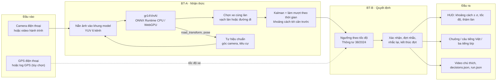
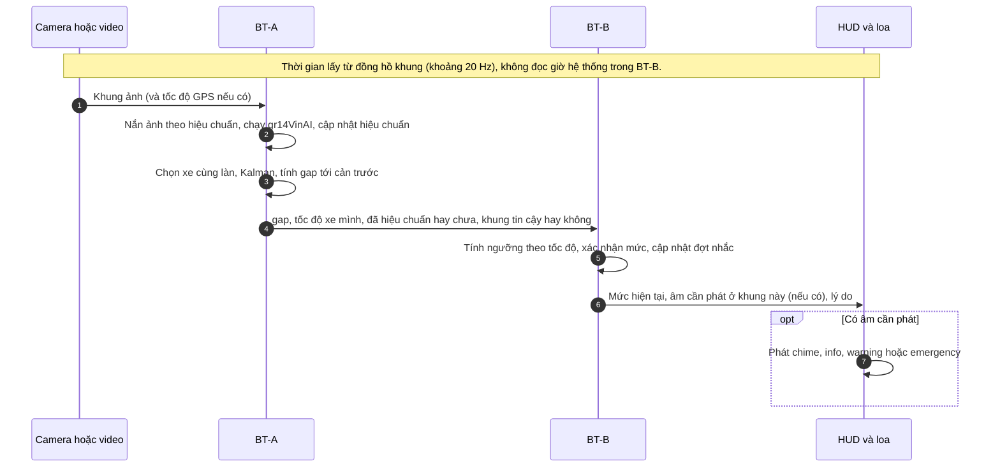
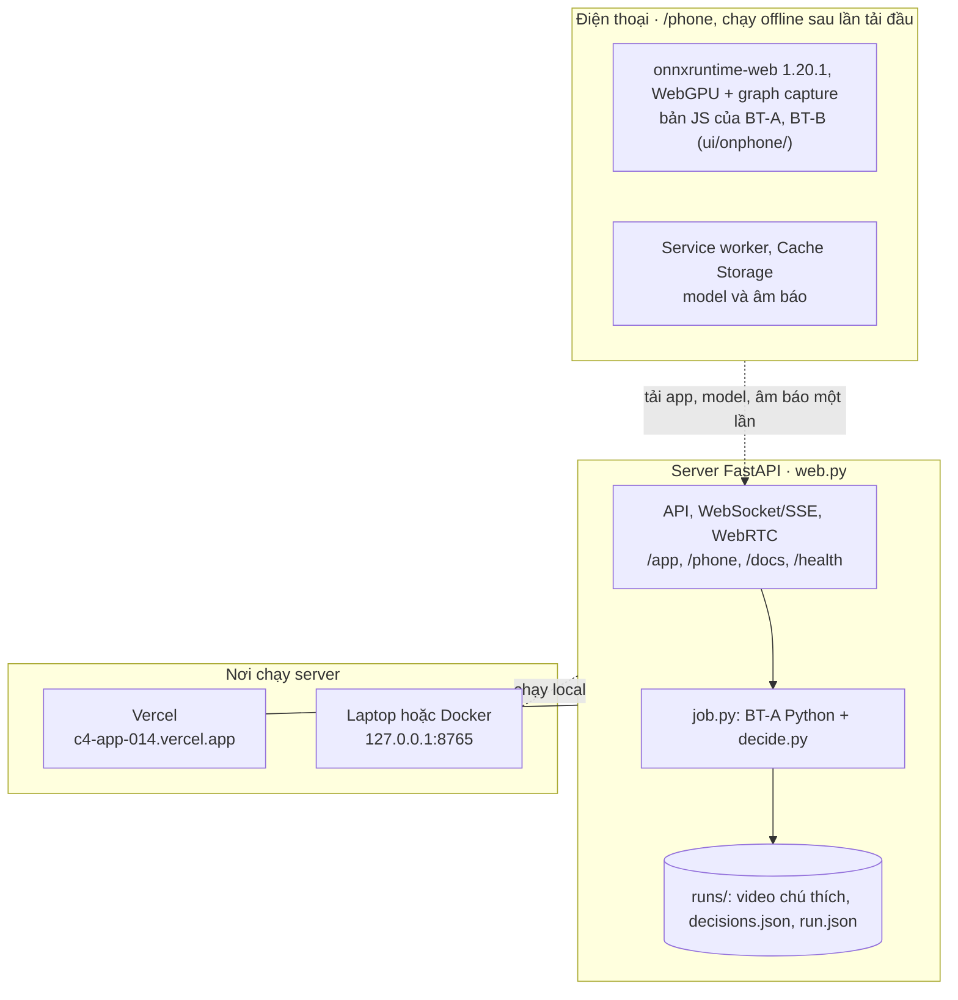

# RoadWatch Copilot: sơ đồ kiến trúc

> Deliverable 3 của môn học: bản trực quan của sản phẩm đã nộp trên `main`, khớp [README](../README.md). **Nguồn chuẩn** về kiến trúc và hợp đồng dữ liệu là [spec kiến trúc](specs/roadwatch-architecture.md); nếu hai nơi khác nhau thì spec thắng. Điểm khác giữa sản phẩm đã nộp và thiết kế engine đầy đủ của spec: spec 12.4.

**Một câu:** điện thoại gắn kính lái chạy offline ngay trên máy.
- Camera → **BT-A** (CV) đo khoảng cách tới xe dẫn đầu cùng làn.
- → **BT-B** (luật và máy trạng thái theo khoảng cách, không dùng LLM, không dùng TTC) chọn có nhắc hay không, nhắc mức nào.
- → chuông, câu tiếng Việt thu sẵn hoặc tiếng bíp; HUD hiện khoảng cách và thảm làn.

**Chú giải chung:** nét liền là phần đã có trên `main`; nét đứt là đường tùy chọn.

## 1. Thành phần

Hai đường chạy dùng chung một thiết kế: **laptop/server** (Python) và **điện thoại** (JavaScript, chạy offline). Bản JS được kiểm khớp với Python bằng dữ liệu chuẩn xuất từ Python (README mục 6).

**Đọc sơ đồ:**
- **BT-A** chọn xe dẫn đầu khi `lead_prob ≥ 0,5` và xe nằm trong làn của mình, kể cả khi vào cua; `gap = khoảng cách đã lọc − khoảng cách camera tới cản trước`. Khi chưa hiệu chuẩn xong hoặc ảnh không phủ đủ khung model, không cảnh báo khoảng cách.
- **Tốc độ xe mình** lấy từ GPS khi có, nếu không thì ước lượng từ `pose` của model (spec D-24).
- **BT-B** chỉ dựa trên khoảng cách và xu hướng khoảng cách: nhắc sớm (`info`), cảnh báo (`warning`, đúng mức luật từ 60 km/h), Khẩn cấp (`emergency`, thiếu nhiều hoặc khoảng cách giảm nhanh), chuông (`chime`) khi vùng nhắc sớm vượt tầm đo 100 m. Dưới 20 km/h im lặng. Luật đầy đủ: spec 3.5, 3.7; bảng ngưỡng: README mục 3.

## 2. Trình tự xử lý một khung

- **Chống báo giả:** xe phải được thấy liên tục 0,5 s; mỗi mức giữ 0,5 s (Khẩn cấp 0,2 s) mới phát; mức cao hơn phát ngay; nhắc lại sau 3 s rồi mỗi 10 s khi chưa giãn ra; đợt kết thúc khi rời vùng nhắc 3 s hoặc mất xe 3 s (spec 3.5).

## 3. Ranh giới triển khai

- **Điện thoại** chạy toàn bộ pipeline ngay trên máy; ảnh không rời khỏi máy (README mục 6).
- **Server** phục vụ web app, API và đường gửi ảnh từ điện thoại về server (tùy chọn). Bản triển khai: [c4-app-014.vercel.app](https://c4-app-014.vercel.app/); chạy local hoặc Docker theo README mục 7.

## 4. Thành phần, file code và mục trong spec

| Thành phần | Laptop / server | Điện thoại (`/phone`) | Mục trong spec |
|---|---|---|---|
| Suy luận gr14VinAI | `src/roadwatch/model.py` | `ui/onphone/captured.mjs` (GPU), `inference.mjs` (CPU) | 2, 12.2 (I-26) |
| Nắn ảnh, hiệu chuẩn | `model.py`, `calibration.py` | `ui/onphone/gpuprep.mjs`, `prep.mjs` | 4.2, 12.2 (I-20…I-24) |
| Chọn xe cùng làn, Kalman | `pipeline.py`, `temporal.py` | `ui/onphone/lanes.mjs`, `track.mjs` | 4.2 |
| BT-B | `decide.py` | `ui/onphone/decide.mjs` | 3.5, 3.7, 12.4 (D-21) |
| HUD | `hud.py` | `ui/onphone/geometry.mjs` | — |
| Giao diện, API | `web.py`, `schemas.py`, `ui/` | `phone.html`, `phone.js`, `sw.js` | 11.5, 12.4 (D-25); [roadwatch-api.md](specs/roadwatch-api.md) |

Thiết kế engine đầy đủ (hợp đồng `contracts`, runtime nhiều thread, baseline, bộ phân xử audio, `rerun-B`) có sơ đồ riêng ở spec mục 2; phần này chưa có trên `main` (spec 12.4, D-20).
