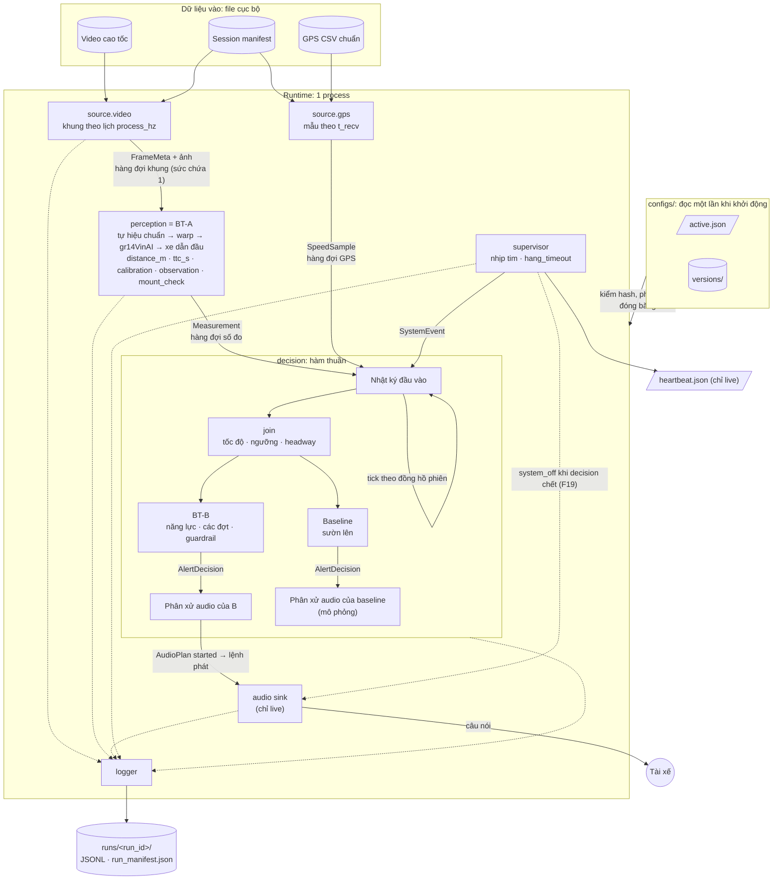
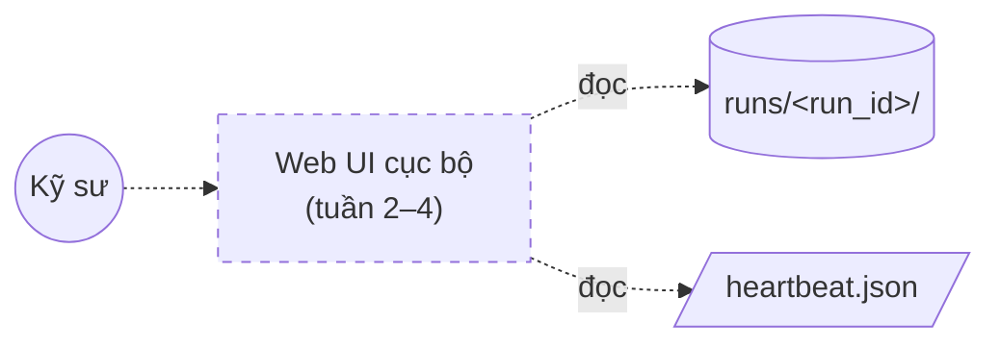
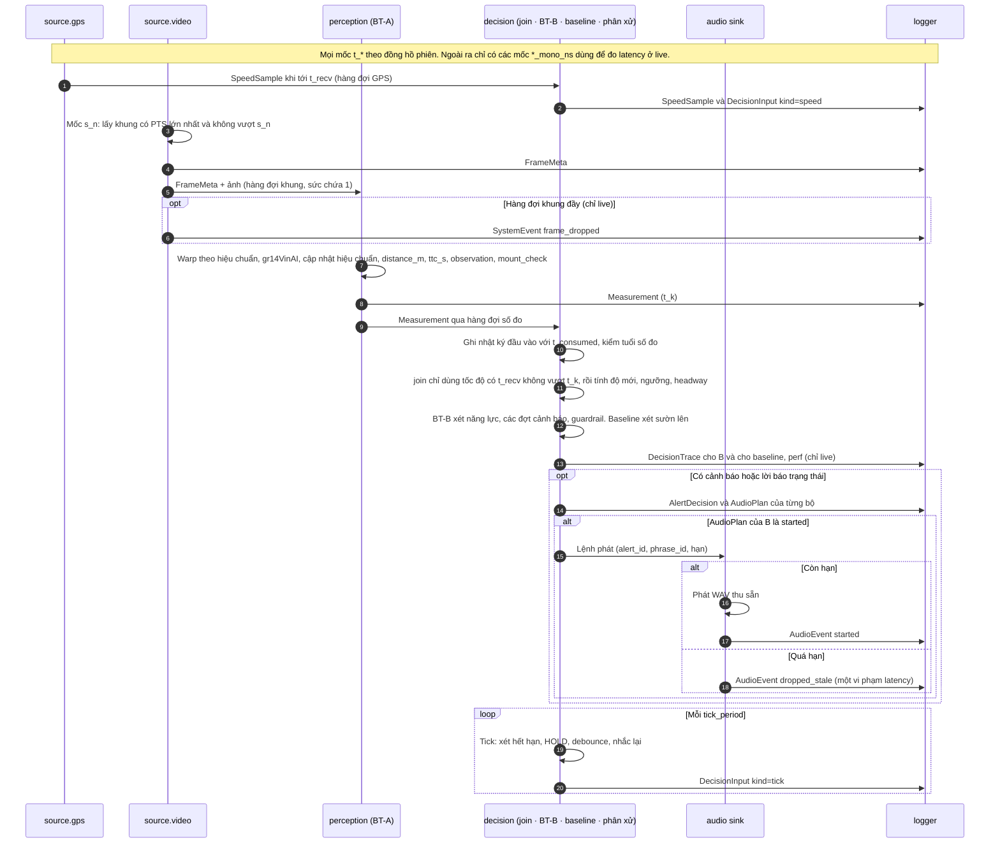
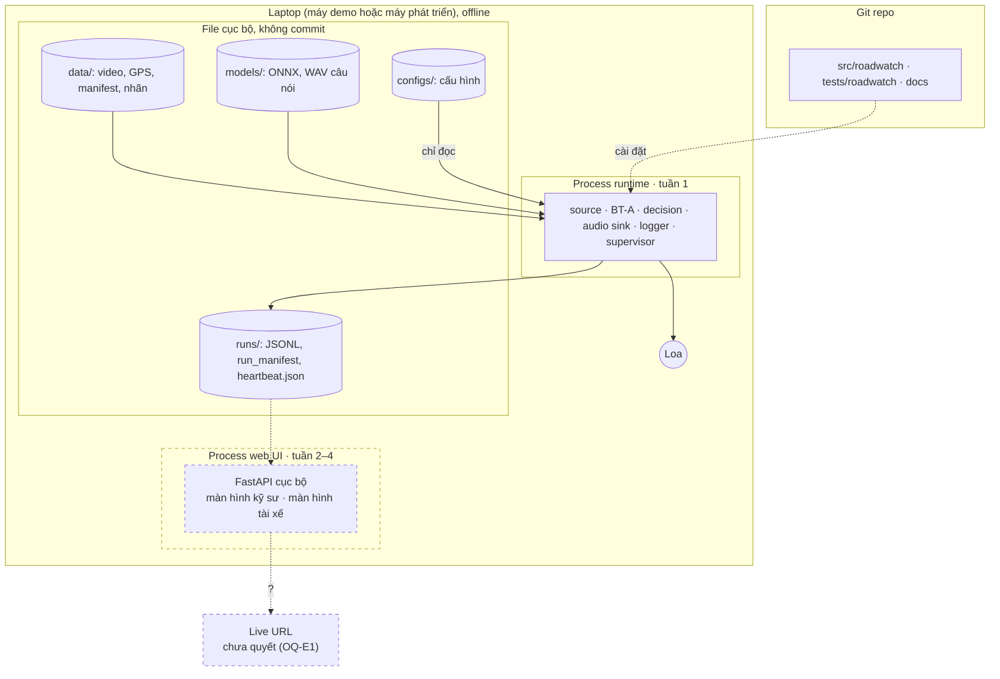

# RoadWatch Copilot: sơ đồ kiến trúc

> Deliverable 3 của môn học: bản trực quan tóm tắt. **Nguồn chuẩn** về kiến trúc và hợp đồng dữ liệu là [spec kiến trúc](specs/roadwatch-architecture.md); nếu hai nơi khác nhau thì spec thắng.
>
> **Mức độ chốt:**
> - Sơ đồ vẽ theo thiết kế của spec: v1.0 đã được PO duyệt ngày 28/09; v1.1 được PO duyệt ngày 29/09 (web UI thuộc ADR-13).
> - Sơ đồ **không** cho biết code đã làm tới đâu. Tình trạng code thực tế nằm ở [spec](specs/roadwatch-architecture.md), mục 12.4.

**Một câu:** thiết bị gắn kính (điện thoại) chạy offline ngay trên máy.
- Camera → **BT-A** (CV) đo khoảng cách tới xe phía trước.
- → **BT-B** (luật và máy trạng thái, không dùng LLM) chọn có nói hay không, nói câu gì.
- → loa phát câu tiếng Việt thu sẵn.

**Chú giải chung:**
- Nét liền: phần của bản nộp MVP (tuần 1).
- Nét đứt: phần mở rộng tuần 2–4, đường dự phòng, hoặc việc chưa quyết.

## 1. Thành phần

### 1a. Runtime: thread, hàng đợi, file

**Đọc sơ đồ:**
- **Nhật ký đầu vào.** Mọi đầu vào của `decision` được ghi vào nhật ký đầu vào **trước khi xử lý**, đúng thứ tự xử lý. Có bốn loại: số đo, tốc độ, sự kiện hệ thống, và tick do chính `decision` sinh theo đồng hồ phiên. Nhờ vậy tái lập được B mà không cần chạy lại A (spec 3.3, 5.4).
- **Logger.** Đường chấm tới logger nghĩa là mọi thread ghi bản ghi qua hàng đợi log. Tràn log thì lần chạy bị đánh dấu không hợp lệ để đánh giá, nhưng đường nóng không bị chặn (spec 3.2).
- **Hàng đợi.**
  - Ở live, hàng đợi khung, số đo và GPS khi đầy thì bỏ bản ghi cũ nhất và ghi một `SystemEvent`: `frame_dropped`, `measurement_dropped` hoặc `speed_dropped`.
  - Ở replay thì không bỏ gì (spec 3.2). Code hiện chạy replay tuần tự trong một thread (D-2).
- **Ra loa.** Ở live, chỉ bộ quyết định chính được nối ra loa. Mặc định là B; trường `active_arbiter` trong `run_manifest` cho biết bộ nào. Bộ còn lại chạy shadow qua bộ phân xử mô phỏng (spec 2).
- **Supervisor.** Khi thấy thread chết hoặc treo, supervisor gửi `system_fault` vào `decision`; `decision` tắt cả hai năng lực cảnh báo. Nếu chính `decision` chết, supervisor tự phát câu "Hệ thống cảnh báo tạm dừng", nhưng chỉ khi audio còn chạy (spec 3.8, F19).

### 1b. Web UI

- **Web UI** thuộc tuần 2–4 (ADR-13, PO duyệt 29/09); chỉ đọc kết quả lần chạy, không sửa cấu hình.

## 2. Trình tự một lần xử lý (live, B là bộ quyết định chính)

- **Replay** gọi đúng các hàm trên nhưng:
  - không chờ theo thời gian thực và không bỏ bản ghi nào;
  - `t_consumed = t_k`;
  - không có audio sink, `perf` hay `audio_events` (spec 3.3, 5.3).
- **Guardrail Khẩn cấp:** khi `cap_ttc = on`, `ttc_s` `ok` và không vượt ngưỡng, B phát ngay ở khung bắt đầu đợt. Trong cùng đợt, chỉ phát lại khi chưa lệnh Khẩn cấp nào `started`, lệnh gần nhất bị huỷ hoặc hết hạn và không còn lệnh đang chờ. Không tham số nào được chặn hai trường hợp bắt buộc phát; không nhắc theo chu kỳ (spec 3.7, OQ-B12).

## 3. Ranh giới triển khai

- **Runtime** chạy offline hoàn toàn và không phụ thuộc web UI. Số đo hiệu năng dùng để nghiệm thu chỉ lấy trên máy demo đã chốt (WP-P2).
- **Web UI** thuộc tuần 2–4 (ADR-13); giao diện là HTML render từ FastAPI (OQ-E2).
- **Live URL** chưa quyết (OQ-E1).

## 4. Thành phần và mục tương ứng trong spec

| Thành phần | Làm gì | Mục trong spec |
|---|---|---|
| `source` | Phát video theo lịch `process_hz`, GPS theo `t_recv`, bản ghi giữ chỗ khi biết chắc không có khung | 2, 3.1, 3.3 |
| BT-A perception | Tự hiệu chuẩn camera, warp, gr14VinAI, xe dẫn đầu, khoảng cách, làn, kiểm tra ảnh, phát hiện lắp lại | 2, 4.2 |
| `join` | Ghép số đo với tốc độ theo mốc cắt thông tin; độ mới của tốc độ, ngưỡng, headway | 3.3 |
| BT-B decision | Năng lực cảnh báo, các đợt cảnh báo có `HOLD`, guardrail Khẩn cấp, lời báo trạng thái | 3.4–3.7 |
| Baseline | Cảnh báo theo sườn lên, cùng đầu vào với B, để so sánh | 2, 5.5 |
| Phân xử audio + audio sink | Một câu đang phát, một ô chờ; chỉ cảnh báo nguy hiểm mới được ngắt câu đang phát; sink bỏ lệnh quá hạn | 3.6 |
| Supervisor, logger | Nhịp tim, `system_fault`, `heartbeat.json`; ghi JSONL không chặn đường nóng | 3.2, 3.8 |
| Web UI (tuần 2–4) | Màn hình kỹ sư và màn hình trạng thái cho tài xế | 11.5 |
