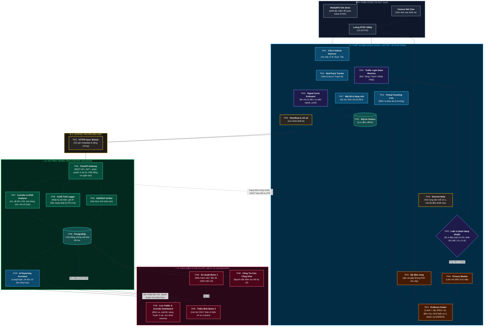
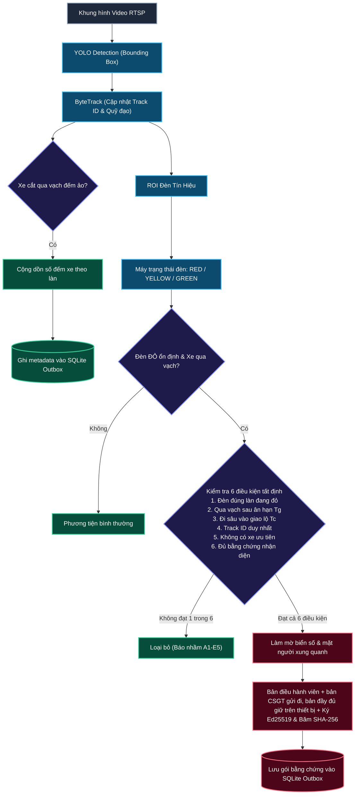
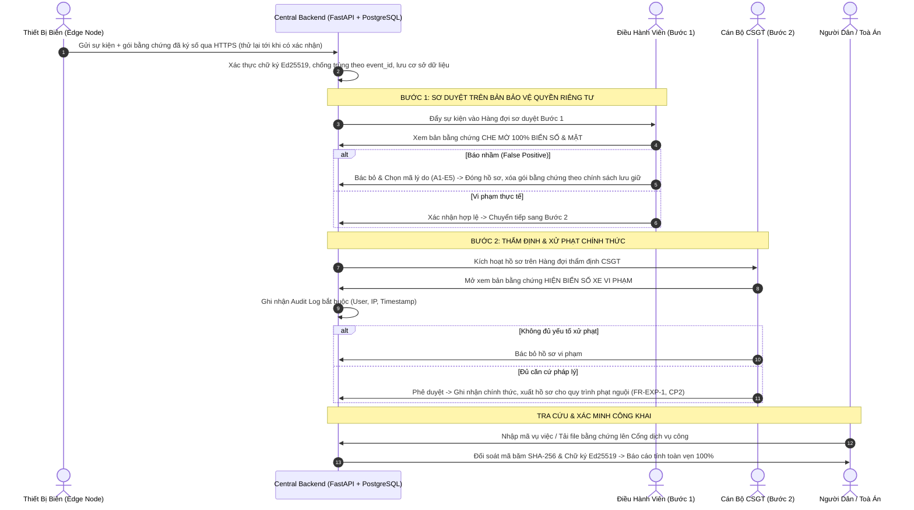
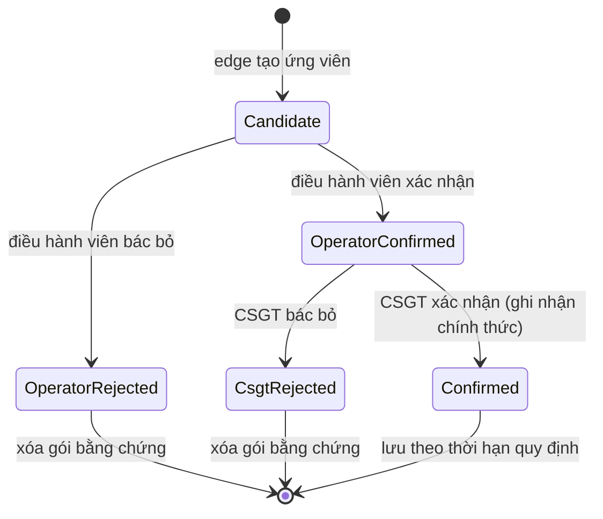

# SƠ ĐỒ KIẾN TRÚC HỆ THỐNG — TRAFFICEYE EDGE

> **Đây là file kiến trúc duy nhất của dự án.** Muốn biết hệ thống gồm những phần nào và nối với nhau ra sao thì đọc file này; mọi sơ đồ kiến trúc đều nằm ở đây. Đây cũng là file khóa học yêu cầu nộp (`docs/guide/deliverables/checklist.md`).
> **Căn cứ:** [spec](spec/trafficeye-spec.md) quy định hệ thống phải làm gì; [báo cáo kỹ thuật](report/trafficeye-edge-report.md) giải thích vì sao chọn kiến trúc này. Khi kiến trúc đổi thì sửa spec trước, rồi sửa file này.

---

## 0. Bản đồ hệ thống: 11 phân hệ

Đọc mục này trước. Mỗi việc trong `docs/plan/phan-viec/` ghi rõ nó thuộc phân hệ nào. Ai phụ trách phân hệ nào: `docs/plan/timeline.md` mục 5.1.

| Mã | Phân hệ | Làm gì | Chạy ở | Yêu cầu (spec) | Hợp đồng dữ liệu (spec) |
|---|---|---|---|---|---|
| PH1 | Nhận diện và đếm xe | Đọc video từ camera; tìm xe trong từng khung hình (YOLO); bám theo từng xe qua các khung (ByteTrack); đếm xe cắt vạch, theo làn | Edge | 4.1; 4.2 (FR-CNT) | Sự kiện đếm: 6.3 |
| PH2 | Đèn tín hiệu và cấu hình cảnh | Đọc màu đèn thành trạng thái ổn định (đỏ, vàng, xanh, không rõ); nạp và kiểm tra file mô tả nút giao (làn, vạch, vùng); đo từng chu kỳ đèn | Edge | 4.3 (FR-LGT); FR-DEN-4 | Cấu hình cảnh: 6.1; sự kiện `signal_cycle`: 6.3 |
| PH3 | Luật vi phạm | Lớp ngữ cảnh loại các ca không phải vi phạm; các luật tất định: vượt đèn đỏ, đi ngược chiều, sai làn. Kết quả là ứng viên vi phạm kèm mã lý do | Edge | 4.3 (FR-CTX); 4.4; 7 | Giao diện luật: 6.6; ngưỡng: 6.2 |
| PH4 | Bằng chứng và riêng tư | Che biển số và khuôn mặt; đóng gói 3 ảnh và đoạn clip; ký số; đọc biển số xe vi phạm (OCR) | Edge | 4.5 | Manifest gói bằng chứng: 6.4 |
| PH5 | Truyền dữ liệu và quản lý thiết bị | Hàng đợi outbox, gửi bù khi có mạng lại; heartbeat; trạng thái mong muốn; cập nhật phần mềm từ xa (OTA); MQTT | Edge ↔ trung tâm | 4.6 | Sự kiện: 6.3; kênh điều khiển: 6.7 |
| PH6 | Trung tâm | Nhận và lưu sự kiện; đăng nhập và phân quyền; API ứng viên; duyệt 2 bước; nhật ký nối băm; xác minh bằng chứng; xuất hồ sơ | Trung tâm | 3; 4.7 | API: 6.5 |
| PH7 | Phân tích giao thông | Mật độ, hàng chờ, ùn tắc tại từng nút; phân tích tuyến 3 nút theo HCM (mức phục vụ, tràn hàng chờ, nút cổ chai); gợi ý điều phối | Edge và trung tâm | 4.2 (FR-DEN, FR-COR); FR-DSP-1 | Cấu hình tuyến: 6.8; ngưỡng tuyến: 6.2 |
| PH8 | Giao diện | Dashboard Next.js: bản đồ, duyệt bước 1, màn CSGT, trang Tuyến, sức khỏe camera, báo cáo, nhật ký | Trình duyệt | 4.8 | API: 6.5 |
| PH9 | Agent AI | Soạn báo cáo ca trực, giải thích ứng viên. Chỉ đọc số liệu tổng hợp; người duyệt rồi mới phát hành; không quyết định vi phạm | Trung tâm | 4.9 | API: 6.5 |
| PH10 | Đánh giá và dữ liệu | Quay và chuẩn hóa video, lập manifest; gán nhãn; script đo; chỉnh ngưỡng; giữ tập test; báo cáo đánh giá | Ngoài hệ thống chạy thật | 4.12 | `docs/eval/protocol.md` |
| PH11 | Vận hành và hiệu năng | Docker, CI; tăng tốc model (ONNX, TensorRT, INT8); chạy 3 camera; bảo mật production; Live URL; giám sát; chạy thử 24 giờ | Mọi nơi | 4.10; 4.11; 5 (NFR); 8.2 | — |

Trong sơ đồ mục 1, mỗi khối có ghi mã phân hệ (PH1…PH9):
- khối B (thiết bị biên): PH1–PH5, và phần mật độ, hàng chờ của PH7;
- khối D (trung tâm): PH6, phân tích tuyến của PH7, PH9;
- khối E (giao diện): PH8.

PH10 và PH11 không phải khối chạy trong sơ đồ. Luồng xử lý trên edge ở mục 2; luồng duyệt 2 bước và vòng đời một vi phạm ở mục 3.

---

## 1. Kiến trúc tổng quan hệ thống (System Overview)

Hệ thống hoạt động theo mô hình **Edge AI First** kết hợp **Phê duyệt 2 bước có con người kiểm soát (Two-Step HITL)**:
- **Thiết bị biên (Edge Node):** Xử lý toàn bộ video tại chỗ: phát hiện, bám vết, đếm xe, và chạy các luật vi phạm tất định (vượt đèn đỏ, đi ngược chiều, sai làn đủ 3 kiểu). Tuyệt đối **không truyền video thô về trung tâm**.
- **Trung tâm (Central Backend):** Tiếp nhận metadata số đếm và các gói bằng chứng đã được ký số; quản lý hàng đợi duyệt vi phạm; xuất hồ sơ vi phạm cho quy trình phạt nguội (FR-EXP-1, CP2). Hệ thống chỉ tạo ứng viên; vi phạm chỉ được ghi nhận chính thức khi người duyệt.

---

## 2. Luồng xử lý chi tiết tại Biên (Edge Pipeline Flow)

Luồng xử lý thời gian thực từ khi nhận khung hình camera đến khi đưa ra quyết định vi phạm hoặc đếm xe. Sơ đồ lấy **luật vượt đèn đỏ** làm ví dụ. Đi ngược chiều và sai làn dùng cùng khung (lớp ngữ cảnh, mã lý do, gói bằng chứng), chỉ khác điều kiện của luật (spec mục 7).

---

## 3. Luồng phê duyệt 2 bước có con người kiểm soát (Two-Step HITL Flow)

Quy trình đảm bảo tính pháp lý, bảo vệ quyền riêng tư và loại bỏ triệt để phạt oan:

**Vòng đời một vi phạm** (trạng thái lưu ở PH6):

---

## 4. Bảng chi tiết các thành phần công nghệ (Component Details)

| Thành phần | Công nghệ / Thư viện | Vai trò và chức năng trong TrafficEye Edge |
|---|---|---|
| **Camera Ingestion** | OpenCV / FFmpeg (RTSP) | Thu nhận luồng video H.264/H.265 (1080p @ 15–20 FPS), tự kết nối lại khi đứt luồng. |
| **Vehicle Detection** | YOLO (tối ưu hóa cho Edge) | Phát hiện 4 loại phương tiện: xe máy, ô tô con, xe buýt, xe tải. |
| **Object Tracking** | ByteTrack | Gán Track ID liên tục, bám vết quỹ đạo chuyển động, xử lý che khuất ngắn hạn. |
| **Counting & Rule Engine** | Hình học phẳng + State Machine | Đếm xe qua vạch ảo theo làn; máy trạng thái đèn; lớp ngữ cảnh có mã lý do; các luật vi phạm tất định dạng plugin (RL, WW, LN). Cấu hình cảnh được kiểm tra hình học khi nạp (spec 6.1). |
| **Privacy & Sealing** | OpenCV + Cryptography | Tự động làm mờ mặt và biển số. Tạo bản điều hành viên và bản CSGT để gửi đi; bản đầy đủ niêm phong, giữ trên thiết bị. Băm SHA-256 và ký số Ed25519. Tỉ lệ biển số, khuôn mặt bị lọt được đo kèm Wilson 95% (spec FR-PRV). |
| **Edge Storage** | SQLite Outbox | Cơ sở dữ liệu hàng đợi cục bộ tại biên, lưu đệm metadata và bằng chứng khi mất kết nối mạng. |
| **Transport Layer** | HTTPS (M1 chạy HTTP trên localhost; TLS qua reverse proxy từ CP2). Từ CP2, MQTT chỉ làm kênh điều khiển | Worker chạy nền đồng bộ dữ liệu từ Outbox về Backend qua HTTPS REST API; không truyền video thô. |
| **Central Backend** | FastAPI + SQLAlchemy | RESTful API Gateway, xác thực chữ ký số Ed25519, điều phối hàng đợi duyệt 2 bước, ghi Audit Log. |
| **Database** | PostgreSQL | Lưu trữ metadata lưu lượng xe theo phút, hồ sơ sự kiện vi phạm và nhật ký kiểm toán. |
| **Central Frontend** | Next.js + TailwindCSS | Live Traffic Dashboard, màn hình duyệt Bước 1 (Operator), màn hình thẩm định Bước 2 (CSGT). |
| **Verification Portal** | Next.js (Web công khai) | Cổng thông tin cho người dân đối soát tính toàn vẹn và chữ ký số của hồ sơ phạt nguội. |
| **AI Reporting Agent** | LangGraph | Công cụ chỉ đọc số liệu tổng hợp, không trả biển số hay ảnh. Soạn bản nháp báo cáo; người duyệt mới phát hành (`interrupt()`). Không gọi được LLM thì sinh báo cáo theo mẫu. Agent không quyết định vi phạm (spec FR-AGT-1). |
