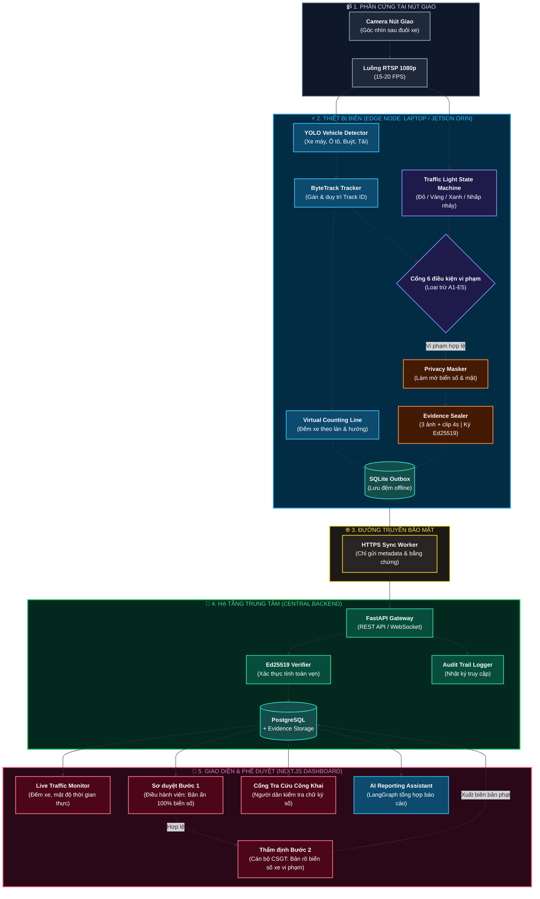
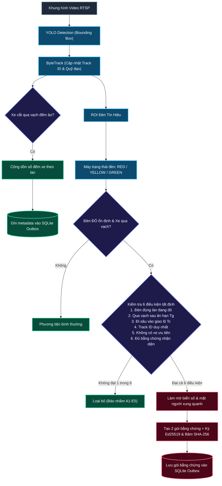
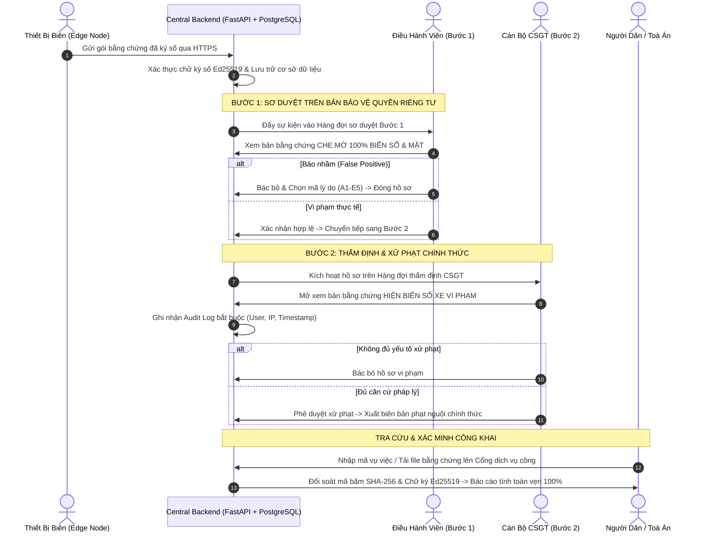

# SƠ ĐỒ KIẾN TRÚC HỆ THỐNG — TRAFFICEYE EDGE

> **Trạng thái:** Bản kiến trúc chuẩn hóa chính thức của dự án TrafficEye Edge  
> **Căn cứ:** [docs/spec/trafficeye-spec.md](spec/trafficeye-spec.md) và [docs/report/trafficeye-edge-report.md](report/trafficeye-edge-report.md)

---

## 1. Kiến trúc tổng quan hệ thống (System Overview)

Hệ thống hoạt động theo mô hình **Edge AI First** kết hợp **Phê duyệt 2 bước có con người kiểm soát (Two-Step HITL)**:
- **Thiết bị biên (Edge Node):** Xử lý toàn bộ video tại chỗ, phát hiện, bám vết, đếm xe và kiểm tra 6 điều kiện vi phạm tất định. Tuyệt đối **không truyền video thô về trung tâm**.
- **Trung tâm (Central Backend):** Tiếp nhận metadata số đếm và các gói bằng chứng đã được ký số; quản lý hàng đợi duyệt vi phạm và xuất biên bản.

---

## 2. Luồng xử lý chi tiết tại Biên (Edge Pipeline Flow)

Luồng xử lý thời gian thực từ khi nhận khung hình camera đến khi đưa ra quyết định vi phạm hoặc đếm xe:

---

## 3. Luồng phê duyệt 2 bước có con người kiểm soát (Two-Step HITL Flow)

Quy trình đảm bảo tính pháp lý, bảo vệ quyền riêng tư và loại bỏ triệt để phạt oan:

---

## 4. Bảng chi tiết các thành phần công nghệ (Component Details)

| Thành phần | Công nghệ / Thư viện | Vai trò và chức năng trong TrafficEye Edge |
|---|---|---|
| **Camera Ingestion** | OpenCV / FFmpeg (RTSP) | Thu nhận luồng video H.264/H.265 (1080p @ 15–20 FPS), tự kết nối lại khi đứt luồng. |
| **Vehicle Detection** | YOLO (tối ưu hóa cho Edge) | Phát hiện 4 loại phương tiện: xe máy, ô tô con, xe buýt, xe tải. |
| **Object Tracking** | ByteTrack | Gán Track ID liên tục, bám vết quỹ đạo chuyển động, xử lý che khuất ngắn hạn. |
| **Counting & Rule Engine** | Hình học phẳng + State Machine | Đếm xe qua vạch ảo theo làn; phân tích máy trạng thái đèn; kiểm tra 6 điều kiện vi phạm tất định. |
| **Privacy & Sealing** | OpenCV + Cryptography | Tự động làm mờ mặt và biển số; tạo 2 gói bằng chứng; băm SHA-256 và ký số Ed25519. |
| **Edge Storage** | SQLite Outbox | Cơ sở dữ liệu hàng đợi cục bộ tại biên, lưu đệm metadata và bằng chứng khi mất kết nối mạng. |
| **Transport Layer** | HTTP Client (TLS 1.3) | Worker chạy nền đồng bộ dữ liệu từ Outbox về Backend qua HTTPS REST API; không truyền video thô. |
| **Central Backend** | FastAPI + SQLAlchemy | RESTful API Gateway, xác thực chữ ký số Ed25519, điều phối hàng đợi duyệt 2 bước, ghi Audit Log. |
| **Database** | PostgreSQL | Lưu trữ metadata lưu lượng xe theo phút, hồ sơ sự kiện vi phạm và nhật ký kiểm toán. |
| **Central Frontend** | Next.js + TailwindCSS | Live Traffic Dashboard, màn hình duyệt Bước 1 (Operator), màn hình thẩm định Bước 2 (CSGT). |
| **Verification Portal** | Next.js (Web công khai) | Cổng thông tin cho người dân đối soát tính toàn vẹn và chữ ký số của hồ sơ phạt nguội. |
| **AI Reporting Agent** | LangGraph + OpenAI/Gemini | Trợ lý phân tích dữ liệu lưu lượng từ PostgreSQL và tự động soạn thảo báo cáo giao thông bằng ngôn ngữ tự nhiên. |
