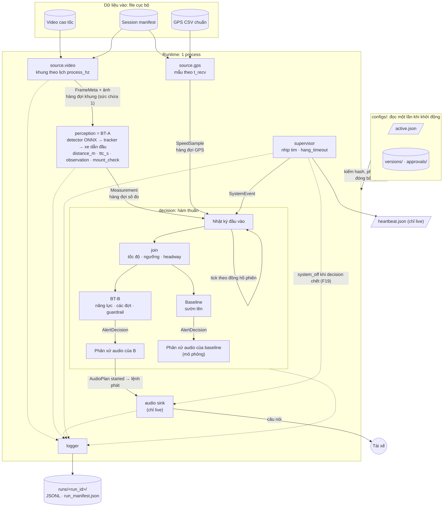
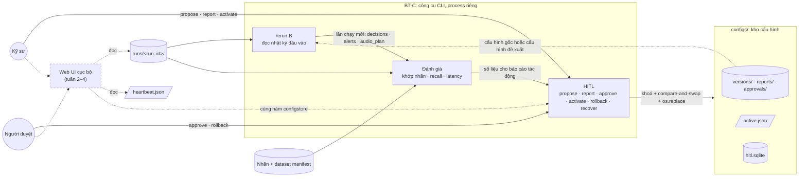
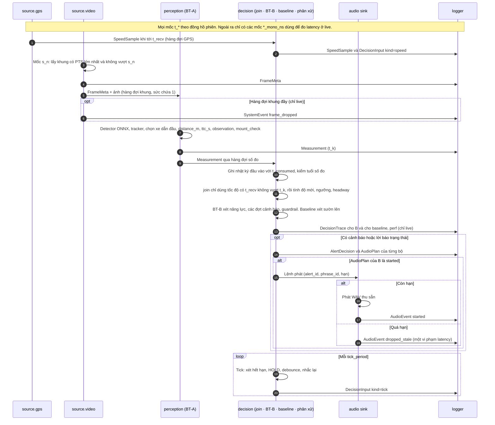
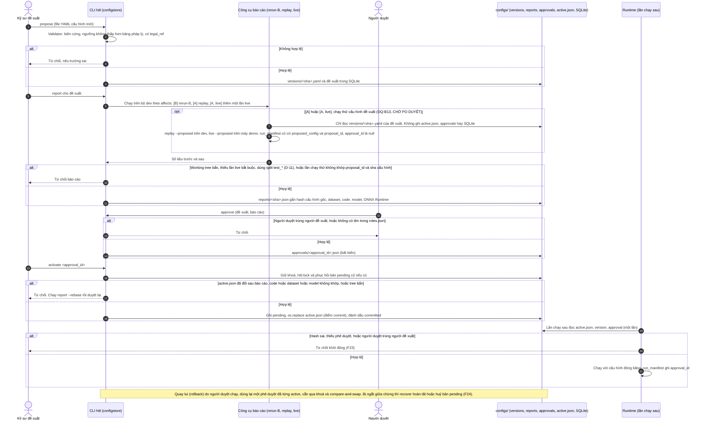
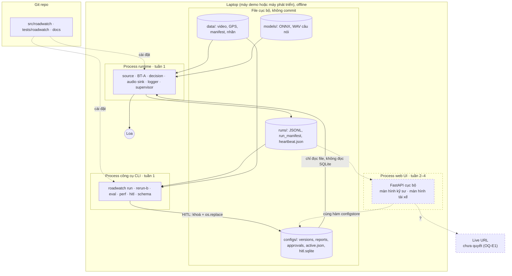

# RoadWatch Copilot: sơ đồ kiến trúc

> Deliverable 3 của môn học: bản trực quan tóm tắt. **Nguồn chuẩn** về kiến trúc và hợp đồng dữ liệu là [spec kiến trúc](specs/roadwatch-architecture.md); nếu hai nơi khác nhau thì spec thắng.
>
> **Mức độ chốt:**
> - Sơ đồ vẽ theo thiết kế của spec: v1.0 đã được PO duyệt ngày 28/09; các phần gắn nhãn [v1.1] đang chờ duyệt (web UI thuộc ADR-13).
> - Sơ đồ **không** cho biết code đã làm tới đâu. Tình trạng code thực tế nằm ở [kế hoạch, mục 3](plan/README.md).

**Một câu:** thiết bị gắn kính chạy offline trên CPU laptop.
- Camera → **BT-A** (CV) đo khoảng cách và TTC tới xe phía trước.
- → **BT-B** (luật và máy trạng thái, không dùng LLM) chọn có nói hay không, nói câu gì.
- → loa phát câu tiếng Việt thu sẵn.
- **BT-C** giữ cấu hình có phiên bản và có người duyệt (HITL), ghi log và chạy đánh giá.

**Chú giải chung:**
- Nét liền: phần của bản nộp MVP (tuần 1).
- Nét đứt: phần mở rộng tuần 2–4, đường dự phòng, hoặc việc chưa quyết.

## 1. Thành phần

### 1a. Runtime: thread, hàng đợi, file

**Đọc sơ đồ:**
- **Nhật ký đầu vào.** Mọi đầu vào của `decision` được ghi vào nhật ký đầu vào **trước khi xử lý**, đúng thứ tự xử lý. Có bốn loại: số đo, tốc độ, sự kiện hệ thống, và tick do chính `decision` sinh theo đồng hồ phiên. Nhờ vậy `rerun-B` tái lập được B mà không cần chạy lại A (spec 3.3, 5.4).
- **Logger.** Đường chấm tới logger nghĩa là mọi thread ghi bản ghi qua hàng đợi log. Tràn log thì lần chạy bị đánh dấu không hợp lệ để đánh giá, nhưng đường nóng không bị chặn (spec 3.2).
- **Hàng đợi.**
  - Ở live, hàng đợi khung, số đo và GPS khi đầy thì bỏ bản ghi cũ nhất và ghi một `SystemEvent`: `frame_dropped`, `measurement_dropped` hoặc `speed_dropped`.
  - Ở replay thì không bỏ gì (spec 3.2). Code hiện chạy replay tuần tự trong một thread (D-2).
- **Ra loa.** Ở live, chỉ bộ quyết định chính được nối ra loa. Mặc định là B; trường `active_arbiter` trong `run_manifest` cho biết bộ nào. Bộ còn lại chạy shadow qua bộ phân xử mô phỏng (spec 2).
- **Supervisor.** Khi thấy thread chết hoặc treo, supervisor gửi `system_fault` vào `decision`; `decision` tắt cả hai năng lực cảnh báo. Nếu chính `decision` chết, supervisor tự phát câu "Hệ thống cảnh báo tạm dừng", nhưng chỉ khi audio còn chạy (spec 3.8, F19).

### 1b. Công cụ BT-C và web UI

- **Chỉ các công cụ BT-C đụng SQLite.** Runtime chỉ đọc `active.json`, `versions/` và `approvals/` (spec 2, luật ranh giới 4). Code hiện vẫn import module `configstore` (D-13).
- **`reports/` và `roles.json`.** Code có hai file này nhưng spec 3.10 chưa liệt kê (D-12).
- **Web UI** thuộc tuần 2–4 (ADR-13, chờ duyệt). Web UI không có đường HITL riêng; mọi lệnh đi qua cùng các hàm mà CLI dùng.

## 2. Trình tự một lần xử lý (live, B là bộ quyết định chính)

- **Replay** gọi đúng các hàm trên nhưng:
  - không chờ theo thời gian thực và không bỏ bản ghi nào;
  - `t_consumed = t_k`;
  - không có audio sink, `perf` hay `audio_events` (spec 3.3, 5.3).
- **`rerun-B`** đọc nhật ký đầu vào như đã ghi, rồi gọi lại `decision` để sinh `decisions`, `alerts`, `audio_plan`.
- **Guardrail Khẩn cấp:** khi `cap_ttc = on`, TTC `ok` và TTC không vượt ngưỡng thì B phát Khẩn cấp ngay tại khung đó. Không tham số nào được chặn hay hoãn cảnh báo này (spec 3.7). Việc có phát lại trong cùng một đợt hay không (đợt kéo dài, phục hồi từ `HOLD_E`, lệnh đầu bị huỷ trước khi phát) đang chờ PO chọn: spec 3.7, OQ-B12.

## 3. Trình tự HITL: từ đề xuất tới lần chạy sau

- Lần chạy đang diễn ra không bị ảnh hưởng, vì cấu hình đã đóng băng từ lúc bắt đầu (spec 3.10).
- **Chạy thử cấu hình đề xuất** (khối `opt`) là đề xuất đang chờ PO duyệt (spec 3.10, OQ-B13). Lần chạy thử không kích hoạt gì, chỉ dùng cho báo cáo tác động, không bao giờ là bằng chứng nghiệm thu. Chạy thường vẫn từ chối cấu hình chưa duyệt (F23).
- Công cụ AI hỗ trợ lập trình không được chạy `approve`, `activate` hay `rollback` trên kho cấu hình thật ([AGENTS.md](../AGENTS.md), mục 1).

## 4. Ranh giới triển khai

- **Runtime** chạy offline hoàn toàn và không phụ thuộc công cụ CLI hay web UI. Số đo hiệu năng dùng để nghiệm thu chỉ lấy trên máy demo đã chốt (WP-P2).
- **`configs/`** trên máy demo là kho cấu hình thật. Test và thử nghiệm dùng kho tạm ([quy tắc code](development/code-rules.md), mục 6).
- **Web UI** thuộc tuần 2–4 (ADR-13, chờ duyệt); công nghệ phía giao diện chờ OQ-E2.
- **Live URL** chưa quyết (OQ-E1).

## 5. Thành phần và mục tương ứng trong spec

| Thành phần | Làm gì | Mục trong spec |
|---|---|---|
| `source` | Phát video theo lịch `process_hz`, GPS theo `t_recv`, bản ghi giữ chỗ khi biết chắc không có khung | 2, 3.1, 3.3 |
| BT-A perception | Phát hiện, theo dõi, chọn xe dẫn đầu, khoảng cách theo cấu hình lắp cố định, TTC, kiểm tra ảnh và lắp đặt | 2, 4.2 |
| `join` | Ghép số đo với tốc độ theo mốc cắt thông tin; độ mới của tốc độ, ngưỡng, headway | 3.3 |
| BT-B decision | Năng lực cảnh báo, các đợt cảnh báo có `HOLD`, guardrail Khẩn cấp, lời báo trạng thái | 3.4–3.7 |
| Baseline | Cảnh báo theo sườn lên, cùng đầu vào với B, để so sánh | 2, 5.5 |
| Phân xử audio + audio sink | Một câu đang phát, một ô chờ; chỉ cảnh báo nguy hiểm mới được ngắt câu đang phát; sink bỏ lệnh quá hạn | 3.6 |
| Supervisor, logger | Nhịp tim, `system_fault`, `heartbeat.json`; ghi JSONL không chặn đường nóng | 3.2, 3.8 |
| Kho cấu hình + HITL | Phiên bản bất biến, người duyệt khác người đề xuất, khoá + compare-and-swap, quay lui | 3.10 |
| `rerun-B`, đánh giá | Tái lập B, khớp nhãn, recall toàn hệ thống; latency của B báo cáo riêng | 5 |
| Web UI (tuần 2–4) | Màn hình kỹ sư và màn hình trạng thái cho tài xế; gọi chung hàm HITL với CLI | 11.5 |
