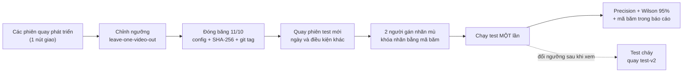

# Giao thức đánh giá precision — phát hiện vượt đèn đỏ (TrafficEye Edge)

> **Trạng thái:** ĐÃ DUYỆT · v1.0 · 21/09/2026 — PO đã chốt 3 quyết định (mục 11).
> **Phạm vi:** mục 1–12 dành cho vi phạm vượt đèn đỏ. **Mục 13 (phụ lục, chờ duyệt cùng spec v1.0)** mở rộng giao thức cho đi ngược chiều, sai làn, mAP, đếm theo làn, hàng chờ và ùn tắc, OCR, hiệu năng. Chưa có code hệ thống. Script đánh giá: `scripts/evaluate.py`; test: `tests/test_evaluate.py`.
> **Quy ước:** **[Kiểm chứng]** = nhận định có nguồn ở mục 12. **[Đề xuất]** = thiết kế hoặc suy luận của team, cần xác nhận bằng dữ liệu. Mọi con số về cỡ mẫu ở mục 7.2 là **tính bằng công thức**, không phải số đo.

---

## 0. Tóm tắt 1 trang

**Vấn đề.** Nếu các ngưỡng (ân hạn, T_c vào vùng giao lộ, số khung xác nhận, ngưỡng tin cậy) được chỉnh trên chính video dùng để đo, precision sẽ bị thổi phồng.
- Dùng sai số kiểm định chéo của một mô hình đã được chỉnh bằng kiểm định chéo cho ra ước lượng lệch đáng kể [Kiểm chứng: Varma & Simon 2006].
- Dùng đi dùng lại một tập holdout để ra quyết định cũng làm nó mất giá trị [Kiểm chứng: Dwork et al. 2015].

**Cách làm, 5 bước:**
1. **Chia theo nhóm, không chia theo khung.** Đơn vị chia là video, phiên quay và địa điểm. Tập test quay mới, **khác nút giao hoặc khác điều kiện**, giống cách UA-DETRAC (train và test ở địa điểm khác nhau) và WILDS (test trên camera chưa từng thấy) [Kiểm chứng].
2. **Chỉnh ngưỡng bằng leave-one-video-out** trên tập tuning/val (đã chốt). Không bao giờ đo trên dữ liệu đã dùng để chỉnh [Kiểm chứng: Varma & Simon 2006; scikit-learn].
3. **Đóng băng** cấu hình (file config + SHA-256 + git tag) vào **11/10/2026** [Đề xuất].
4. **Quay tập test mới sau khi đóng băng.** Hai người gán nhãn độc lập, không xem kết quả hệ thống; nhãn được khóa bằng mã băm trước khi chạy.
5. **Chạy test một lần.** Báo precision kèm khoảng tin cậy Wilson 95% [Kiểm chứng: Brown, Cai & DasGupta 2001], kèm mã băm của config và manifest.

**Con số cần biết (tính toán, không phải số đo):**
- 20 cảnh báo đúng hết thì cận dưới khoảng tin cậy 95% của precision vẫn chỉ là 83,9%.
- Cần ≥ 29 cảnh báo không sai cái nào mới khẳng định được precision ≥ 90%, và ≥ 59 cảnh báo để khẳng định ≥ 95% (một phía, 95%) [Kiểm chứng: quy tắc 3/n, Hanley & Lippman-Hand 1983].
- **Mục tiêu: ≥ 60 cảnh báo trên tập test. Dưới 30 thì con số chỉ mang tính minh họa** [Đề xuất].

**Câu trả lời 30 giây cho giám khảo:** mục 10.1. **Ba quyết định đã chốt:** mục 11.

---

## 1. Thuật ngữ

| Thuật ngữ | Nghĩa |
|---|---|
| Phiên quay (session) | Một đoạn quay liên tục tại một nút giao, một camera, một khung giờ. Là đơn vị nhỏ nhất khi chia dữ liệu |
| Cảnh báo (alert) | Một vi phạm mà hệ thống gửi sang bước duyệt của người |
| Sự kiện thật (GT event) | Một lần mép trước của xe qua vạch dừng, do người gán nhãn xác định |
| Tập phát triển (dev) | Gộp tuning và validation, được chia lại bằng kiểm định chéo theo phiên |
| Custodian | Người giữ tập test, không tham gia chỉnh ngưỡng |
| Mã lý do | A1…E5 trong `docs/survey/false-positives.md` |

---

## 2. Chia dữ liệu

### 2.1 Vì sao không chia theo khung
Các khung liền kề gần như giống hệt nhau. Nếu chia ngẫu nhiên theo khung, cùng một xe và cùng một pha đèn sẽ xuất hiện ở cả tập chỉnh lẫn tập đo.
- Đây là dạng rò rỉ do dữ liệu train và test không độc lập, nằm trong phân loại rò rỉ của Kapoor & Narayanan [Kiểm chứng].
- Các kỹ sư perception ô tô cũng nêu đúng những dạng này: rò rỉ giữa các khung video liên tiếp, khung trùng lặp, và trùng địa điểm giữa các tập [Kiểm chứng: Babu et al. 2026].

### 2.2 Phân cấp nhóm
`tuyến ⊃ nút giao ⊃ camera/hướng ⊃ phiên quay ⊃ file ⊃ clip`

- Mọi thứ thuộc cùng một phiên luôn nằm cùng một tập.
- Tập test phải khác **điều kiện hoặc ngày quay** với tập phát triển (đã chốt), theo cách làm của UA-DETRAC và WILDS [Kiểm chứng].
- **MVP có 1 tuyến gồm 3 nút giao liên tiếp** (đã chốt Q7 ngày 21/09; 3 camera quay cùng lúc theo FR-MC-1).
- Ba camera phải đồng bộ thời gian: đầu mỗi buổi quay, 3 camera cùng quay màn hình đồng hồ chuẩn (`time.is`), và manifest ghi giờ bắt đầu với sai số ± 1 giây.

### 2.3 Sơ đồ chia cho tuyến 3 nút giao

| Tập | Nguồn | Dùng để | Lịch quay | Ai được xem |
|---|---|---|---|---|
| Phát triển (dev) | Tuyến 3 nút giao MVP (3 camera quay cùng lúc), ít nhất 4 phiên quay ở các ngày và khung giờ khác nhau (có giờ cao điểm); bao phủ đủ các pha đèn và nhiều tình huống | Chỉnh ngưỡng vi phạm và ngưỡng phân tích tuyến bằng leave-one-video-out | Trước 30/09 | Cả team |
| Test dự phòng (sealed) | Cùng tuyến 3 nút, một ngày quay riêng ở tuần 2, custodian niêm phong | Thay test chính nếu lịch trượt; gộp vào test chính nếu thiếu cảnh báo và chưa bị mở | 03/10 | Custodian và 2 người gán nhãn |
| Test chính (prospective) | Cùng tuyến 3 nút, quay **sau** khi đóng băng 11/10; ưu tiên phiên có điều kiện khác (tối hoặc mưa) | Báo cáo, chạy một lần | Chiều 14/10 (sau demo CP1) | Như trên |

Mỗi phiên quay chỉ thuộc về một tập. Không cắt cùng một buổi quay ra cho cả tập phát triển và tập test [Đề xuất].

### 2.4 Chỉnh ngưỡng bằng kiểm định chéo theo nhóm
**Đã chốt:** leave-one-video-out trên tuning/val, với nhóm = video. Phần dưới giải thích biến thể lồng nhau và so sánh các cách chia.

- Vòng ngoài giữ lại một phiên để **đo**.
- Vòng trong chạy leave-one-session-out trên các phiên còn lại để **chọn** ngưỡng.
- Kết quả vòng ngoài ước lượng hiệu năng của **cả quy trình chỉnh**, và gần như không bị lệch [Kiểm chứng: Varma & Simon 2006].
- Công cụ: `LeaveOneGroupOut` hoặc `GroupKFold` của scikit-learn, với nhóm = phiên [Kiểm chứng].

| Cách chia | Ưu điểm | Nhược điểm | Khi nào dùng |
|---|---|---|---|
| 3 tập cố định (tuning / val / test) | Đơn giản, dễ giải thích | Mỗi tập rất nhỏ; kết quả phụ thuộc vào cách chia | Khi có nhiều phiên ở nhiều nút |
| Group k-fold lồng nhau | Dùng hết dữ liệu | Ít nhóm thì các fold lệch nhau; khó giải thích hơn | Khi số phiên đủ lớn để chia k phần cân bằng |
| **Leave-one-out theo nhóm** | Dùng hết dữ liệu; thấy được phương sai giữa các nhóm | Tốn tính toán hơn; mỗi nhóm là một điểm đo nhiều nhiễu | **Khi có ít nhóm — team chốt biến thể theo video** |

Chi phí tính toán gần như không đáng kể nếu **cache** đầu ra detection, tracking và trạng thái đèn cho từng video. Khi đó mỗi lần thử ngưỡng chỉ cần chạy lại lớp quy tắc [Đề xuất].

Kết quả leave-one-video-out là con số của **tập phát triển**, không thay thế tập test. Đem nó so với kết quả test sẽ thấy độ lệch miền.

### 2.5 Kiểm tra trùng lặp
1. **Trùng file:** tính SHA-256 mọi file video của dev, test và dữ liệu public đã dùng để huấn luyện hoặc tinh chỉnh detector. File trùng thì loại khỏi test.
2. **Gần trùng:** trích 1 khung/giây, tính pHash bằng thư viện `imagehash` (hỗ trợ ahash, phash, dhash, whash) rồi so khoảng cách Hamming [Kiểm chứng]. Không có ngưỡng Hamming chuẩn, nên chọn bằng thử trên dữ liệu của team [Đề xuất]. Cặp nghi trùng thì cho người xem lại.
3. **Diễn giải đúng:** hai phiên khác ngày tại cùng một nút có nền rất giống nhau nên pHash gần nhau; đó **không phải** rò rỉ. Bước 2 chỉ nhằm bắt các clip bị cắt từ cùng một đoạn quay nhưng nằm ở hai tập khác nhau. Vì MVP chỉ có 1 nút giao, pHash giữa các phiên sẽ luôn gần nhau. Ranh giới thật giữa các tập là **phiên quay** (ngày, khung giờ), và phiên quay được ghi trong manifest [Đề xuất].

### 2.6 Chuẩn hóa video (đã duyệt sau design review, H-02)
- Kiểm tra từng video bằng ffprobe, rồi chuyển về 15 FPS cố định (`ffmpeg -fps_mode cfr -r 15`) trước khi gán nhãn.
- Gán nhãn và chạy hệ thống trên **cùng một file**: `video_sha256` trong file nhãn phải trùng SHA-256 trong manifest. Script sẽ kiểm tra điều này (L-01).
- Khi đánh giá, pipeline đọc thẳng file nên không rơi khung. FPS xử lý nằm trong config đóng băng.

---

## 3. Đóng băng và chống dùng nhầm tập test

### 3.1 Đăng ký trước, trước ngày đóng băng [Đề xuất]
Commit một file `eval/preregistration.md` gồm:
- quy tắc khớp cảnh báo với sự kiện (mục 4.3);
- quy ước trùng lặp và ca mơ hồ (mục 4.4, 4.5);
- chỉ số chính và phương pháp khoảng tin cậy;
- danh sách ngưỡng được quét cùng phạm vi quét (mục 7.6);
- các nhóm điều kiện sẽ báo riêng;
- cỡ mẫu mục tiêu;
- nút và điều kiện của tập test.

### 3.2 Đóng băng
- `configs/frozen/rl-v1.yaml` chứa mọi ngưỡng, phiên bản model và cấu hình từng nút (vạch dừng, vùng giao lộ, ROI đèn, ánh xạ đèn với làn, FPS xử lý).
- Ghi SHA-256 của file config và của trọng số model.
- Gắn tag git `eval-freeze-v1` cho commit đó.

### 3.3 Cơ chế kỹ thuật: nhiều lớp, chi phí thấp [Đề xuất]

| Lớp | Cơ chế | Chặn được gì |
|---|---|---|
| Con người | Custodian giữ video test ngoài repo, có hai bản sao mã hóa ở hai nơi (M-07); người chỉnh ngưỡng không có bản sao | Nhìn trộm tập test; mất tập test |
| Script chỉnh ngưỡng | `tune` chỉ đọc `eval/manifests/dev.csv`, và từ chối mọi file có SHA-256 nằm trong `eval/manifests/test.csv` | Chép nhầm file test vào dev |
| Script đánh giá (`scripts/evaluate.py`, đã có) | Mỗi lần chạy ghi một dòng vào `eval/logs/test_runs.jsonl`: người chạy, thời gian, mã băm của config, manifest, nhãn, file cảnh báo và của chính script. Nếu cùng tập test đã từng chạy bằng config khác thì status là `burned`, kèm cảnh báo. Việc so mã băm config với mã băm lúc gắn tag làm bằng tay hoặc bằng CI | Chạy lén; chỉnh ngưỡng trên test mà không ai biết |
| CI (GitHub Actions) | Báo lỗi nếu nhãn test đổi sau tag khóa nhãn, nếu config đóng băng bị sửa, hoặc nếu `test_runs.jsonl` bị xóa dòng | Sửa lịch sử |
| Báo cáo | Ghi mã băm của config, manifest test, file nhãn, tag, và số lần chạy test | Giám khảo tự kiểm tra được |

Căn cứ:
- MOTChallenge không công bố nhãn test và giới hạn tối đa 4 lần nộp cho mỗi tracker, mỗi lần cách nhau 72 giờ, để ngăn việc chỉnh tham số trên test [Kiểm chứng].
- Các kỹ sư perception ô tô xem kiểm soát rò rỉ là bài toán phối hợp giữa các vai trò, nên cần phân vai rõ ràng [Kiểm chứng: Babu et al. 2026].

Bộ cơ chế này cũng cho giám khảo thấy quy trình làm việc trên GitHub, tức tiêu chí Kỹ thuật.

**Chạy lại bằng đúng config đã đóng băng** (ví dụ khi demo) không làm "cháy" tập test, vì kết quả phải giống hệt. Chỉ có việc **đổi** config sau khi đã xem kết quả mới làm cháy tập test.

### 3.4 Khi tập test "cháy"
Nếu phải đổi bất kỳ ngưỡng nào sau khi đã xem kết quả test:
1. Ghi "test-v1 đã cháy" vào báo cáo, kèm lý do, và giữ nguyên kết quả cũ.
2. Quay tập test-v2 mới rồi lặp lại mục 3.1–3.3.
3. Không báo con số của test-v1 sau khi chỉnh như thể đó là kết quả sạch [Kiểm chứng: Dwork et al. 2015 về rủi ro dùng lại holdout].

---

## 4. Định nghĩa đo

### 4.1 Đơn vị đo
Một **sự kiện** = một xe, một hướng hoặc làn, một lần mép trước của xe qua vạch dừng. Không đo theo khung.

### 4.2 Hệ thống phải xuất gì cho mỗi cảnh báo
Bắt buộc, vì script đọc (định dạng JSON Lines): `alert_id, video_id, frame, bbox [x1, y1, x2, y2], confidence`. Nên có thêm: `track_id, light_state, red_onset_frame, config_hash`.

Candidate bị loại cũng được ghi lại, kèm mã lý do, để phục vụ phân tích lỗi.

### 4.3 Quy tắc khớp (đã chốt; hằng số nằm trong `scripts/evaluate.py`)
Một cảnh báo khớp với một sự kiện thật khi là **cùng xe trong cửa sổ thời gian cố định**:
- cùng video;
- thời điểm qua vạch lệch nhau không quá **1,0 s** (`MATCH_WINDOW_S`);
- IoU giữa bbox của cảnh báo và bbox thật, mỗi bên lấy tại khung qua vạch của mình, ≥ **0,3** (`MATCH_IOU_MIN`).

Cách ghép:
- Xét cảnh báo theo confidence giảm dần, như PASCAL VOC [Kiểm chứng].
- Mỗi cảnh báo lấy sự kiện có IoU cao nhất trong số các sự kiện thỏa điều kiện.
- Nếu sự kiện đó đã có cảnh báo thì cảnh báo mới là **trùng lặp**, không được chuyển sang sự kiện bên cạnh. Nhờ vậy một cảnh báo trùng không bao giờ biến thành TP [Đề xuất].
- Muốn đổi hai hằng số trên thì phải commit, không đổi theo từng lần chạy.
- **Kiểm tra trước khi đóng băng (M-02):** trên tập dev, xem bao nhiêu cặp đúng bị rớt ngưỡng IoU, ví dụ khi hai người gán nhãn cùng một xe. Nếu con số đáng kể, cảnh báo sẽ gửi kèm quỹ đạo ngắn và IoU được so **tại cùng một khung**. Mọi thay đổi ghi vào bản đăng ký trước.
- Cảnh báo không khớp với sự kiện nào → **FP**.
- Sự kiện thật không có cảnh báo nào khớp → **FN**.
- Bài toán phát hiện sự kiện không có TN có nghĩa. Thay vào đó dùng số báo nhầm theo giờ (mục 7.3).

### 4.4 Trùng lặp (đã chốt)
- Các cảnh báo trùng cho cùng một xe (thường do tracker đổi ID) được **gộp làm một** và ghi là **lỗi tracking**, không tính là FP.
- Quy ước này khác PASCAL VOC, nơi trùng lặp bị tính là báo nhầm [Kiểm chứng]. Vì vậy số trùng lặp (`duplicates_merged_tracking_errors`) luôn được báo ngay cạnh precision.
- Cảnh báo trùng cho một xe không có nhãn cũng được gộp theo cùng quy tắc "cùng xe".

### 4.5 Ca mơ hồ (đã chốt)
Nhãn thật có 3 giá trị: `violation`, `non_violation` (kèm mã lý do) và `ambiguous`.
- Cảnh báo rơi vào ca mơ hồ **không tính vào precision** mà được **báo riêng** (`ambiguous_alerts`). Người đọc tự tính được cận xấu nhất: TP / (TP + FP + số cảnh báo mơ hồ).
- Với recall, sự kiện mơ hồ không tính là FN.
- Mẫu âm khó (`non_violation` kèm mã A1…E5) nằm trong tập test. Cảnh báo rơi vào mẫu âm khó là FP, kèm mã lý do (`fp_by_reason`).

---

## 5. Gán nhãn

### 5.1 Nguyên tắc
- Người gán nhãn **không xem kết quả hệ thống**.
- **Tập test:** hai người gán nhãn độc lập toàn bộ [Đã chốt].
- **Tập dev:** một người gán; người thứ hai gán ngẫu nhiên 30% để tính kappa (H-07). Ở clip thử, đo số phút công cho mỗi phút video để chốt số giờ video cần quay.
- Nhãn test phải được khóa (commit + mã băm + tag `labels-lock-test-v1`) **trước** khi chạy hệ thống trên test.
- Người thứ ba (custodian) phân xử các bất đồng và ghi lại lý do.
- Hướng dẫn gán nhãn dựa trên `docs/survey/false-positives.md`: mỗi nhãn `non_violation` hoặc `ambiguous` phải kèm mã lý do A1…E5.

### 5.2 Hai bước gán nhãn
1. **Dòng thời gian đèn (làm tay):** với mỗi hướng, đánh dấu khung chuyển xanh→vàng, vàng→đỏ, đỏ→xanh, cùng các đoạn đèn nhấp nháy, tắt hoặc bị che. Hai người làm độc lập; nếu lệch nhau quá 2 khung thì đưa ra phân xử [Đề xuất].
2. **Sự kiện qua vạch:** chỉ cần xem từ lúc đèn vàng bật tới hết pha đỏ, nhờ vậy giảm khối lượng. Với mỗi xe có mép trước qua vạch dừng, ghi: khung qua vạch, bbox, làn, loại xe, nhãn, mã lý do.

### 5.3 Đo độ đồng thuận
- Lập danh sách **hợp** các lần qua vạch mà ít nhất một người đã đánh dấu. Mỗi người gán nhãn **toàn bộ** danh sách này (lượt hai cho những ca mình chưa đánh dấu), không xem nhãn của người kia.
- Tính Cohen's kappa trên 3 nhãn, kèm bảng bất đồng. Thang diễn giải gốc của Cohen có thể quá dễ dãi với các ứng dụng có hậu quả lớn [Kiểm chứng: McHugh 2012].
- Ngưỡng để đi tiếp: κ ≥ 0,8 trên clip gán nhãn thử. Nếu thấp hơn thì sửa hướng dẫn và gán lại [Đề xuất].

### 5.4 Khi người gán nhãn bỏ sót vi phạm thật
Sau khi chạy test, một người xem lại các FP (bước này không thể giấu kết quả cảnh báo). Nếu một FP hóa ra là vi phạm thật bị sót:
- **không** sửa số chính;
- báo thêm một con số "sau phân xử", kèm số nhãn đã bị đổi [Đề xuất].

Nhờ vậy số chính luôn nghiêng về phía thận trọng.

---

## 6. Tách nguồn lỗi theo thành phần

| Thành phần | Cách đo | Chỉ số |
|---|---|---|
| (a) Trạng thái đèn | So dòng thời gian đèn của hệ thống với nhãn làm tay | Độ chính xác theo khung; sai số mốc chuyển pha (ms); số lần mốc chuyển đỏ lệch nhiều hơn khoảng ân hạn |
| (b) Phát hiện và tracking | Xem từng FP và FN; kiểm tra track có liền mạch từ vùng tiếp cận tới vùng giao lộ không | Tỉ lệ sự kiện thật được một track liền mạch bao phủ; số FP do đổi ID; số FP do bị che |
| (c) Logic quy tắc | Chạy lại lớp quy tắc bằng **trạng thái đèn thật** (oracle) thay cho trạng thái của hệ thống | FP biến mất → lỗi do đèn. FP còn lại → lỗi do tracking hoặc do quy tắc; phân biệt tiếp bằng mã lý do |

- Mỗi FP được gán đúng một nguyên nhân chính theo mã lý do. Phân tích lỗi theo loại giúp biết nên sửa chỗ nào, giống cách Hoiem et al. phân tích lỗi của detector [Kiểm chứng].
- Chạy oracle cho đèn là [Đề xuất]. Cách này rẻ vì nhãn đèn đã có sẵn từ bước 5.2.

---

## 7. Báo cáo

### 7.1 Chỉ số chính
- **Precision = TP / (TP + FP)**, không gồm ca mơ hồ, kèm khoảng tin cậy **Wilson 95%** do script tính. Brown, Cai & DasGupta khuyến nghị Wilson khi mẫu nhỏ và nhận xét Clopper-Pearson rộng quá mức cần thiết [Kiểm chứng]. Clopper-Pearson là tùy chọn, chưa có trong script.
- Recall, kèm Wilson 95%.
- Bảng TP / FP / FN; số cảnh báo trùng; số cảnh báo rơi vào ca mơ hồ.
- **Tỉ lệ che lọt (H-04):** soát tay các gói bằng chứng của tập test, đếm biển số và khuôn mặt không được che trên bản điều hành viên và bản CSGT; báo tỉ lệ kèm Wilson 95%.
- **Độ chính xác đếm xe (M-01):** đếm tay 2 đoạn, mỗi đoạn 10 phút, trên tập test theo loại xe và hướng; báo sai số tuyệt đối và sai số phần trăm.

### 7.2 Cỡ mẫu (tính bằng công thức, không phải số đo)

| Số cảnh báo (n) | Số FP | Precision quan sát | Wilson 95% | Clopper-Pearson 95% |
|---|---|---|---|---|
| 20 | 0 | 100% | 83,9–100% | 83,2–100% |
| 20 | 1 | 95% | 76,4–99,1% | 75,1–99,9% |
| 40 | 0 | 100% | 91,2–100% | 91,2–100% |
| 40 | 2 | 95% | 83,5–98,6% | 83,1–99,4% |
| 60 | 0 | 100% | 94,0–100% | 94,0–100% |
| 60 | 3 | 95% | 86,3–98,3% | 86,1–99,0% |
| 100 | 5 | 95% | 88,8–97,8% | 88,7–98,4% |
| 200 | 10 | 95% | 91,0–97,3% | 91,0–97,6% |

- **Khi không có FP nào** trong n cảnh báo, cận dưới một phía 95% của precision là 0,05^(1/n), xấp xỉ 1 − 3/n (quy tắc 3) [Kiểm chứng: Hanley & Lippman-Hand 1983]. Cần n ≥ 29 để khẳng định precision ≥ 90%, và n ≥ 59 để khẳng định ≥ 95%.
- **Để nửa độ rộng khoảng Wilson ≤ 10 điểm %:** cần n ≥ 24 nếu precision quanh 95%, hoặc n ≥ 34 nếu quanh 90%. **Để ≤ 5 điểm %:** cần n ≥ 82, hoặc n ≥ 141.
- **Mục tiêu:** ≥ 60 cảnh báo trên tập test. **Dưới 30** thì ghi rõ "chỉ minh họa, không đủ để kết luận" [Đề xuất].
- **Số giờ video cần** ≈ n mục tiêu ÷ (số vi phạm thật mỗi giờ × recall). Tỉ lệ vi phạm mỗi giờ hiện **chưa biết**; sẽ đo bằng đếm tay trên video thử ở tuần 1. *Ví dụ giả định, không phải số đo:* nếu có 20 vi phạm/giờ và recall 0,7 thì cần khoảng 4,3 giờ video test.
- **Giới hạn:** khoảng tin cậy nhị thức giả định các cảnh báo độc lập với nhau. Cảnh báo trong cùng một phiên có tương quan, nên độ bất định thật lớn hơn. Vì vậy báo thêm precision theo từng phiên [Đề xuất].

Bảng trên được tính bằng Wilson và Clopper-Pearson chính xác, đã tự kiểm tra với giá trị đã biết (9/10). Hàm Wilson dùng cho báo cáo nằm trong `scripts/evaluate.py` và được kiểm tra trong `tests/test_evaluate.py`.

### 7.3 Chỉ số theo góc nhìn điều hành viên
**Số báo nhầm mỗi giờ mỗi camera** = FP / số giờ-camera của tập test. Chỉ số này cùng tư duy với tỉ lệ báo nhầm theo thời gian (RFA) trong đánh giá phát hiện sự kiện giám sát của TRECVID [Kiểm chứng].

### 7.4 Tỉ lệ vi phạm thật và mẫu âm khó
Precision phụ thuộc vào tỉ lệ dương tính trong dữ liệu. Với dữ liệu mất cân bằng, đường precision-recall phản ánh hiệu năng đúng hơn đường ROC [Kiểm chứng: Saito & Rehmsmeier 2015].

Báo cáo phải ghi:
- số vi phạm thật mỗi giờ trong tập test;
- số ca "trông giống vi phạm" (mẫu âm khó, theo mã A1…E5) có trong tập test.

Nên chủ động quay ở nút hoặc khung giờ có nhiều ca khó: xe ưu tiên, làn rẽ phải có biển, giờ kẹt xe [Đề xuất].

### 7.5 Precision theo điều kiện
Báo precision, kèm khoảng tin cậy, theo ngày / đêm / mưa và theo từng nút. Nhóm nào có ít hơn 10 cảnh báo thì chỉ báo số đếm, không báo phần trăm [Đề xuất].

### 7.6 Phân tích độ nhạy và đường precision-recall
- Danh sách ngưỡng được quét và phạm vi quét phải được **đăng ký trước** (mục 3.1).
- Trên tập test, vẽ precision và recall theo từng ngưỡng (ân hạn, T_c vào vùng giao lộ, số khung xác nhận, ngưỡng tin cậy) và đánh dấu điểm đã đóng băng. Phần này chỉ **mô tả**, không dùng để chọn lại ngưỡng. Chọn lại ngưỡng đồng nghĩa với tập test đã cháy (mục 3.4).
- scikit-learn cũng cảnh báo không được dùng cùng một dữ liệu để vừa huấn luyện vừa chỉnh ngưỡng quyết định [Kiểm chứng].

### 7.7 Hạn chế đã biết (bắt buộc)
Cỡ mẫu; **chỉ 1 nút giao** (chưa đo được khả năng tổng quát sang nút khác); các điều kiện chưa thử; nguồn video (mô phỏng bằng video quay sẵn); phương pháp gán nhãn; tương quan giữa các cảnh báo trong cùng phiên.

Mẫu báo cáo nằm ở `docs/eval/report-template.md`. Báo cáo hoàn chỉnh được dán vào hoặc liên kết từ `eval/results/report.md` (deliverable #10 của khóa).

---

## 8. Cấu trúc thư mục đề xuất

```text
data/eval/                      # KHÔNG commit (.gitignore đã có data/)
  dev/<session_id>/<video_id>.mp4
  test/<session_id>/<video_id>.mp4   # bản gốc chỉ custodian giữ
configs/
  frozen/rl-v1.yaml             # config đóng băng; mã băm ghi trong báo cáo
eval/
  preregistration.md            # đăng ký trước (mục 3.1)
  manifests/
    dev.csv                     # bắt buộc: video_id, camera_id, fps, duration_s; thêm: sha256, location, condition
    test.csv                    # tạo khi quay xong test
  splits/
    lovo_folds.json             # các fold leave-one-video-out
  labels/
    dev/<video_id>.json         # dòng thời gian đèn + sự kiện qua vạch
    test/<video_id>.json        # khóa bằng tag labels-lock-test-v1
  cache/                        # KHÔNG commit: đầu ra detection/tracking/đèn
  logs/
    test_runs.jsonl             # scripts/evaluate.py ghi mỗi lần chạy test (dev_runs.jsonl cho dev); chỉ ghi thêm
  results/
    report.md                   # đã có — deliverable #10
    test-v1/                    # metrics.json, fp_list.csv, pr_curve.png
docs/
  eval/protocol.md              # file này
  eval/report-template.md
  survey/false-positives.md     # mã lý do A1…E5
```

Khung một file nhãn: mỗi video một file; bbox tính bằng pixel theo dạng [x1, y1, x2, y2]; `light_phases` dùng cho phân tích lỗi, script đánh giá không đọc phần này.

```json
{
  "video_id": "C-2026-10-14-sang-01",
  "video_sha256": "<sha256>",
  "annotator": "<mã người gán nhãn>",
  "light_phases": [
    {"approach": "N", "head": "N-chinh", "state": "RED", "start_frame": 0, "end_frame": 0}
  ],
  "crossings": [
    {"id": "c001", "approach": "N", "lane": 2, "frame": 0, "bbox": [0, 0, 0, 0],
     "class": "motorbike", "label": "violation", "reason_code": null, "note": ""}
  ]
}
```

---

## 9. Kế hoạch 5 tuần (21/09 – 26/10/2026) [Đề xuất]

| Tuần | Dữ liệu | Gán nhãn | Chỉnh ngưỡng và đóng băng | Đo và báo cáo |
|---|---|---|---|---|
| **1** (21–27/09) | Khảo sát và chọn nút giao MVP (thấy rõ đèn, vạch dừng, làn). Quay các phiên phát triển ở nhiều khung giờ. Đếm tay số vi phạm/giờ trên một clip để tính số giờ test cần quay | Viết hướng dẫn v0; gán nhãn thử 1 clip; tính κ; sửa hướng dẫn | — | PO duyệt giao thức |
| **2** (28/09–04/10) | Quay test dự phòng (cùng nút, ngày riêng); custodian niêm phong; lập manifest và SHA-256 | Gán nhãn dev (đèn + sự kiện) | Chạy pipeline trên dev, cache đầu ra | Viết script đánh giá (sau khi duyệt) |
| **3** (05–11/10) | — | Hoàn tất nhãn dev | Chỉnh bằng leave-one-video-out; phân tích lỗi trên dev; commit bản đăng ký trước; **đóng băng 11/10** | Có số leave-one-video-out của dev (`--split dev`) |
| **4** (12–18/10) | Quay test chính sau đóng băng (cùng nút, ngày mới; thêm phiên tối hoặc mưa nếu kịp); kiểm tra trùng lặp | Gán nhãn test mù; phân xử; **khóa nhãn** | Không đổi gì | — |
| **5** (19–25/10) | — | — | — | **Chạy test một lần (19/10)**; báo cáo; slide; tập demo; thời gian dự phòng. Nộp 26/10 |

Rủi ro và phương án:
- **Đóng băng trễ:** dùng test dự phòng làm test chính.
- **Test có dưới 30 cảnh báo:** gộp thêm test dự phòng nếu chưa bị mở; nếu vẫn thiếu thì ghi "chỉ minh họa".
- **Không kịp quay đêm hoặc mưa:** ghi vào mục hạn chế, không đoán kết quả.

---

## 10. Trình bày cho giám khảo

### 10.1 Câu trả lời 30 giây
> "Ngưỡng chỉ được chỉnh trên các phiên quay phát triển, bằng kiểm định chéo bỏ-ra-từng-video. Ngày 11/10 chúng tôi đóng băng cấu hình; đây là mã băm và git tag. Sau đó mới quay các phiên test vào những ngày và khung giờ mới mà hệ thống chưa từng thấy. Hai người gán nhãn độc lập, không xem kết quả hệ thống, và nhãn được khóa trước khi chạy. Hệ thống chạy trên tập test đúng một lần: precision X% trên N cảnh báo, khoảng tin cậy 95% từ L đến U. Mọi lần chạy đều được ghi log trên GitHub."

### 10.2 Slide luồng dữ liệu



### 10.3 Demo "đo trực tiếp"
Lệnh: `python scripts/evaluate.py --split test --config configs/frozen/rl-v1.yaml --alerts eval/results/test-v1/alerts.jsonl`. Màn hình in ra (định dạng thật của script):

```text
split           : test  (status: fresh)
config sha256   : <sha256>
manifest sha256 : <sha256>  (<số video> videos, <số giờ> camera-hours)
labels sha256   : <sha256>
alerts          : <N>  TP <..>  FP <..>  FN <..>  ambiguous <..>  duplicates merged <..>
precision       : <X>%  Wilson 95% [<L>%, <U>%]
recall          : <..>%  Wilson 95% [<..>%, <..>%]
false alerts    : <..> per camera-hour
log             : appended to eval/logs/test_runs.jsonl
```

- Demo dùng lại file cảnh báo của lần chạy chính, nên kết quả phải trùng từng số.
- Status sẽ là `rerun_same_config`. Nếu cùng tập test đã từng chạy bằng một config khác thì status là `burned`, kèm cảnh báo.
- So `config sha256` với mã băm đã ghi lúc gắn tag `eval-freeze-v1`.

---

## 11. Ba quyết định đã chốt (PO, 21/09/2026)

1. **Chia dữ liệu:** theo video, phiên quay và địa điểm. Tập test quay mới sau khi đóng băng, khác địa điểm hoặc điều kiện. Chỉnh ngưỡng bằng leave-one-video-out trên tuning/val.
2. **Đo:**
   - đơn vị là sự kiện vi phạm;
   - khớp theo cùng phương tiện trong cửa sổ thời gian cố định (mục 4.3);
   - cảnh báo trùng do đổi ID được gộp và ghi là lỗi tracking (mục 4.4);
   - nhãn có 3 loại, ca mơ hồ báo riêng (mục 4.5);
   - mẫu âm khó nằm trong tập test.
3. **Gán nhãn và đóng băng:**
   - hai người gán nhãn độc lập, không xem kết quả hệ thống; đo kappa; người thứ ba phân xử;
   - đóng băng bằng git tag + mã băm config + mã băm manifest test;
   - chạy test một lần; chỉnh lại sau khi đã xem kết quả thì tập test coi như cháy.

**Phân vai:** người chỉnh ngưỡng không được đọc thư mục test; người giữ test không chỉnh ngưỡng.

**Chốt thêm ngày 21/09:**
- ngày đóng băng là **11/10**; sau mốc này chỉ đổi kiến trúc hoặc công nghệ lớn khi có lý do kỹ thuật rõ ràng;
- MVP có **1 nút giao**; phát triển bằng video quay sẵn trước, rồi mới tích hợp camera thật;
- khi tích hợp, nguồn camera **bắt buộc là video liên tục**, không dùng ảnh tĩnh.

**Chốt sau design review (21/09):**
- chuẩn hóa video 15 FPS cố định (mục 2.6);
- đo thêm tỉ lệ che lọt và độ chính xác đếm xe (mục 7.1);
- tập dev gán đôi 30% (mục 5.1);
- kiểm tra quy tắc ghép trước khi đóng băng (mục 4.3);
- hai bản sao mã hóa của tập test (mục 3.3).

**Việc còn mở:** chọn nút giao cụ thể (theo tiêu chí C-01 trong design review) và lịch quay.

---

## 12. Nguồn

1. Varma S., Simon R. *Bias in error estimation when using cross-validation for model selection.* BMC Bioinformatics 7:91, 2006. https://pubmed.ncbi.nlm.nih.gov/16504092/
2. Dwork C., Feldman V., Hardt M., Pitassi T., Reingold O., Roth A. *The reusable holdout: Preserving validity in adaptive data analysis.* Science 349(6248):636–638, 2015. https://www.science.org/doi/10.1126/science.aaa9375
3. Kapoor S., Narayanan A. *Leakage and the reproducibility crisis in machine-learning-based science.* Patterns 4(9), 2023. https://www.cell.com/patterns/fulltext/S2666-3899(23)00159-9
4. Babu M. A. A. et al. *Data Leakage in Automotive Perception: Practitioners' Insights.* arXiv:2604.06899, 2026. https://arxiv.org/abs/2604.06899
5. Wen L. et al. *UA-DETRAC: A New Benchmark and Protocol for Multi-Object Detection and Tracking.* arXiv:1511.04136. https://arxiv.org/abs/1511.04136
6. Dendorfer P. et al. *MOTChallenge: A Benchmark for Single-Camera Multiple Target Tracking.* arXiv:2010.07548; chính sách nộp bài: https://github.com/dendorferpatrick/MOTChallengeEvalKit/blob/master/MOT/README.md
7. Koh P. W. et al. *WILDS: A Benchmark of in-the-Wild Distribution Shifts.* ICML 2021, arXiv:2012.07421. https://arxiv.org/abs/2012.07421
8. scikit-learn: *Cross-validation* (dữ liệu theo nhóm, GroupKFold, LeaveOneGroupOut) https://scikit-learn.org/stable/modules/cross_validation.html ; *Tuning the decision threshold for class prediction* https://scikit-learn.org/stable/modules/classification_threshold.html
9. Brown L. D., Cai T. T., DasGupta A. *Interval Estimation for a Binomial Proportion.* Statistical Science 16(2), 2001. https://projecteuclid.org/journals/statistical-science/volume-16/issue-2/Interval-Estimation-for-a-Binomial-Proportion/10.1214/ss/1009213286.full
10. Hanley J. A., Lippman-Hand A. *If nothing goes wrong, is everything all right? Interpreting zero numerators.* JAMA 249(13):1743–1745, 1983. https://jhanley.biostat.mcgill.ca/c607/ch08/zero_numerator.pdf
11. PASCAL VOC Development Kit (nhiều phát hiện cho cùng một đối tượng tính là báo nhầm). https://host.robots.ox.ac.uk/pascal/VOC/voc2006/htmldoc/index.html
12. McHugh M. L. *Interrater reliability: the kappa statistic.* Biochemia Medica 22(3):276–282, 2012. https://www.biochemia-medica.com/en/journal/22/3/10.11613/BM.2012.031
13. Saito T., Rehmsmeier M. *The Precision-Recall Plot Is More Informative than the ROC Plot When Evaluating Binary Classifiers on Imbalanced Datasets.* PLOS ONE 10(3):e0118432, 2015. https://journals.plos.org/plosone/article?id=10.1371/journal.pone.0118432
14. Hoiem D., Chodpathumwan Y., Dai Q. *Diagnosing Error in Object Detectors.* ECCV 2012. https://dhoiem.cs.illinois.edu/publications/eccv2012_detanalysis_derek.pdf
15. TRECVID Surveillance Event Detection — NDCR và tỉ lệ báo nhầm theo thời gian (RFA): CRIM notebook paper 2011 https://www-nlpir.nist.gov/projects/tvpubs/tv11.papers/crim.sed.pdf ; tổng quan TRECVID 2022 (ActEV đo Pmiss tại RFA cố định) https://arxiv.org/abs/2306.13118
16. `imagehash` — thư viện perceptual hashing cho Python. https://github.com/JohannesBuchner/imagehash

---

## 13. Phụ lục — Đánh giá mở rộng theo spec v1.0 (phạm vi RL + WW + LN đã chốt ngày 21/09; toàn văn spec duyệt tại M0)

Phụ lục này mở rộng giao thức cho các loại vi phạm và các metric mới của spec (`docs/spec/trafficeye-spec.md`, FR-EVAL-1…7). Mọi nguyên tắc ở mục 2–7 giữ nguyên:
- chia dữ liệu theo phiên quay;
- đóng băng ngày 11/10;
- tập test chỉ chạy một lần;
- gán nhãn mù;
- báo kèm Wilson 95%.

### 13.1 Nhiều loại vi phạm trên cùng tập dữ liệu

- **Một lượt xem, mọi loại sự kiện.** Tập dev và tập test giữ nguyên. Người gán nhãn đánh dấu mọi sự kiện vượt đèn đỏ, đi ngược chiều, sai làn (đủ 3 kiểu) và dừng đỗ sai trong cùng một lượt xem.
- **File nhãn thêm trường `type`.** Mỗi phần tử trong `crossings[]` có thêm `type` ∈ `red_light`, `wrong_way`, `lane_class`, `lane_solid_line`, `lane_exit`, `illegal_stop`. Thiếu trường này thì coi là `red_light`, để nhãn cũ vẫn dùng được.
- **Sai làn đủ 3 kiểu, đều MUST (chốt Q8 ngày 21/09):**
  - `LN-a` (`lane_class`): đi không đúng làn dành cho loại xe quy định.
  - `LN-b` (`lane_solid_line`): chuyển làn đè/qua vạch liền.
  - `LN-c` (`lane_exit`): đi sai hướng theo mũi tên chỉ hướng của làn.
- **Quy tắc ghép theo từng loại**, đăng ký trước trong `eval/preregistration.md` trước ngày 11/10:
  - cùng video, cùng loại; |Δt| không vượt cửa sổ của loại đó; IoU ≥ 0,3 tại khung gần nhất;
  - cửa sổ khởi điểm: vượt đèn đỏ 1,0 giây; đi ngược chiều 3,0 giây; sai làn (cả 3 kiểu LN-a, LN-b, LN-c) 2,0 giây; dừng đỗ sai 5,0 giây;
  - lý do: với ba loại sau, lúc "vi phạm trở nên rõ" kéo dài hơn so với vượt đèn đỏ;
  - cửa sổ được chốt lại sau khi kiểm tra quy tắc ghép trên dev (M-02).
- **Báo cáo riêng từng loại và từng kiểu sai làn:** precision, recall, số báo nhầm/giờ/camera.
  - Không gộp thành một con số precision chung, vì loại dễ sẽ che mất loại khó; sai làn phải báo riêng từng kiểu `LN-a`, `LN-b`, `LN-c`.
  - Loại nào có dưới 30 cảnh báo thì chỉ mang tính minh họa (mục 7.2).
- **Script:** `scripts/evaluate.py` sẽ thêm tham số `--type`, hoặc tự tách kết quả theo `type`. Việc này là một task trong plan M2/M3; phần Wilson và phần log giữ nguyên.

### 13.2 mAP (FR-EVAL-1)

- **Tập khung dev** (khoảng 200 khung):
  - lấy đều 1 khung mỗi 3–5 giây từ các phiên dev, phủ ngày, đêm, lúc đông và lúc thưa xe;
  - gán box cho 4 lớp xe; lớp `person` (dùng để che mặt) báo riêng;
  - dùng để chọn model và độ phân giải; được phép để model gợi ý box rồi sửa tay.
- **Tập khung test** (khoảng 150 khung):
  - lấy từ các phiên test, sau khi đã khóa nhãn sự kiện;
  - gán nhãn **từ đầu, không dùng model gợi ý**, để kết quả không nghiêng về phía model;
  - người gán là hai người gán nhãn mù (TV2, TV3); TV4 phân xử.
- **Metric:**
  - mAP50, mAP50-95 và AP từng lớp, tính trên model đã đóng băng;
  - dùng cùng một bộ khung cho mọi định dạng (FP32, FP16, INT8) để đo độ lệch giữa các định dạng;
  - nếu công cụ hỗ trợ, báo AP theo nhóm kích thước box (nhỏ, vừa, lớn), vì xe máy ở xa có box rất nhỏ.

### 13.3 Đếm theo làn (FR-EVAL-2)

Mở rộng M-01:
- Đếm tay 2 đoạn × 10 phút trên tập test, và 2 đoạn trên dev để chỉnh.
- Mỗi đoạn đếm theo làn × loại xe × hướng.
- Báo sai số tuyệt đối và sai số %. Ô nào đếm tay bằng 0 thì không tính sai số %.

### 13.4 Hàng chờ và mức ùn tắc (FR-EVAL-4)

- **Hàng chờ:**
  - chọn ngẫu nhiên ít nhất 20 chu kỳ đèn trên tập test; danh sách chu kỳ được đăng ký trước;
  - với mỗi chu kỳ, người đếm số xe đứng yên liên tiếp từ vạch dừng tại lúc đèn chuyển xanh;
  - báo sai số tuyệt đối trung bình.
- **Mức ùn tắc:**
  - lấy mẫu ít nhất 30 phút;
  - người đánh giá gán mức 0–3 theo hướng dẫn có ảnh mẫu;
  - báo tỉ lệ khớp và kappa có trọng số.
- **Sự kiện ùn tắc:** trên các đoạn đã gán nhãn "ùn tắc" hoặc "thông thoáng", báo tỉ lệ phát hiện và tỉ lệ báo nhầm.

### 13.5 OCR (FR-EVAL-6)

- Tính trên mọi ca vi phạm được xác nhận của tập test:
  - tỉ lệ khớp hoàn toàn với biển số do người đọc từ bản CSGT;
  - tỉ lệ đúng theo từng ký tự;
  - tỉ lệ phải chuyển cho người đọc.
- Biển số chỉ dùng trong phạm vi đánh giá; không đưa lên slide ở dạng rõ.

### 13.6 Hiệu năng (FR-EVAL-7)

- **Chế độ file:** chạy toàn bộ video test với mọi luật bật. Báo FPS trung bình, và độ trễ p95 từ khung sự kiện tới lúc vào outbox.
- **Chế độ RTSP:** chạy thêm 30 phút để đo số khung bị rơi.
- Ghi rõ máy chạy, phiên bản driver và định dạng model.

### 13.7 Vai trò và chống rò rỉ

Giữ nguyên:
- TV1 không đọc thư mục test.
- TV4 không chỉnh ngưỡng.
- TV2 và TV3 không xem kết quả hệ thống trên tập test trước khi nhãn được khóa.
- Luật nào chưa được đóng băng trước 11/10 thì không được đánh giá trên tập test; chỉ được trình diễn.

### 13.8 Đo theo chu kỳ đèn và sự kiện tuyến (FR-EVAL-8)

Chỉnh trên dev, đóng băng cùng ngày 11/10 (`configs/frozen/corridor-v1.yaml`), chạy tập test đúng một lần.

| Hạng mục đo | So sánh với | Mục tiêu |
|---|---|---|
| Độ dài chu kỳ $C$ và thời gian xanh thực tế $g$ | Nhãn đèn làm tay (đã có sẵn từ luật vượt đèn đỏ) | Sai số trung vị ≤ 1 giây |
| Tốc độ thoát bão hòa $s$ | Đếm tay kèm bấm giờ trong pha xanh, ≥ 20 chu kỳ mỗi nút | Sai số ≤ 15% |
| Số xe thoát mỗi chu kỳ | Đếm tay, ≥ 20 chu kỳ mỗi nút | Sai số ≤ 10% |
| Nhận diện chu kỳ thất bại (`cycle failure`) | Nhãn tay, ≥ 30 chu kỳ | Precision và recall |
| Sự kiện tràn hàng chờ (`spillback`) | Đoạn người gán nhãn, lệch cho phép ± 1 chu kỳ | Precision và recall; n < 30 thì ghi "chỉ minh họa" |

**Hạn chế:** Độ trễ và mức phục vụ (LOS) là ước tính theo công thức Highway Capacity Manual (HCM 2010/2016), không có nhãn thật trên đường để đối chiếu. Điều này được ghi rõ trong mục hạn chế của báo cáo.
