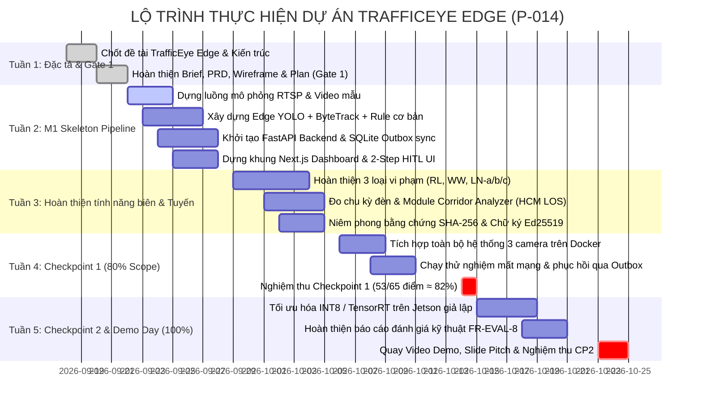

# PHÂN CÔNG NHIỆM VỤ 4 THÀNH VIÊN & LỘ TRÌNH TRIỂN KHAI

**Dự án:** TrafficEye Edge (Hệ thống Camera AI giám sát giao thông tại biên & phân tích tuyến hành lang)  
**Mã đội:** P-014 | **Quy mô:** 4 thành viên  

---

## 1. Phân chia vai trò 4 thành viên (Team Roles & Responsibilities)

| Thành viên | Vai trò phụ trách | Trách nhiệm chính ở Gate 1 (Đặc tả & Thiết kế) | Trách nhiệm ở Giai đoạn Build (Thực thi & Tích hợp) |
|---|---|---|---|
| **Thành viên 1** *(Trưởng nhóm)* | **AI Lead & Edge Pipeline** | - Khảo sát bài toán và chốt đề tài TrafficEye Edge. - Soạn thảo 1-Page Brief, PRD và Đặc tả kỹ thuật hệ thống. - Thiết kế kiến trúc Pipeline AI tại biên (YOLO + ByteTrack + Rule Engine). - Phân bổ Work Packages (WP) cho các thành viên. | - Huấn luyện và tinh chỉnh mô hình YOLO phát hiện 4 loại phương tiện. - Xây dựng bộ theo dõi ByteTrack và đếm xe theo làn. - Phát triển Rule Engine phát hiện 3 loại vi phạm (RL, WW, LN-a/b/c) và đo chu kỳ đèn (`signal_cycle` v1). - Tích hợp module làm mờ quyền riêng tư và niêm phong SHA-256 / Ed25519 tại Edge. |
| **Thành viên 2** | **Backend & Corridor Engineer** | - Thiết kế lược đồ cơ sở dữ liệu PostgreSQL (lưu lượng, sự kiện vi phạm, audit logs). - Đặc tả hợp đồng API RESTful giữa Edge Camera và Central Server. - Nghiên cứu công thức tính toán độ trễ và mức độ phục vụ (LOS A–F) theo chuẩn HCM 2010. | - Xây dựng Central Backend bằng FastAPI và SQLAlchemy. - Lập trình Worker tiếp nhận và đồng bộ dữ liệu từ SQLite Outbox. - Phát triển module Corridor Analyzer: phân tích liên nút giao 3 camera, phát hiện tràn hàng chờ (spillback) và điểm nghẽn (bottleneck). - Xây dựng AI Reporting Agent tự động soạn thảo báo cáo ca trực. |
| **Thành viên 3** | **Frontend & UI/UX Engineer** | - Thiết kế sơ đồ điều hướng UI Flow và khung Wireframe cho hệ thống. - Thiết kế màn hình Dashboard giám sát tuyến hành lang 3 camera. - Thiết kế giao diện luồng thẩm định vi phạm 2 bước (Operator & CSGT) và Cổng xác minh công khai. | - Xây dựng ứng dụng web Central Frontend bằng Next.js, TailwindCSS và TypeScript. - Phát triển Live Traffic & Corridor Dashboard (hiển thị bản đồ, biểu đồ LOS A–F thời gian thực). - Lập trình màn hình duyệt Bước 1 (Operator - che biển số) và màn hình thẩm định Bước 2 (CSGT - rõ biển số). - Xây dựng Cổng xác minh công khai cho công dân tra cứu đối soát mã băm SHA-256. |
| **Thành viên 4** | **QA, Evaluation & DevOps** | - Nghiên cứu tài liệu hướng dẫn và xây dựng Giao thức kiểm thử (Evaluation Protocol). - Chuẩn bị kịch bản quay video mẫu tại hiện trường thực tế (3 camera trên 1 trục đường). - Thiết lập môi trường Docker Compose và Git repository. | - Đóng gói toàn bộ hệ thống bằng Docker Compose (Edge Simulator + Backend + PostgreSQL + Frontend). - Xây dựng công cụ kiểm thử tự động FR-EVAL-8 đối soát kết quả với nhãn thực tế (Ground-truth). - Thực hiện đo đếm benchmark hiệu năng (FPS, FP16, INT8) trên phần cứng mục tiêu. - Tổng hợp báo cáo đánh giá kỹ thuật (Deliverable #10: Evaluation Report). |

---

## 2. Kế hoạch làm việc nhóm 5 tuần (Gantt Chart)

---

## 3. Bảng phân chia 56 Work Packages (WP-01 đến WP-56)

Hệ thống được chia thành 56 gói công việc (Work Packages) cụ thể cho 4 thành viên theo `timeline.md`:
* **Thành viên 1 (14 WPs):** Phụ trách toàn bộ pipeline thị giác máy tính tại biên, mô hình YOLO, thuật toán ByteTrack, Rule Engine phát hiện vi phạm (RL, WW, LN-a/b/c) và module bảo mật niêm phong SHA-256/Ed25519.
* **Thành viên 2 (14 WPs):** Phụ trách Central Backend (FastAPI, PostgreSQL), cơ chế đồng bộ Outbox, thuật toán Corridor Analyzer (độ trễ HCM, v/c, LOS, spillback/bottleneck) và AI Reporting Agent.
* **Thành viên 3 (14 WPs):** Phụ trách toàn bộ giao diện Next.js, bao gồm Live Traffic Dashboard, màn hình Tuyến 3 nút giao, luồng duyệt 2 bước (Operator & CSGT) và Cổng xác minh công khai.
* **Thành viên 4 (14 WPs):** Phụ trách hạ tầng Docker Compose, bộ dữ liệu video mẫu (3 camera đồng bộ `time.is`), công cụ đánh giá tự động FR-EVAL-8, benchmark hiệu năng và hồ sơ bàn giao.

---

## 4. Checklist hoàn thành Gate 1
- [x] **AI Log Setup:** Ghi nhận tự động prompt vào `.ai-log/session.jsonl`.
- [x] **1-Page Brief:** File `docs/gate1/1-page-brief.md` đầy đủ thông tin đề tài TrafficEye Edge.
- [x] **PRD:** File `docs/gate1/prd.md` chi tiết các phân hệ, yêu cầu chức năng FR và phi chức năng NFR.
- [x] **Wireframe & UI Flow:** File `docs/gate1/wireframe-ui-flow.md` trực quan hóa toàn bộ luồng hoạt động và giao diện.
- [x] **Phân công nhiệm vụ & Lộ trình:** File `docs/gate1/team-roles-and-plan.md` rõ ràng cho cả 4 thành viên.
