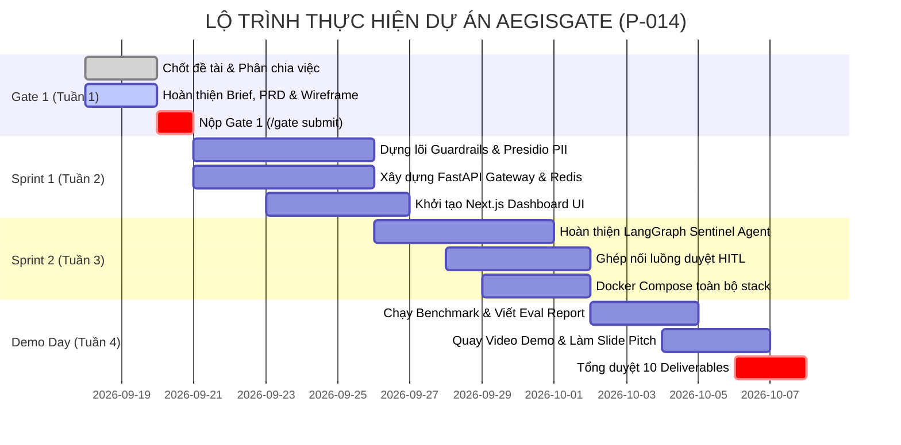

# PHÂN CÔNG NHIỆM VỤ 4 THÀNH VIÊN & LỘ TRÌNH TRIỂN KHAI

**Dự án:** AegisGate (AI Security Gateway & Sentinel Agent)  
**Mã đội:** P-014 | **Quy mô:** 4 thành viên  

---

## 1. Phân chia vai trò 4 thành viên (Team Roles & Responsibilities)

| Thành viên | Vai trò phụ trách | Trách nhiệm chính ở Gate 1 (Hiện tại) | Trách nhiệm ở Giai đoạn Build (Sau Gate 1) |
|---|---|---|---|
| **Thành viên 1** *(Trưởng nhóm)* | **AI Lead & System Architect** | - Khảo sát bài toán và chốt đề tài với cả nhóm. - Viết 1-Page Brief & PRD. - Cấu hình repo & AI Log Hook. - Phân chia nhiệm vụ cho cả nhóm. | - Thiết kế và lập trình LangGraph StateGraph (Sentinel Agent). - Tích hợp Microsoft Presidio & Guardrail nodes. - Xây dựng logic phân loại Severity và tự sinh Rule. |
| **Thành viên 2** | **Backend & Security Engineer** | - Tìm hiểu kiến trúc FastAPI trong template. - Nghiên cứu thư viện Microsoft Presidio & cơ chế caching Redis. - Phối hợp chốt đặc tả API trong PRD. | - Lập trình API Gateway routes (`/chat`, `/incidents`, `/rules`). - Tích hợp Redis Rate Limiting và PostgreSQL database. - Quản lý cơ chế xác thực RBAC cho 2 vai trò. |
| **Thành viên 3** | **Frontend & UI/UX Engineer** | - Đóng góp ý kiến về luồng trải nghiệm (UI Flow). - Lên khung Wireframe cho Dashboard & Modal HITL. - Chuẩn bị boilerplate Next.js + TailwindCSS. | - Xây dựng SecOps Dashboard giám sát thời gian thực. - Xây dựng Modal duyệt sự cố HITL (Phê duyệt chặn/rule). - Xây dựng màn hình Gateway Test Playground để demo. |
| **Thành viên 4** | **QA, Evaluation & DevOps** | - Nghiên cứu chương 8 & 9 trong Technical Guidebook. - Chuẩn bị danh sách bộ dữ liệu mẫu (Prompt Injection & PII test cases). - Khởi tạo file WORKLOG.md và JOURNAL.md. | - Đóng gói hệ thống bằng Docker Compose (Backend + DB + Redis + UI). - Viết unit test & integration test tự động. - Chạy bài test đánh giá hiệu quả phát hiện rủi ro (Deliverable #10: Evaluation Report). |

---

## 2. Kế hoạch làm việc nhóm từ Gate 1 đến Demo Day

---

## 3. Checklist chuẩn bị để nộp Gate 1 ngay hôm nay
- [x] **AI Log Setup:** Đã cài đặt và kiểm tra ghi nhận prompt tự động vào `.ai-log/session.jsonl`.
- [x] **1-Page Brief:** File `docs/gate1/1-page-brief.md` đã sẵn sàng.
- [x] **PRD:** File `docs/gate1/prd.md` đã sẵn sàng.
- [x] **Wireframe / UI Flow:** File `docs/gate1/wireframe-ui-flow.md` đã sẵn sàng.
- [x] **Bảng phân công nhiệm vụ:** File `docs/gate1/team-roles-and-plan.md` đã sẵn sàng.
- [ ] **Họp nhóm (30 phút):** Trưởng nhóm chia sẻ tài liệu này cho 3 thành viên, giải thích nhanh vai trò và cùng bấm `/gate submit`.
