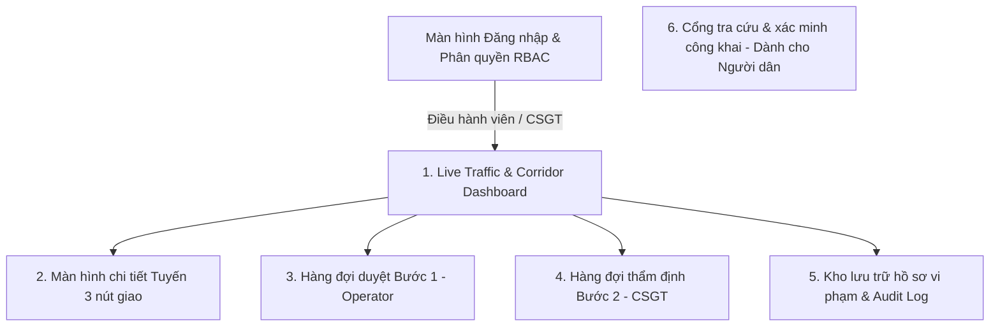

# WIREFRAME & UI FLOW SPECIFICATION — TRAFFICEYE EDGE

**Dự án:** TrafficEye Edge (Hệ thống Camera AI giám sát giao thông tại biên & phân tích tuyến hành lang)  
**Mã đội:** P-014 | **Giai đoạn:** Gate 1  

---

## 1. Kiến trúc luồng hệ thống (System & UI Sequence Diagram)

```mermaid
sequenceDiagram
    autonumber
    actor Cam as Camera (RTSP 1080p)
    participant Edge as Edge Node (YOLO + ByteTrack + Rule Engine)
    participant Outbox as SQLite Outbox (Tại biên)
    participant BE as Central Backend (FastAPI + PostgreSQL)
    actor Op as Điều hành viên (Operator - Bước 1)
    actor CSGT as Cán bộ CSGT (Bước 2)
    actor Public as Người dân (Cổng Dịch vụ công)

    Cam->>Edge: Luồng video RTSP (15-20 FPS)
    Edge->>Edge: Phát hiện xe, đếm theo làn, đo chu kỳ đèn
    Edge->>Edge: Phát hiện vi phạm (Vượt đèn đỏ / Ngược chiều / Sai làn)
    Edge->>Edge: Che mặt & biển số xung quanh; băm SHA-256 & ký số Ed25519
    Edge->>Outbox: Ghi sự kiện + gói bằng chứng vào SQLite Outbox
    Outbox->>BE: Gửi HTTPS REST (Sự kiện vi phạm + signal_cycle v1)
    
    Note over BE: Phân tích hành lang 3 nút giao (Độ trễ HCM, v/c, LOS A-F)
    
    BE->>Op: Đẩy vào Hàng đợi duyệt Bước 1 (Bản che biển số)
    Op->>BE: [Duyệt Bước 1] Xác nhận có hành vi vi phạm
    
    BE->>CSGT: Chuyển sang Hàng đợi thẩm định Bước 2 (Bản rõ biển số)
    CSGT->>BE: [Thẩm định Bước 2] Ký số phê duyệt & ban hành quyết định phạt
    
    Note over Public,BE: TRA CỨU CÔNG KHAI
    Public->>BE: Nhập mã vụ việc / Biển số xe tra cứu
    BE->>Public: Hiển thị clip bằng chứng + Kết quả đối soát mã băm SHA-256 (100% khớp)
```

---

## 2. Sơ đồ điều hướng giao diện (UI Site Map)



---

## 3. Bản phác thảo giao diện (Wireframe Mockups)

### 3.1. Màn hình 1: Live Traffic & Corridor Dashboard
> Bảng điều khiển trung tâm giúp Điều hành viên giám sát tình trạng giao thông thời gian thực trên trục hành lang 3 nút giao.

```text
+----------------------------------------------------------------------------------------------------+
|  [🚦 TrafficEye Edge]   Bản đồ tuyến     Duyệt Bước 1 (5)     Thẩm định Bước 2 (2)     [Operator v] |
+----------------------------------------------------------------------------------------------------+
|                                                                                                    |
|  [⚠️ CẢNH BÁO TUYẾN: Phát hiện tràn hàng chờ (Spillback) từ Nút B về Nút A - Chiều: Bắc -> Nam]      |
|                                                                                                    |
|  +--------------------+  +--------------------+  +--------------------+  +---------------------+   |
|  | NÚT A (NGUYỄN TRÃI)|  | NÚT B (KHUẤT DUY T)|  | NÚT C (HÀ ĐÔNG)    |  | MỨC PHỤC VỤ TUYẾN   |   |
|  | Lưu lượng: 1,840 v/h|  | Lưu lượng: 2,450 v/h|  | Lưu lượng: 1,620 v/h|  | LOS: D (Chậm trễ)   |   |
|  | LOS: C (v/c = 0.72)|  | LOS: E (v/c = 0.94)|  | LOS: B (v/c = 0.58)|  | Độ trễ tb: 48.2s/xe |   |
|  +--------------------+  +--------------------+  +--------------------+  +---------------------+   |
|                                                                                                    |
|  +-------------------------------------------------+  +-----------------------------------------+  |
|  | SƠ ĐỒ BẢN ĐỒ TUYẾN HÀNH LANG 3 NÚT GIAO         |  | BIỂU ĐỒ ĐO CHU KỲ ĐÈN & LƯU LƯỢNG        |  |
|  |                                                 |  |  ^ v/c ratio                            |  |
|  |  [CAM-01: Nút A] -----> [CAM-02: Nút B] ------> |  | 1.0|          _/\_  (Nút B kẹt)         |  |
|  |     (LOS C)                (LOS E: Nút nghẽn)   |  | 0.8|    _/\__/    \__ (Nút A)           |  |
|  |                              |                  |  | 0.5| __/              \__ (Nút C)       |  |
|  |                              v                  |  |    +-------------------------> chu kỳ   |  |
|  |                       [CAM-03: Nút C] (LOS B)   |  | Chu kỳ hiện tại: C = 85s (Đỏ: 45s, Xanh:35s)|
|  +-------------------------------------------------+  +-----------------------------------------+  |
|                                                                                                    |
|  DANH SÁCH ỨNG VIÊN VI PHẠM MỚI NHẤT TẠI CÁC NÚT GIAO                                               |
|  +--------------+-------------+--------------------+--------------+-------------------+------------+ |
|  | Thời gian    | Vị trí      | Loại vi phạm       | Phương tiện  | Trạng thái        | Thao tác   | |
|  +--------------+-------------+--------------------+--------------+-------------------+------------+ |
|  | 08:15:22     | Nút B - Làn 1| Vượt đèn đỏ (RL)   | Ô tô con     | Chờ duyệt Bước 1  | [Xem xét]  | |
|  | 08:14:05     | Nút A - Làn 3| Đi ngược chiều (WW)| Xe máy       | Chờ duyệt Bước 1  | [Xem xét]  | |
|  | 08:10:48     | Nút B - Làn 2| Đè vạch liền (LN-b)| Xe tải nhẹ   | Đã chuyển CSGT    | [Chi tiết] | |
|  +--------------+-------------+--------------------+--------------+-------------------+------------+ |
+----------------------------------------------------------------------------------------------------+
```

---

### 3.2. Màn hình 2: Màn hình duyệt Bước 1 (Dành cho Điều hành viên - Operator)
> Bản bằng chứng đã được AI tự động che khuôn mặt và che biển số xe để bảo vệ quyền riêng tư. Điều hành viên chỉ đánh giá hành vi khách quan.

```text
+----------------------------------------------------------------------------------------------------+
|  HỒ SƠ VI PHẠM BƯỚC 1: SƠ DUYỆT HÀNH VI                            [Mã sự cố: #VIO-2026-0922-0042] |
+----------------------------------------------------------------------------------------------------+
|  Thời gian: 2026-09-22 08:15:22 | Camera: CAM-02-NUT-B (Làn 1) | Loại vi phạm: VƯỢT ĐÈN ĐỎ (RL)     |
|                                                                                                    |
|  CLIP / HÌNH ẢNH BẰNG CHỨNG (BẢN ĐÃ CHE BIỂN SỐ & MẶT):                                            |
|  +-------------------------------------------------------+  +------------------------------------+ |
|  | [ VIDEO TRÍCH XUẤT 4 GIÂY ]                           |  | THÔNG SỐ TẤT ĐỊNH TỪ AI EDGE:      | |
|  |                                                       |  | - Thời điểm đèn đỏ bật: 08:15:19.2 | |
|  |    +-----------------------------+                    |  | - Thời điểm xe vượt vạch: 08:15:22 | |
|  |    | [ĐÈN ĐỎ: 4.8s]              |                    |  | - Vượt sau đèn đỏ: +2.8s (> 0.5s)  | |
|  |    |                             |                    |  | - Vận tốc qua vạch: 38 km/h        | |
|  |    |  [Xe vi phạm: BIỂN SỐ ĐÃ CHE]|                    |  | - Tâm xe vượt vạch: THỎA MÃN       | |
|  |    |  (Khuôn mặt tài xế đã che)  |                    |  | - Mã băm SHA-256: 7f83b165...a1e  | |
|  |    |  -------------------------- | (Vạch dừng ảo)     |  +------------------------------------+ |
|  |    +-----------------------------+                    |                                         |
|  +-------------------------------------------------------+  LÝ DO LOẠI BỎ (NẾU BÁC BỎ):           |
|                                                             [ Chọn lý do: Xe ưu tiên / Cứu hỏa v ]|
|                                                                                                    |
|  [  X  LOẠI BỎ (KHÔNG VI PHẠM)  ]                           [  ✓  XÁC NHẬN CÓ VI PHẠM (CHUYỂN CSGT) ]|
+----------------------------------------------------------------------------------------------------+
```

---

### 3.3. Màn hình 3: Màn hình thẩm định Bước 2 (Dành cho Cán bộ CSGT)
> Cán bộ CSGT có thẩm quyền pháp lý được xem bản rõ biển số xe vi phạm, thẩm định kỹ thuật và ký số ban hành quyết định phạt nguội.

```text
+----------------------------------------------------------------------------------------------------+
|  HỒ SƠ VI PHẠM BƯỚC 2: THẨM ĐỊNH PHÁP LÝ & PHẠT NGUỘI               [Hồ sơ: #CSGT-2026-0922-0042] |
+----------------------------------------------------------------------------------------------------+
|  BIỂN SỐ NHẬN DIỆN: [ 29A-888.99 ] (Độ tin cậy OCR: 98.6%) | Loại xe: Ô tô con (Toyota Vios Đen)  |
|  Người duyệt Bước 1: Operator_03 (Xác nhận lúc 08:17:01)    | Trạng thái: Chờ CSGT thẩm định      |
|                                                                                                    |
|  BẰNG CHỨNG PHÁP LÝ (BẢN RÕ NÉT DÀNH RIÊNG CHO CSGT):                                              |
|  +-------------------------------------------------------+  +------------------------------------+ |
|  | [ HÌNH ẢNH RÕ BIỂN SỐ XE VI PHẠM ]                    |  | ĐIỀU KHOẢN XỬ PHẠT DỰ KIẾN:        | |
|  |                                                       |  | - Hành vi: Vượt đèn đỏ tại ngã tư  | |
|  |    [ 29A - 888.99 ]                                   |  | - Căn cứ: Điểm a Khoản 5 Điều 5    | |
|  |    (Biển số xe vi phạm hiển thị rõ nét)               |  |   Nghị định 100/2019/NĐ-CP (sửa đổi| |
|  |    (Các xe xung quanh vẫn được làm mờ bảo mật)        |  |   bổ sung NĐ 123/2021/NĐ-CP).      | |
|  |                                                       |  | - Mức phạt: 4.000.000 - 6.000.000đ | |
|  |    Toàn vẹn dữ liệu: [✓ SHA-256 VERIFIED]             |  | - Tước GPLX: 01 - 03 tháng         | |
|  +-------------------------------------------------------+  +------------------------------------+ |
|                                                                                                    |
|  [  TỪ CHỐI DUYỆT (GHI RÕ LÝ DO)  ]                          [  🖋️  KÝ SỐ & BAN HÀNH PHẠT NGUỘI  ] |
+----------------------------------------------------------------------------------------------------+
```

---

### 3.4. Màn hình 4: Cổng tra cứu & Xác minh công khai (Public Verification Portal)
> Dành cho người dân tra cứu trực tuyến, đối soát công khai mã băm SHA-256 và chữ ký số để bảo đảm bằng chứng không bị cắt ghép, làm giả.

```text
+----------------------------------------------------------------------------------------------------+
|  CỔNG THÔNG TIN DỊCH VỤ CÔNG — TRA CỨU PHẠT NGUỘI GIAO THÔNG                                      |
+----------------------------------------------------------------------------------------------------+
|                                                                                                    |
|  NHẬP THÔNG TIN TRA CỨU:                                                                           |
|  Biển số xe: [ 29A-888.99         ]    Mã vụ việc: [ VIO-2026-0922-0042 ]    [  TRA CỨU NGAY  ]    |
|                                                                                                    |
|  ================================================================================================  |
|  KẾT QUẢ TRA CỨU VỤ VIỆC #VIO-2026-0922-0042:                                                      |
|  - Phương tiện: 29A-888.99 | Thời gian: 08:15:22 22/09/2026 | Địa điểm: Nút giao B (Nguyễn Trãi)   |
|  - Lỗi vi phạm: Điều khiển phương tiện không chấp hành hiệu lệnh của đèn tín hiệu giao thông.     |
|                                                                                                    |
|  XÁC THỰC TÍNH TOÀN VẸN CỦA VIDEO BẰNG CHỨNG (DATA INTEGRITY):                                     |
|  +----------------------------------------------------------------------------------------------+  |
|  | Mã băm gốc tại Camera Biên (SHA-256):  7f83b1657ff1fc53b92dc18148a1d65dfc2d4b1fa3d677284addd... |  |
|  | Mã băm tính toán lại trên Web Server: 7f83b1657ff1fc53b92dc18148a1d65dfc2d4b1fa3d677284addd... |  |
|  | TRẠNG THÁI: [ ✓ 100% TRÙNG KHỚP - BẰNG CHỨNG NGUYÊN BẢN, KHÔNG BỊ CHỈNH SỬA ]                 |  |
|  | Chữ ký số biên Ed25519: [ ✓ HỢP LỆ - CẤP BỞI THIẾT BỊ CAMERA BIÊN CAM-02-NUT-B ]             |  |
|  +----------------------------------------------------------------------------------------------+  |
|                                                                                                    |
|  [  XEM CLIP BẰNG CHỨNG VI PHẠM  ]                           [  TẢI FILE BIÊN BẢN ĐÃ KÝ SỐ (.PDF)  ]|
+----------------------------------------------------------------------------------------------------+
```
