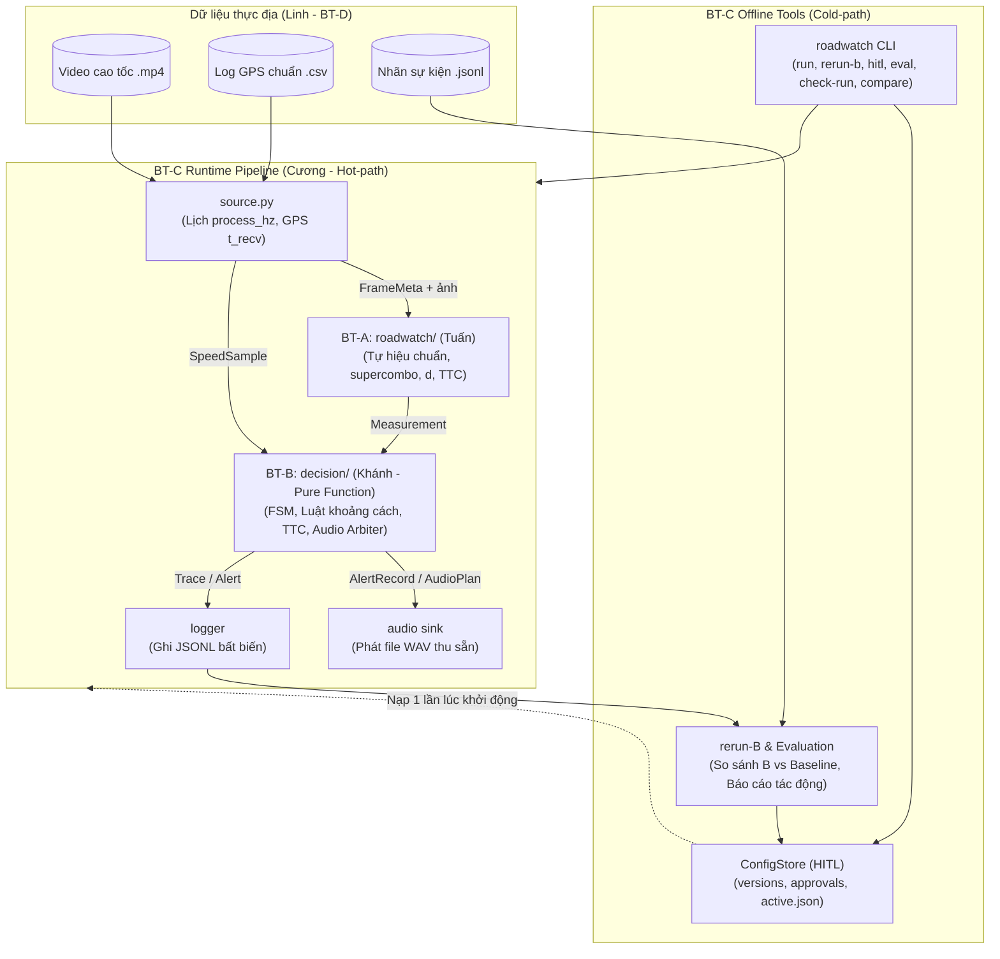

# TỔNG QUAN BÀI TOÁN C (BT-C) — BẢN ĐỒ KIẾN TRÚC & ĐIỀU PHỐI DÀNH CHO LEAD

> **Dành cho:** Cương (PO / Team Lead & Phụ trách Nền tảng BT-C)  
> **Cập nhật:** 01/10/2026 (Ngày N2 trên lịch nén N0…N5, chuẩn bị nộp MVP 04/10/2026)  
> **Mục tiêu:** Cung cấp góc nhìn toàn cảnh về bản chất BT-C, 5 module mã nguồn cốt lõi, mạng lưới quan hệ/ràng buộc với BT-A, BT-B, BT-D, hiện trạng thực tế và các hành động điều phối đường găng của Lead.

---

## 1. Bản chất cốt lõi: Bài toán C là gì trong RoadWatch Copilot?

Nếu hình dung hệ thống **RoadWatch Copilot** là một phương tiện ADAS hoàn chỉnh:
* **BT-A (Tuấn — Thị giác máy):** Là **"Đôi mắt"** — nhìn camera, bắt xe dẫn đầu, đo khoảng cách $d$ và tính toán thời gian va chạm $TTC$.
* **BT-B (Khánh — Luật ra quyết định):** Là **"Bộ não"** — phân tích độ nguy hiểm, kiểm soát máy trạng thái cảnh báo, quản lý các đợt nhắc và chọn câu tiếng Việt phát ra loa.
* **BT-C (Cương — Nền tảng & Điều phối):** Là **"Khung gầm, Hệ thần kinh & Hộp đen bảo vệ toàn diện"**.

Cụ thể, BT-C giải quyết 5 trụ cột kỹ thuật trọng yếu của toàn bộ hệ thống:

```
┌─────────────────────────────────────────────────────────────────────────────┐
│                             5 TRỤ CỘT CỦA BT-C                              │
├─────────────────────────────────────────────────────────────────────────────┤
│ 1. Hợp đồng dữ liệu (Contracts): Định nghĩa ngôn ngữ chung Pydantic.        │
│ 2. Kho cấu hình an toàn (ConfigStore & HITL): Kiểm soát 4 mắt, bất biến.     │
│ 3. Nhạc trưởng thời gian thực (Runtime Pipeline): Đa luồng, FPS, drop frame.│
│ 4. Hộp đen & Máy gia tốc (Replay & rerun-B): Tái lập 100%, test offline.   │
│ 5. Giao diện dòng lệnh hợp nhất (CLI): Điểm chạm duy nhất cho nhóm & demo.  │
└─────────────────────────────────────────────────────────────────────────────┘
```

1. **Hợp đồng dữ liệu (`contracts/`):** Định nghĩa cấu trúc dữ liệu Pydantic chuẩn (`Measurement`, `SpeedSample`, `JoinedInput`, `AlertRecord`, `AppConfig`...). Thiếu C, A trả về một kiểu dữ liệu, B lại đợi một kiểu khác $\rightarrow$ toàn bộ hệ thống vỡ vụn.
2. **Quản lý cấu hình có người duyệt (`configstore.py` — HITL):** Đặc tính an toàn bắt buộc của ADAS. Không ai được tự tiện sửa tham số đang chạy trên xe. Mọi thay đổi đều phải đi qua 4 bước: *Đề xuất $\rightarrow$ Chạy thử đo tác động $\rightarrow$ Người khác duyệt (nguyên tắc 4 mắt) $\rightarrow$ Kích hoạt nguyên tử*.
3. **Bộ điều phối thời gian thực (`runtime.py`, `source.py`):** Cầm trịch các luồng (thread) chạy song song trên CPU laptop (giới hạn 4 threads): đọc video/GPS (`source`), gọi thị giác máy (`perception`), gọi suy luận cảnh báo (`decision`), phát loa (`audio sink`) và ghi nhật ký (`logger`).
4. **Hộp đen & Tái lập (`rerun.py`, `evaluate.py`):** Ghi lại toàn bộ đầu vào (`decision_inputs.jsonl`). Nhờ B là hàm thuần (pure function), C cung cấp công cụ `rerun-B` chạy lại hàng ngàn khung hình trong vài giây để thử nghiệm thuật toán/ngưỡng mới mà không cần chạy lại AI nhận diện hình ảnh của A.
5. **Giao diện dòng lệnh thống nhất (`cli.py`):** Điểm chạm duy nhất cho toàn bộ nhóm và ban giám khảo (`roadwatch run`, `rerun-b`, `eval`, `hitl`, `perf`, `schema`, `check-run`, `compare`).

---

## 2. Năm module cốt lõi của BT-C trong mã nguồn

Mã nguồn của BT-C tập trung tại `src/roadwatch/`:

| Module | File code chính | Chức năng cụ thể | Trạng thái hiện tại |
|---|---|---|---|
| **1. Contracts** | [contracts/](file:///c:/Users/cuong/OneDrive/Documents/PH%C3%81T%20TRI%E1%BB%82N%20B%E1%BA%A2N%20TH%C3%82N/PROJECT__CODE/PJVinAIGr14/P-014/src/roadwatch/contracts/) (`base.py`, `config.py`, `streams.py`) | Định nghĩa Pydantic model cho mọi bản ghi; kiểm tra liên luồng D-7 (`check_links`, `check_streams`); xuất JSON Schema chuẩn. | **Đã xong v0.2.0**, 14 fixture JSONL (2 hợp lệ, 12 sai chuẩn). Chờ review (WP-C3). |
| **2. ConfigStore & HITL** | [configstore.py](file:///c:/Users/cuong/OneDrive/Documents/PH%C3%81T%20TRI%E1%BB%82N%20B%E1%BA%A2N%20TH%C3%82N/PROJECT__CODE/PJVinAIGr14/P-014/src/roadwatch/configstore.py) | Quản lý kho cấu hình: đề xuất (`proposals/`), phiên bản bất biến gắn hash (`versions/<sha>.yaml`), biên bản phê duyệt (`approvals/<id>.json`), cập nhật con trỏ `active.json` nguyên tử bằng `os.replace`. | **Đã xong lõi**, chặn tự duyệt, CAS, khôi phục crash, hỗ trợ cờ `--proposed`. |
| **3. Runtime Pipeline** | [runtime.py](file:///c:/Users/cuong/OneDrive/Documents/PH%C3%81T%20TRI%E1%BB%82N%20B%E1%BA%A2N%20TH%C3%82N/PROJECT__CODE/PJVinAIGr14/P-014/src/roadwatch/runtime.py), [source.py](file:///c:/Users/cuong/OneDrive/Documents/PH%C3%81T%20TRI%E1%BB%82N%20B%E1%BA%A2N%20TH%C3%82N/PROJECT__CODE/PJVinAIGr14/P-014/src/roadwatch/source.py), [live.py](file:///c:/Users/cuong/OneDrive/Documents/PH%C3%81T%20TRI%E1%BB%82N%20B%E1%BA%A2N%20TH%C3%82N/PROJECT__CODE/PJVinAIGr14/P-014/src/roadwatch/live.py) | Vòng đời chạy live/replay: Nạp cấu hình đóng băng 1 lần lúc boot $\rightarrow$ Thread Pool + Queues kết nối `source` $\rightarrow$ `perception` $\rightarrow$ `decision` $\rightarrow$ `audio sink` & `logger`. Ghi `run_stats.json`. | **Đã xong khung**, chạy mượt với mock và video tổng hợp; sẵn sàng ghép model thật. |
| **4. Replay & Evaluation** | [rerun.py](file:///c:/Users/cuong/OneDrive/Documents/PH%C3%81T%20TRI%E1%BB%82N%20B%E1%BA%A2N%20TH%C3%82N/PROJECT__CODE/PJVinAIGr14/P-014/src/roadwatch/rerun.py), [evaluate.py](file:///c:/Users/cuong/OneDrive/Documents/PH%C3%81T%20TRI%E1%BB%82N%20B%E1%BA%A2N%20TH%C3%82N/PROJECT__CODE/PJVinAIGr14/P-014/src/roadwatch/evaluate.py) | Đọc log `decision_inputs.jsonl`, bơm lại vào module Decision (BT-B) để so sánh B với baseline, đo độ trễ `L_alert`, đếm số cảnh báo thừa/thiếu, sinh báo cáo tác động. | **Đã xong lõi**, hỗ trợ cờ xác minh `--verify`, chặn rò rỉ dữ liệu `test_*`. |
| **5. CLI Unified** | [cli.py](file:///c:/Users/cuong/OneDrive/Documents/PH%C3%81T%20TRI%E1%BB%82N%20B%E1%BA%A2N%20TH%C3%82N/PROJECT__CODE/PJVinAIGr14/P-014/src/roadwatch/cli.py) | Giao diện dòng lệnh hợp nhất: `run`, `rerun-b`, `eval`, `hitl` (8 lệnh con), `perf`, `schema`, `check-run`, `compare`. | **Đã xong 100%** (WP-C2), 2/2 test CLI xanh, bảo vệ an toàn cho D-8 và D-11. |

---

## 3. Sơ đồ tương tác và các ràng buộc kiến trúc với BT-A, BT-B, BT-D

BT-C đóng vai trò trung tâm điều phối toàn bộ các luồng thông tin giữa các bài toán con:



### 3.1. Ràng buộc với BT-A (Tuấn — Thị giác máy & Backend)
1. **Ranh giới Hợp đồng:** BT-A chỉ được xuất dữ liệu đúng cấu trúc `Measurement` do BT-C quy định trong `contracts/streams.py`. A hoàn toàn không biết tốc độ GPS của xe, không biết luật cảnh báo và không biết các ngưỡng an toàn.
2. **Cách ly tuyệt đối (Decoupling):** **A và B tuyệt đối không được import lẫn nhau**. Chỉ có `runtime.py` của BT-C được phép import A và import B để kết nối đường ống dữ liệu.
3. **Môi trường thực thi:** Luồng `perception` trong Runtime của C sẽ bọc model ONNX của Tuấn. C khống chế cấu hình `intra_op_num_threads = 4`, `inter_op_num_threads = 1` và áp dụng chính sách bỏ khung hình (drop frame policy) khi camera phát nhanh hơn tốc độ xử lý của mô hình, đảm bảo hệ thống không bao giờ bị tràn RAM hay lag tích lũy.

### 3.2. Ràng buộc với BT-B (Khánh — Luật ra quyết định & Âm thanh)
1. **Tính chất Hàm thuần tuyệt đối (Pure Function Determinism):**
   * Toàn bộ module `decision/` của BT-B là hàm thuần: cùng đầu vào dữ liệu + cùng cấu hình $\rightarrow$ **100% cho ra cùng một chuỗi cảnh báo**.
   * B **không được phép** gọi `time.time()`, không đọc giờ hệ thống, không đọc file, không mạng. Mọi thông tin B cần phải do C đóng gói vào `JoinedInput` và nhịp `tick` (tính từ PTS video hoặc đồng hồ phiên).
   * **Lợi ích chiến lược:** Nhờ C giữ B là hàm thuần, C mới viết được công cụ `rerun-B` chạy offline cực nhanh. Khi Khánh muốn tinh chỉnh ngưỡng cảnh báo, chỉ cần chạy lại file log đầu vào trong 5 giây thay vì mất 30 phút chạy lại AI nhận diện hình ảnh.
2. **Kiểm tra liên luồng (D-7):** C chịu trách nhiệm kiểm tra tính toàn vẹn: mỗi cảnh báo mà B phát ra phải có đúng một trace suy luận, và mỗi lệnh âm thanh (`AudioPlan`) phải trỏ đúng một `alert_id` hợp lệ.

### 3.3. Ràng buộc với BT-D (Linh — Dữ liệu thực địa & Đánh giá)
1. **Cổng tiếp nhận dữ liệu:** C nạp video và file GPS của Linh qua module `source.py` (sau khi Tuấn chuyển đổi định dạng GPS sang CSV chuẩn theo WP-A12).
2. **Bảo vệ tập kiểm thử, chống rò rỉ dữ liệu (D-11):**
   * C cài đặt guardrail chặn cứng trong CLI: khi kỹ sư chạy thử cấu hình đề xuất (`--proposed`), nếu dữ liệu thuộc tập kiểm thử `test_*`, C lập tức từ chối chạy.
   * Quy tắc này bảo đảm tập `test_small` của Linh chỉ được chạy đúng 1 lần duy nhất lúc nghiệm thu, tránh tuyệt đối hiện tượng "học vẹt trên tập test" (over-fitting/data leakage).
3. **Bộ công cụ nghiệm thu:** C cung cấp các lệnh `check-run` (kiểm tra lần chạy có bị mất khung hay lỗi luồng không) và `compare` (so sánh 2 lần chạy để chứng minh tính tái lập 100% cho AC-M1, AC-M10).

### 3.4. Ràng buộc an toàn toàn hệ thống (ADAS Safety & Architecture Guardrails)
1. **Tách biệt đường nóng và đường nguội (Hot-path Decoupling):** Runtime chạy trên đường nóng không phụ thuộc vào SQLite hay Web UI. SQLite chỉ dùng cho CLI HITL (đường nguội) để lưu vết lịch sử kiểm toán (audit trail). Runtime chỉ đọc các file tĩnh: `active.json`, `versions/`, `approvals/`.
2. **Đóng băng cấu hình (Frozen Config):** Runtime chỉ nạp `active.json` đúng 1 lần duy nhất lúc bắt đầu phiên chạy và giữ nguyên thông số suốt phiên. Dù kỹ sư có đổi `active.json` bên ngoài thì phiên đang chạy cũng không bị thay đổi đột ngột giữa chừng (loại bỏ hoàn toàn lỗi race condition khi xe đang lăn bánh).
3. **Nguyên tắc 4 mắt trong HITL (Four-Eyes Principle):** Người đề xuất thay đổi cấu hình (`author`) tuyệt đối không được phép tự làm người duyệt (`approver`). Quy trình bắt buộc phải có 2 người khác nhau tham gia.

---

## 4. Bản đồ tài liệu chuẩn cần tra cứu cho BT-C

Khi cần tra cứu sâu vào tài liệu gốc của dự án, Lead sử dụng bảng điều hướng sau:

| Nội dung cần tra cứu | Nguồn chuẩn duy nhất | Điểm cần chú ý |
|---|---|---|
| **Kiến trúc tổng thể, Luồng dữ liệu, Ranh giới** | [docs/specs/roadwatch-architecture.md](file:///c:/Users/cuong/OneDrive/Documents/PH%C3%81T%20TRI%E1%BB%82N%20B%E1%BA%A2N%20TH%C3%82N/PROJECT__CODE/PJVinAIGr14/P-014/docs/specs/roadwatch-architecture.md) | **Mục 2:** Sơ đồ kiến trúc & bảng phân chia trách nhiệm;<br/>**Mục 3.8 & 3.10:** Quy chế log JSONL và kho HITL;<br/>**Mục 4:** Hợp đồng dữ liệu chi tiết;<br/>**Mục 5:** Kiểm chứng, replay và đánh giá tác động. |
| **Checklist chi tiết từng task của Cương** | [docs/plan/phan-viec/cuong.md](file:///c:/Users/cuong/OneDrive/Documents/PH%C3%81T%20TRI%E1%BB%82N%20B%E1%BA%A2N%20TH%C3%82N/PROJECT__CODE/PJVinAIGr14/P-014/docs/plan/phan-viec/cuong.md) | Điều kiện xong, cách kiểm chứng và bằng chứng commit của WP-P1…P8, WP-C2, WP-C3. |
| **Bảng tiến độ tổng & phụ thuộc giữa các task** | [docs/plan/README.md](file:///c:/Users/cuong/OneDrive/Documents/PH%C3%81T%20TRI%E1%BB%82N%20B%E1%BA%A2N%20TH%C3%82N/PROJECT__CODE/PJVinAIGr14/P-014/docs/plan/README.md) | Nguồn chuẩn duy nhất cho trạng thái task (⬜, 🟡, ✅, ⛔), đường găng tuần 1 (Mục 2 & Mục 4). |
| **Quy tắc code, ranh giới import, lệnh test/lint** | [docs/development/code-rules.md](file:///c:/Users/cuong/OneDrive/Documents/PH%C3%81T%20TRI%E1%BB%82N%20B%E1%BA%A2N%20TH%C3%82N/PROJECT__CODE/PJVinAIGr14/P-014/docs/development/code-rules.md) | **Mục 3:** Ranh giới module;<br/>**Mục 6:** Quy tắc code `configstore`;<br/>**Mục 8 & 9:** Lệnh test/lint và quy trình đổi schema. |
| **9 Ranh giới không được phá của dự án** | [AGENTS.md](file:///c:/Users/cuong/OneDrive/Documents/PH%C3%81T%20TRI%E1%BB%82N%20B%E1%BA%A2N%20TH%C3%82N/PROJECT__CODE/PJVinAIGr14/P-014/AGENTS.md) | Chỉ cảnh báo; Không LLM/RAG; Hàm thuần đường nóng; Guardrail khẩn cấp; Fail-safe theo năng lực; HITL 4 mắt. |

---

## 5. Hiện trạng thực tế của BT-C (Cập nhật 01/10/2026)

Nhờ triết lý **Contract-First** và kiểm thử bằng **Fixtures/Mocks**, BT-C đã hoàn thành độc lập **85% đến 90%** khối lượng công việc mà không cần chờ code AI của Tuấn hay code FSM của Khánh:

* **Kết quả kiểm thử tự động:**
  * **145 test xanh 100%** (`python -m pytest tests/roadwatch --confcutdir=tests/roadwatch -q` $\rightarrow$ 145 passed in 56s).
  * `ruff check src/ tests/` hoàn toàn sạch sẽ.
  * Không còn test đỏ có chủ đích hay phải dùng cờ bỏ qua (`--ignore`).
* **Sản phẩm cụ thể đã bàn giao:**
  * **WP-C2 (CLI đầy đủ):** Đã có 8 lệnh con của `hitl`, các lệnh `run`, `rerun-b`, `eval`, `perf`, `schema`, thêm `check-run` và `compare`. Hỗ trợ `--proposed` chạy thử an toàn không đổi `active.json` (D-8) và tự động chặn split `test_*` (D-11). Thêm `run_stats.json` phục vụ nghiệm thu AC-M9.
  * **WP-C3 (Fixture & Kiểm tra liên luồng):** Đã có 14 bộ fixture JSONL trong `tests/roadwatch/fixtures/` (2 hợp lệ replay/live, 12 thư mục vi phạm chuẩn F1–F16). Kiểm tra liên luồng D-7 trong `contracts/streams.py` hoạt động chính xác.

---

## 6. Mười lăm phần trăm (15%) còn lại của BT-C để đạt 100%

> *Lưu ý:* Con số 15% là ước lượng kỹ thuật của Cương, thể hiện phần việc phụ thuộc vào sự phối hợp và dữ liệu thật của cả nhóm.

Ba đầu việc cuối cùng để BT-C hoàn tất 100% mục tiêu MVP:

1. **WP-C3 & WP-C2 (Chờ Reviewer nghiệm thu):**
   * WP-C2 chờ Tuấn chạy kiểm chứng tay kịch bản AC-M9 trên máy demo.
   * WP-C3 chờ Khánh review bộ fixture JSONL và xác nhận kiểm tra liên luồng D-7.
2. **WP-P4 (Đóng băng `contracts` v1.0 — Đạt AC-M2):**
   * Xuất JSON Schema ra thư mục `docs/specs/schemas/` (`python -m src.roadwatch.cli schema --out docs/specs/schemas`).
   * Tạo git tag `contracts-v1.0`.
   * *Điều kiện:* Chờ Khánh hoàn thành WP-B9 (xác nhận code BT-B đọc/ghi trơn tru v1.0 mà không sửa đổi).
3. **WP-P8 (Tích hợp đầu–cuối trên máy demo — Đạt AC-M1, AC-M10):**
   * Máy demo đã chốt là **laptop của Khánh** (theo quyết định PO ngày 30/09).
   * Chạy thử `live` và `replay` trên video cao tốc thật kết hợp model ONNX thật của Tuấn và file âm thanh WAV của Khánh.
   * Dùng công cụ `check-run` để xác minh đủ luồng và dùng `compare` để đối chiếu tính tái lập 100%, ghi biên bản gắn mã hash vào báo cáo `eval/results/report.md`.

---

## 7. Kế hoạch hành động & Điều phối của Lead (Hạn nộp 04/10/2026)

Hôm nay là **N2 (01/10/2026)**, dự án đang ở giai đoạn đường găng quyết định. Lead cần tập trung chỉ đạo các mũi nhọn sau:

### Điều phối nhóm:
* **Với Tuấn (BT-A):**
  * Thúc đẩy **WP-A1**: Xuất detector ONNX và đo benchmark tốc độ trên máy demo (khống chế 4 threads CPU $\le 65\text{ ms}$).
  * Thúc đẩy **WP-C1**: Bổ sung `pytest_asyncio` vào môi trường CI để toàn bộ CI của repo xanh đồng loạt.
  * Hỗ trợ Linh thực hiện **WP-A12** (bộ chuyển đổi file GPS sang CSV chuẩn).
  * Nhờ Tuấn review **WP-C2** (CLI).
* **Với Khánh (BT-B):**
  * Thúc đẩy **WP-B1**: Chốt bảng pháp lý và tham số B cho cấu hình khởi tạo v0.
  * Thúc đẩy **WP-B2**: Xuất các file âm thanh cảnh báo tiếng Việt định dạng WAV chuẩn.
  * Nhờ Khánh review **WP-C3** (Fixtures).
* **Với Linh (BT-D):**
  * Chốt ứng dụng GPS (**WP-D2**).
  * Chuẩn bị và tiến hành buổi quay thực địa cao tốc (**WP-D3**) để có video và GPS thật vào ngày N2/N3.

### Nguyên tắc vận hành của Lead:
1. **Đồng bộ GitHub đầu phiên:** Luôn chạy `git fetch origin main`, kiểm tra thay đổi mới nhất trước khi làm việc, chỉ commit và push trên nhánh task riêng (`feat/...`), **tuyệt đối không push trực tiếp vào `main`**.
2. **Cập nhật tiến độ tức thì:** Khi một task đổi trạng thái, cập nhật đồng thời cả 3 nơi trong cùng commit: code $\rightarrow$ checklist trong `phan-viec/cuong.md` $\rightarrow$ dòng trạng thái tổng tại mục 4.3 của [README.md](file:///c:/Users/cuong/OneDrive/Documents/PH%C3%81T%20TRI%E1%BB%82N%20B%E1%BA%A2N%20TH%C3%82N/PROJECT__CODE/PJVinAIGr14/P-014/docs/plan/README.md).
3. **Bảo vệ tiêu chí nghiệm thu:** Giữ vững 9 ranh giới trong [AGENTS.md](file:///c:/Users/cuong/OneDrive/Documents/PH%C3%81T%20TRI%E1%BB%82N%20B%E1%BA%A2N%20TH%C3%82N/PROJECT__CODE/PJVinAIGr14/P-014/AGENTS.md), không thỏa hiệp với việc "bịa số đo thực địa" hay "nới lỏng guardrail".
