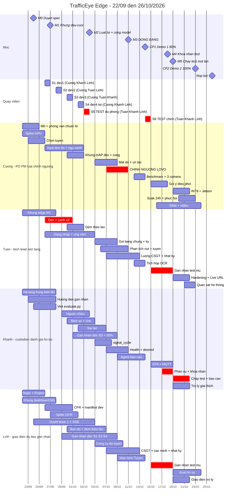

# Kế Hoạch Lộ Trình (Timeline) — TrafficEye Edge
> Nguồn: Tách từ timeline.md (Mục 0, 1, 2, 3, 6, 7, 8, 9) tuân thủ SDLC Bước 5: Implementation Planning.
> Quy tắc quản trị: 150 - 250 dòng.

# Kế hoạch và timeline dự án — TrafficEye Edge

> **Phiên bản:** 3.0 · 22/09/2026 · theo spec v1.0 (`docs/spec/trafficeye-spec.md`) · thay bản 2.0.
> **Thay đổi ở 3.0:**
> - chia lại việc theo người thật (mục 5), gán tên vào mọi WP;
> - thêm tải ước lượng theo tuần, ai phụ thuộc ai, và các điểm dễ nghẽn;
> - lịch quay video có tên người đi quay;
> - chốt phương án (a) của Q11: WP-38 xong ngày 02/10;
> - dời vài hạn để khớp phụ thuộc: WP-18 và WP-19 sang 12/10, WP-56 lên 09/10, WP-46 sang 18/10; WP-23, WP-49 và WP-52 sang tuần 5;
> - spike OCR (WP-37) làm trên bộ biển số công khai, xong 01/10.
>
> Các mốc M0–M7, CP1 và CP2 **không đổi**.
>
> **File này là kế hoạch chung của cả team, và là file duy nhất ghi tên người làm từng việc.** Mỗi người có một file việc riêng ở `docs/plan/phan-viec/` (`cuong.md`, `tuan.md`, `khanh.md`, `linh.md`): file đó chỉ nói việc của người đó, theo thứ tự, kèm các bước làm. Khi file riêng lệch với file này thì theo file này.
> **Kiến trúc** (hệ thống gồm 11 phân hệ nào): `docs/architecture_diagram.md`.
> **Plan chi tiết từng task:** M1 đã có (`2026-09-21-m1-skeleton.md`). Các plan sau viết bằng `/write-plan` khi gần tới mốc.
> **Căn cứ:** spec v1.0, báo cáo 1.0-draft, `docs/eval/protocol.md`, CLAUDE.md mục 10–13.

---

## Thuật ngữ trong file này

| Từ | Nghĩa |
|---|---|
| WP-xx | Gói việc số xx (mục 4). Mỗi WP là một issue trên GitHub Project |
| TASK-0xx | Một bước nhỏ trong plan M1 (`2026-09-21-m1-skeleton.md`), có sẵn code và lệnh kiểm tra |
| PH1…PH11 | 11 phân hệ của hệ thống (`docs/architecture_diagram.md` mục 0). Ai phụ trách phân hệ nào: mục 5.1 |
| M0…M7 | Mốc nội bộ (mục 2) |
| CP1, CP2 | Hai buổi demo với ban tổ chức: CP1 ngày 14/10 (80%), CP2 ngày 23/10 (100%, sẵn sàng production) |
| Spec, FR, AC | Spec quy định hệ thống phải làm gì (`docs/spec/trafficeye-spec.md`). FR-xxx là một yêu cầu; AC là tiêu chí nghiệm thu của yêu cầu đó |
| TV1…TV4 | Mã vai dùng trong protocol và spec: TV1 = Cường, TV2 = Tuấn, TV3 = Linh, TV4 = Khánh |
| S1…S6 | Sáu buổi quay video (mục 5.5): S1–S4 cho tập dev, S5 và S6 cho tập test |
| Tập dev, tập test | Tập dev: video để phát triển và chỉnh ngưỡng. Tập test: video quay sau ngày đóng băng, chỉ dùng để đo một lần |
| Chỉnh ngưỡng, đóng băng | Chỉnh ngưỡng: chọn các con số trong luật trên tập dev, bằng cách leave-one-video-out (lần lượt để riêng một video ra kiểm). Đóng băng (M3, 11/10): khóa luật và ngưỡng |
| Người giữ tập test | Người duy nhất cầm video test, niêm phong và chạy đo (protocol gọi là custodian) |
| Gán nhãn mù, kappa | Gán nhãn mù: ghi lại vi phạm thật mà không xem kết quả hệ thống. Kappa: mức hai người gán nhãn đồng ý với nhau; cần từ 0,8 |
| Precision, Wilson 95% | Precision: trong các cảnh báo, bao nhiêu phần trăm là vi phạm thật. Wilson 95%: khoảng tin cậy đi kèm |
| CFR 15 FPS, manifest | Video chuyển về đúng 15 khung hình mỗi giây. Manifest: file CSV liệt kê video kèm SHA-256 |
| Cổng tinh chỉnh model | Quyết định ngày 04/10: nếu AP50 của xe máy < 0,5 thì huấn luyện thêm YOLO trên dữ liệu Việt Nam |
| Đường găng, vùng đệm | Đường găng: chuỗi việc mà trễ một khâu là trễ cả dự án (mục 6). Vùng đệm: khoảng thời gian dự phòng |
| HCM, LOS, tràn hàng chờ | Phương pháp đánh giá nút giao; LOS là mức phục vụ từ A tới F; tràn hàng chờ là hàng xe nút sau kéo dài tới nút trước |
| Hardening, Live URL, soak test | Làm chắc bảo mật trước production; địa chỉ web công khai cho giám khảo; chạy liền 24 giờ để kiểm độ bền |
| DoD, Change Request | DoD: điều kiện "xong" chung (spec mục 9). Change Request: đề nghị đổi spec sau M0 (spec mục 12) |

---

## 1. Quy trình và nguyên tắc chống làm lại

| Bước | Trạng thái |
|---|---|
| GRILL ME, BRAINSTORM, RESEARCH | Xong |
| DESIGN | Báo cáo 1.0-draft (bản hợp nhất) |
| DESIGN REVIEW | Xong 21/09: 22 phát hiện, PO đã duyệt |
| **SPEC** | Bản v1.0-draft; PO duyệt tại **M0 (24/09)** |
| WRITE PLAN (`/write-plan`) | Plan M1 xong. Plan M2 viết ngay sau M0 (25/09). Plan M3 viết khoảng 02/10. Plan cho CP2 viết khoảng 12/10 |
| IMPLEMENT → TEST → EVALUATE → DOCUMENT | Theo timeline dưới đây |

**Năm nguyên tắc để không phải đập đi xây lại** (chi tiết ở spec mục 0 và 12):
1. Spec và các hợp đồng (cấu hình cảnh, sự kiện, API) được chốt tại M0. Sau đó chỉ đổi qua Change Request.
2. M1 là khung chạy đầu–cuối; mọi tính năng về sau gắn vào khung này.
3. Làm theo lát dọc: mỗi tính năng chạy đủ edge → trung tâm → giao diện ở mức tối thiểu rồi mới làm sâu.
4. **Làm trên dữ liệu mẫu theo hợp đồng trước, không ngồi chờ phụ thuộc xong.** Nhờ vậy 4 người làm song song được.
5. Không bắt đầu việc chưa đạt Definition of Ready. Không đóng việc chưa đạt Definition of Done (spec mục 9).

---

## 2. Các mốc và checkpoint

| Mốc | Ngày | Điều kiện đạt (chi tiết ở spec) | Người chịu trách nhiệm |
|---|---|---|---|
| **M0** — Duyệt spec | Thứ 5, 24/09 | PO duyệt toàn văn spec v1.0, phân vai bản 3.0 (mục 5), Q5 (thời hạn lưu giữ), Q10, Q11 | Cường |
| **M1** — Khung đầu–cuối | CN, 27/09 | TASK-022 của plan M1 đạt | Tuấn |
| **M2** — Luật lõi | CN, 04/10 | Chạy được trên dev: đèn, vượt đèn đỏ, đi ngược chiều. Luật làn đang làm. Đã có: che biển số, đăng nhập, duyệt bước 1, bản đồ. **Quyết định cổng tinh chỉnh model (FR-DET-1)** | Cường |
| **M3** — **ĐÓNG BĂNG** [Đã chốt] | CN, 11/10 | Mọi luật được đánh giá (RL, WW, LN đủ 3 kiểu) và ngưỡng phân tích tuyến đã chỉnh bằng leave-one-video-out và đóng băng | Cường |
| **CP1 — Demo 1 (80%)** | **Thứ 4, 14/10** | Spec mục 8.1 | Cường chủ trì, cả team |
| **M4** — Khóa nhãn test | CN, 18/10 | Nhãn test gán mù, phân xử, khóa | Khánh |
| **M5** — Chạy test một lần | Thứ 2, 19/10 | Log ghi `status: fresh` | Khánh |
| **CP2 — Demo 2 (100%, production)** | **Thứ 6, 23/10** | Spec mục 8.2: checklist production xanh; có báo cáo đánh giá tập test | Cường chủ trì, cả team |
| **M7** — Tổng duyệt cuối, khóa code | CN, 25/10 | Từ đây chỉ sửa lỗi nghiêm trọng | Tuấn |
| **Nộp bài** | Thứ 2, 26/10 | | Cường |

---

## 3. Sơ đồ Gantt theo người



Nhãn trong Gantt viết không dấu, để tránh lỗi hiển thị trên một số trình render Mermaid.

---


## 6. Đường găng và vùng đệm

**Đường găng:**

```text
chọn tuyến (Cường, Khánh · 25/09)
  → video dev + nhãn dev (Linh, Khánh · 30/09 → 08/10)
  → luật RL (Cường · 02/10), WW/LN (Khánh · 03/10, 06/10); signal_cycle (Khánh · 07/10) → phân tích tuyến (Tuấn · 10/10)
  → CHỈNH NGƯỠNG (Cường · 07–10/10)
  → ĐÓNG BĂNG 11/10 (Cường)
  → quay test chính (Tuấn, Khánh, Linh · 14/10)
  → gán nhãn mù (Tuấn, Linh · 15–18/10) → phân xử, khóa nhãn (Khánh · 18/10)
  → CHẠY TEST 19/10 (Khánh)
  → báo cáo đánh giá (Khánh · 21/10)
  → slide (Cường) → CP2 (23/10)
```

**Đường găng thứ hai, cho CP1:**

```text
hạ tầng trung tâm (Khánh · 27/09) → API ứng viên (Tuấn · 04/10) → gói bằng chứng (Tuấn · 08/10)
  → luồng CSGT (Tuấn · 12/10) → màn CSGT (Linh · 12/10) + màn Tuyến (Linh · 13/10) → CP1 (14/10)
```

Tuấn giữ 3 mắt xích liền nhau của đường này. Vì vậy trong tuần 2–3, Tuấn không nhận thêm việc ngoài danh sách.

**Vùng đệm:**
- 12–13/10: hai ngày trước CP1, không đụng tới ngưỡng. Ở bản 3.0 vùng này đã bị WP-18 và WP-19 dùng một phần.
- 19–23/10: năm ngày giữa lúc chạy test và CP2.
- Tập test dự phòng (WP-16).

**Nguyên tắc:** không lùi ngày đóng băng. Nếu tới 11/10 một luật chưa xong thì luật đó chỉ được trình diễn, không báo precision trên tập test.

---

## 7. Danh sách cắt và điểm kích hoạt

Theo spec mục 11. Cột cuối cho biết cắt xong thì ai được bớt việc.

| Thứ tự cắt | Hạng mục | Ai được bớt việc (ước lượng) |
|---|---|---|
| 1 | FR-INT-3, FR-INT-4, FR-INT-5 | Chưa xếp lịch, nên không bớt được gì |
| 2 | FR-VIO-ST | Chưa xếp lịch, nên không bớt được gì |
| 3 | MQTT (FR-DEV-2). Hỏi định kỳ đã có từ CP1 nên cắt MQTT không mất chức năng; chỉ mất việc báo mất kết nối trong ≤ 10 giây và thông báo tức thì | Khánh, khoảng 7 giờ, tuần 4 |
| 4 | FR-OPT-2 (giữ FP16) | Cường, khoảng 5 giờ, tuần 5 |
| 5 | FR-DSP-1 (chỉ giữ sự kiện ùn tắc và sự kiện tuyến) | Cường, khoảng 10 giờ, tuần 4 |
| 6 | Bản đồ nhiệt của trang Tuyến (giữ bản đồ và bảng số) | Linh, khoảng 3 giờ, tuần 4 |
| 7 | Tuyến giảm còn 2 nút (FR-MC-1 còn 2 camera) | Mỗi buổi quay chỉ cần 2 người; nhãn tuyến bớt khoảng 1/3. Cả team bớt khoảng 20–25 giờ |
| 8 | FR-OTA-1 (chỉ cập nhật cấu hình, vẫn giữ kiểm chữ ký) | Khánh, khoảng 5 giờ, tuần 4 |

**Không bao giờ cắt:**
- vượt đèn đỏ, đi ngược chiều, sai làn đủ 3 kiểu (LN-a, LN-b, LN-c);
- che biển số và khuôn mặt; duyệt 2 bước; chữ ký bằng chứng; đăng nhập;
- đếm theo làn, mật độ, phần lõi của phân tích tuyến (đo theo chu kỳ, hiệu năng từng nút, phát hiện tràn hàng chờ), Agent báo cáo ca trực;
- các metric mAP, độ chính xác đếm, precision vi phạm;
- chạy offline; đo FPS.

| Điểm kiểm tra | Nếu chưa đạt | Hành động |
|---|---|---|
| 25/09: không tuyến nào có làn riêng theo loại xe | Thiếu dữ liệu tự nhiên cho LN-a | Quay thêm một điểm riêng cho LN-a (tổ quay dev); báo PO |
| 27/09: kappa gán thử giữa Linh và Khánh < 0,8 | Nhãn dev không đáng tin | Linh học lại hướng dẫn, gán lại; vẫn thấp thì đổi phân công gán nhãn như mục 5.6 |
| M1 (27/09): chưa chạy được đầu–cuối | Rủi ro trễ toàn bộ | Dồn người vào đường găng; lùi WP-37 sang tuần 3 |
| 30/09: WP-10 trễ | Cường và Khánh bị chặn | Cường và Khánh tiếp tục trên hợp đồng `FrameContext`; Tuấn hoãn WP-13 một ngày để xong WP-10 |
| M2 (04/10): cổng tinh chỉnh kích hoạt | Tuần 3 của Cường không đủ chỗ | Cường tinh chỉnh 04–06/10. WP-39 chuyển cho Khánh nếu WP-34 xong 06/10; không thì cắt #5 (WP-47) |
| M2 (04/10): luật vượt đèn đỏ chưa qua thử trên dev | Cường quá tải | Cắt ngay FR-VIO-ST; Khánh viết thêm test cho luật; FR-DSP-1 xuống COULD |
| 04/10: WP-13 (API ứng viên) trễ | Dồn tải Tuấn | Khánh nhận phần API tuyến của WP-54 |
| 04/10: detector biển số chưa đạt | Không che được biển số đúng | Che nửa dưới bbox (tạm thời); ghi vào mục hạn chế |
| 08/10: luật làn chưa sẵn sàng | Không kịp đóng băng | Luật làn chỉ trình diễn, không báo precision trên test |
| CP1 (14/10): hoàn thành < 70% | Không kịp CP2 | Cắt ngay các mục 1–5 (spec mục 11). Mục 1–2 chưa có lịch, nên thực chất là cắt mục 3, 4, 5 |
| 14/10: quay test chính không được | Không có test prospective | Dùng tập test dự phòng (WP-16) |
| 19/10: có dưới 30 cảnh báo cho một loại vi phạm | Precision của loại đó chỉ minh họa | Gộp tập dự phòng nếu chưa bị mở; nếu vẫn thiếu thì ghi "chỉ minh họa" |

---

## 8. Nhịp làm việc và quy trình GitHub

- **Standup 15 phút mỗi ngày:** hôm qua làm gì, hôm nay làm gì, đang vướng gì, **đang chờ ai** (theo bảng mục 5.3).
- **Demo nội bộ tối Chủ nhật** (27/09, 04/10, 11/10, 18/10):
  - PO nghiệm thu các WP theo cột "Nghiệm thu";
  - báo % hoàn thành theo spec mục 8.3.
- **Checkpoint:** CP1 ngày 14/10, CP2 ngày 23/10, theo kịch bản và điều kiện nghiệm thu ở spec mục 8. Sau CP1, phản hồi của stakeholder đi qua Change Request.
- **GitHub:**
  - mỗi WP (sau này mỗi TASK) là một issue, có `Spec ID`, `Size`, `Checkpoint` và **tên người**;
  - mỗi issue làm trên một branch riêng, mở PR, cần một người khác review;
  - **review trong 24 giờ**:
    - Tuấn review mọi PR chạm hợp đồng edge ↔ trung tâm;
    - Cường review mọi PR chạm luật;
  - CI phải xanh mới được merge.
- **Nhật ký:** cập nhật `WORKLOG.md` hằng ngày, `JOURNAL.md` hằng tuần. AI log tự ghi vào `.ai-log/session.jsonl`; chạy công cụ AI **từ trong thư mục `P-014`** để log được ghi.

---

## 9. Giả định cần PO xác nhận

1. **Thời gian:** bản 2.0 giả định mỗi người khoảng 25 giờ/tuần. Theo mục 5.4, phạm vi hiện tại cần khoảng 40 giờ/tuần trong tuần 2–4. **PO chốt số giờ thật của từng người tại M0**, rồi áp dụng mục 7 nếu thiếu.
2. **Máy demo:** laptop của PO có GPU RTX 4050 nhưng driver 528.25 đã cũ. WP-31 cập nhật driver và đo lại. Nếu không dùng được GPU thì chạy ONNX Runtime trên CPU; đã đo được 28 FPS cho detect + track.
3. **Dữ liệu vi phạm tự nhiên:** tại nút đã chọn có đủ ca ngược chiều và sai làn xảy ra tự nhiên. **Không dàn dựng vi phạm trên đường.** Loại nào có n < 30 thì báo cáo là "chỉ minh họa".
4. **Phỏng vấn:** có ít nhất một đầu mối. Nếu không có, dùng ban quản lý khu dân cư làm nguồn dự phòng.
5. **Dữ liệu biển số:** license của bộ dữ liệu biển số công khai cho phép dùng (WP-12, WP-37). Nếu không, tự gán nhãn một bộ nhỏ từ video dev.
6. **Quyết định của PO** (spec mục 14): Q1–Q4 và Q6–Q9 đã chốt ngày 21/09. Chốt tại M0:
   - phân vai 3.0 (thay phần phân vai của Q5);
   - thời hạn lưu giữ (phần còn lại của Q5);
   - Q10;
   - Q11: bản 3.0 áp dụng phương án (a).
