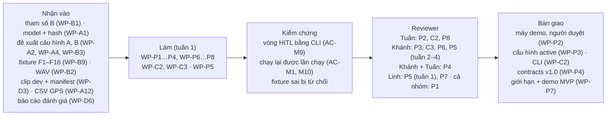

# Phần việc của Cương: PO/Lead + R-C (BT-C, tích hợp)

Bạn giữ kiến trúc, `contracts`, BT-C (cấu hình và HITL, runtime, log, `rerun-B`, CLI) và việc tích hợp. Bạn cũng chịu trách nhiệm phương pháp và tính đúng của phần **tái lập** trong báo cáo.

- **Owner, reviewer, phụ thuộc, hạn, trạng thái tổng:** [README](../README.md), mục 4. Nếu sơ đồ dưới đây khác bảng đó thì bảng thắng.
- **Checklist dưới mỗi task:** cập nhật ngay khi xong từng mục, theo luật ở [README](../README.md), mục 0.
- **Tài liệu cần đọc:** [AGENTS.md](../../../AGENTS.md), mục 3, các dòng "Runtime", "Cấu hình, HITL, CLI", "Hợp đồng dữ liệu" và "Tài liệu, sơ đồ".

## Thuật ngữ riêng

| Từ | Nghĩa |
|---|---|
| `configstore` | Kho cấu hình: phiên bản bất biến, file phê duyệt, con trỏ `active.json`. SQLite chỉ dùng cho HITL (spec 3.10) |
| Báo cáo tác động | Số liệu trước và sau khi đổi cấu hình. Chạy theo `affects` của mục bị đổi: `[B]` thì `rerun-B`; `[A]` thì replay; `[A, live]` thì replay cộng một lần live |
| `--proposed` | Chạy replay, hoặc live cho đường `[A, live]`, với cấu hình đề xuất chưa duyệt, chỉ để làm báo cáo tác động; không kích hoạt gì. Kết quả bị gắn cờ và không dùng để nghiệm thu (D-8; spec 3.10, OQ-B13 được PO duyệt 29/09) |
| Fixture | File JSONL mẫu, gồm loại hợp lệ và loại sai hợp đồng (spec 4.6) |
| Dấu vân tay máy | Thông tin máy demo ghi trong `run_manifest`, dùng để ràng buộc các kết quả đo live |

## Tuần 1

### WP-P1 · Duyệt bộ tài liệu
- **Xong khi:** không còn mục [v1.1] nào chưa quyết; ba thành viên đã đọc phần của mình; mâu thuẫn nào tìm thấy thì đã được sửa hoặc ghi thành OQ.
- **Kiểm chứng:** mỗi reviewer ghi một dòng xác nhận vào `WORKLOG.md`.
- **Checklist:**
  - Bàn giao
    - [x] Các phần [v1.1] trong `docs/specs/roadwatch-architecture.md` → 29/09/2026: đã soạn; sửa lại theo 7 phát hiện review (3.5, 3.7 với OQ-B12; 3.10, 4.4 với OQ-B13; 6.2; 10.1; D-8), chờ PO duyệt; commit 8943c1c
    - [x] `AGENTS.md`, `README.md`, `ARCHITECTURE.md`, `docs/architecture_diagram.md` → 29/09/2026: đã soạn; sửa lại AGENTS mục 1 (guardrail đủ ba điều kiện, fail-safe theo từng năng lực) và sơ đồ HITL (khối chạy thử, chờ OQ-B13); commit 8943c1c
    - [x] `docs/development/code-rules.md`, `docs/development/docs-rules.md` → 29/09/2026: đã soạn; sửa lại code-rules mục 5 (fail-safe), mục 10 và docs-rules mục 4 (mỗi AC dùng đúng loại bằng chứng của spec mục 7); commit 8943c1c
    - [x] `docs/plan/` (README, `so-do.md`, `review-v1.1.md`, bốn file phân việc) → 29/09/2026: đã soạn; sửa lại WP-D3, WP-D10, WP-D11, WP-P7, WP-C2, WP-B9, WP-A4, WP-A12, hai sơ đồ ở `so-do.md`, quyết định 18 và 19; commit 8943c1c
    - [x] Quyết định cho từng I-x, D-x ghi thẳng vào spec mục 12 (OQ-A10) → 29/09/2026: PO chốt theo review-v1.1 mục 5, quyết định 8; đã ghi vào spec mục 12, D-12 sửa vào 3.10; commit 4ed1285
    - [x] Câu trả lời OQ-B12 (spec 3.7) và OQ-B13 (spec 3.10), ghi ở spec mục 10.1 → 29/09/2026: OQ-B12 chọn (b), OQ-B13 duyệt như 3.10; đã ghi ở 3.7, 3.10, 10.1; commit 4ed1285
    - [ ] Một commit riêng cho bộ tài liệu, không gộp với `tests/roadwatch/test_cli.py` → tiếp theo: commit sau khi PO duyệt
    - [x] Chuẩn hóa trạng thái spec/plan, luật Khẩn cấp đang có hiệu lực và literal hợp đồng ở `docs/specs/roadwatch-architecture.md` → 29/09/2026: sửa theo quyết định đã ghi nhận; không đổi runtime; trong commit chuẩn hóa WP-P1
    - [x] `scripts/roadwatch/check_docs.py`, `scripts/roadwatch/export_schemas.py`, `docs/specs/schemas/contracts.schema.json`, `tests/roadwatch/test_documentation.py` → 29/09/2026: kiểm metadata, link, ID, task và phụ thuộc; snapshot 16 model gốc từ Pydantic; không đổi code runtime; trong commit chuẩn hóa WP-P1
  - Kiểm thử và kiểm chứng
    - [x] Kiểm lại tài liệu sau chuẩn hóa cho agent → 29/09/2026: các lệnh kiểm tài liệu, snapshot schema và unittest ở code-rules mục 8 đều đạt; 2 test công cụ, gồm 10 ca cài lỗi trên bản sao. `uvx ruff check scripts/roadwatch tests/roadwatch/test_documentation.py` và `git diff --check` sạch. Toàn bộ RoadWatch: 106 test đạt trong môi trường tạm có pytest; Mermaid không đổi, chưa render lại trong phiên này. Bằng chứng đi cùng commit chuẩn hóa WP-P1.
  - Review và nghiệm thu
    - [ ] Ba reviewer đọc phần của mình và ghi xác nhận vào `WORKLOG.md`
    - [x] PO duyệt, rồi bỏ nhãn [v1.1] ở các mục được duyệt → 29/09/2026: PO duyệt trong phiên làm việc với AI, ghi ở review-v1.1 mục 5; đã bỏ nhãn trong spec; commit 4ed1285

### WP-P2 · Người duyệt HITL và máy demo
- **Xong khi:** WP-C2 và WP-P3 dùng được danh sách người duyệt; WP-A1, WP-A6, WP-P8 đo trên cùng một máy.
- **Kiểm chứng:** reviewer xác nhận mọi thay đổi cấu hình luôn có ít nhất một người duyệt khác người đề xuất.
- **Checklist:**
  - Bàn giao
    - [x] Câu trả lời OQ-B6 (máy demo) và OQ-B7 (người đề xuất, người duyệt), ghi trong `docs/specs/roadwatch-architecture.md`, mục 10.1 → 29/09/2026: laptop của Cương; cả bốn người là người duyệt; commit 4ed1285
  - Kiểm thử và kiểm chứng
    - [ ] Danh sách đủ để tạo `roles.json` bằng `hitl init` trên máy demo (`configs/` không commit)
  - Review và nghiệm thu
    - [ ] Reviewer kiểm theo mục "Kiểm chứng"

### WP-P3 · Cấu hình khởi tạo
- **Xong khi:** trên máy demo, runtime khởi động không gặp lỗi F23, và `run_manifest` có `approval_id`.
- **Kiểm chứng:** người duyệt chạy một replay ngắn và thấy `approval_id` trong manifest; kiểm rằng mọi giá trị không phải số đo đều nằm trong `provisional_keys`.
- **Checklist:**
  - Bàn giao
    - [ ] File cấu hình v0 ghép phần B (WP-B1) và phần A (WP-A1), lưu ở `config/proposals/v0.yaml`
    - [ ] Phê duyệt đầu tiên trên máy demo: `configs/versions/`, `configs/approvals/`, `configs/active.json` (không commit; ghi `approval_id` làm bằng chứng)
    - [ ] `scripts/roadwatch/hitl_bootstrap.py`: gọi thẳng các hàm `configstore` (OQ-B3), vẫn chặn người đề xuất tự duyệt
  - Kiểm thử và kiểm chứng
    - [ ] Replay ngắn trên máy demo chạy được, `run_manifest.json` có `approval_id`
  - Review và nghiệm thu
    - [ ] Người duyệt (khác người đề xuất) kiểm theo mục "Kiểm chứng"

### WP-C2 · CLI
- **Xong khi:** `tests/roadwatch/test_cli.py` xanh mà không sửa kỳ vọng của test, và chạy trọn được một vòng HITL bằng CLI.
- **Kiểm chứng:** reviewer chạy tay kịch bản AC-M9 (spec 7.1) trên máy demo và ghi biên bản vào mô tả PR. Chạy thêm một lần `--proposed` (OQ-B13) và xác nhận `active.json`, `approvals/` không đổi.
- **Code có sẵn:** lõi T2 (README mục 3).
- **Checklist:**
  - Bàn giao
    - [x] `tests/roadwatch/test_cli.py` viết trước: vòng HITL qua CLI, xuất JSON Schema → 28/09/2026: 2 test, đỏ có chủ đích vì chưa có `cli.py`; chưa commit
    - [ ] `src/roadwatch/cli.py`: `run`, `rerun-b`, `eval`, `perf`, `schema`, `hitl` (`init`, `propose`, `report`, `approve`, `activate`, `rollback`, `recover`, `status`) → tiếp theo: viết sau N0 tới khi `test_cli.py` xanh
    - [ ] `--proposed <proposal_id>` cho replay và live (D-8), trong `src/roadwatch/runtime.py`, `src/roadwatch/cli.py`; cờ `proposed_config` và `proposal_id` trong `run_manifest` (`src/roadwatch/contracts/`); `hitl report` chỉ nhận lần chạy thử đúng đề xuất và đúng sha cấu hình (spec 3.10, OQ-B13)
    - [ ] `hitl report` từ chối dữ liệu thuộc split `test_*` (D-11), trong `src/roadwatch/cli.py`
    - [ ] `run_stats.json` trong thư mục lần chạy, do `src/roadwatch/runtime.py` ghi
  - Kiểm thử và kiểm chứng
    - [ ] Test cho D-11, viết trước code, trong `tests/roadwatch/test_cli.py`
    - [ ] Test cho D-8 theo spec 3.10, viết trước code, trong `tests/roadwatch/test_cli.py` và `tests/roadwatch/test_runtime.py`, trên kho tạm: lần chạy thử (replay và live giả) không đổi `active.json`, không tạo phê duyệt; manifest có cờ và `proposal_id`, `approval_id` là `null`; từ chối split `test_*`; `hitl report` từ chối lần chạy thử của đề xuất khác hoặc sha khác; chạy thường với cấu hình chưa duyệt vẫn bị từ chối (F23)
    - [ ] Lệnh kiểm tra ở [code-rules](../../development/code-rules.md) mục 8 xanh, không còn `--ignore`
  - Review và nghiệm thu
    - [ ] Reviewer kiểm theo mục "Kiểm chứng"

### WP-C3 · Fixture và kiểm tra liên luồng
- **Xong khi:** mọi fixture sai đều bị từ chối với đúng lý do, và CI chạy các test này.
- **Kiểm chứng:** reviewer tự thêm một fixture sai mà bạn chưa thấy trước, và thấy nó bị từ chối.
- **Checklist:**
  - Bàn giao
    - [ ] `tests/roadwatch/fixtures/`: file JSONL hợp lệ và file sai hợp đồng cho mọi schema (spec 4.6)
    - [ ] Kiểm tra liên luồng (D-7) trong `src/roadwatch/contracts/`: mỗi cặp (`input_seq`, `arbiter`) có đúng một trace; `AudioPlan` chỉ trỏ tới `alert_id` có thật
  - Kiểm thử và kiểm chứng
    - [ ] `tests/roadwatch/test_contracts.py` đọc toàn bộ fixture; fixture sai bị từ chối đúng lý do
  - Review và nghiệm thu
    - [ ] Reviewer kiểm theo mục "Kiểm chứng"

### WP-P6 · Chốt với mentor
- **Xong khi:** có câu trả lời cho OQ-A1, OQ-A2, OQ-A11. Nếu mentor chưa trả lời thì ghi rõ, và báo cáo tuần 1 chỉ dùng cách diễn đạt "sơ bộ".
- **Kiểm chứng:** reviewer đối chiếu nội dung ghi vào spec với biên bản.
- **Checklist:**
  - Bàn giao
    - [ ] Câu trả lời ghi thẳng vào `docs/specs/roadwatch-architecture.md`, mục 10.3
    - [ ] Biên bản trao đổi với mentor trong `JOURNAL.md` (tuần 1)
  - Kiểm thử và kiểm chứng
    - [ ] Nếu còn câu chưa có trả lời: báo cáo tuần 1 chỉ dùng "sơ bộ"
  - Review và nghiệm thu
    - [ ] Reviewer kiểm theo mục "Kiểm chứng"

### WP-P8 · Tích hợp đầu–cuối trên máy demo
- **Xong khi:** AC-M1 và AC-M10 có biên bản gắn hash.
- **Kiểm chứng:** reviewer lặp lại một lần chạy trong biên bản trên cùng máy và nhận kết quả khớp.
- **Checklist:**
  - Bàn giao
    - [ ] Biên bản chạy offline và tái lập, ghi ở mục "Tái lập" của `eval/results/report.md`
    - [ ] Lần chạy `live` và `replay` trên máy demo: `runs/<run_id>/` (không commit; ghi `run_id` và hash làm bằng chứng)
  - Kiểm thử và kiểm chứng
    - [ ] Máy ở chế độ máy bay; lần chạy có đủ các luồng của spec 4.4
    - [ ] `rerun-B --verify` đạt; replay hai lần cho `measurements` đã chuẩn hoá giống nhau (spec 5.4)
  - Review và nghiệm thu
    - [ ] Reviewer kiểm theo mục "Kiểm chứng"

### WP-P4 · Đóng băng `contracts` v1.0
- **Xong khi:** AC-M2 đạt.
- **Kiểm chứng:** hai reviewer xác nhận code A và code B của họ đọc và ghi được v1.0 mà không phải sửa.
- **Checklist:**
  - Bàn giao
    - [ ] `src/roadwatch/contracts/` ở phiên bản 1.0
    - [ ] `docs/specs/roadwatch-architecture.md`, mục 4: D-3 đã đồng bộ mô tả trong WP-P1; còn D-4 và kiểm chứng trước khi đóng băng
    - [ ] JSON Schema xuất ra `docs/specs/schemas/`
    - [ ] Thẻ git `contracts-v1.0`
  - Kiểm thử và kiểm chứng
    - [ ] Mọi fixture hợp lệ đều qua, mọi fixture sai đều bị từ chối, test hợp đồng của từng thành phần đạt
  - Review và nghiệm thu
    - [ ] Hai reviewer kiểm theo mục "Kiểm chứng"

### WP-P7 · Giới hạn đã biết và demo MVP
- **Xong khi:** mọi AC-M có một trong ba trạng thái (đạt, chưa đạt, chưa kết luận), kèm bằng chứng.
- **Kiểm chứng:** reviewer đối chiếu từng AC-M với bằng chứng ở bảng dưới. Không dòng "đạt" nào được thiếu bằng chứng.
- **Cần có** (cột "Cần có" ở README mục 4.1 lấy đúng từ bảng này):

| Bằng chứng cho WP-P7 | Task cho ra |
|---|---|
| AC-M3, M4, M5, M6: báo cáo `test_small` và các mục đã tổng hợp của `eval/results/report.md` | WP-D6 |
| AC-M1, M10: biên bản chạy offline và tái lập | WP-P8 |
| AC-M2: `contracts` v1.0 | WP-P4 |
| AC-M7: phần B (fixture F1–F16) và phần live (F1, F18) | WP-B9, WP-A6 |
| AC-M8: kết luận kiểm tra lắp đặt | WP-A3 |
| AC-M9: vòng HITL trọn vẹn qua CLI | WP-C2 |
| AC-M12: runtime chạy trên clip thật có âm thanh, bảng B so với baseline | WP-P8, WP-D6 |

  WP-P5 (nhật ký), WP-P6 (chốt với mentor) và WP-D7 (phỏng vấn) không chặn WP-P7. Câu nào của WP-P6 chưa có trả lời thì ghi vào danh sách giới hạn.
- **Checklist:**
  - Bàn giao
    - [ ] Danh sách giới hạn (AC-M11) ở mục "Giới hạn" của `eval/results/report.md`: AC chưa đạt hoặc chưa kết luận, mục "chưa kiểm chứng", F17, giới hạn cam kết âm thanh, trạng thái file Word (OQ-A6), OQ còn mở
    - [ ] Buổi demo hoặc video chạy offline (AC-M12); link hoặc biên bản ghi trong `JOURNAL.md`, tuần 1
  - Kiểm thử và kiểm chứng
    - [ ] Mỗi AC-M có trạng thái, và bằng chứng đúng loại mà spec mục 7 ghi cho AC đó
  - Review và nghiệm thu
    - [ ] Reviewer kiểm theo mục "Kiểm chứng"

### WP-P5 · Nhật ký và deliverables
- **Xong khi:**
  - Tuần 1: mỗi ngày làm việc có dòng WORKLOG của cả bốn người, và JOURNAL tuần 1 đủ các mục của template.
  - Tuần 2–4: đủ deliverables 2, 6, 7 (spec 11.2).
- **Kiểm chứng:** reviewer đối chiếu WORKLOG với các task có trạng thái đổi trong tuần; kiểm deliverables theo `docs/guide/deliverables/checklist.md`.
- **Checklist:**
  - Bàn giao
    - [x] `WORKLOG.md`: các ngày 28/09 và 29/09 → 29/09/2026: đã ghi; commit 8943c1c, 4ed1285
    - [ ] `JOURNAL.md`, tuần 1
    - [ ] `README.md` hoàn chỉnh cho deliverable 2 (tuần 2–4)
    - [ ] `presentation/pitch_deck.pptx`, 10 slide (tuần 2–4)
    - [ ] Video demo ≤ 5 phút; link ghi trong `presentation/README.md` (tuần 2–4)
  - Kiểm thử và kiểm chứng
    - [ ] Các thành viên còn lại tự ghi WORKLOG mỗi ngày họ làm việc
  - Review và nghiệm thu
    - [ ] Reviewer kiểm tuần 1 theo mục "Kiểm chứng"
    - [ ] Reviewer kiểm deliverables tuần 2–4

## Tuần 2–4

### WP-C5 · Docker, `.env.example`, logging
- **Xong khi:** `docker build` chạy được, và lệnh test chạy được trong container.
- **Kiểm chứng:** reviewer build lại từ đầu trên một máy khác.
- **Checklist:**
  - Bàn giao
    - [ ] `Dockerfile` và `docker-compose.yml` cho công cụ và web UI
    - [ ] `.env.example` chỉ còn các biến RoadWatch cần, không chứa bí mật
    - [ ] Logging có cấu trúc cho công cụ trong `src/roadwatch/`
  - Kiểm thử và kiểm chứng
    - [ ] `docker build` chạy được; lệnh test chạy được trong container
  - Review và nghiệm thu
    - [ ] Reviewer kiểm theo mục "Kiểm chứng"

### WP-C9 · Live URL
- **Xong khi:** theo phương án PO chọn ở OQ-E1. Nếu chọn không deploy thì lý do được ghi vào spec mục 11.2 và task đóng.
- **Kiểm chứng:** reviewer mở URL từ một máy khác, với dữ liệu mẫu.
- **Checklist:**
  - Bàn giao
    - [ ] Cấu hình deploy trong `deploy/` (tên thư mục chốt sau OQ-E1), và URL ghi trong `README.md` → tiếp theo: hỏi mentor ở WP-P6
  - Kiểm thử và kiểm chứng
    - [ ] URL chạy với dữ liệu mẫu, không cần runtime
  - Review và nghiệm thu
    - [ ] Reviewer kiểm theo mục "Kiểm chứng"
