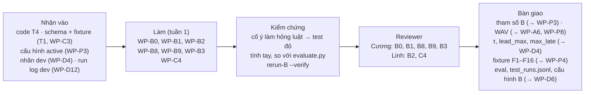

# Phần việc của Khánh: R-B (BT-B, lời cảnh báo, đánh giá hành vi cảnh báo)

Bạn phụ trách phần "nói":
- luật và máy trạng thái quyết định có cảnh báo hay không;
- lời cảnh báo;
- phương pháp đánh giá B so với baseline.

Bạn chịu trách nhiệm phương pháp và tính đúng của mục "B so với baseline" và của `L_alert(B)` trong báo cáo. R-D tổng hợp báo cáo, nhưng không chịu trách nhiệm phương pháp của các mục này.

Code BT-B đã có (T4, `src/roadwatch/decision/`; tình trạng ở README mục 3). Việc đầu tiên của bạn là tiếp nhận code đó, không viết lại.

**Từ 01/10/2026:** theo chỉ định của PO, Cương làm các task tuần 1 trong file này; Khánh sang hỗ trợ phần việc của Tuấn và sẽ quay lại hỗ trợ sau. Bảng owner và reviewer ở [README](../README.md), mục 4, **chưa đổi**: PO chưa chỉ định reviewer mới cho những task mà Cương đang là reviewer.

- **Owner, reviewer, phụ thuộc, hạn, trạng thái tổng:** [README](../README.md), mục 4. Nếu sơ đồ dưới đây khác bảng đó thì bảng thắng.
- **Checklist dưới mỗi task:** cập nhật ngay khi xong từng mục, theo luật ở [README](../README.md), mục 0.
- **Tài liệu cần đọc:** [AGENTS.md](../../../AGENTS.md), mục 3, dòng "BT-B" và dòng "Đánh giá, `rerun-B`".

## Thuật ngữ riêng

| Từ | Nghĩa |
|---|---|
| Năng lực | `cap_distance` và `cap_ttc`: hệ thống còn cảnh báo được loại nào (spec 3.4) |
| Đợt khoảng cách | `IDLE → PENDING → ALERTED → CLEARING`; `HOLD` khi mất dữ liệu ngắn; `SUSPENDED` khi quá `T_hold` (spec 3.5) |
| Đợt khẩn cấp | `IDLE → ACTIVE → CLEARING_E`; `HOLD_E` (spec 3.5) |
| Guardrail | Đủ ba điều kiện `cap_ttc = on`, TTC `ok`, TTC ≤ ngưỡng: phát ngay khi bắt đầu đợt; chỉ phát lại nếu chưa lệnh nào `started`, lệnh gần nhất bị huỷ/hết hạn và không còn lệnh đang chờ. Không tham số nào được chặn trường hợp bắt buộc phát (spec 3.7, OQ-B12) |
| Baseline | Bộ cảnh báo đơn giản theo sườn lên, dùng cùng đầu vào với B, để so sánh (ADR-03) |
| `rerun-B` | Chạy lại B trên nhật ký đầu vào đã ghi, không cần chạy lại A |
| Khớp lần đầu / lặp / không khớp | Ba nhóm; mỗi cảnh báo thuộc đúng một nhóm (spec 5.2) |
| τ, `lead_max`, `max_late` | Ngưỡng IoU khi khớp đối tượng; độ sớm tối đa; độ trễ tối đa với `collision_risk` (spec 5.2, OQ-A3) |

## Tuần 1

### WP-B0 · Tiếp nhận code BT-B
- **Xong khi:** mỗi luật ở spec 3.4–3.7 hoặc có test, hoặc được ghi là "thiếu test" và chuyển sang WP-B9.
- **Kiểm chứng:** reviewer chọn ngẫu nhiên ba luật, cố ý làm hỏng từng luật trong code, thấy test tương ứng đỏ, rồi khôi phục.
- **Code có sẵn:** T4 và test của nó, gồm test thuộc tính cho guardrail (README mục 3).
- **Checklist:**
  - Bàn giao
    - [ ] Bảng đối chiếu luật ở spec 3.3–3.7 với test trong `tests/roadwatch/test_decision.py`, đặt trong mô tả PR của WP-B0 → 01/10/2026: đã soạn bảng (mỗi luật một dòng, kèm tên test) ở `doc_indivisual/bai_toan_B.md`, mục 3; file này là ghi chú cá nhân, không commit. Còn thiếu: chưa mở PR. Tiếp theo: dán bảng vào mô tả PR
    - [x] Đề xuất cho I-12, I-13 và mọi điểm lệch mới, viết vào `docs/specs/roadwatch-architecture.md`, mục 12 → 01/10/2026: I-12 (giữ, ghi vào bảng 3.5), I-13 (cách đo ở WP-B3) mang nhãn [v1.2], PO chưa quyết. Điểm mới tìm thấy khi đọc code: I-16…I-19 (cách code đang đọc spec) và D-14…D-18 (lệch spec; D-14, D-15, D-18 đã sửa trong WP-B9, WP-B8, WP-C4; D-16, D-17 chờ PO). Cùng commit với checklist này
    - [x] Luật còn thiếu test được thêm thành mục trong checklist của WP-B9, ở `docs/plan/phan-viec/khanh.md` → 01/10/2026: 14 luật, liệt kê ở mục "Luật thiếu test tìm thấy ở WP-B0" của WP-B9
  - Kiểm thử và kiểm chứng
    - [x] Toàn bộ test RoadWatch xanh sau khi tiếp nhận → 01/10/2026: `python -m pytest tests/roadwatch --confcutdir=tests/roadwatch -q` cho 222 passed, không có test đỏ hay `xfail` (chạy lại cuối phiên, sau khi tách `configread.py` và thêm luật OQ-A5). `ruff check src/ tests/ scripts/roadwatch` sạch. Code ở các commit `1325e86`, `87b0814`, `85c58ca`
    - [x] (Người làm tự kiểm, không thay bước của reviewer) cố ý làm hỏng từng luật trong `src/roadwatch/decision/`, mỗi lần một dòng → 01/10/2026: 55 lần (`episodes.py` 23, `stage.py` 15, `capability.py` 10, `join.py` 5, `arbiter.py` 2); lần nào test tương ứng cũng đỏ; đã khôi phục sau mỗi lần. Chạy lại cả loạt trên code cuối phiên, sau luật OQ-A5: vẫn đỏ đủ 55
  - Review và nghiệm thu
    - [ ] Reviewer kiểm theo mục "Kiểm chứng"

### WP-B1 · Bảng pháp lý và tham số B
- **Xong khi:** validator cấu hình chấp nhận file, và mọi giá trị không lấy từ văn bản luật đều nằm trong `provisional_keys`.
- **Kiểm chứng:** reviewer đối chiếu từng dải với **văn bản luật** TT38/2024. Bảng ở file 1 mục 1.1 chỉ là bản tóm tắt, không dùng làm nguồn.
- **Checklist:**
  - Bàn giao
    - [x] Phần B của `config/proposals/v0.yaml`: `legal_table` kèm `legal_ref`; giá trị tạm cho `ttc`, `dispatch`, `speed`, `status_msgs`, `audio` (OQ-B2 phần B) → 01/10/2026: `legal_table` theo TT 38/2024/TT-BGTVT, Điều 11 khoản 1, bốn dòng (V = 60 → 35 m; 60–80 → 55; 80–100 → 70; 100–120 → 100). Các mục còn lại lấy giá trị tạm ở I-2; ngưỡng TTC giữ 1,8 s (PO quyết 29/09: giữ, tinh chỉnh ở WP-B3). File mới chỉ có phần B; phần A do WP-P3 ghép. Commit `1325e86`
    - [x] Mọi giá trị không lấy từ văn bản luật nằm trong `provisional_keys` (điều kiện ở "Xong khi") → 01/10/2026: PO quyết D-17: thêm `provisional_keys` ở cấp gốc của `rw.config` (làm trong WP-P4). `config/proposals/v0.yaml` liệt kê 17 khoá của phần B: mọi trường của `ttc`, `dispatch`, `speed`, `status_msgs`, cùng `audio.max_cmd_age_ms` và `audio.phrases`. Đây đúng là danh sách trước đó nằm trong chú thích đầu file. Validator từ chối khoá không trỏ tới trường có thật (`test_provisional_keys_must_name_fields_of_the_config`). Phần A thêm khoá của mình ở WP-P3. Cùng commit với checklist WP-P4, nhánh `feat/wp-p4-contracts-v1`
    - [x] Câu trả lời OQ-B4 (có dải cho tốc độ dưới 60 km/h hay không), ghi ở `docs/specs/roadwatch-architecture.md`, mục 10.1 → 01/10/2026: ghi dưới bảng 10.1 với nhãn [v1.2], là **đề xuất của R-B, PO chưa quyết**: không có dải dưới 60 km/h (khoản 2 không cho trị số); PO cần quyết có giữ dòng "V = 60 → 35 m" hay không. Cùng commit với checklist này
    - [x] Sửa cách tra bảng cho đúng chữ của Điều 11 (điểm lệch tìm thấy khi làm task này; I-16) → 01/10/2026: `src/roadwatch/decision/join.py`. Trước đó code dùng `[v_min, v_max)`, nên đúng 80, 100, 120 km/h rơi sai dải hoặc không có ngưỡng; phép đổi m/s sang km/h còn để lại sai số dấu phẩy động ở 60 và 120. Test `test_legal_band_includes_its_upper_speed_as_article_11_says` viết trước, đỏ rồi xanh. Commit `1325e86`
  - Kiểm thử và kiểm chứng
    - [x] Validator cấu hình (`RwConfig`) chấp nhận file → 01/10/2026: `test_v0_proposal_part_b_is_a_valid_config_and_carries_article_11` trong `tests/roadwatch/test_decision.py` ghép phần B của file với phần A của cấu hình test rồi validate, và so bốn dải với Điều 11. Còn thiếu: validate cả file khi đã có phần A (WP-P3)
    - [x] Biên cứng của tham số B (I-1) bị validator chặn → 01/10/2026: thêm ba ca vào `test_config_guardrails` trong `tests/roadwatch/test_contracts.py` (`ttc_emergency_s` dưới biên, `t_clear_e_ms` và `h_ttc_s` trên biên)
  - Review và nghiệm thu
    - [ ] Reviewer kiểm theo mục "Kiểm chứng": đối chiếu từng dải với **văn bản gốc** của TT 38/2024. Người làm mới đối chiếu qua bản đăng lại trên mạng, chưa có bản gốc trong repo

### WP-B2 · Câu nói tiếng Việt
- **Xong khi:** mọi `phrase_id` mà B có thể phát đều có file WAV, và hash thư viện câu nói có trong cấu hình.
- **Kiểm chứng:** reviewer nghe toàn bộ câu trên máy demo và xác nhận câu rõ, đúng nghĩa, không câu nào bắt tài xế nhìn màn hình. Sau đó so danh sách `phrase_id` trong code với thư mục WAV.
- **Checklist:**
  - Bàn giao
    - [ ] `scripts/roadwatch/render_phrases.py`: gồm văn bản các câu (OQ-B5) và bước render bằng Piper vi_VN. Các câu: Khẩn cấp kèm tiếng bíp, Cảnh báo, Thông tin, tạm dừng hệ thống, tắt cảnh báo khoảng cách, tắt cảnh báo va chạm, phục hồi, nhắc lại → 01/10/2026: đã có script với đủ tám câu, ghép tiếng bíp vào trước câu Khẩn cấp, in ra độ dài từng câu và hash thư viện; lệnh `--check <file cấu hình>` so thư viện với mục `audio`. Văn bản các câu ghi dưới bảng 10.1 của spec (đề xuất [v1.2], PO chưa quyết; hai câu "phục hồi" và "nhắc lại" là câu mới). Test dùng bộ tổng hợp giọng giả. **Còn thiếu: chưa chạy lệnh Piper thật lần nào** (máy này chưa cài Piper, chưa tải giọng). Tiếp theo: trên máy demo, `pip install piper-tts`, tải giọng `vi_VN-vais1000-medium`, chạy `python -m scripts.roadwatch.render_phrases --model vi_VN-vais1000-medium --data-dir models/piper`; nếu lệnh Piper khác tài liệu thì sửa hàm `piper()`. Commit `85c58ca`
    - [ ] `models/phrases/*.wav` (không commit; ghi hash thư viện câu làm bằng chứng) → còn thiếu: chưa render (xem mục trên). Tiếp theo: render, nghe lại từng câu, ghi `phrases_sha256` mà script in ra vào đây
    - [ ] Mục `audio` trong file cấu hình đề xuất: độ dài từng câu, hash thư viện câu nói → 01/10/2026: `config/proposals/v0.yaml` đã có mục `audio`, nhưng độ dài từng câu vẫn là giá trị tạm của cấu hình test, chưa phải độ dài đo từ WAV. Từ 01/10 schema có `audio.phrases_sha256` (D-16, PO quyết 01/10, làm trong WP-P4); `v0.yaml` đang để `null`. Còn thiếu: chép độ dài thật và `phrases_sha256` mà script in ra sau khi render
    - [x] Live kiểm thư viện câu lúc khởi động (bổ sung khi làm task này, vì bộ phân xử tính lúc câu kết thúc từ `audio.phrases`) → 01/10/2026: `check_phrases` trong `src/roadwatch/runtime.py`, đặt cạnh kiểm tra hash model của F23 và chỉ chạy khi live sắp phát loa thật; thiếu file WAV hoặc độ dài file khác cấu hình thì từ chối khởi động, trước khi ghi bất cứ gì. `live.py` không đổi. Commit `85c58ca`
    - [x] Backend loa và nghe thử thư viện (02/10/2026, cho bàn giao B+C) → `default_play` trong `src/roadwatch/live.py`: `winsound` trên Windows, lệnh `aplay` trên Linux (dừng câu đang phát khi có câu mới). Hệ điều hành khác hoặc thiếu `aplay` thì `live` từ chối khởi động, không tự chạy im lặng. `--audio simulated` chạy không loa, gắn cờ `simulated_audio`, và `run_stats.json` ghi `null` ở số câu đã phát. `python -m scripts.roadwatch.render_phrases --check <cấu hình> --play` phát lần lượt từng câu qua chính backend này. Test trong `tests/roadwatch/test_phrases.py` (3 test mới, dùng `Popen` giả). **Còn thiếu: chưa phát âm thanh thật lần nào**, cả `winsound` lẫn `aplay`; `aplay` chưa chạy trên máy Linux. Chưa review. nhánh `feat/wp-p4-contracts-v1`
  - Kiểm thử và kiểm chứng
    - [ ] Mỗi `phrase_id` trong `src/roadwatch/decision/` có một file WAV tương ứng → 01/10/2026: `tests/roadwatch/test_phrases.py` (7 test) kiểm mọi `kind` mà B phát đều có văn bản, render ra đủ file PCM, tiếng bíp đứng trước câu Khẩn cấp, và live từ chối khởi động khi thiếu file. Còn thiếu: chạy `python -m scripts.roadwatch.render_phrases --check config/proposals/v0.yaml` trên thư viện WAV thật
  - Review và nghiệm thu
    - [ ] Reviewer kiểm theo mục "Kiểm chứng"

### WP-B8 · Phương pháp đánh giá hành vi cảnh báo
- **Xong khi:** PO đã duyệt OQ-A3, và R-D dùng được các giá trị đó trong hướng dẫn gán nhãn (WP-D4).
- **Kiểm chứng:** reviewer tự tạo một bộ nhãn và cảnh báo nhỏ, có ca chồng nhau và ca `exempt`; tính kết quả bằng tay và so với `evaluate.py`.
- **Checklist:**
  - Bàn giao
    - [x] Đề xuất τ, `lead_max`, `max_late` kèm lý do, ghi vào OQ-A3 ở `docs/specs/roadwatch-architecture.md`, mục 10.3, **trước** khi gán nhãn `test_small` → 01/10/2026: ghi dưới bảng 10.3: τ = 0,5; `lead_max` = 3,0 s; `max_late` = 2,0 s, kèm lý do, cách kiểm trên `dev`, và điều kiện đi kèm về `t_start` của `collision_risk` cho hướng dẫn gán nhãn. Đây là giá trị khởi đầu theo lập luận, không phải số đo. **PO quyết 01/10/2026 (trong phiên làm việc với AI): dùng cho `dev`; giá trị cho `test_small` chốt sau khi xem số liệu `dev`.** Cần báo Linh (WP-D4): ba giá trị này, định nghĩa `t_start` của `collision_risk`, và `clip_id` phải bằng `session_id`. Cùng commit với checklist này
    - [x] Khung mục "B so với baseline" trong `eval/results/report.md`, theo chỉ số chính và phụ ở spec 5.5 → 01/10/2026: thêm mục 6, mọi ô số liệu để "—"; mỗi dòng ghi tên trường tương ứng trong báo cáo của lệnh `eval`. Cùng commit với checklist này
    - [x] Test cho các luật ở spec 5.2 còn thiếu, trong `tests/roadwatch/test_rerun_eval.py` → 01/10/2026: thêm test cho cửa sổ mở từ `t_start − lead_max`, sự kiện không có `target`, thứ tự chọn theo `event_id`, lead time, khớp đối tượng bằng IoU tại khung chốt, bảng phân rã bỏ sót theo lý do. Commit `87b0814`
    - [x] Báo cáo `eval` có đủ mục của spec 5.5 (D-18) → 01/10/2026: `src/roadwatch/evaluate.py` thêm lead time, số cảnh báo trong đoạn `congestion`, `events_differ`, kết cục ở bộ phân xử (`plan_outcomes`), bảng phân rã bỏ sót (`misses`), và `provenance` (hash cấu hình, commit, model, ONNX Runtime, `contracts`, đầu vào); lệnh `eval` in thêm `labels_sha256`. `eval` chấm được kết quả `rerun-B` (đọc khung và số đo của lần chạy nguồn). Commit `87b0814`
  - Kiểm thử và kiểm chứng
    - [ ] Bảng đối chiếu luật ở spec 5.2 với test, đặt trong mô tả PR → 01/10/2026: đã soạn ở `doc_indivisual/bai_toan_B.md`, mục 4 (ghi chú cá nhân, không commit). Còn thiếu: chưa mở PR. Tiếp theo: dán bảng vào mô tả PR
    - [x] (Người làm tự kiểm, không thay bước của reviewer) cố ý làm hỏng từng luật khớp nhãn và từng mục báo cáo, mỗi lần một dòng → 01/10/2026: 13 lần (12 ở `src/roadwatch/evaluate.py`, 1 ở `src/roadwatch/cli.py`), lần nào test cũng đỏ; đã khôi phục
  - Review và nghiệm thu
    - [ ] Reviewer kiểm theo mục "Kiểm chứng"
    - [ ] PO duyệt OQ-A3 → 01/10/2026: PO cho dùng ba giá trị trên `dev`. Còn thiếu: chốt giá trị cho `test_small`. Tiếp theo: khi có lần chạy `dev` (WP-D12), xem số `object_unresolved`, phân bố lead time và số lệnh Khẩn cấp rơi ngay sau cửa sổ, rồi PO chốt trước khi Linh gán nhãn `test_small`

### WP-B9 · Fixture tình huống lỗi cho B và OQ-A5
- **Xong khi:** mọi dòng ở cột "Fixture cho B" của spec 6.2 đều có test, kể cả kịch bản S1–S7 của spec 3.7 theo phương án (b) của OQ-B12, và phần pytest của AC-M7 đạt.
- **Kiểm chứng:** reviewer đối chiếu bảng 6.2 với danh sách test. Còn dòng nào thiếu thì chưa được ✅. Riêng S4 và S7, reviewer đối chiếu kết quả test với phương án (b) của OQ-B12.
- **Checklist:**
  - Bàn giao
    - [x] Fixture cho các dòng F1–F16 thuộc B, loại "hợp lệ nhưng mô tả tình huống lỗi" (spec 4.6): `tests/roadwatch/fixtures/`, kèm test trong `tests/roadwatch/test_decision.py` → 01/10/2026: 15 thư mục ở `tests/roadwatch/fixtures/scenarios/` (khoảng 1 MB), phủ mọi dòng có cột "Fixture cho B" ở spec 6.2: F1; F2, F4, F18; F3, F19; F7a, F7b, F8; F10–F12; F13–F16; F17. Mỗi thư mục là một nhật ký đầu vào thật (`decision_inputs`, `measurements`, `speed`, `events`) qua được `check_streams`, kèm `scenario.json`. Sinh lại bằng `python -m tests.roadwatch.make_fixtures scenarios`; test `test_scenario_fixtures_are_what_the_generator_writes` bắt được file bị sửa tay. 15 test `test_f1_…` đến `test_f18_…` đọc fixture rồi kiểm hành vi của B. Commit `1325e86`
    - [x] Test kịch bản `HOLD` lặp lại trong `CLEARING_E` (OQ-A5), trong `tests/roadwatch/test_decision.py` → 01/10/2026: `test_oq_a5_danger_long_after_the_last_one_is_a_new_episode_despite_short_data_blips`. **Kết quả với luật cũ: không có giới hạn trên.** Mỗi giây một khung không hợp lệ thì đợt không bao giờ đóng; nguy hiểm sau 60 s bị gộp vào đợt cũ và không được phát. `test_oq_a5_tailgating_…` cho thấy đợt khoảng cách có cùng cơ chế. Hai test này ban đầu để `xfail`; sau khi PO chọn thêm luật (01/10) đã bỏ dấu `xfail` và cả hai xanh. Commit `1325e86`
    - [x] Đề xuất cho OQ-A5 (thêm luật hay ghi thành giới hạn), ghi ở `docs/specs/roadwatch-architecture.md`, mục 10.3 → 01/10/2026: R-B đề xuất hai phương án: (a) thêm luật, (b) ghi thành giới hạn. **PO chọn (a) ngày 01/10/2026**, trong phiên làm việc với AI; quyết định và lý do ghi ở spec 10.3, luật ghi ở 3.5. Cùng commit với checklist này
    - [x] Luật "`HOLD` khi đợt đang rời" theo quyết định OQ-A5: `src/roadwatch/decision/episodes.py` → 01/10/2026: khi đợt đang `CLEARING` hoặc `CLEARING_E`, `HOLD` không xoá và không dừng mốc đếm; ở khung hợp lệ đầu tiên sau `HOLD`, nếu đã đủ `T_clear`/`T_clear_e` thì đợt đóng trước khi xét khung đó, trace ghi `cleared_in_hold`. Trước `HOLD` là `ALERTED` hoặc `ACTIVE` thì không đổi, nên S1–S7 giữ nguyên. Test viết trước, 7 test đỏ rồi xanh: `test_hold_e_while_clearing_neither_erases_nor_stops_the_clearing_time`, `test_danger_after_a_hold_that_outlasted_the_clearing_time_is_a_new_episode`, `test_isolated_usable_frames_do_not_keep_a_heard_episode_open` (ca xấu nhất), `test_hold_while_clearing_neither_erases_nor_stops_the_clearing_time`, `test_tailgating_after_a_hold_that_outlasted_the_clearing_time_is_a_new_episode` và hai test `test_oq_a5_*`. Ba test giữ cho luật không làm quá tay: `test_danger_back_before_the_clearing_time_is_over_is_the_same_heard_episode_even_across_a_hold`, `test_hold_from_active_starts_…`, `test_hold_from_alerted_starts_…`. Tự kiểm: 9 lần cố ý làm hỏng luật mới, lần nào test cũng đỏ. Hai fixture `valid/replay`, `valid/live` vẫn qua `rerun-b --verify`, không phải sinh lại. Commit `1325e86`
    - [x] Test kịch bản S1–S7 của spec 3.7 trong `tests/roadwatch/test_decision.py`: S1, S2, S3, S5, S6 theo hành vi hiện tại; S4, S7 theo phương án (b) của OQ-B12: phát ở khung *m* → 01/10/2026: bảy test `test_s1_…` đến `test_s7_…`. S4: lệnh bị huỷ trong ô chờ được phát lại khi phục hồi từ `HOLD_E`. S7: lệnh hết hạn trong ô chờ được phát lại khi đợt còn `ACTIVE`. Commit `1325e86`
    - [x] Phương án (b) của OQ-B12: sửa `src/roadwatch/decision/episodes.py`, `src/roadwatch/decision/stage.py`, và mở rộng test thuộc tính guardrail → 01/10/2026: `stage.py` nhớ lệnh Khẩn cấp gần nhất của đợt và đọc kết cục của nó từ bộ phân xử thuần (không đọc audio sink); phát lại khi đợt đang `ACTIVE`, chưa lệnh nào `started` và lệnh gần nhất bị `cancelled` hoặc `expired`. Test thuộc tính thứ hai `test_guardrail_property_no_dangerous_frame_leaves_its_episode_unheard` chạy 40 chuỗi ngẫu nhiên. Test viết trước, đỏ rồi xanh. Commit `1325e86`
    - Luật thiếu test tìm thấy ở WP-B0 (mỗi mục một luật, đã có test trong `tests/roadwatch/test_decision.py`; 01/10/2026, commit `1325e86`):
      - [x] 3.3, mốc cắt thông tin: mẫu tốc độ có `t_recv > t_k` không dùng cho khung *k* → `test_speed_sample_received_after_the_frame_time_is_not_used_for_that_frame`
      - [x] 3.3 và I-16, tốc độ đúng biên của bảng pháp lý → `test_legal_band_includes_its_upper_speed_as_article_11_says`
      - [x] 3.4, tốc độ xử lý dưới `min_ttc_rate_hz` chỉ tắt `cap_ttc` → `test_low_processing_rate_turns_only_the_collision_warning_off`. Test này lộ ra D-15 (cửa sổ đếm dư một khung); đã sửa `capability.py`
      - [x] 3.4, nhắc lại khi `remind_interval` khác `null` → `test_reminder_repeats_while_degraded_once_remind_interval_is_set`
      - [x] 3.5, thời gian trong `HOLD` không tính vào `T_confirm` → `test_time_in_hold_does_not_count_towards_t_confirm`
      - [x] 3.5, phục hồi từ `PENDING` với `d ≥ ngưỡng` thì về `IDLE` → `test_pending_episode_resumed_at_or_above_the_threshold_goes_idle`
      - [x] 3.5, phục hồi với xe khác thì là đợt mới → `test_another_lead_after_hold_starts_a_new_episode`
      - [x] 3.5, `CLEARING` ngắn hơn `T_clear` quay về `ALERTED`, không nói lại → `test_clearing_shorter_than_t_clear_returns_to_the_same_episode_silently`
      - [x] 3.5, cooldown theo xe sau khi đợt đóng → `test_cleared_episode_warns_the_same_lead_again_only_after_the_cooldown`
      - [x] 3.5 và I-12, `CLEARING` phải liên tục trên `ngưỡng + h` → `test_clearing_must_stay_above_threshold_plus_h_for_the_whole_t_clear`
      - [x] 3.5, phục hồi từ `HOLD_E` khi hết nguy hiểm → ban đầu là `test_hold_e_resumed_without_danger_restarts_the_clearing_time` (luật cũ: đếm lại `T_clear_e`). Mở lại và kiểm chứng lại ngày 01/10 vì luật đổi theo OQ-A5: test được thay bằng `test_hold_e_while_clearing_neither_erases_nor_stops_the_clearing_time` (đếm tiếp từ mốc cũ)
      - [x] 3.5, đợt không sống qua khoảng trống số đo dài hơn `T_hold` → `test_emergency_episode_does_not_survive_a_measurement_gap_longer_than_t_hold`, `test_distance_episode_does_not_survive_…`, `test_system_fault_holds_the_episodes_even_when_no_measurement_follows`. Ba test này lộ ra D-14 (đợt không chuyển `HOLD` khi không có số đo); đã sửa `episodes.py`, `stage.py`
      - [x] 3.6, ô chờ giữ lệnh ưu tiên cao nhất, bằng nhau thì giữ lệnh mới hơn → `test_pending_slot_keeps_the_highest_priority_and_the_newer_of_equals`
      - [x] 3.6, Cảnh báo đang chờ bị huỷ khi đợt rời `ALERTED` → `test_waiting_warning_is_cancelled_when_its_episode_stops_being_alerted`
  - Kiểm thử và kiểm chứng
    - [x] Phần pytest của AC-M7 đạt → 01/10/2026: `python -m pytest tests/roadwatch/test_decision.py --confcutdir=tests/roadwatch -q` cho 85 passed, không còn `xfail` (chạy lại sau khi thêm luật OQ-A5). Gồm hai test thuộc tính guardrail và 15 test fixture F1–F18. Phần "test schema không có trường điều khiển xe" và biên bản kiểm tra live F1, F18 thuộc task khác (WP-C3, WP-A6)
    - [x] Đã thử cố ý làm hỏng luật phát Khẩn cấp và thấy test S1–S7 hoặc test thuộc tính đỏ, rồi khôi phục ([code-rules](../../development/code-rules.md), mục 10) → 01/10/2026: 10 lần làm hỏng riêng luật của đợt khẩn cấp (không phát khi vào `ACTIVE`; bỏ phát lại; phát lại cả khi đã `started`; không tính `expired`; không tính `cancelled`; gộp xe mới vào đợt cũ; khoảng trống số đo không giữ đợt; Khẩn cấp phải chờ `T_confirm`; bỏ `T_clear_e`; `CLEARING_E` bỏ qua dữ liệu không hợp lệ). Lần nào test S1–S7, test thuộc tính hoặc test fixture cũng đỏ; đã khôi phục. Hai fixture lần chạy `valid/replay`, `valid/live` vẫn tái lập được sau khi sửa B: `rerun-b --verify` đạt cho cả hai
  - Review và nghiệm thu
    - [ ] Reviewer kiểm theo mục "Kiểm chứng"

### WP-C4 · Loại phiên GPS kém và sổ ghi lần chạy test
- **Xong khi:** có test cho cả hai luật; mục tiêu độ bất định là tham số của công cụ đánh giá, không hard-code, vì con số 0,5 s ở spec 5.1 mới là đề xuất.
- **Kiểm chứng:** reviewer chạy `eval` trên một manifest có phiên mang giá trị `null`. Phiên đó không vào chỉ số chính mà xuất hiện ở mục riêng.
- **Checklist:**
  - Bàn giao
    - [x] `src/roadwatch/evaluate.py` loại khỏi chỉ số chính các phiên có `gps_offset_uncertainty_ms` là `null` hoặc vượt mục tiêu, và các phiên có `speed.source = simulated`; các phiên này vẫn được báo cáo riêng (spec 5.1) → 01/10/2026: `evaluate_dataset` và lệnh `python -m src.roadwatch.cli eval <run…> --labels … --sessions <session.json…> --max-sync-uncertainty-ms <ms>`. Báo cáo có `main` (chỉ các phiên đạt), `per_run`, `excluded` (kèm lý do: `sync_uncertainty_unknown`, `sync_uncertainty_above_target`, `speed_simulated`) và `labels_without_run`. Mục tiêu độ bất định là tham số bắt buộc, **không có giá trị mặc định**. Nhãn ghép với lần chạy theo `clip_id` = `session_id` (I-17). Commit `87b0814`
    - [x] Mọi lần chạy trên `test_*` được ghi vào `eval/test_runs.jsonl` (spec 5.5). File này được commit cùng báo cáo → 01/10/2026: lệnh `run` tự ghi một dòng cho mỗi lần chạy trên split `test_*`, kể cả lần chạy hỏng giữa chừng (ghi `error`); lần chạy trên `dev` không ghi. Đường dẫn sổ đổi được bằng `--test-ledger`. `rerun-b --config` từ chối lần chạy đã có trong sổ (B chỉ tinh chỉnh trên `dev`); `rerun-b --verify` vẫn chạy. Nội dung một dòng ghi ở spec 5.5 ([v1.2], PO chưa quyết). File sổ chưa tồn tại vì chưa có lần chạy `test_*` nào. Commit `87b0814`
  - Kiểm thử và kiểm chứng
    - [x] Test cho cả hai luật, trong `tests/roadwatch/test_rerun_eval.py` → 01/10/2026: `test_sessions_with_poor_sync_or_simulated_speed_are_named_for_exclusion` (6 ca, gồm ca `null` và ca đúng bằng mục tiêu), `test_dataset_report_keeps_excluded_sessions_out_of_the_main_metrics_but_reports_them` (cả hàm lẫn lệnh CLI), `test_cli_run_records_every_run_on_a_test_split_in_the_ledger`, `test_cli_rerun_b_refuses_another_config_on_a_run_recorded_as_a_test_run`. Cả file: 33 passed. Tự kiểm bằng cách cố ý làm hỏng luật: 10 lần (6 ở `evaluate.py`, 4 ở `cli.py`), lần nào test cũng đỏ; đã khôi phục
  - Review và nghiệm thu
    - [ ] Reviewer kiểm theo mục "Kiểm chứng"

### WP-B3 · Tinh chỉnh B trên bộ `dev`
- **Xong khi:** trên `dev`, số cảnh báo không khớp của B nhỏ hơn baseline và `recall_B ≥ recall_baseline`. Nếu không đạt thì ghi rõ và giải thích vì sao.
- **Kiểm chứng:** người duyệt HITL chạy lại `rerun-B --verify` trên một lần chạy có trong báo cáo, và kiểm rằng báo cáo không dùng split `test_*`.
- **Luật riêng:** bạn tinh chỉnh B, nên **không được xem clip hay nhãn của `test_small`** trước lần chạy duy nhất (WP-D6).
- **Checklist:**
  - Bàn giao
    - [ ] Kết quả quét `T_confirm`, `h`, `T_clear`, cooldown bằng `rerun-B`, chỉ trên `dev`, đặt trong mô tả PR → 01/10/2026: mới có công cụ quét `scripts/roadwatch/sweep_b.py` (chạy `rerun-B` cho từng tổ hợp giá trị rồi chấm bằng `eval`; từ chối phiên `test_*` và tham số không thuộc B), kèm 2 test trong `tests/roadwatch/test_rerun_eval.py`; commit `87b0814`. **Chưa quét gì: chưa có nhãn `dev` (WP-D4) và lần chạy `dev` (WP-D12).** Tiếp theo, khi có dữ liệu: `python -m scripts.roadwatch.sweep_b --runs runs/<a> … --sessions <a>.json … --labels <nhãn dev>.jsonl --lead-max-s … --max-late-s … --tau … --max-sync-uncertainty-ms … --set dispatch.t_confirm_ms=1000,1500,2000 --set dispatch.h_m=3,5`
    - [ ] File cấu hình B đề xuất trong `config/proposals/`
    - [ ] Báo cáo tác động (đường `[B]`) trên máy demo: `configs/reports/<sha>.json` (không commit; ghi sha làm bằng chứng)
  - Kiểm thử và kiểm chứng
    - [ ] So B với baseline trên `dev` theo "Xong khi"
  - Review và nghiệm thu
    - [ ] Người duyệt HITL kiểm theo mục "Kiểm chứng", rồi duyệt và kích hoạt

## Tuần 2–4

### WP-B6 · Mở rộng B
- **Xong khi:** AC-F4 đạt: qua các fixture và clip có nhãn.
- **Kiểm chứng:** reviewer chạy lại các fixture và clip có nhãn.
- **Checklist:**
  - Bàn giao
    - [ ] `src/roadwatch/decision/`: nhắc sớm theo xu hướng; ân hạn khi bị chen, chỉ khi có bằng chứng từ WP-A9 (ADR-09); chế độ ùn tắc; chế độ người mới
    - [ ] `docs/specs/roadwatch-architecture.md`, mục 3.5 và bảng tình huống lỗi, cập nhật theo hành vi mới
  - Kiểm thử và kiểm chứng
    - [ ] Test và fixture trong `tests/roadwatch/test_decision.py`, `tests/roadwatch/fixtures/`; guardrail vẫn đạt
  - Review và nghiệm thu
    - [ ] Reviewer kiểm theo mục "Kiểm chứng"

### WP-B7 · Chu kỳ nhắc và ngưỡng trễ cảm nhận
- **Xong khi:** có biên bản thử nghe (WP-D9), và giá trị được duyệt qua HITL.
- **Kiểm chứng:** reviewer đối chiếu giá trị chọn với biên bản thử nghe.
- **Checklist:**
  - Bàn giao
    - [ ] `remind_interval` và ngưỡng `perceived_delay` theo mức, trong file cấu hình đề xuất
    - [ ] Câu trả lời OQ-A8, ghi ở `docs/specs/roadwatch-architecture.md`, mục 10.3
  - Kiểm thử và kiểm chứng
    - [ ] Báo cáo tác động bằng `rerun-B` trên `dev`
  - Review và nghiệm thu
    - [ ] Reviewer kiểm theo mục "Kiểm chứng"; duyệt qua HITL
