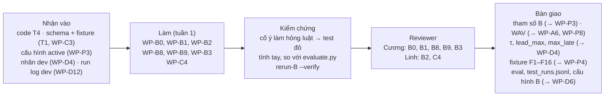

# Phần việc của Khánh: R-B (BT-B, lời cảnh báo, đánh giá hành vi cảnh báo)

Bạn phụ trách phần "nói":
- luật và máy trạng thái quyết định có cảnh báo hay không;
- lời cảnh báo;
- phương pháp đánh giá B so với baseline.

Bạn chịu trách nhiệm phương pháp và tính đúng của mục "B so với baseline" và của `L_alert(B)` trong báo cáo. R-D tổng hợp báo cáo, nhưng không chịu trách nhiệm phương pháp của các mục này.

Code BT-B đã có (T4, `src/roadwatch/decision/`; tình trạng ở README mục 3). Việc đầu tiên của bạn là tiếp nhận code đó, không viết lại.

- **Owner, reviewer, phụ thuộc, hạn, trạng thái tổng:** [README](../README.md), mục 4. Nếu sơ đồ dưới đây khác bảng đó thì bảng thắng.
- **Checklist dưới mỗi task:** cập nhật ngay khi xong từng mục, theo luật ở [README](../README.md), mục 0.
- **Tài liệu cần đọc:** [AGENTS.md](../../../AGENTS.md), mục 3, dòng "BT-B" và dòng "Đánh giá, `rerun-B`".

## Thuật ngữ riêng

| Từ | Nghĩa |
|---|---|
| Năng lực | `cap_distance` và `cap_ttc`: hệ thống còn cảnh báo được loại nào (spec 3.4) |
| Đợt khoảng cách | `IDLE → PENDING → ALERTED → CLEARING`; `HOLD` khi mất dữ liệu ngắn; `SUSPENDED` khi quá `T_hold` (spec 3.5) |
| Đợt khẩn cấp | `IDLE → ACTIVE → CLEARING_E`; `HOLD_E` (spec 3.5) |
| Guardrail | Khi `cap_ttc = on`, TTC `ok` và TTC ≤ ngưỡng thì phải phát Khẩn cấp ngay, không tham số nào được chặn (spec 3.7). Phát lại trong cùng một đợt khi đợt chưa có lệnh Khẩn cấp nào `started` (OQ-B12, phương án (b)) |
| Baseline | Bộ cảnh báo đơn giản theo sườn lên, dùng cùng đầu vào với B, để so sánh (ADR-03) |
| `rerun-B` | Chạy lại B trên nhật ký đầu vào đã ghi, không cần chạy lại A |
| Khớp lần đầu / lặp / không khớp | Ba nhóm; mỗi cảnh báo thuộc đúng một nhóm (spec 5.2) |
| τ, `lead_max`, `max_late` | Ngưỡng IoU khi khớp đối tượng; độ sớm tối đa; độ trễ tối đa với `collision_risk` (spec 5.2, OQ-A3) |

## Tuần 1

### WP-B0 · Tiếp nhận code BT-B
- **Xong khi:** mỗi luật ở spec 3.4–3.7 hoặc có test, hoặc được ghi là "thiếu test" và chuyển sang WP-B9.
- **Kiểm chứng:** reviewer chọn ngẫu nhiên ba luật, cố ý làm hỏng từng luật trong code, thấy test tương ứng đỏ, rồi khôi phục.
- **Code có sẵn:** T4 và test của nó, gồm test thuộc tính cho guardrail (README mục 3).
- **Checklist:**
  - Bàn giao
    - [ ] Bảng đối chiếu luật ở spec 3.3–3.7 với test trong `tests/roadwatch/test_decision.py`, đặt trong mô tả PR của WP-B0
    - [ ] Đề xuất cho I-12, I-13 và mọi điểm lệch mới, viết vào `docs/specs/roadwatch-architecture.md`, mục 12
    - [ ] Luật còn thiếu test được thêm thành mục trong checklist của WP-B9, ở `docs/plan/phan-viec/khanh.md`
  - Kiểm thử và kiểm chứng
    - [ ] Toàn bộ test RoadWatch xanh sau khi tiếp nhận
  - Review và nghiệm thu
    - [ ] Reviewer kiểm theo mục "Kiểm chứng"

### WP-B1 · Bảng pháp lý và tham số B
- **Xong khi:** validator cấu hình chấp nhận file, và mọi giá trị không lấy từ văn bản luật đều nằm trong `provisional_keys`.
- **Kiểm chứng:** reviewer đối chiếu từng dải với **văn bản luật** TT38/2024. Bảng ở file 1 mục 1.1 chỉ là bản tóm tắt, không dùng làm nguồn.
- **Checklist:**
  - Bàn giao
    - [ ] Phần B của `config/proposals/v0.yaml`: `legal_table` kèm `legal_ref`; giá trị tạm cho `ttc`, `dispatch`, `speed`, `status_msgs`, `audio` (OQ-B2 phần B)
    - [ ] Câu trả lời OQ-B4 (có dải cho tốc độ dưới 60 km/h hay không), ghi ở `docs/specs/roadwatch-architecture.md`, mục 10.1
  - Kiểm thử và kiểm chứng
    - [ ] Validator cấu hình (`RwConfig`) chấp nhận file
  - Review và nghiệm thu
    - [ ] Reviewer kiểm theo mục "Kiểm chứng"

### WP-B2 · Câu nói tiếng Việt
- **Xong khi:** mọi `phrase_id` mà B có thể phát đều có file WAV, và hash thư viện câu nói có trong cấu hình.
- **Kiểm chứng:** reviewer nghe toàn bộ câu trên máy demo và xác nhận câu rõ, đúng nghĩa, không câu nào bắt tài xế nhìn màn hình. Sau đó so danh sách `phrase_id` trong code với thư mục WAV.
- **Checklist:**
  - Bàn giao
    - [ ] `scripts/roadwatch/render_phrases.py`: gồm văn bản các câu (OQ-B5) và bước render bằng Piper vi_VN. Các câu: Khẩn cấp kèm tiếng bíp, Cảnh báo, Thông tin, tạm dừng hệ thống, tắt cảnh báo khoảng cách, tắt cảnh báo va chạm, phục hồi, nhắc lại
    - [ ] `models/phrases/*.wav` (không commit; ghi hash thư viện câu làm bằng chứng)
    - [ ] Mục `audio` trong file cấu hình đề xuất: độ dài từng câu, hash thư viện câu nói
  - Kiểm thử và kiểm chứng
    - [ ] Mỗi `phrase_id` trong `src/roadwatch/decision/` có một file WAV tương ứng
  - Review và nghiệm thu
    - [ ] Reviewer kiểm theo mục "Kiểm chứng"

### WP-B8 · Phương pháp đánh giá hành vi cảnh báo
- **Xong khi:** PO đã duyệt OQ-A3, và R-D dùng được các giá trị đó trong hướng dẫn gán nhãn (WP-D4).
- **Kiểm chứng:** reviewer tự tạo một bộ nhãn và cảnh báo nhỏ, có ca chồng nhau và ca `exempt`; tính kết quả bằng tay và so với `evaluate.py`.
- **Checklist:**
  - Bàn giao
    - [ ] Đề xuất τ, `lead_max`, `max_late` kèm lý do, ghi vào OQ-A3 ở `docs/specs/roadwatch-architecture.md`, mục 10.3, **trước** khi gán nhãn `test_small`
    - [ ] Khung mục "B so với baseline" trong `eval/results/report.md`, theo chỉ số chính và phụ ở spec 5.5
    - [ ] Test cho các luật ở spec 5.2 còn thiếu, trong `tests/roadwatch/test_rerun_eval.py`
  - Kiểm thử và kiểm chứng
    - [ ] Bảng đối chiếu luật ở spec 5.2 với test, đặt trong mô tả PR
  - Review và nghiệm thu
    - [ ] Reviewer kiểm theo mục "Kiểm chứng"
    - [ ] PO duyệt OQ-A3

### WP-B9 · Fixture tình huống lỗi cho B và OQ-A5
- **Xong khi:** mọi dòng ở cột "Fixture cho B" của spec 6.2 đều có test, kể cả kịch bản S1–S7 của spec 3.7 theo phương án (b) của OQ-B12, và phần pytest của AC-M7 đạt.
- **Kiểm chứng:** reviewer đối chiếu bảng 6.2 với danh sách test. Còn dòng nào thiếu thì chưa được ✅. Riêng S4 và S7, reviewer đối chiếu kết quả test với phương án (b) của OQ-B12.
- **Checklist:**
  - Bàn giao
    - [ ] Fixture cho các dòng F1–F16 thuộc B, loại "hợp lệ nhưng mô tả tình huống lỗi" (spec 4.6): `tests/roadwatch/fixtures/`, kèm test trong `tests/roadwatch/test_decision.py`
    - [ ] Test kịch bản `HOLD` lặp lại trong `CLEARING_E` (OQ-A5), trong `tests/roadwatch/test_decision.py`
    - [ ] Đề xuất cho OQ-A5 (thêm luật hay ghi thành giới hạn), ghi ở `docs/specs/roadwatch-architecture.md`, mục 10.3
    - [ ] Test kịch bản S1–S7 của spec 3.7 trong `tests/roadwatch/test_decision.py`: S1, S2, S3, S5, S6 theo hành vi hiện tại; S4, S7 theo phương án (b) của OQ-B12: phát ở khung *m*
    - [ ] Phương án (b) của OQ-B12: sửa `src/roadwatch/decision/episodes.py`, `src/roadwatch/decision/stage.py`, và mở rộng test thuộc tính guardrail
  - Kiểm thử và kiểm chứng
    - [ ] Phần pytest của AC-M7 đạt
    - [ ] Đã thử cố ý làm hỏng luật phát Khẩn cấp và thấy test S1–S7 hoặc test thuộc tính đỏ, rồi khôi phục ([code-rules](../../development/code-rules.md), mục 10)
  - Review và nghiệm thu
    - [ ] Reviewer kiểm theo mục "Kiểm chứng"

### WP-C4 · Loại phiên GPS kém và sổ ghi lần chạy test
- **Xong khi:** có test cho cả hai luật; mục tiêu độ bất định là tham số của công cụ đánh giá, không hard-code, vì con số 0,5 s ở spec 5.1 mới là đề xuất.
- **Kiểm chứng:** reviewer chạy `eval` trên một manifest có phiên mang giá trị `null`. Phiên đó không vào chỉ số chính mà xuất hiện ở mục riêng.
- **Checklist:**
  - Bàn giao
    - [ ] `src/roadwatch/evaluate.py` loại khỏi chỉ số chính các phiên có `gps_offset_uncertainty_ms` là `null` hoặc vượt mục tiêu, và các phiên có `speed.source = simulated`; các phiên này vẫn được báo cáo riêng (spec 5.1)
    - [ ] Mọi lần chạy trên `test_*` được ghi vào `eval/test_runs.jsonl` (spec 5.5). File này được commit cùng báo cáo
  - Kiểm thử và kiểm chứng
    - [ ] Test cho cả hai luật, trong `tests/roadwatch/test_rerun_eval.py`
  - Review và nghiệm thu
    - [ ] Reviewer kiểm theo mục "Kiểm chứng"

### WP-B3 · Tinh chỉnh B trên bộ `dev`
- **Xong khi:** trên `dev`, số cảnh báo không khớp của B nhỏ hơn baseline và `recall_B ≥ recall_baseline`. Nếu không đạt thì ghi rõ và giải thích vì sao.
- **Kiểm chứng:** người duyệt HITL chạy lại `rerun-B --verify` trên một lần chạy có trong báo cáo, và kiểm rằng báo cáo không dùng split `test_*`.
- **Luật riêng:** bạn tinh chỉnh B, nên **không được xem clip hay nhãn của `test_small`** trước lần chạy duy nhất (WP-D6).
- **Checklist:**
  - Bàn giao
    - [ ] Kết quả quét `T_confirm`, `h`, `T_clear`, cooldown bằng `rerun-B`, chỉ trên `dev`, đặt trong mô tả PR
    - [ ] File cấu hình B đề xuất trong `config/proposals/`
    - [ ] Báo cáo tác động (đường `[B]`) trên máy demo: `configs/reports/<sha>.json` (không commit; ghi sha làm bằng chứng)
  - Kiểm thử và kiểm chứng
    - [ ] So B với baseline trên `dev` theo "Xong khi"
  - Review và nghiệm thu
    - [ ] Người duyệt HITL kiểm theo mục "Kiểm chứng", rồi duyệt và kích hoạt

## Tuần 2–4

### WP-B6 · Mở rộng B
- **Xong khi:** AC-F4 đạt: qua các fixture và clip có nhãn.
- **Kiểm chứng:** reviewer chạy lại các fixture và clip có nhãn.
- **Checklist:**
  - Bàn giao
    - [ ] `src/roadwatch/decision/`: nhắc sớm theo xu hướng; ân hạn khi bị chen, chỉ khi có bằng chứng từ WP-A9 (ADR-09); chế độ ùn tắc; chế độ người mới
    - [ ] `docs/specs/roadwatch-architecture.md`, mục 3.5 và bảng tình huống lỗi, cập nhật theo hành vi mới
  - Kiểm thử và kiểm chứng
    - [ ] Test và fixture trong `tests/roadwatch/test_decision.py`, `tests/roadwatch/fixtures/`; guardrail vẫn đạt
  - Review và nghiệm thu
    - [ ] Reviewer kiểm theo mục "Kiểm chứng"

### WP-B7 · Chu kỳ nhắc và ngưỡng trễ cảm nhận
- **Xong khi:** có biên bản thử nghe (WP-D9), và giá trị được duyệt qua HITL.
- **Kiểm chứng:** reviewer đối chiếu giá trị chọn với biên bản thử nghe.
- **Checklist:**
  - Bàn giao
    - [ ] `remind_interval` và ngưỡng `perceived_delay` theo mức, trong file cấu hình đề xuất
    - [ ] Câu trả lời OQ-A8, ghi ở `docs/specs/roadwatch-architecture.md`, mục 10.3
  - Kiểm thử và kiểm chứng
    - [ ] Báo cáo tác động bằng `rerun-B` trên `dev`
  - Review và nghiệm thu
    - [ ] Reviewer kiểm theo mục "Kiểm chứng"; duyệt qua HITL
