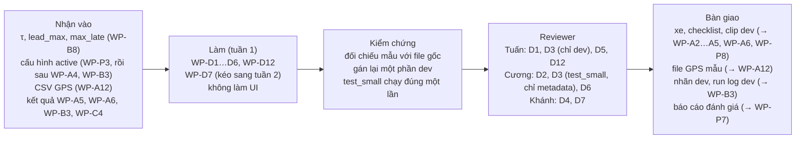

# Phần việc của Linh: R-D (dữ liệu, gán nhãn, vận hành đánh giá; web UI từ tuần 2)

Bạn phụ trách mọi thứ liên quan tới bằng chứng:
- quay dữ liệu thực địa;
- gán nhãn;
- chạy các lần đánh giá;
- tổng hợp `eval/results/report.md`;
- phỏng vấn người dùng.

Bạn **tổng hợp** báo cáo. Phương pháp và tính đúng của từng mục do owner của thành phần đó xác nhận (README mục 1); riêng mục phỏng vấn là của bạn.

**Tuần 1 bạn không làm giao diện**: bản MVP chỉ có CLI và âm thanh. Web UI bắt đầu từ tuần 2.

- **Owner, reviewer, phụ thuộc, hạn, trạng thái tổng:** [README](../README.md), mục 4. Nếu sơ đồ dưới đây khác bảng đó thì bảng thắng.
- **Checklist dưới mỗi task:** cập nhật ngay khi xong từng mục, theo luật ở [README](../README.md), mục 0.
- **Tài liệu cần đọc:** [AGENTS.md](../../../AGENTS.md), mục 3, dòng "Dữ liệu thực địa, gán nhãn" và "Đánh giá, `rerun-B`". Từ tuần 2 đọc thêm dòng "Web UI".



## Thuật ngữ riêng

| Từ | Nghĩa |
|---|---|
| Phiên quay | Một lần gắn camera và quay liên tục. Split được chia theo phiên, không theo clip (spec 5.1) |
| Session manifest | File mô tả một phiên quay (spec 4.4): video, GPS, `gps_offset_ms`, độ bất định (để `null` khi chưa đo, không ghi 0), checklist, split |
| Sự kiện đồng bộ | Khoảnh khắc thấy rõ trên cả video lẫn GPS, ví dụ lăn bánh từ lúc đứng yên. Dùng để tính độ lệch thời gian giữa video và GPS |
| `must_alert` / `exempt` | Sự kiện hệ thống phải cảnh báo / ngữ cảnh mà cảnh báo khoảng cách chỉ là báo phiền (spec 5.2) |
| `collision_risk` + `cause` | Nhãn nguy cơ va chạm; `cause` ghi nguyên nhân. TTC thấp không đồng nghĩa với xe trước phanh gấp |
| Gán mù | Gán nhãn khi chưa xem đầu ra của B hay baseline |

**Nơi để dữ liệu thực địa:** `data/` (đã có trong `.gitignore`, không commit). Bằng chứng trong checklist ghi đường dẫn tương đối trong `data/`, kèm hash khi cần.

## Hướng dẫn thực hành dữ liệu MVP

Bổ sung ngày 30/09/2026. Đây là cách thực hiện WP-D1…D6/D12, không thay đổi phạm vi, hạn hay tiêu chí nghiệm thu. Nguồn chuẩn: [spec](../../specs/roadwatch-architecture.md), mục 4–5; [cấu hình lắp đặt](../../requirements/RoadWatch_Copilot_3_Cau_hinh_lap_dat.md), mục 3–4. Các gợi ý tổ chức dưới đây không phải số đo hoặc ngưỡng đã duyệt.

### 1. Cần những dữ liệu gì, giao cho ai?

| Gói | Nội dung cụ thể | Mục đích và người nhận |
|---|---|---|
| Video cao tốc + GPS đồng thời | Video gốc liên tục, log GPS gốc, CSV chuẩn do WP-A12 chuyển, manifest và ghi chú đồng bộ của từng phiên | Tuấn kiểm CV; Cương chạy pipeline; Khánh tinh chỉnh B qua các run dev |
| Số đo lắp đặt | Chiều cao tâm camera so với mặt đường, khoảng cách ngang camera–cản trước, ảnh cách đo và checklist mỗi lần gắn | Tuấn dùng cho hình học; Cương đưa vào cấu hình qua HITL |
| Khoảng cách camera–cản trước | Số đo `d_cam_bumper_m` trên từng xe thử, ảnh vị trí camera | Tuấn hướng dẫn KS-3; Linh hỗ trợ đo và lưu ảnh |
| Khoảng cách tham chiếu | Clip hai xe đứng yên, khoảng cách cản trước–đuôi xe trước đo bằng thước, ảnh bằng chứng | Tuấn kiểm sai số khoảng cách WP-A5; không dùng đầu ra CV làm số đo chuẩn |
| Nhãn sự kiện | Thời gian bắt đầu/kết thúc, loại sự kiện, xe liên quan, mức cảnh báo tối thiểu theo hướng dẫn | Khánh chốt phương pháp; Linh gán mù và chạy đánh giá |
| Bằng chứng đánh giá | Dataset manifest, hash nhãn, danh sách run, cấu hình/code/model dùng, kết quả và giới hạn | Linh tổng hợp; owner từng phương pháp xác nhận; Cương chốt bản nộp |

Không cần tự gán bounding box mọi xe ở mọi khung để huấn luyện detector trong tuần 1. Nhãn RoadWatch là **nhãn sự kiện** và bbox xe liên quan ở khung chốt; chỉ bổ sung nhãn CV khác nếu task đã yêu cầu. GPS là tốc độ xe mình, không phải khoảng cách tới xe trước hay TTC chuẩn.

### 2. Trên mạng đã có gì?

Nguồn được kiểm tra ngày 30/09/2026. Chỉ tải mẫu nhỏ sau khi xác nhận có file cần dùng và quyền sử dụng; không tải toàn bộ dataset để chờ chọn sau.

| Nguồn chính thức | Có gì | Dùng trong dự án thế nào? |
|---|---|---|
| [KITTI Raw](https://www.cvlibs.net/datasets/kitti/raw_data.php) | Chuỗi ảnh, timestamp, GPS/IMU có vận tốc, calibration; một số chuỗi có nhãn tracklet 3D. Có bản synced/rectified; tải cần đăng nhập | Ưu tiên khảo sát một chuỗi nhóm Road để thử dữ liệu nhiều cảm biến. Tuấn phải xử lý hệ tọa độ, thời gian và camera của KITTI; không áp cấu hình camera xe nhóm vào KITTI |
| [BDD100K — repo chính thức](https://github.com/bdd100k/bdd100k) | Dataset lái xe phục vụ nhiều bài toán thị giác, có toolkit và đường dẫn dữ liệu | Hữu ích cho thử detector trên cảnh đa dạng. Phải kiểm tra từng gói video/nhãn/telemetry thực sự tải được; không mặc định mỗi clip có calibration, GPS hay nhãn khoảng cách/TTC cần cho RoadWatch |
| Video dashcam có quyền sử dụng | Hình ảnh tình huống giao thông | Chỉ khảo sát cảnh hoặc thử detector nếu thiếu GPS/calibration. Không tự điền tốc độ, chiều cao camera hay khoảng cách để biến thành bằng chứng nghiệm thu |

KITTI công bố [giấy phép CC BY-NC-SA 3.0](https://www.cvlibs.net/datasets/kitti/). Với BDD100K, kiểm điều khoản của **gói dữ liệu** ở trang tải, không lấy giấy phép toolkit làm giấy phép dataset. Với mỗi nguồn, lưu URL, ngày tải, sequence ID, giấy phép/điều khoản, danh sách file và SHA-256 trong ghi chú nguồn bên cạnh dữ liệu.

**Cách chọn cho tuần 1:** dữ liệu tự quay vẫn là đầu vào chính của WP-D3/D5/D6 theo plan. Dữ liệu công khai chỉ hỗ trợ phát triển riêng trong `data/external/`; không trộn vào kết quả thực địa của xe nhóm. Nếu không tiếp cận được xe/đường quay, báo Cương quyết định phạm vi và ghi phần chưa kiểm chứng; không tự thay bằng video mạng rồi đánh dấu đạt.

### 3. Chuẩn bị và thử trước khi ra đường — WP-D1/D2

1. Chốt xe, sự đồng ý của chủ xe, người lái, người thao tác ghế phụ và lịch quay. Chuẩn bị camera/điện thoại, giá cố định, thiết bị GPS, nguồn điện, dung lượng lưu, và thước dây (đo KS-3). Tuần 1 chỉ tiếp cận được một xe thì ghi giới hạn theo WP-D1.
2. Tuấn kiểm vị trí camera cạnh gương, góc nhìn thấy đường và đuôi xe trước. Ghi thiết bị, độ phân giải, FPS và chế độ quay; giữ nguyên zoom, chế độ chống rung/crop đã hiệu chuẩn. Nếu thay đổi chế độ ảnh hoặc gắn lại camera, nhờ Tuấn kiểm lại.
3. Ứng viên Android để thử: [GPSLogger](https://gpslogger.app/) hỗ trợ xuất CSV/GPX và ghi tốc độ khi có; [BasicAirData GPSLogger](https://github.com/BasicAirData/GPSLogger) là ứng viên khác. Đây chưa phải quyết định chọn app. Nếu chỉ có iPhone, kiểm app trên máy thật bằng cùng checklist đầu ra trước khi chốt.
4. Bật nguồn GPS/GNSS, cho phép ghi nền, kiểm pin và tắt tự gửi log lên mạng. Chọn khoảng ghi ngắn nhất ổn định trên thiết bị, rồi đo khoảng cách giữa các mẫu thực tế. Tần suất cài đặt không bảo đảm tần suất log thực nhận.
5. Ghi thử khi đứng yên rồi di chuyển bình thường ở nơi an toàn, đồng thời quay video. Kiểm cả lúc màn hình khóa: GPS còn ghi, video còn chạy, timestamp có múi giờ, tốc độ có đơn vị, không mất cả đoạn log. Nếu dùng chung một điện thoại cho quay và GPS, phải thử đúng cách này.
6. Giao file gốc và ảnh cài đặt app cho Tuấn (WP-A12), nhờ xác nhận chuyển được sang `time_utc`, `speed_mps`; `recv_time_utc` và `speed_accuracy_mps` chỉ có khi nguồn thực sự cung cấp. Không lấy độ chính xác vị trí (m) điền vào độ chính xác tốc độ (m/s).
7. Cương xác nhận cách xử lý thời điểm nhận mẫu trước buổi quay chính. Theo spec 3.3 và 4.4, `recv_time_basis = logged` cần `recv_time_utc`; `modeled` cần `recv_delay_ms` đã đo. Không sao chép thời điểm GPS fix thành thời điểm nhận hoặc tự điền độ trễ 0. Nếu app không cung cấp và chưa đo được thì WP-D2 chưa đủ để bàn giao pipeline đánh giá.

Ghi quy trình đã thử và lựa chọn app vào `docs/plan/quy-trinh-quay.md` theo checklist WP-D1/D2. Hướng dẫn ở đây chưa thay cho biên bản thử trên thiết bị thật.

### 4. Quay và đo tại hiện trường — WP-D3/D5

**Trước mỗi phiên:** xe đỗ ở nơi an toàn, camera được cố định; ghi session ID và checklist. Đo KS-3, chụp rõ vị trí tâm camera và mốc cản trước. Camera tự hiệu chuẩn khi xe chạy, không cần đo góc lắp; Linh lưu ảnh gốc và kết quả được bàn giao.

**Buổi đo tĩnh:** dùng bãi trống an toàn, hai xe đứng yên; đo các mốc 10, 20, 40, 60 m theo KS-6, xa hơn chỉ khi an toàn. Mỗi mốc lưu clip, ảnh thước, khoảng cách thực đo và mã xe/camera. Đo theo phương ngang từ cản trước xe mình đến đuôi xe phía trước; không lấy khoảng cách từ camera hoặc số ước lượng bằng mắt. Mốc nào không làm được thì ghi thiếu, không nội suy thành số đo. Thử lệch camera WP-A3 chỉ khi xe đứng yên; phục hồi và kiểm lại lắp đặt trước phiên chạy.

**Buổi quay cao tốc:**

1. Bật GPS trước, bắt đầu video khi đứng yên ở điểm xuất phát an toàn. Ghi ít nhất hai sự kiện đồng bộ có thể nhận biết ở cả video và GPS, chẳng hạn bắt đầu lăn bánh và dừng ở điểm kết thúc an toàn. Không dừng trên cao tốc để tạo mốc.
2. Người lái lái bình thường; người ghế phụ thao tác thiết bị. Không cố tình bám sát, phanh gấp hay cắt đầu để tạo nhãn nguy hiểm. Hệ thống chỉ được chạy phát lại để đánh giá, không dùng nó làm căn cứ lái thử nguy hiểm.
3. Giữ video liên tục và GPS gốc. Ghi chú các cảnh tự nhiên gặp được: có/không có xe trước, đổi xe dẫn đầu, che khuất, ánh sáng khó, xe cắt vào. Ùn tắc nếu xuất hiện thì ghi ngữ cảnh ngoài phạm vi MVP, không biến thành tính năng đã hỗ trợ.
4. Theo WP-D3 cần ít nhất hai phiên; đề xuất tổ chức một phiên `dev`, một phiên `test_small`, chốt danh sách trước tinh chỉnh. Độ dài phụ thuộc điều kiện thực tế; plan không đặt số phút tối thiểu, không coi quay đủ phút là đủ sự kiện đánh giá.
5. Sau khi dừng an toàn, mở kiểm video và log trên máy. Sao lưu bản gốc, lập manifest và hash trước khi xử lý. Linh kiểm nội dung `test_small`; Tuấn chỉ nhận `dev`, Cương chỉ kiểm metadata của `test_small` theo WP-D3.

### 5. Đồng bộ video–GPS và kiểm chất lượng

Nguồn chuẩn: spec 3.1, 4.4, 5.1; tên trường cụ thể theo `SessionManifest` (spec 4.4). Cương/Tuấn xác nhận cách tính trước khi dùng cho chỉ số chính.

1. Với từng mốc đồng bộ, ghi thời gian trên video theo PTS và timestamp GPS UTC tương ứng, kèm khoảng không chắc chắn khi nhận diện mốc. Không lấy giờ sửa file làm giờ quay.
2. Gọi `G` là `video_start_utc_guess_ns`; với mốc i, gọi `U_i` là giờ GPS và `V_i` là thời gian tính từ đầu video. Offset ứng viên là `(U_i - V_i - G)` sau khi đưa về cùng đơn vị. Code dùng `start = G + gps_offset_ms`; kiểm dấu bằng cách đặt lại mốc vào video.
3. Lưu bảng tất cả offset ứng viên, cách tổng hợp và sai số nhận diện mốc. Cương xác nhận phương pháp ước lượng độ bất định; không chỉ lấy độ lệch giữa hai mốc làm toàn bộ sai số vì GPS còn có chu kỳ lấy mẫu và trễ phản hồi. Nếu mốc đầu/cuối lệch rõ, kiểm drift, timestamp và video mất/cắt đoạn trước khi chấp nhận một offset cố định.
4. `gps_offset_uncertainty_ms` để `null` nếu chưa đo được, giải thích trong `sync_method` hoặc ghi chú kèm theo. Spec 5.1 loại phiên này khỏi chỉ số chính; mục tiêu 0,5 s trong spec vẫn là đề xuất cần kiểm chứng. Không tự coi đó là ngưỡng đã duyệt.
5. Phân biệt offset giữa hai đồng hồ với độ trễ nhận GPS (`recv_delay_ms`): hai đại lượng khác nhau. Thiếu bằng chứng cho đại lượng nào thì ghi thiếu đại lượng đó.
6. Sau chuyển đổi, Tuấn kiểm `read_gps` đọc được CSV, đơn vị m/s, thời gian có múi giờ và thứ tự hợp lý; Linh đối chiếu mẫu với file gốc. Không điền 0 vào tốc độ mất. CSV hiện tại yêu cầu tốc độ dạng số, nên dòng thiếu phải được converter xử lý minh bạch theo WP-A12, giữ log gốc và báo số dòng bị loại.

### 6. Lưu file, phân quyền và bàn giao

Sơ đồ dưới đây là cách đặt tên gợi ý, không thêm trường vào schema. Giữ tên/path đã thống nhất với CLI nếu khác. `data/` và `runs/` không commit; không bỏ dữ liệu trong thư mục chia sẻ cho cả nhóm rồi chỉ dựa vào lời nhắc giữ kín test.

```text
data/
  gps-sample/                     # file ghi thử + cài đặt app
  survey/                        # ảnh và số đo KS-3
  static/<measurement_id>/       # clip + ảnh thước + bảng số đo KS-6
  sessions/<session_id>/
    video.mp4                    # bản gốc, không ghi đè
    gps-original.<ext>            # log từ app
    gps.csv                      # bản chuẩn hóa của WP-A12
    session_manifest.json
    capture-notes.md              # cài đặt, mốc đồng bộ, lý do thiếu dữ liệu
  labels/                        # nhãn theo session/split, hạn chế quyền test
  external/<dataset>/<sequence>/ # mẫu công khai + nguồn và điều khoản
  dataset_manifest.json          # theo công cụ/định dạng repo thống nhất
runs/<run_id>/                   # sản phẩm pipeline; không phải dữ liệu gốc
```

- Giữ `test_small` và nhãn trên vùng chỉ Linh truy cập; nếu dùng Drive, đặt folder riêng với quyền riêng. Cương kiểm bằng công cụ chỉ in metadata; không cấp Tuấn/Khánh quyền xem nội dung trước WP-D6.
- Session manifest phải trỏ đúng file pipeline dùng và hash đúng file đó. Log GPS gốc vẫn lưu riêng để truy vết phép chuyển đổi. Không đổi tên/cắt video sau khi đã gán frame và hash mà không cập nhật các tham chiếu liên quan.
- Mỗi lần bàn giao ghi session ID, split, đường dẫn, hash, số khung/thời lượng, số mẫu GPS, thông số nào còn thiếu và người nhận. Không tự thêm các ghi chú này vào JSON strict; để file ghi chú hoặc dataset manifest đúng định dạng công cụ hỗ trợ.
- Giữ nguyên bản gốc để đánh giá; bản video dùng trình chiếu/công khai có thể cần che thông tin nhận dạng và vị trí riêng tư, lưu thành bản khác. Bản đã biên tập không thay âm thầm cho bản có hash.

### 7. Gán nhãn mà không lấy dự đoán làm đáp án — WP-D4

1. Nhận phương pháp WP-B8 từ Khánh và viết `docs/plan/huong-dan-gan-nhan.md` theo spec 5.2. Khánh phải làm rõ cách xác định đầu/cuối sự kiện và căn cứ phân biệt `tailgating`/`collision_risk`; Linh không tự suy ra ngưỡng hay số TTC từ quan sát mắt.
2. Xem video gốc khi chưa xem cảnh báo của B/baseline. Ghi `event_id`, `clip_id`, thời gian bắt đầu/kết thúc theo giây; xác nhận với Cương cách ánh xạ `clip_id` vào phiên. Nếu dùng đoạn cắt để xem, vẫn giữ ánh xạ về PTS/frame gốc.
3. Chọn `type`, `expect`, `min_level` đúng `EventLabel` (spec 5.2): `must_alert` phải có mức; `exempt` có `min_level = null`. `collision_risk` cần `cause`; chưa rõ nguyên nhân thì `unknown`, không mặc định xe trước phanh gấp.
4. Với sự kiện có xe mục tiêu, lưu `key_frame_idx` và bbox pixel ở độ phân giải của video gốc theo schema. Với `congestion`, `target = null`. Bbox ở một khung chốt không phải yêu cầu vẽ lại toàn bộ video.
5. Cảnh không đủ căn cứ thì ghi vào danh sách cần làm rõ bên ngoài schema, không tự thêm enum hoặc ép thành nhãn chắc chắn. Chốt quy tắc xử lý trước đóng băng; công bố giới hạn ground truth. Kiểm guardrail bằng fixture của Khánh không thay cho recall thực địa.
6. Khánh gán lại một phần **dev**, đối chiếu khác biệt rồi hoàn thiện hướng dẫn. Linh áp dụng hướng dẫn cho test mà không đưa nội dung test cho người tinh chỉnh. Đóng băng nhãn và hash trước lần chạy test.

### 8. Thứ tự làm và điểm phải dừng

| Bước | Linh thực hiện | Cần nhận / nếu thiếu |
|---|---|---|
| Chuẩn bị | WP-D1/D2: thử app, thiết bị, đồng bộ, gửi log mẫu | Tuấn xác nhận converter; Cương xác nhận cách xử lý thời gian nhận |
| Thu dữ liệu | WP-D3/D5: phiên cao tốc, số đo lắp đặt, clip khoảng cách chuẩn | Tuấn hỗ trợ hiệu chuẩn; thiếu xe thì báo lead ngay |
| Chuẩn bị dev/test | WP-D4: chia phiên, gán mù, giữ kín và đóng băng test | Khánh giao hướng dẫn/phương pháp WP-B8; không mở test để tinh chỉnh |
| Chạy dev | WP-D12: replay dev và kiểm tái lập | Nhận CLI, model, CSV và cấu hình active sau WP-A4; chuyển run cho WP-B3 |
| Đánh giá MVP | WP-D6: một lần test, tổng hợp báo cáo | Chỉ chạy khi đủ phụ thuộc trong README, nhãn đóng băng, cấu hình active và công cụ ghi lượt test đã sẵn sàng |

Không chép lệnh CLI phỏng đoán vào quy trình: Cương bàn giao cú pháp đã chạy được ở WP-C2, Tuấn bàn giao converter WP-A12. Các lệnh kiểm tra chuẩn nằm ở [code-rules](../../development/code-rules.md), mục 8. Ghi lệnh thực chạy và kết quả vào bằng chứng task. Nếu lần test lỗi, giữ log và báo lead theo quy định đánh giá; không xóa dấu vết rồi chạy lại như chưa từng chạy.

Khi xong từng file hoặc bước, cập nhật checklist đúng WP-D bên dưới kèm ngày, đường dẫn/hash và kết quả; chỉ ghi hoàn thành phần thực sự đã làm. Hướng dẫn này không có nghĩa là đã thu dữ liệu, đã chọn app hay đã nghiệm thu task.

## Tuần 1

### WP-D1 · Xe, thiết bị, quy trình quay
- **Xong khi:** KS-1 đạt tiêu chí của file 3. Nếu chỉ có một xe thì ghi rõ, kèm hệ quả: AC-F1 chưa làm được.
- **Kiểm chứng:** reviewer gắn thử camera một lần theo checklist lắp đặt và báo lại bước nào còn chưa rõ.
- **Checklist:**
  - Bàn giao
    - [ ] Kết quả KS-1 (xe tiếp cận được, chủ xe đồng ý hay không, thiết bị quay), ghi ở `docs/requirements/RoadWatch_Copilot_3_Cau_hinh_lap_dat.md`, mục 4.4
    - [ ] `docs/plan/quy-trinh-quay.md`. Gồm:
      - người ngồi ghế phụ thao tác, người lái không đụng vào thiết bị;
      - bắt đầu quay khi xe đang đứng yên;
      - mỗi phiên có đủ sự kiện đồng bộ để ước lượng độ bất định (ít nhất hai);
      - checklist lắp đặt.
  - Kiểm thử và kiểm chứng
    - [ ] Chạy thử quy trình một lần khi xe đứng yên
  - Review và nghiệm thu
    - [ ] Reviewer kiểm theo mục "Kiểm chứng"

### WP-D2 · App GPS và quy trình đồng bộ
- **Xong khi:** WP-A12 có file mẫu, và WP-D3 có quy trình để lập session manifest.
- **Kiểm chứng:** reviewer chọn một sự kiện đồng bộ trong lần ghi thử, tự đọc thời điểm trên video và trên GPS, rồi so với độ lệch tính theo quy trình.
- **Checklist:**
  - Bàn giao
    - [ ] Tên app GPS đã chọn (ưu tiên app ghi được thời điểm nhận mẫu, OQ-M4), cùng quy trình tính `gps_offset_ms` và `gps_offset_uncertainty_ms`, ghi trong `docs/plan/quy-trinh-quay.md`
    - [ ] File GPS mẫu từ một lần ghi thử, trong `data/gps-sample/`; giao cho WP-A12
  - Kiểm thử và kiểm chứng
    - [ ] Quy trình đã chạy thử trên lần ghi đó
  - Review và nghiệm thu
    - [ ] Reviewer kiểm theo mục "Kiểm chứng"

### WP-D3 · Quay dữ liệu cao tốc
- **Xong khi:**
  - WP-A3, WP-A4, WP-D12, WP-A6 và WP-P8 dùng được các phiên `dev`; WP-D4 dùng được cả `dev` lẫn `test_small`.
  - Mỗi phiên có `gps_offset_ms`, và có `gps_offset_uncertainty_ms` (hoặc `null` kèm lý do, không ghi 0).
  - Nếu chỉ có một phiên thì chia split theo khối thời gian, và ghi đây là một giới hạn.
- **Luật giữ kín `test_small`** (spec 5.1; luật ở WP-D4): người tinh chỉnh A hay B (Tuấn, Khánh) không mở video, GPS hay nhãn của phiên `test_small` trước lần chạy duy nhất ở WP-D6. Chỉ bạn xem nội dung các phiên này, vì bạn không tinh chỉnh A hay B.
- **Kiểm chứng:** tách theo split.
  - **Phiên `dev` và ảnh KS-3** (Tuấn): mở từng phiên, kiểm video phát được, GPS có mẫu, manifest đủ trường, số đo KS-3 có ảnh đi kèm.
  - **Phiên `test_small`** (Cương, chỉ xem metadata): chạy `scripts/roadwatch/check_sessions.py` và đọc bản in ra. Không mở video, không xem khung hình hay nhãn. Script báo lỗi thì bạn tự sửa phiên đó rồi Cương chạy lại, không chuyển phiên cho người khác xem.
- **Checklist:**
  - Bàn giao
    - [ ] Ít nhất hai phiên cao tốc, mỗi phiên trong `data/sessions/<session_id>/`: video, GPS, checklist lắp đặt, session manifest (lập theo quy trình của WP-D2), split (spec 5.1)
    - [ ] KS-3 trên từng xe thử, ghi ở `docs/requirements/RoadWatch_Copilot_3_Cau_hinh_lap_dat.md`, mục 3 và 4.4; ảnh chụp cách đo trong `data/survey/`
    - [ ] `scripts/roadwatch/check_sessions.py`: với mỗi phiên, chỉ in metadata: manifest đọc được bằng `SessionManifest`, `split`, hash file khớp manifest, video mở được cùng số khung và thời lượng, số dòng của file GPS gốc. Không hiển thị hay ghi ra khung hình, không đọc nhãn
  - Kiểm thử và kiểm chứng
    - [ ] Script chạy không lỗi trên mọi phiên `dev` và `test_small`. Việc `read_gps` đọc được GPS đã chuyển đổi thuộc WP-A12
  - Review và nghiệm thu
    - [ ] Tuấn kiểm các phiên `dev` và ảnh KS-3 theo mục "Kiểm chứng"
    - [ ] Cương chạy script trên các phiên `test_small` và ghi bản in ra vào mô tả PR, không mở nội dung

### WP-D5 · Clip xe đứng yên (KS-6)
- **Xong khi:** mỗi khoảng cách mà KS-6 quy định có clip và số đo, và WP-A5 dùng được.
- **Kiểm chứng:** reviewer kiểm ảnh thước ở từng khoảng cách.
- **Checklist:**
  - Bàn giao
    - [ ] Clip xe demo đứng yên ở từng khoảng cách, cùng ảnh thước và bảng khoảng cách đo (từ cản trước xe mình tới đuôi xe phía trước), trong `data/static/`
    - [ ] Kết quả KS-6 ghi ở `docs/requirements/RoadWatch_Copilot_3_Cau_hinh_lap_dat.md`, mục 4.4
  - Kiểm thử và kiểm chứng
    - [ ] Cùng buổi này làm lần thử chạm lệch camera của WP-A3
  - Review và nghiệm thu
    - [ ] Reviewer kiểm theo mục "Kiểm chứng"

### WP-D4 · Gán nhãn
- **Xong khi:** dataset manifest có hash của nhãn, và nhãn `test_small` đã đóng băng **trước** WP-D6.
- **Kiểm chứng:** reviewer đối chiếu hướng dẫn với spec 5.2. Trên `dev`, reviewer tự gán lại một phần clip rồi so khác biệt với nhãn của bạn.
- **Luật:** không ai đang tinh chỉnh A hay B được xem clip hay nhãn `test_small` trước lần chạy duy nhất. Người kiểm tra nhãn chỉ kiểm trên `dev`.
- **Checklist:**
  - Bàn giao
    - [ ] `docs/plan/huong-dan-gan-nhan.md`: hướng dẫn gán nhãn theo spec 5.2, dùng giá trị OQ-A3 đã duyệt ở WP-B8
    - [ ] Nhãn `dev` trong `data/labels/`
    - [ ] Nhãn `test_small` gán mù trong `data/labels/`, đóng băng bằng hash ghi trong dataset manifest
  - Kiểm thử và kiểm chứng
    - [ ] Mọi file nhãn đọc được bằng `EventLabel`
  - Review và nghiệm thu
    - [ ] Reviewer kiểm theo mục "Kiểm chứng"

### WP-D12 · Chạy replay bộ `dev`
- **Xong khi:** mọi lần chạy có manifest với `approval_id`, và `rerun-B --verify` đạt.
- **Kiểm chứng:** reviewer kiểm manifest: đúng cấu hình active, không có cờ `dirty_tree`, `unapproved_code` hay `scripted_detector`.
- **Checklist:**
  - Bàn giao
    - [ ] Các lần chạy replay trên toàn bộ `dev`, với cấu hình active sau WP-A4: `runs/<run_id>/` (không commit). Ghi danh sách `run_id` làm bằng chứng và giao cho WP-B3
  - Kiểm thử và kiểm chứng
    - [ ] `rerun-B --verify` đạt với mọi lần chạy
  - Review và nghiệm thu
    - [ ] Reviewer kiểm theo mục "Kiểm chứng"

### WP-D6 · Chạy `test_small` và tổng hợp báo cáo
- **Xong khi:** AC-M5 và AC-M6, cùng AC-M3 và AC-M4 lấy từ WP-A6, có số liệu. Nếu chưa đủ điều kiện thì ghi "sơ bộ", "chưa kết luận" hoặc "chưa kiểm chứng" đúng theo luật của spec.
- **Kiểm chứng:**
  - `eval/test_runs.jsonl` có đúng một lần chạy `test_small`.
  - Hash trong báo cáo khớp với manifest.
  - Mục nào cũng có xác nhận của owner.
- **Checklist:**
  - Bàn giao
    - [ ] **Đúng một** lần chạy `test_small`, với cấu hình đã duyệt và đang active, được ghi vào `eval/test_runs.jsonl`. File này được commit cùng báo cáo
    - [ ] `eval/results/report.md`: tổng hợp các mục, gắn hash theo spec 5.5
  - Kiểm thử và kiểm chứng
    - [ ] Mỗi mục của báo cáo có xác nhận của owner phương pháp (README mục 1)
  - Review và nghiệm thu
    - [ ] Reviewer kiểm theo mục "Kiểm chứng"

### WP-D7 · Phỏng vấn người dùng
- **Xong khi:** có tóm tắt với đủ số người theo file 1 (5–8 người mới lái, 3–5 người vừa đổi xe). Nếu thiếu người thì ghi số người thực tế.
- **Kiểm chứng:** reviewer đọc tóm tắt và ghi lại điểm nào ảnh hưởng tới câu nói hoặc chính sách cảnh báo.
- **Checklist:**
  - Bàn giao
    - [ ] Bộ câu hỏi dựa trên các giả định ở file 1, mục 3, chuẩn bị ngay trong tuần 1, ở mục "Phản hồi người dùng" của `eval/results/report.md`
    - [ ] Tóm tắt phỏng vấn đã ẩn danh, có trích dẫn: mục "Phản hồi người dùng" của `eval/results/report.md`
  - Kiểm thử và kiểm chứng
    - [ ] Không còn thông tin nhận dạng người được phỏng vấn
  - Review và nghiệm thu
    - [ ] Reviewer kiểm theo mục "Kiểm chứng"

## Tuần 2–4

### WP-C6 · Màn hình kỹ sư
- **Xong khi:** AC-F5; responsive, có dark mode, qua kiểm tra accessibility cơ bản.
- **Kiểm chứng:** reviewer chạy luồng HITL trên web và kiểm rằng nó dùng cùng hàm `configstore` với CLI.
- **Checklist:**
  - Bàn giao
    - [x] 09/10/2026: theo yêu cầu merge tất cả thay đổi đang có, đưa trang trình diễn `judge.html` vào `/`, giữ trang kỹ sư ở `/engineer`, thêm danh sách/chạy video mẫu. API 1.1.0 và OpenAPI được cập nhật; test dùng kho tạm kiểm sample còn nguyên sau xóa phiên, fallback sao chép, metadata không hợp lệ, cùng hai trang. Tổng 43 test Python 3.11 đạt; JS syntax, lint và Docker smoke đạt. Chưa kiểm accessibility, HITL hay nghiệm thu AC-F5. Người dùng yêu cầu bỏ file giấy phép openpilot.
    - [x] 03/10/2026: người dùng yêu cầu upload là tự chạy realtime; chọn file tự POST job rồi mở SSE preview, không có bước bấm phân tích. Nút còn lại là Chạy lại video. Test Chrome chứng minh chỉ chọn file đã tạo POST đúng một lần; kiểm video thật tự mở preview khi job đang chạy, không bấm Start.
    - [x] 03/10/2026: sửa theo phản hồi người dùng: stream JPEG có detection ngay trong lúc xử lý qua SSE, vẽ mọi xe phát hiện và xe dẫn đầu, metric/trace/cảnh báo/WAV cùng khung. Chrome xác nhận preview xuất hiện khi nút chạy còn disabled; clip thật `replay-20261003T091603-b3e173` có 82 bản ghi, 2 cảnh báo B, rerun-B khớp. Ảnh bằng chứng `/tmp/roadwatch-streaming-desktop.png`. Không chờ kết thúc clip mới hiển thị.
    - [x] 03/10/2026: theo yêu cầu mới của người dùng, thay số dựng sẵn bằng pipeline upload ONNX → A → B → C thật (`web/server.py`, `web/app.js`); giữ viewer log cũ. Bounding box/metric/trace đồng bộ video; WAV bản nháp phát theo audio_plan; ZIP log và rerun-B thật. Người dùng cho phép giả định camera/tốc độ, được ghi rõ trên UI và config; chưa phải số đo thực địa.
    - [x] 03/10/2026: API trên kho tạm đạt 3 test (khẩn cấp TTC vẫn phát khi thiếu tốc độ, tốc độ mô phỏng có nguồn, lỗi video/GPS); test Chrome viewer/upload/mobile đạt. Clip thật không overlay: replay `replay-20261003T085404-7123a0`, 82 bản ghi, 81 khung có xe dẫn đầu, 2 cảnh báo B, rerun-B khớp. Không dùng làm nghiệm thu.
    - [x] 03/10/2026: theo yêu cầu trực tiếp của người dùng, dựng bản demo MVP độc lập tại `src/roadwatch/web/index.html`; tình huống giả lập, nhật ký JSON, sáng/tối và responsive. Đây là bản trình diễn trước API, không hoàn thành màn hình kỹ sư thật và không đổi lịch sản phẩm.
    - [x] 03/10/2026: `tests/roadwatch/test_web_demo.py` chạy đạt trên Chrome: bảy tình huống, năng lực độc lập, runtime không rõ, chạy/tạm dừng, đặt lại, xuất JSON, sáng/tối và không tràn ngang ở 390 px; ảnh xem ở `/tmp/roadwatch-demo-desktop.png`, `/tmp/roadwatch-demo-mobile.png`.
    - [x] 03/10/2026: thêm chọn/phát/bỏ video cục bộ, không gửi server; báo lỗi file không hợp lệ hoặc codec không hỗ trợ. Chrome kiểm video WebM tổng hợp, phát thành công, thay về minh họa, lỗi file và mobile đạt; test trình duyệt hiện có kiểm thêm từ chối file và phục hồi khi video hỏng. Chỉ số cảnh báo vẫn giả lập.
    - [x] 03/10/2026: theo yêu cầu demo MVP, thêm server chỉ đọc log `src/roadwatch/web/demo.py` và `replay.js`: kiểm hợp đồng bằng `check_streams`, xem thời gian, chọn B/baseline, số đo, năng lực, trace và xuất log. Test `test_demo_replay.py` kiểm đọc không ghi và từ chối số 0 cho dữ liệu thiếu; Chrome kiểm Khẩn cấp lúc 7 s, mất GPS nhưng TTC bật lúc 20 s, baseline, điều khiển, xuất JSON và mobile đạt. Ảnh `/tmp/roadwatch-replay-desktop.png`, `/tmp/roadwatch-replay-mobile.png`. Server độc lập, không gọi runtime hay HITL; log demo lấy từ lần chạy trên dữ liệu tổng hợp.
    - [ ] Còn thiếu: API WP-C10, danh sách lần chạy, HITL dùng `configstore`, kiểm accessibility đầy đủ và reviewer. Tiếp theo: nối API khi WP-C10 có sản phẩm dùng được; demo chỉ đọc log không nghiệm thu AC-F5.
    - [ ] Giao diện trong `src/roadwatch/web/` (HTML render từ FastAPI, OQ-E2): danh sách lần chạy, so sánh B với baseline, trace và lý do nói hay không nói theo thời gian, luồng HITL (spec 11.5)
  - Kiểm thử và kiểm chứng
    - [ ] Kiểm responsive, dark mode, accessibility cơ bản; ghi kết quả trong mô tả PR
  - Review và nghiệm thu
    - [ ] Reviewer kiểm theo mục "Kiểm chứng"

### WP-C7 · Màn hình trạng thái cho tài xế
- **Xong khi:** hiện đúng mọi tổ hợp năng lực ở spec 3.4, và hiện được trạng thái runtime sập (F21).
- **Kiểm chứng:** reviewer đổi `heartbeat.json` mẫu qua từng tổ hợp và xem màn hình hiện đúng.
- **Checklist:**
  - Bàn giao
    - [ ] Màn hình trạng thái trong `src/roadwatch/web/`, đọc `heartbeat.json`
  - Kiểm thử và kiểm chứng
    - [ ] Test hiển thị với các `heartbeat.json` mẫu trong `tests/roadwatch/fixtures/`
  - Review và nghiệm thu
    - [ ] Reviewer kiểm theo mục "Kiểm chứng"

### WP-D9 · Thử nghe với người mới lái
- **Xong khi:** có biên bản để WP-B7 dùng.
- **Kiểm chứng:** reviewer đọc biên bản và xác nhận đủ để chốt `remind_interval` và `perceived_delay`.
- **Checklist:**
  - Bàn giao
    - [ ] Biên bản thử nghe (ẩn danh) ở mục "Thử nghe" của `eval/results/report.md`
  - Kiểm thử và kiểm chứng
    - [ ] Dùng đúng file WAV của thư viện câu nói đang active
  - Review và nghiệm thu
    - [ ] Reviewer kiểm theo mục "Kiểm chứng"

### WP-D10 · Dữ liệu `test_final` và xe thử 2
- **Xong khi:**
  - Có dữ liệu cho AC-F1 và AC-F2, gồm các phiên mới chưa dùng để tinh chỉnh.
  - Nhãn `test_final` đã gán mù, đọc được bằng `EventLabel`, và đã đóng băng bằng hash trong dataset manifest **trước** lần chạy duy nhất ở WP-D11.
- **Luật giữ kín `test_final`:** giống `test_small` ở WP-D3. `test_final` không bao giờ được dùng để tinh chỉnh; người tinh chỉnh A hay B (Tuấn, Khánh) không mở video, GPS hay nhãn của các phiên này. Bạn gán nhãn khi chưa xem đầu ra của B hay baseline trên các phiên đó. Phiên xe thử 2 mà Tuấn dùng cho AC-F1 không được xếp vào `test_final`.
- **Kiểm chứng:**
  - **Dữ liệu xe thử 2 cho AC-F1** (Tuấn): kiểm như phiên `dev` ở WP-D3.
  - **Phiên và nhãn `test_final`** (Cương, chỉ xem metadata): bản in của `scripts/roadwatch/check_sessions.py` cho thấy split `test_final` chỉ gồm phiên mới; mọi file nhãn đọc được bằng `EventLabel`; hash nhãn nằm trong dataset manifest. Không mở video, không đọc nội dung nhãn.
- **Checklist:**
  - Bàn giao
    - [ ] Các phiên `test_final` và phiên của xe thử 2 trong `data/sessions/`, có manifest và split
    - [ ] Nhãn `test_final` gán mù theo `docs/plan/huong-dan-gan-nhan.md` (WP-D4), trong `data/labels/`
    - [ ] Nhãn `test_final` đóng băng: hash ghi trong dataset manifest ở `data/`, trước mọi lần chạy trên `test_final`
  - Kiểm thử và kiểm chứng
    - [ ] Không phiên nào của `test_final` từng xuất hiện trong `dev` hay `test_small`
    - [ ] Mọi file nhãn `test_final` đọc được bằng `EventLabel`
    - [ ] `scripts/roadwatch/check_sessions.py` chạy không lỗi trên các phiên mới
  - Review và nghiệm thu
    - [ ] Tuấn kiểm dữ liệu xe thử 2 theo mục "Kiểm chứng"
    - [ ] Cương kiểm phiên và nhãn `test_final` chỉ bằng metadata, theo mục "Kiểm chứng"

### WP-D11 · Đánh giá cuối và báo cáo cuối
- **Xong khi:** đủ deliverable 10, với đúng một lần chạy `test_final` bằng cấu hình đóng băng, chấm trên bộ nhãn `test_final` đã đóng băng ở WP-D10.
- **Kiểm chứng:** giống WP-D6, áp dụng cho `test_final`. Thêm: hash dataset manifest ghi trong báo cáo (spec 5.5) trùng với hash nhãn đã đóng băng ở WP-D10.
- **Checklist:**
  - Bàn giao
    - [ ] `eval/results/report.md` bản cuối, gắn hash, có hash của bộ nhãn `test_final` đã đóng băng
  - Kiểm thử và kiểm chứng
    - [ ] `eval/test_runs.jsonl` có đúng một lần chạy `test_final`
    - [ ] Lần chạy dùng đúng bộ nhãn đã đóng băng ở WP-D10; nhãn không đổi sau khi đóng băng
  - Review và nghiệm thu
    - [ ] Reviewer kiểm theo mục "Kiểm chứng"
