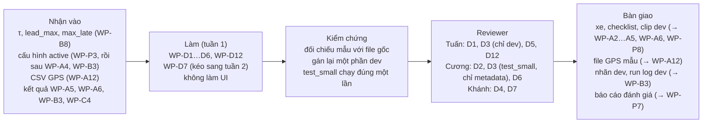

# Phần việc của Linh: R-D (dữ liệu, gán nhãn, vận hành đánh giá; web UI từ tuần 2)

Bạn phụ trách mọi thứ liên quan tới bằng chứng:
- quay dữ liệu thực địa;
- gán nhãn;
- chạy các lần đánh giá;
- tổng hợp `eval/results/report.md`;
- phỏng vấn người dùng.

Bạn **tổng hợp** báo cáo. Phương pháp và tính đúng của từng mục do owner của thành phần đó xác nhận (README mục 1); riêng mục phỏng vấn là của bạn.

**Tuần 1 bạn không làm giao diện**: bản MVP chỉ có CLI và âm thanh. Web UI bắt đầu từ tuần 2.

- **Owner, reviewer, phụ thuộc, hạn, trạng thái tổng:** [README](../README.md), mục 4. Nếu sơ đồ dưới đây khác bảng đó thì bảng thắng.
- **Checklist dưới mỗi task:** cập nhật ngay khi xong từng mục, theo luật ở [README](../README.md), mục 0.
- **Tài liệu cần đọc:** [AGENTS.md](../../../AGENTS.md), mục 3, dòng "Dữ liệu thực địa, gán nhãn" và "Đánh giá, `rerun-B`". Từ tuần 2 đọc thêm dòng "Web UI".

## Thuật ngữ riêng

| Từ | Nghĩa |
|---|---|
| Phiên quay | Một lần gắn camera và quay liên tục. Split được chia theo phiên, không theo clip (spec 5.1) |
| Session manifest | File mô tả một phiên quay (spec 4.4): video, GPS, `gps_offset_ms`, độ bất định (để `null` khi chưa đo, không ghi 0), checklist, split |
| Sự kiện đồng bộ | Khoảnh khắc thấy rõ trên cả video lẫn GPS, ví dụ lăn bánh từ lúc đứng yên. Dùng để tính độ lệch thời gian giữa video và GPS |
| `must_alert` / `exempt` | Sự kiện hệ thống phải cảnh báo / ngữ cảnh mà cảnh báo khoảng cách chỉ là báo phiền (spec 5.2) |
| `collision_risk` + `cause` | Nhãn nguy cơ va chạm; `cause` ghi nguyên nhân. TTC thấp không đồng nghĩa với xe trước phanh gấp |
| Gán mù | Gán nhãn khi chưa xem đầu ra của B hay baseline |

**Nơi để dữ liệu thực địa:** `data/` (đã có trong `.gitignore`, không commit). Bằng chứng trong checklist ghi đường dẫn tương đối trong `data/`, kèm hash khi cần.

## Tuần 1

### WP-D1 · Xe, thiết bị, quy trình quay
- **Xong khi:** KS-1 đạt tiêu chí của file 3. Nếu chỉ có một xe thì ghi rõ, kèm hệ quả: AC-F1 chưa làm được.
- **Kiểm chứng:** reviewer gắn thử camera một lần theo checklist lắp đặt và báo lại bước nào còn chưa rõ.
- **Checklist:**
  - Bàn giao
    - [ ] Kết quả KS-1 (xe tiếp cận được, chủ xe đồng ý hay không, thiết bị quay), ghi ở `docs/requirements/RoadWatch_Copilot_3_Cau_hinh_lap_dat.md`, mục 4.4
    - [ ] `docs/plan/quy-trinh-quay.md`. Gồm:
      - người ngồi ghế phụ thao tác, người lái không đụng vào thiết bị;
      - bắt đầu quay khi xe đang đứng yên;
      - mỗi phiên có đủ sự kiện đồng bộ để ước lượng độ bất định (ít nhất hai);
      - checklist lắp đặt.
  - Kiểm thử và kiểm chứng
    - [ ] Chạy thử quy trình một lần khi xe đứng yên
  - Review và nghiệm thu
    - [ ] Reviewer kiểm theo mục "Kiểm chứng"

### WP-D2 · App GPS và quy trình đồng bộ
- **Xong khi:** WP-A12 có file mẫu, và WP-D3 có quy trình để lập session manifest.
- **Kiểm chứng:** reviewer chọn một sự kiện đồng bộ trong lần ghi thử, tự đọc thời điểm trên video và trên GPS, rồi so với độ lệch tính theo quy trình.
- **Checklist:**
  - Bàn giao
    - [ ] Tên app GPS đã chọn (ưu tiên app ghi được thời điểm nhận mẫu, OQ-M4), cùng quy trình tính `gps_offset_ms` và `gps_offset_uncertainty_ms`, ghi trong `docs/plan/quy-trinh-quay.md`
    - [ ] File GPS mẫu từ một lần ghi thử, trong `data/gps-sample/`; giao cho WP-A12
  - Kiểm thử và kiểm chứng
    - [ ] Quy trình đã chạy thử trên lần ghi đó
  - Review và nghiệm thu
    - [ ] Reviewer kiểm theo mục "Kiểm chứng"

### WP-D3 · Quay dữ liệu cao tốc
- **Xong khi:**
  - WP-A3, WP-A4, WP-D12, WP-A6 và WP-P8 dùng được các phiên `dev`; WP-D4 dùng được cả `dev` lẫn `test_small`.
  - Mỗi phiên có `gps_offset_ms`, và có `gps_offset_uncertainty_ms` (hoặc `null` kèm lý do, không ghi 0).
  - Nếu chỉ có một phiên thì chia split theo khối thời gian, và ghi đây là một giới hạn.
- **Luật giữ kín `test_small`** (spec 5.1; luật ở WP-D4): người tinh chỉnh A hay B (Tuấn, Khánh) không mở video, GPS hay nhãn của phiên `test_small` trước lần chạy duy nhất ở WP-D6. Chỉ bạn xem nội dung các phiên này, vì bạn không tinh chỉnh A hay B.
- **Kiểm chứng:** tách theo split.
  - **Phiên `dev` và ảnh KS-2/KS-3** (Tuấn): mở từng phiên, kiểm video phát được, GPS có mẫu, manifest đủ trường, số đo KS-2/KS-3 có ảnh đi kèm.
  - **Phiên `test_small`** (Cương, chỉ xem metadata): chạy `scripts/roadwatch/check_sessions.py` và đọc bản in ra. Không mở video, không xem khung hình hay nhãn. Script báo lỗi thì bạn tự sửa phiên đó rồi Cương chạy lại, không chuyển phiên cho người khác xem.
- **Checklist:**
  - Bàn giao
    - [ ] Ít nhất hai phiên cao tốc, mỗi phiên trong `data/sessions/<session_id>/`: video, GPS, checklist lắp đặt, session manifest (lập theo quy trình của WP-D2), split (spec 5.1)
    - [ ] KS-2 và KS-3 trên từng xe thử, ghi ở `docs/requirements/RoadWatch_Copilot_3_Cau_hinh_lap_dat.md`, mục 3 và 4.4; ảnh chụp cách đo trong `data/survey/`
    - [ ] `scripts/roadwatch/check_sessions.py`: với mỗi phiên, chỉ in metadata: manifest đọc được bằng `SessionManifest`, `split`, hash file khớp manifest, video mở được cùng số khung và thời lượng, số dòng của file GPS gốc. Không hiển thị hay ghi ra khung hình, không đọc nhãn
  - Kiểm thử và kiểm chứng
    - [ ] Script chạy không lỗi trên mọi phiên `dev` và `test_small`. Việc `read_gps` đọc được GPS đã chuyển đổi thuộc WP-A12
  - Review và nghiệm thu
    - [ ] Tuấn kiểm các phiên `dev` và ảnh KS-2/KS-3 theo mục "Kiểm chứng"
    - [ ] Cương chạy script trên các phiên `test_small` và ghi bản in ra vào mô tả PR, không mở nội dung

### WP-D5 · Clip xe đứng yên (KS-6)
- **Xong khi:** mỗi khoảng cách mà KS-6 quy định có clip và số đo, và WP-A5 dùng được.
- **Kiểm chứng:** reviewer kiểm ảnh thước ở từng khoảng cách.
- **Checklist:**
  - Bàn giao
    - [ ] Clip xe demo đứng yên ở từng khoảng cách, cùng ảnh thước và bảng khoảng cách đo (từ cản trước xe mình tới đuôi xe phía trước), trong `data/static/`
    - [ ] Kết quả KS-6 ghi ở `docs/requirements/RoadWatch_Copilot_3_Cau_hinh_lap_dat.md`, mục 4.4
  - Kiểm thử và kiểm chứng
    - [ ] Cùng buổi này làm lần thử chạm lệch camera của WP-A3
  - Review và nghiệm thu
    - [ ] Reviewer kiểm theo mục "Kiểm chứng"

### WP-D4 · Gán nhãn
- **Xong khi:** dataset manifest có hash của nhãn, và nhãn `test_small` đã đóng băng **trước** WP-D6.
- **Kiểm chứng:** reviewer đối chiếu hướng dẫn với spec 5.2. Trên `dev`, reviewer tự gán lại một phần clip rồi so khác biệt với nhãn của bạn.
- **Luật:** không ai đang tinh chỉnh A hay B được xem clip hay nhãn `test_small` trước lần chạy duy nhất. Người kiểm tra nhãn chỉ kiểm trên `dev`.
- **Checklist:**
  - Bàn giao
    - [ ] `docs/plan/huong-dan-gan-nhan.md`: hướng dẫn gán nhãn theo spec 5.2, dùng giá trị OQ-A3 đã duyệt ở WP-B8
    - [ ] Nhãn `dev` trong `data/labels/`
    - [ ] Nhãn `test_small` gán mù trong `data/labels/`, đóng băng bằng hash ghi trong dataset manifest
  - Kiểm thử và kiểm chứng
    - [ ] Mọi file nhãn đọc được bằng `EventLabel`
  - Review và nghiệm thu
    - [ ] Reviewer kiểm theo mục "Kiểm chứng"

### WP-D12 · Chạy replay bộ `dev`
- **Xong khi:** mọi lần chạy có manifest với `approval_id`, và `rerun-B --verify` đạt.
- **Kiểm chứng:** reviewer kiểm manifest: đúng cấu hình active, không có cờ `dirty_tree`, `unapproved_code` hay `scripted_detector`.
- **Checklist:**
  - Bàn giao
    - [ ] Các lần chạy replay trên toàn bộ `dev`, với cấu hình active sau WP-A4: `runs/<run_id>/` (không commit). Ghi danh sách `run_id` làm bằng chứng và giao cho WP-B3
  - Kiểm thử và kiểm chứng
    - [ ] `rerun-B --verify` đạt với mọi lần chạy
  - Review và nghiệm thu
    - [ ] Reviewer kiểm theo mục "Kiểm chứng"

### WP-D6 · Chạy `test_small` và tổng hợp báo cáo
- **Xong khi:** AC-M5 và AC-M6, cùng AC-M3 và AC-M4 lấy từ WP-A6, có số liệu. Nếu chưa đủ điều kiện thì ghi "sơ bộ", "chưa kết luận" hoặc "chưa kiểm chứng" đúng theo luật của spec.
- **Kiểm chứng:**
  - `eval/test_runs.jsonl` có đúng một lần chạy `test_small`.
  - Hash trong báo cáo khớp với manifest.
  - Mục nào cũng có xác nhận của owner.
- **Checklist:**
  - Bàn giao
    - [ ] **Đúng một** lần chạy `test_small`, với cấu hình đã duyệt và đang active, được ghi vào `eval/test_runs.jsonl`. File này hiện nằm trong `.gitignore`: chờ quyết định 17, review-v1.1 mục 5
    - [ ] `eval/results/report.md`: tổng hợp các mục, gắn hash theo spec 5.5
  - Kiểm thử và kiểm chứng
    - [ ] Mỗi mục của báo cáo có xác nhận của owner phương pháp (README mục 1)
  - Review và nghiệm thu
    - [ ] Reviewer kiểm theo mục "Kiểm chứng"

### WP-D7 · Phỏng vấn người dùng
- **Xong khi:** có tóm tắt với đủ số người theo file 1 (5–8 người mới lái, 3–5 người vừa đổi xe). Nếu thiếu người thì ghi số người thực tế.
- **Kiểm chứng:** reviewer đọc tóm tắt và ghi lại điểm nào ảnh hưởng tới câu nói hoặc chính sách cảnh báo.
- **Checklist:**
  - Bàn giao
    - [ ] Bộ câu hỏi dựa trên các giả định ở file 1, mục 3, chuẩn bị ngay trong tuần 1, ở mục "Phản hồi người dùng" của `eval/results/report.md`
    - [ ] Tóm tắt phỏng vấn đã ẩn danh, có trích dẫn: mục "Phản hồi người dùng" của `eval/results/report.md`
  - Kiểm thử và kiểm chứng
    - [ ] Không còn thông tin nhận dạng người được phỏng vấn
  - Review và nghiệm thu
    - [ ] Reviewer kiểm theo mục "Kiểm chứng"

## Tuần 2–4

### WP-C6 · Màn hình kỹ sư
- **Xong khi:** AC-F5; responsive, có dark mode, qua kiểm tra accessibility cơ bản.
- **Kiểm chứng:** reviewer chạy luồng HITL trên web và kiểm rằng nó dùng cùng hàm `configstore` với CLI.
- **Checklist:**
  - Bàn giao
    - [ ] Giao diện trong `src/roadwatch/web/` (đường dẫn và công nghệ chốt theo OQ-E2): danh sách lần chạy, so sánh B với baseline, trace và lý do nói hay không nói theo thời gian, luồng HITL (spec 11.5)
  - Kiểm thử và kiểm chứng
    - [ ] Kiểm responsive, dark mode, accessibility cơ bản; ghi kết quả trong mô tả PR
  - Review và nghiệm thu
    - [ ] Reviewer kiểm theo mục "Kiểm chứng"

### WP-C7 · Màn hình trạng thái cho tài xế
- **Xong khi:** hiện đúng mọi tổ hợp năng lực ở spec 3.4, và hiện được trạng thái runtime sập (F21).
- **Kiểm chứng:** reviewer đổi `heartbeat.json` mẫu qua từng tổ hợp và xem màn hình hiện đúng.
- **Checklist:**
  - Bàn giao
    - [ ] Màn hình trạng thái trong `src/roadwatch/web/`, đọc `heartbeat.json`
  - Kiểm thử và kiểm chứng
    - [ ] Test hiển thị với các `heartbeat.json` mẫu trong `tests/roadwatch/fixtures/`
  - Review và nghiệm thu
    - [ ] Reviewer kiểm theo mục "Kiểm chứng"

### WP-D9 · Thử nghe với người mới lái
- **Xong khi:** có biên bản để WP-B7 dùng.
- **Kiểm chứng:** reviewer đọc biên bản và xác nhận đủ để chốt `remind_interval` và `perceived_delay`.
- **Checklist:**
  - Bàn giao
    - [ ] Biên bản thử nghe (ẩn danh) ở mục "Thử nghe" của `eval/results/report.md`
  - Kiểm thử và kiểm chứng
    - [ ] Dùng đúng file WAV của thư viện câu nói đang active
  - Review và nghiệm thu
    - [ ] Reviewer kiểm theo mục "Kiểm chứng"

### WP-D10 · Dữ liệu `test_final` và xe thử 2
- **Xong khi:**
  - Có dữ liệu cho AC-F1 và AC-F2, gồm các phiên mới chưa dùng để tinh chỉnh.
  - Nhãn `test_final` đã gán mù, đọc được bằng `EventLabel`, và đã đóng băng bằng hash trong dataset manifest **trước** lần chạy duy nhất ở WP-D11.
- **Luật giữ kín `test_final`:** giống `test_small` ở WP-D3. `test_final` không bao giờ được dùng để tinh chỉnh; người tinh chỉnh A hay B (Tuấn, Khánh) không mở video, GPS hay nhãn của các phiên này. Bạn gán nhãn khi chưa xem đầu ra của B hay baseline trên các phiên đó. Phiên xe thử 2 mà Tuấn dùng cho AC-F1 không được xếp vào `test_final`.
- **Kiểm chứng:**
  - **Dữ liệu xe thử 2 cho AC-F1** (Tuấn): kiểm như phiên `dev` ở WP-D3.
  - **Phiên và nhãn `test_final`** (Cương, chỉ xem metadata): bản in của `scripts/roadwatch/check_sessions.py` cho thấy split `test_final` chỉ gồm phiên mới; mọi file nhãn đọc được bằng `EventLabel`; hash nhãn nằm trong dataset manifest. Không mở video, không đọc nội dung nhãn.
- **Checklist:**
  - Bàn giao
    - [ ] Các phiên `test_final` và phiên của xe thử 2 trong `data/sessions/`, có manifest và split
    - [ ] Nhãn `test_final` gán mù theo `docs/plan/huong-dan-gan-nhan.md` (WP-D4), trong `data/labels/`
    - [ ] Nhãn `test_final` đóng băng: hash ghi trong dataset manifest ở `data/`, trước mọi lần chạy trên `test_final`
  - Kiểm thử và kiểm chứng
    - [ ] Không phiên nào của `test_final` từng xuất hiện trong `dev` hay `test_small`
    - [ ] Mọi file nhãn `test_final` đọc được bằng `EventLabel`
    - [ ] `scripts/roadwatch/check_sessions.py` chạy không lỗi trên các phiên mới
  - Review và nghiệm thu
    - [ ] Tuấn kiểm dữ liệu xe thử 2 theo mục "Kiểm chứng"
    - [ ] Cương kiểm phiên và nhãn `test_final` chỉ bằng metadata, theo mục "Kiểm chứng"

### WP-D11 · Đánh giá cuối và báo cáo cuối
- **Xong khi:** đủ deliverable 10, với đúng một lần chạy `test_final` bằng cấu hình đóng băng, chấm trên bộ nhãn `test_final` đã đóng băng ở WP-D10.
- **Kiểm chứng:** giống WP-D6, áp dụng cho `test_final`. Thêm: hash dataset manifest ghi trong báo cáo (spec 5.5) trùng với hash nhãn đã đóng băng ở WP-D10.
- **Checklist:**
  - Bàn giao
    - [ ] `eval/results/report.md` bản cuối, gắn hash, có hash của bộ nhãn `test_final` đã đóng băng
  - Kiểm thử và kiểm chứng
    - [ ] `eval/test_runs.jsonl` có đúng một lần chạy `test_final`
    - [ ] Lần chạy dùng đúng bộ nhãn đã đóng băng ở WP-D10; nhãn không đổi sau khi đóng băng
  - Review và nghiệm thu
    - [ ] Reviewer kiểm theo mục "Kiểm chứng"
