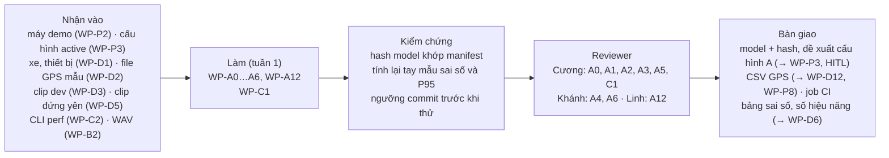

# Phần việc của Tuấn: R-A (BT-A) và hỗ trợ backend

Bạn phụ trách phần "đo":
- phát hiện và theo dõi xe;
- chọn xe dẫn đầu;
- khoảng cách theo cấu hình lắp cố định;
- TTC;
- kiểm tra ảnh và kiểm tra lắp đặt.

Bạn chịu trách nhiệm phương pháp và tính đúng của mục **khoảng cách** và mục **hiệu năng** trong báo cáo. Riêng `L_alert(B)` thuộc R-B.

Phần hỗ trợ backend: CI và bộ chuyển đổi GPS ở tuần 1; API cho web UI ở tuần 2–4.

Code BT-A đã có (T5: `detect.py`, `perception.py`; tình trạng ở README mục 3). Việc của bạn là tiếp nhận code đó, rồi làm cho nó đúng trên dữ liệu thật và đo được.

- **Owner, reviewer, phụ thuộc, hạn, trạng thái tổng:** [README](../README.md), mục 4. Nếu sơ đồ dưới đây khác bảng đó thì bảng thắng.
- **Checklist dưới mỗi task:** cập nhật ngay khi xong từng mục, theo luật ở [README](../README.md), mục 0.
- **Tài liệu cần đọc:** [AGENTS.md](../../../AGENTS.md), mục 3, dòng "BT-A", "Runtime, nguồn dữ liệu" và "CI, dependency, Docker".

## Thuật ngữ riêng

| Từ | Nghĩa |
|---|---|
| `Measurement` | Bản ghi A xuất cho mỗi khung (spec 4.2). Thiếu dữ liệu thì dùng `null` kèm `status`, không bao giờ dùng 0 |
| `h_cam`, `d_cam_cản`, `y_horizon` | Chiều cao camera; khoảng cách theo phương ngang từ camera tới cản trước; hàng pixel của đường chân trời (file 3) |
| KS-x | Việc khảo sát thực địa (file 3, mục 4.4). Giá trị đo được ghi vào file 3 |
| `mount_check` | Kiểm tra lắp đặt khi đang chạy, cho ra `ok`, `suspect` hoặc `unknown`. Chỉ phát hiện, không tự sửa (ADR-05) |
| `ttc.valid` | Điều kiện để TTC được coi là `ok` |
| `likely_id_switch` | A đoán rằng track đổi ID nhưng vẫn là cùng một xe, nên danh tính được giữ nguyên |
| `provisional_keys` | Danh sách tham số cấu hình vẫn còn là giả định, chưa đo |

## Tuần 1

### WP-A0 · Tiếp nhận code BT-A
- **Xong khi:** mỗi luật ở spec 4.2 hoặc có test, hoặc được ghi là "thiếu test".
- **Kiểm chứng:** reviewer cố ý làm hỏng hai luật (ví dụ ghi 0 thay cho `null`, hoặc bỏ kiểm tra "đáy xe nằm trên chân trời") và thấy test đỏ.
- **Checklist:**
  - Bàn giao
    - [ ] Bảng đối chiếu `detect.py`, `perception.py` với spec 2, 3.9, 4.2 (bao gồm bảng giá trị `null`), đặt trong mô tả PR của WP-A0
    - [ ] Ý kiến giữ, sửa hay bỏ cho I-4…I-10, D-6, D-10, ghi vào `docs/specs/roadwatch-architecture.md`, mục 12
    - [ ] Test còn thiếu, trong `tests/roadwatch/test_perception.py`
  - Kiểm thử và kiểm chứng
    - [ ] Toàn bộ test RoadWatch xanh
  - Review và nghiệm thu
    - [ ] Reviewer kiểm theo mục "Kiểm chứng"

### WP-C1 · Dependency và CI
- **Xong khi:** CI xanh trên nhánh tích hợp, và job CI của template không bị phá.
- **Kiểm chứng:** reviewer mở một PR cố ý làm hỏng một test và thấy CI đỏ.
- **Lưu ý:** `.github/` thuộc CODEOWNERS của template. Kiểm tra cài đặt duyệt PR trước khi làm (review-v1.1.md, mục 5, quyết định 3).
- **Checklist:**
  - Bàn giao
    - [ ] File dependency của RoadWatch: `requirements-roadwatch.txt`
    - [ ] Job CI riêng cho RoadWatch trên Python 3.11, chạy lint và test (lệnh ở [code-rules](../../development/code-rules.md), mục 8): `.github/workflows/roadwatch.yml`
  - Kiểm thử và kiểm chứng
    - [ ] Job RoadWatch xanh trên nhánh tích hợp; job `ci.yml` của template vẫn chạy như trước
  - Review và nghiệm thu
    - [ ] Reviewer kiểm theo mục "Kiểm chứng"

### WP-A1 · Model ONNX và thời gian suy luận
- **Xong khi:** runtime chạy được model thật qua đường detector hiện có. Nếu đầu ra của model không thuộc hai dạng mà `postprocess` hỗ trợ thì sửa, và thêm test cho dạng mới.
- **Kiểm chứng:** reviewer chạy một replay ngắn với model trên máy demo, và thấy hash trong manifest khớp với file model.
- **Checklist:**
  - Bàn giao
    - [ ] `scripts/roadwatch/export_detector.py`
    - [ ] `models/<tên model>.onnx` (không commit; ghi `model_sha256` làm bằng chứng)
    - [ ] Bảng P50/P95 thời gian suy luận của ONNX Runtime FP32, `intra_op` = 4, đo trên máy demo, kèm dấu vân tay máy: mục "Hiệu năng" của `eval/results/report.md`
    - [ ] Nếu cần: `src/roadwatch/detect.py` hỗ trợ dạng đầu ra mới, kèm test trong `tests/roadwatch/test_perception.py`
  - Kiểm thử và kiểm chứng
    - [ ] Replay ngắn với model thật chạy được trên máy demo
  - Review và nghiệm thu
    - [ ] Reviewer kiểm theo mục "Kiểm chứng"

### WP-A12 · Bộ chuyển đổi GPS
- **Xong khi:** `read_gps` đọc được mọi phiên của WP-D3. Trường nào thiếu thì để trống, không điền 0.
- **Giữ kín `test_small`:** bạn chỉ chạy và kiểm script trên phiên `dev`. Phiên `test_small` do Linh chuyển đổi bằng chính script này ([linh.md: WP-D3](linh.md)).
- **Kiểm chứng:** reviewer chạy script trên một phiên thật, rồi đối chiếu năm mẫu chọn ngẫu nhiên với file gốc.
- **Checklist:**
  - Bàn giao
    - [ ] `scripts/roadwatch/convert_gps.py`: chuyển file của app GPS (do WP-D2 chọn) sang CSV chuẩn theo I-15
    - [ ] Đoạn file mẫu ngắn, không lộ vị trí riêng tư, trong `tests/roadwatch/fixtures/`
  - Kiểm thử và kiểm chứng
    - [ ] Test chuyển đổi trên file mẫu, trong `tests/roadwatch/test_source.py`
  - Review và nghiệm thu
    - [ ] Reviewer kiểm theo mục "Kiểm chứng"

### WP-A2 · Hiệu chỉnh camera và góc lắp
- **Xong khi:** cấu hình active dùng giá trị đo thật cho KS-4 và KS-5.
- **Kiểm chứng:** reviewer xem ảnh bàn cờ và sai số reprojection bạn báo cáo, rồi kiểm `y_horizon` trên một ảnh đường thẳng.
- **Checklist:**
  - Bàn giao
    - [ ] `scripts/roadwatch/calibrate_camera.py`: hiệu chỉnh bằng bàn cờ ở đúng độ phân giải quay
    - [ ] `f`, `cx`, `cy`, hệ số méo (KS-5), `y_horizon` và góc lắp (KS-4), ghi kèm trạng thái vào `docs/requirements/RoadWatch_Copilot_3_Cau_hinh_lap_dat.md`, mục 3 và 4.4
    - [ ] Đề xuất cấu hình A (đường `[A]`) trong `config/proposals/`; giá trị còn là giả định vẫn nằm trong `provisional_keys`
  - Kiểm thử và kiểm chứng
    - [ ] Sai số reprojection được báo cáo cùng số ảnh đã dùng
  - Review và nghiệm thu
    - [ ] Reviewer kiểm theo mục "Kiểm chứng"

### WP-A3 · Kiểm chứng kiểm tra lắp đặt
- **Xong khi:** AC-M8 có kết luận. Đạt thì bật `mount_check`; không đạt thì tắt bằng cờ và ghi "chưa đạt".
- **Kiểm chứng:** reviewer xem `git log` để chắc commit chứa ngưỡng có trước commit chứa kết quả thử.
- **Checklist:**
  - Bàn giao
    - [ ] Ngưỡng đạt/không đạt (OQ-M3), **commit trước khi thử**, ghi ở `docs/specs/roadwatch-architecture.md`, mục 10.2
    - [ ] `mount_check.deviation_px` (D-10) trong `src/roadwatch/perception.py`, kèm test trong `tests/roadwatch/test_perception.py`
    - [ ] Kết quả với lệch giả lập (dịch và xoay ảnh), số lần báo `suspect` oan mỗi giờ, và một lần chạm lệch camera thật (cùng buổi với WP-D5): mục "Kiểm tra lắp đặt" của `eval/results/report.md`
  - Kiểm thử và kiểm chứng
    - [ ] Kết luận AC-M8 so với ngưỡng đã commit
  - Review và nghiệm thu
    - [ ] Reviewer kiểm theo mục "Kiểm chứng"

### WP-A4 · Tinh chỉnh perception trên clip dev
- **Xong khi:** có bảng kiểm bằng mắt việc chọn xe dẫn đầu trên các khung mẫu của clip dev, kèm tỷ lệ chọn đúng. Cách chọn mẫu phải công bố trước khi kiểm.
- **Kiểm chứng:** reviewer tự kiểm lại một phần khung chọn ngẫu nhiên và so với bảng của bạn.
- **Luật riêng:** bạn tinh chỉnh A, nên chỉ dùng phiên `dev`: không mở video, GPS hay nhãn của `test_small` trước lần chạy duy nhất (WP-D6). Khi review WP-D3 bạn cũng chỉ kiểm phiên `dev` ([linh.md: WP-D3](linh.md)).
- **Checklist:**
  - Bàn giao
    - [ ] Đề xuất cấu hình A qua HITL (đường `[A]`) trong `config/proposals/`. Gồm: ROI làn (I-4), tham số `ttc.valid` (OQ-M6, I-8), ngưỡng `observation` (I-10), luật `likely_id_switch` (I-6)
    - [ ] Bảng kiểm chọn xe dẫn đầu và cách chọn mẫu, đặt trong mô tả PR của WP-A4
  - Kiểm thử và kiểm chứng
    - [ ] Test của `perception.py` vẫn xanh sau khi đổi tham số
  - Review và nghiệm thu
    - [ ] Reviewer kiểm theo mục "Kiểm chứng"

### WP-A5 · Kiểm chứng khoảng cách
- **Xong khi:** AC-M6 có bảng. Dải nào không có mẫu thì ghi "chưa kiểm chứng". Không kết luận đạt hay không đạt, vì OQ-A2 chưa chốt.
- **Kiểm chứng:** reviewer tự tính lại ba mẫu từ ảnh và cấu hình, rồi so với bảng.
- **Checklist:**
  - Bàn giao
    - [ ] Bảng sai số theo dải, kèm số mẫu, của hai phép kiểm ở spec 5.7: hình học (mép dưới xe gán tay) và `distance_m` của toàn bộ A (replay trên clip xe đứng yên). Ghi ở mục "Khoảng cách" của `eval/results/report.md`
  - Kiểm thử và kiểm chứng
    - [ ] Lần chạy replay trên clip đứng yên có manifest với `approval_id`; ghi `run_id` làm bằng chứng
  - Review và nghiệm thu
    - [ ] Reviewer kiểm theo mục "Kiểm chứng"

### WP-A6 · Throughput, latency, kiểm tra live
- **Xong khi:** AC-M3 và AC-M4 có số liệu kèm dấu vân tay máy. Nếu n < 200 thì ghi "chưa kết luận".
- **Kiểm chứng:** reviewer (owner phương pháp của `L_alert(B)`) tự tính lại P95 từ `audio_events` và `perf` của một lần chạy.
- **Checklist:**
  - Bàn giao
    - [ ] Tách `t_infer_end` trong `perf.jsonl` (D-6): `src/roadwatch/live.py`, kèm test trong `tests/roadwatch/test_runtime.py`
    - [ ] Năng lực xử lý, tỷ lệ bỏ khung khi chạy live, và `L_alert(B)`: mục "Hiệu năng" của `eval/results/report.md`
    - [ ] Biên bản kiểm tra live F1 (ngắt nguồn video) và F18 (CPU bị tải nền chiếm), ở mục "Hiệu năng" của `eval/results/report.md`
  - Kiểm thử và kiểm chứng
    - [ ] Các lần chạy live có B là bộ quyết định chính; ghi `run_id` và dấu vân tay máy
  - Review và nghiệm thu
    - [ ] Reviewer kiểm theo mục "Kiểm chứng"

## Tuần 2–4

### WP-A7 · Lọc Kalman
- **Xong khi:** nhiễu khoảng cách giảm trên clip dev, có test; `sigma_m` lấy từ phương sai.
- **Kiểm chứng:** reviewer so khoảng cách trước và sau khi lọc trên cùng một clip dev.
- **Checklist:**
  - Bàn giao
    - [ ] Bộ lọc và `sigma_m` trong `src/roadwatch/perception.py`; spec mục 4.2 cập nhật nếu nghĩa của `sigma` đổi
  - Kiểm thử và kiểm chứng
    - [ ] Test trong `tests/roadwatch/test_perception.py`
  - Review và nghiệm thu
    - [ ] Reviewer kiểm theo mục "Kiểm chứng"

### WP-A8 · Vạch làn
- **Xong khi:** qua các fixture và clip có nhãn.
- **Kiểm chứng:** reviewer chạy lại trên clip có nhãn.
- **Checklist:**
  - Bàn giao
    - [ ] Nhận diện vạch làn, `lead.basis = lane_markings`, `lateral_offset_m` trong `src/roadwatch/perception.py`
  - Kiểm thử và kiểm chứng
    - [ ] Test và fixture trong `tests/roadwatch/test_perception.py`, `tests/roadwatch/fixtures/`
  - Review và nghiệm thu
    - [ ] Reviewer kiểm theo mục "Kiểm chứng"

### WP-A9 · Bằng chứng chen làn
- **Xong khi:** qua các kịch bản chen làn, bị che rồi đổi ID, và xe trước phanh gấp.
- **Kiểm chứng:** reviewer chạy lại các kịch bản đó.
- **Checklist:**
  - Bàn giao
    - [ ] `ChangeEvidence` (ADR-09) trong `src/roadwatch/perception.py`
  - Kiểm thử và kiểm chứng
    - [ ] Test kịch bản trong `tests/roadwatch/test_perception.py`
  - Review và nghiệm thu
    - [ ] Reviewer kiểm theo mục "Kiểm chứng"

### WP-A10 · Kiểm chứng phạm vi áp dụng trên xe thử 2
- **Xong khi:** AC-F1 có bảng sai số theo dải cho xe thử 2, dùng nguyên cấu hình cố định (file 3, mục 4.5).
- **Kiểm chứng:** reviewer tự tính lại ba mẫu.
- **Checklist:**
  - Bàn giao
    - [ ] Bảng sai số của xe thử 2 ở mục "Khoảng cách" của `eval/results/report.md`
    - [ ] Kết luận phạm vi áp dụng, ghi ở `docs/requirements/RoadWatch_Copilot_3_Cau_hinh_lap_dat.md`, mục 4.5
    - [ ] Kết quả trên KITTI/DDAD ở mục "Khoảng cách" của `eval/results/report.md`; chỉ làm nếu còn thời gian
  - Kiểm thử và kiểm chứng
    - [ ] Lần chạy replay có manifest với `approval_id`
  - Review và nghiệm thu
    - [ ] Reviewer kiểm theo mục "Kiểm chứng"

### WP-A11 · ByteTrack đầy đủ
- **Xong khi:** số lần đổi ID giảm trên clip dev. Chỉ làm nếu lỗi đổi ID chiếm phần lớn sai số.
- **Kiểm chứng:** reviewer so số lần đổi ID trước và sau.
- **Checklist:**
  - Bàn giao
    - [ ] Tracker trong `src/roadwatch/detect.py`; so sánh trước và sau đặt trong mô tả PR
  - Kiểm thử và kiểm chứng
    - [ ] Test tracker trong `tests/roadwatch/test_perception.py`
  - Review và nghiệm thu
    - [ ] Reviewer kiểm theo mục "Kiểm chứng"

### WP-C10 · API cho web UI
- **Xong khi:** WP-C6 và WP-C7 dùng được API. Lệnh HITL gọi chung hàm `configstore` với CLI, không có đường HITL thứ hai.
- **Kiểm chứng:** reviewer kiểm rằng không endpoint nào ghi `configs/` mà không đi qua hàm của `configstore`.
- **Checklist:**
  - Bàn giao
    - [ ] API FastAPI và đăng nhập hai vai trò, trong `src/roadwatch/web/` (HTML render từ FastAPI, OQ-E2)
  - Kiểm thử và kiểm chứng
    - [ ] Test API trong `tests/roadwatch/test_web_api.py`, dùng kho cấu hình tạm
  - Review và nghiệm thu
    - [ ] Reviewer kiểm theo mục "Kiểm chứng"
