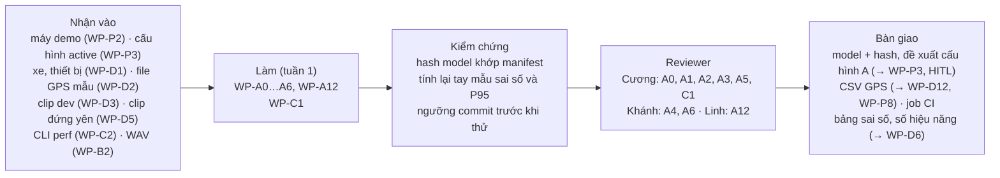

# Phần việc của Tuấn: R-A (BT-A) và hỗ trợ backend

Bạn phụ trách phần "đo":
- tự hiệu chuẩn camera (tiêu cự, pitch, yaw, chiều cao);
- warp ảnh vào khung model và chạy supercombo;
- xe dẫn đầu, khoảng cách, TTC, làn;
- kiểm tra ảnh và phát hiện camera bị lắp lại.

Bạn chịu trách nhiệm phương pháp và tính đúng của mục **khoảng cách**, mục **hiệu chuẩn** và mục **hiệu năng** trong báo cáo. Riêng `L_alert(B)` thuộc R-B.

Phần hỗ trợ backend: CI và bộ chuyển đổi GPS ở tuần 1; API cho web UI ở tuần 2–4.

Code BT-A ở package [`src/roadwatch/`](../../../src/roadwatch/) (spec 2, 4.2, 12.2: I-20…I-25). Việc của bạn là làm nó xuất `Measurement` 2.0.0, rồi kiểm chứng trên dữ liệu thật.

- **Owner, reviewer, phụ thuộc, hạn, trạng thái tổng:** [README](../README.md), mục 4. Nếu sơ đồ dưới đây khác bảng đó thì bảng thắng.
- **Checklist dưới mỗi task:** cập nhật ngay khi xong từng mục, theo luật ở [README](../README.md), mục 0.
- **Tài liệu cần đọc:** [AGENTS.md](../../../AGENTS.md), mục 3, dòng "BT-A", "Runtime, nguồn dữ liệu" và "CI, dependency, Docker".

## Thuật ngữ riêng

| Từ | Nghĩa |
|---|---|
| `Measurement` | Bản ghi A xuất cho mỗi khung (spec 4.2, 2.0.0). Thiếu dữ liệu thì dùng `null` kèm `status`, không bao giờ dùng 0 |
| `d_cam_bumper_m` | Khoảng cách theo phương ngang từ camera tới cản trước; tham số duy nhất người dùng nhập (KS-3) |
| `calibration` | Khối hiệu chuẩn tự động trong `Measurement`: `fy_px`, pitch, yaw, chiều cao, trạng thái |
| `mount_check` | `ok` khi đã hiệu chuẩn xong, `unknown` khi đang hiệu chuẩn, `suspect` khi vừa phát hiện camera bị lắp lại |
| supercombo | Model ONNX của openpilot (MIT): xe dẫn đầu, làn, chuyển động của camera, mặt đường |
| `provisional_keys` | Danh sách tham số cấu hình vẫn còn là giả định, chưa đo |

## Tuần 1

### WP-A0 · `Measurement` 2.0.0 từ `src/roadwatch/`
- **Xong khi:** `src/roadwatch/` ghi `measurements.jsonl` đúng spec 4.2 (2.0.0); mỗi dòng của các bảng `observation`, `calibration`, `lead`, `ttc_s`, `lane` có test.
- **Kiểm chứng:** reviewer cố ý làm hỏng hai luật (ví dụ ghi 0 thay cho `null`, hoặc cho `distance_m = ok` khi `mount_check ≠ ok`) và thấy test đỏ.
- **Checklist:**
  - Bàn giao
    - [ ] Model Pydantic `Measurement` 2.0.0 (`extra = forbid`) và bộ ghi JSONL (D-10)
    - [ ] Identity xe dẫn đầu và `lead.change` theo spec 4.2
    - [ ] Cách nối với runtime theo quyết định OQ-A12
  - Kiểm thử và kiểm chứng
    - [ ] Test trong `tests/roadwatch/`; `ruff` sạch
  - Review và nghiệm thu
    - [ ] Reviewer kiểm theo mục "Kiểm chứng"

### WP-C1 · Dependency và CI
- **Xong khi:** CI xanh trên nhánh tích hợp, và job CI của template không bị phá.
- **Kiểm chứng:** reviewer mở một PR cố ý làm hỏng một test và thấy CI đỏ.
- **Lưu ý:** `.github/` thuộc CODEOWNERS của template. Kiểm tra cài đặt duyệt PR trước khi làm (review-v1.1.md, mục 5, quyết định 3).
- **Checklist:**
  - Bàn giao
    - [x] File dependency của RoadWatch: `requirements-roadwatch.txt` → 02/10/2026 (Cương làm thay theo yêu cầu của PO): `pydantic`, `pyyaml`, `numpy`, `opencv-python-headless`, `onnxruntime`, `pytest`, `ruff`. Đã cài vào một venv mới Python 3.11.16 trên Windows và chạy 236 test đạt; phiên bản đã chạy ghi ở đầu file. Còn thiếu: chưa cài trên Linux; cận dưới của từng gói chưa thử. nhánh `feat/wp-p4-contracts-v1`
    - [x] Job CI riêng cho RoadWatch trên Python 3.11, chạy lint và test (lệnh ở [code-rules](../../development/code-rules.md), mục 8): `.github/workflows/roadwatch.yml` → 02/10/2026 (Cương làm thay): workflow chạy `ruff check`, pytest RoadWatch, `check_docs` và `export_schemas --check` khi push `main`, `develop` hoặc mở PR vào `main`. Các bước này đã chạy tay trên Windows với Python 3.11: đạt. Cùng ngày, job template trong `ci.yml` thêm `--ignore=tests/roadwatch` (commit `483d20f`): job đó chỉ cài `requirements.txt`, nên trước đây lỗi ngay khi thu thập `tests/roadwatch`
  - Kiểm thử và kiểm chứng
    - [ ] Job RoadWatch xanh trên nhánh tích hợp; job `ci.yml` của template vẫn chạy như trước → 02/10/2026: còn thiếu: hai workflow chưa chạy lần nào trên GitHub với các thay đổi này (nhánh đã push ngày 02/10, nhưng workflow chỉ chạy khi mở PR vào `main`; chưa mở PR), chưa chạy trên Linux. Đã chạy tay từng bước trên Windows, Python 3.11, mỗi job một venv mới: job RoadWatch đạt (242 passed); job template đạt 5 test và `ruff check src/ tests/` sạch (trước khi sửa `ci.yml`: 8 lỗi thu thập, `No module named 'cv2'`). Tiếp theo: mở PR, xem hai job
  - Review và nghiệm thu
    - [ ] Reviewer kiểm theo mục "Kiểm chứng"

### WP-A1 · Model supercombo và thời gian suy luận
- **Xong khi:** `src/roadwatch/` chạy được trên máy demo với model đã kiểm hash.
- **Kiểm chứng:** reviewer chạy một replay ngắn trên máy demo, và thấy hash trong manifest khớp với file model.
- **Checklist:**
  - Bàn giao
    - [x] `scripts/roadwatch/download_model.py` tải supercombo ở commit openpilot cố định, kiểm SHA-256, tỉa thành  và xóa bản gốc → 07/10/2026
    - [ ] Bảng P50/P95 thời gian mỗi khung (warp + model + giải mã đầu ra), ONNX Runtime FP32, `intra_op` = 4, đo trên máy demo, kèm dấu vân tay máy: mục "Hiệu năng" của `eval/results/report.md`. Đã có số trên máy phát triển (i5-14400F): khoảng 15 ms/khung
  - Kiểm thử và kiểm chứng
    - [ ] Replay ngắn chạy được trên máy demo
  - Review và nghiệm thu
    - [ ] Reviewer kiểm theo mục "Kiểm chứng"

### WP-A12 · Bộ chuyển đổi GPS
- **Xong khi:** `read_gps` đọc được mọi phiên của WP-D3. Trường nào thiếu thì để trống, không điền 0.
- **Giữ kín `test_small`:** bạn chỉ chạy và kiểm script trên phiên `dev`. Phiên `test_small` do Linh chuyển đổi bằng chính script này ([linh.md: WP-D3](linh.md)).
- **Kiểm chứng:** reviewer chạy script trên một phiên thật, rồi đối chiếu năm mẫu chọn ngẫu nhiên với file gốc.
- **Checklist:**
  - Bàn giao
    - [ ] `scripts/roadwatch/convert_gps.py`: chuyển file của app GPS (do WP-D2 chọn) sang CSV chuẩn theo I-15
    - [ ] Đoạn file mẫu ngắn, không lộ vị trí riêng tư, trong `tests/roadwatch/fixtures/`
  - Kiểm thử và kiểm chứng
    - [ ] Test chuyển đổi trên file mẫu, trong `tests/roadwatch/test_source.py`
  - Review và nghiệm thu
    - [ ] Reviewer kiểm theo mục "Kiểm chứng"

### WP-A2 · `d_cam_bumper_m` và kiểm chứng hiệu chuẩn tự động
- **Xong khi:** cấu hình active dùng `d_cam_bumper_m` đo thật (KS-3); có bảng sai số hiệu chuẩn (`fy_px`, pitch, yaw, chiều cao) trên video có đáp án.
- **Kiểm chứng:** reviewer chạy lại trên một video có đáp án và so với bảng.
- **Checklist:**
  - Bàn giao
    - [ ] `d_cam_bumper_m` đo trên xe demo, ghi vào `docs/requirements/RoadWatch_Copilot_3_Cau_hinh_lap_dat.md`
    - [ ] Bảng sai số hiệu chuẩn trên comma `calib_challenge` và KITTI raw: mục "Hiệu chuẩn" của `eval/results/report.md`. Đã có trên video comma 0: `fy_px` 931 so với 910; pitch, yaw lệch 0,5 và 2,2 mrad
    - [ ] Đề xuất cấu hình A (đường `[A]`) trong `config/proposals/`
  - Kiểm thử và kiểm chứng
    - [ ] Bảng có số video và số khung đã dùng
  - Review và nghiệm thu
    - [ ] Reviewer kiểm theo mục "Kiểm chứng"

### WP-A3 · Kiểm chứng phát hiện lắp lại camera
- **Xong khi:** AC-M8 có kết luận so với ngưỡng đã commit trước khi thử.
- **Kiểm chứng:** reviewer xem `git log` để chắc commit chứa ngưỡng có trước commit chứa kết quả thử.
- **Checklist:**
  - Bàn giao
    - [ ] Ngưỡng đạt/không đạt (OQ-M3), **commit trước khi thử**, ghi ở `docs/specs/roadwatch-architecture.md`, mục 10.2
    - [ ] Độ trễ phát hiện và thời gian hiệu chuẩn lại, trên video ghép và một lần lắp lại camera thật (cùng buổi với WP-D5): mục "Hiệu chuẩn" của `eval/results/report.md`. Đã có trên comma 0 + 1: phát hiện sau 10,2 s
  - Kiểm thử và kiểm chứng
    - [ ] Kết luận AC-M8 so với ngưỡng đã commit
  - Review và nghiệm thu
    - [ ] Reviewer kiểm theo mục "Kiểm chứng"

### WP-A4 · Tinh chỉnh A trên clip dev
- **Xong khi:** có bảng kiểm bằng mắt việc chọn xe dẫn đầu và đổi identity trên các khung mẫu của clip dev, kèm tỷ lệ đúng. Cách chọn mẫu phải công bố trước khi kiểm.
- **Kiểm chứng:** reviewer tự kiểm lại một phần khung chọn ngẫu nhiên và so với bảng của bạn.
- **Luật riêng:** bạn tinh chỉnh A, nên chỉ dùng phiên `dev`: không mở video, GPS hay nhãn của `test_small` trước lần chạy duy nhất (WP-D6). Khi review WP-D3 bạn cũng chỉ kiểm phiên `dev` ([linh.md: WP-D3](linh.md)).
- **Checklist:**
  - Bàn giao
    - [ ] Đề xuất cấu hình A qua HITL (đường `[A]`) trong `config/proposals/`: ngưỡng xác suất xe dẫn đầu và vạch làn, ngưỡng đổi identity, ngưỡng hiệu chuẩn (I-20…I-22)
    - [ ] Bảng kiểm xe dẫn đầu và cách chọn mẫu, đặt trong mô tả PR của WP-A4
  - Kiểm thử và kiểm chứng
    - [ ] Test trong `tests/roadwatch/` vẫn xanh sau khi đổi tham số
  - Review và nghiệm thu
    - [ ] Reviewer kiểm theo mục "Kiểm chứng"

### WP-A5 · Kiểm chứng khoảng cách
- **Xong khi:** AC-M6 có bảng. Dải nào không có mẫu thì ghi "chưa kiểm chứng". Không kết luận đạt hay không đạt, vì OQ-A2 chưa chốt.
- **Kiểm chứng:** reviewer tự tính lại ba mẫu, rồi so với bảng.
- **Checklist:**
  - Bàn giao
    - [ ] Bảng sai số `distance_m` theo dải, kèm số mẫu, trên KITTI raw (LiDAR) và clip xe đứng yên (spec 5.7). Ghi ở mục "Khoảng cách" của `eval/results/report.md`
    - [ ] Phép kiểm "TTC không phụ thuộc tiêu cự" (spec 5.7, OQ-A16)
  - Kiểm thử và kiểm chứng
    - [ ] Lần chạy replay có manifest với `approval_id`; ghi `run_id` làm bằng chứng
  - Review và nghiệm thu
    - [ ] Reviewer kiểm theo mục "Kiểm chứng"

### WP-A6 · Throughput, latency, kiểm tra live
- **Xong khi:** AC-M3 và AC-M4 có số liệu kèm dấu vân tay máy. Nếu n < 200 thì ghi "chưa kết luận".
- **Kiểm chứng:** reviewer (owner phương pháp của `L_alert(B)`) tự tính lại P95 từ `audio_events` và `perf` của một lần chạy.
- **Checklist:**
  - Bàn giao
    - [ ] Tách `t_infer_end` trong `perf.jsonl` (D-6): `src/roadwatch/live.py`, kèm test trong `tests/roadwatch/test_runtime.py`
    - [ ] Năng lực xử lý, tỷ lệ bỏ khung khi chạy live, và `L_alert(B)`: mục "Hiệu năng" của `eval/results/report.md`
    - [ ] Biên bản kiểm tra live F1 (ngắt nguồn video) và F18 (CPU bị tải nền chiếm), ở mục "Hiệu năng" của `eval/results/report.md`
  - Kiểm thử và kiểm chứng
    - [ ] Các lần chạy live có B là bộ quyết định chính; ghi `run_id` và dấu vân tay máy
  - Review và nghiệm thu
    - [ ] Reviewer kiểm theo mục "Kiểm chứng"

## Tuần 2–4

### WP-A7 · Khử méo ống kính
- **Xong khi:** hiệu chuẩn và khoảng cách trên camera góc rộng không kém hơn camera ít méo (I-24).
- **Kiểm chứng:** reviewer so kết quả có và không khử méo trên cùng một clip.
- **Checklist:**
  - Bàn giao
    - [ ] Ước lượng hoặc đọc hệ số méo và khử méo trước khi warp, trong `src/roadwatch/`
  - Kiểm thử và kiểm chứng
    - [ ] Test trong `tests/roadwatch/`
  - Review và nghiệm thu
    - [ ] Reviewer kiểm theo mục "Kiểm chứng"

### WP-A8 · Làn từ supercombo
- **Xong khi:** `lane` và `lead.lateral_offset_m` được kiểm trên clip có nhãn.
- **Kiểm chứng:** reviewer chạy lại trên clip có nhãn.
- **Checklist:**
  - Bàn giao
    - [ ] Bảng sai số `lane.left_m`, `lane.right_m` trên clip có nhãn
  - Kiểm thử và kiểm chứng
    - [ ] Test trong `tests/roadwatch/`
  - Review và nghiệm thu
    - [ ] Reviewer kiểm theo mục "Kiểm chứng"

### WP-A9 · Bằng chứng chen làn
- **Xong khi:** qua các kịch bản chen làn, bị che rồi đổi ID, và xe trước phanh gấp.
- **Kiểm chứng:** reviewer chạy lại các kịch bản đó.
- **Checklist:**
  - Bàn giao
    - [ ] `ChangeEvidence` (ADR-09) trong `src/roadwatch/`
  - Kiểm thử và kiểm chứng
    - [ ] Test kịch bản trong `tests/roadwatch/`
  - Review và nghiệm thu
    - [ ] Reviewer kiểm theo mục "Kiểm chứng"

### WP-A10 · Kiểm chứng phạm vi áp dụng trên xe thử 2
- **Xong khi:** AC-F1 có bảng sai số theo dải cho xe thử 2; chỉ nhập `d_cam_bumper_m` của xe đó, phần còn lại tự hiệu chuẩn.
- **Kiểm chứng:** reviewer tự tính lại ba mẫu.
- **Checklist:**
  - Bàn giao
    - [ ] Bảng sai số của xe thử 2 ở mục "Khoảng cách" của `eval/results/report.md`
    - [ ] Kết luận phạm vi áp dụng, ghi ở `docs/requirements/RoadWatch_Copilot_3_Cau_hinh_lap_dat.md`, mục 4.5
    - [ ] Kết quả trên DDAD ở mục "Khoảng cách" của `eval/results/report.md`; chỉ làm nếu còn thời gian
  - Kiểm thử và kiểm chứng
    - [ ] Lần chạy replay có manifest với `approval_id`
  - Review và nghiệm thu
    - [ ] Reviewer kiểm theo mục "Kiểm chứng"

### WP-A11 · Nối A vào runtime
- **Xong khi:** runtime nhận `Measurement` 2.0.0 từ `src/roadwatch/` theo quyết định OQ-A12, ở cả `replay` và `live`.
- **Kiểm chứng:** reviewer chạy replay một clip dev và thấy B nhận đủ một bản ghi cho mỗi khung.
- **Checklist:**
  - Bàn giao
    - [ ] Điểm nối theo OQ-A12, kèm test tích hợp
  - Kiểm thử và kiểm chứng
    - [ ] Replay tái lập trên clip dev
  - Review và nghiệm thu
    - [ ] Reviewer kiểm theo mục "Kiểm chứng"

### WP-C10 · API cho web UI
- **Xong khi:** WP-C6 và WP-C7 dùng được API. Lệnh HITL gọi chung hàm `configstore` với CLI, không có đường HITL thứ hai.
- **Kiểm chứng:** reviewer kiểm rằng không endpoint nào ghi `configs/` mà không đi qua hàm của `configstore`.
- **Checklist:**
  - Bàn giao
    - [ ] API FastAPI và đăng nhập hai vai trò, trong `src/roadwatch/web/` (HTML render từ FastAPI, OQ-E2)
  - Kiểm thử và kiểm chứng
    - [ ] Test API trong `tests/roadwatch/test_web_api.py`, dùng kho cấu hình tạm
  - Review và nghiệm thu
    - [ ] Reviewer kiểm theo mục "Kiểm chứng"
