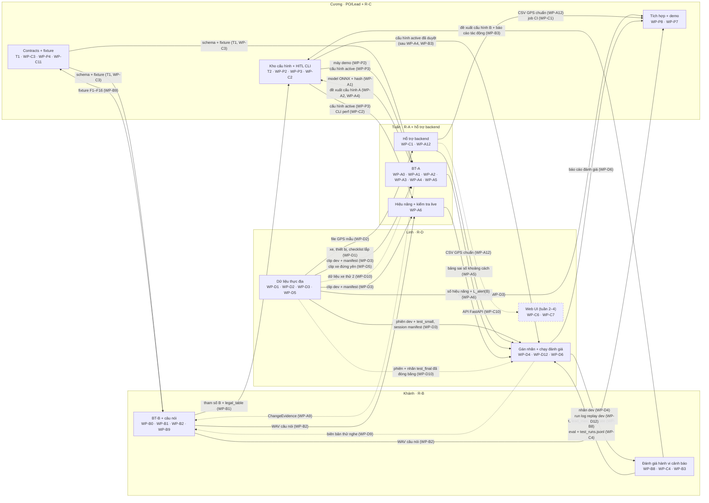
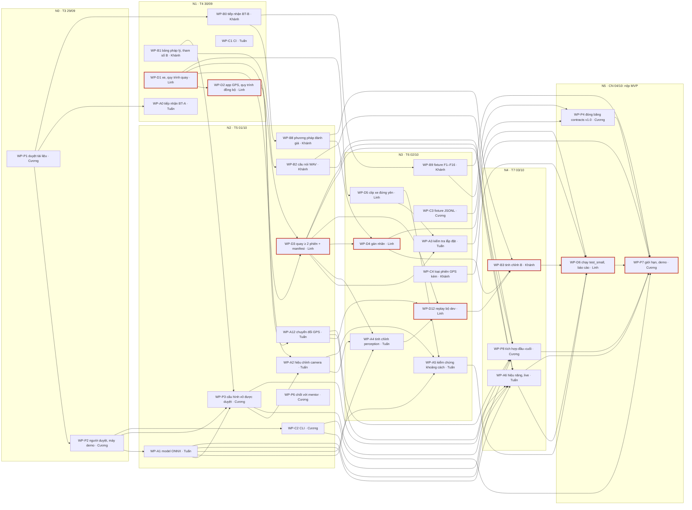

# Sơ đồ phối hợp và phụ thuộc task

> Hai sơ đồ dưới đây vẽ lại bảng task ở [README.md](README.md), mục 4. Khi sơ đồ khác bảng thì **bảng thắng**; khi đổi owner hay phụ thuộc, sửa bảng trước rồi sửa sơ đồ trong cùng commit.
>
> Nét liền là việc của bản nộp MVP (tuần 1). Nét đứt là việc tuần 2–4. Mốc N0…N5 định nghĩa ở README mục 0: N0 = 29/09, N5 = 04/10 (nộp MVP).

## 1. Phối hợp bốn người: ai giao sản phẩm gì cho ai

**Đọc sơ đồ:**
- Mọi thay đổi cấu hình của A và B đều đi qua kho cấu hình + HITL của Cương, và người duyệt phải khác người đề xuất. Người khác chỉ nhận **cấu hình active đã duyệt**, không nhận file cấu hình trao tay.
- Linh **tổng hợp** báo cáo đánh giá. Số liệu của từng mục do người làm ra nó chịu trách nhiệm (README, mục 1):
  - bảng sai số từ Tuấn;
  - số hiệu năng từ Tuấn, riêng `L_alert(B)` do Khánh kiểm;
  - so sánh B với baseline từ Khánh.
- **Phiên `test_small` và `test_final` chỉ đi từ dữ liệu thực địa sang gán nhãn và chạy đánh giá của Linh** (WP-D4, WP-D6; WP-D10, WP-D11). Tuấn và Khánh chỉ nhận phiên `dev`; từ tuần 2, Tuấn nhận thêm dữ liệu xe thử 2, không nhận `test_final`. Cương kiểm các phiên này bằng script chỉ in metadata, không mở nội dung ([linh.md: WP-D3, WP-D10](phan-viec/linh.md)).
- Sơ đồ chỉ vẽ sản phẩm bàn giao, không vẽ quan hệ review. Reviewer của từng task ghi ở README, mục 4.

## 2. Phụ thuộc task tuần 1 và đường găng

**Đọc sơ đồ:**
- **Mỗi mũi tên** là một dòng trong cột "Cần có" của README mục 4.1.
- **WP-P7** chỉ cần các task cho ra bằng chứng của AC-M1…M12 ([cuong.md: WP-P7](phan-viec/cuong.md)); không cần WP-P5, WP-P6, WP-D7.
- **Không vẽ** WP-P5 (việc liên tục) và WP-D7 (không chặn MVP).
- **Viền đỏ là đường găng:** WP-D1 → WP-D2 → WP-D3 → WP-D4 và WP-D12 → WP-B3 → WP-D6 → WP-P7.
  - Chuỗi này đi qua dữ liệu thực địa: có dữ liệu thì mới có nhãn và các lần chạy trên bộ dev; có nhãn và các lần chạy đó thì mới tinh chỉnh được B; tinh chỉnh B xong mới chạy được `test_small`.
  - Mọi task nằm trên đường găng đều không còn ngày dự phòng. Phương án khi trễ: README, mục 5.
