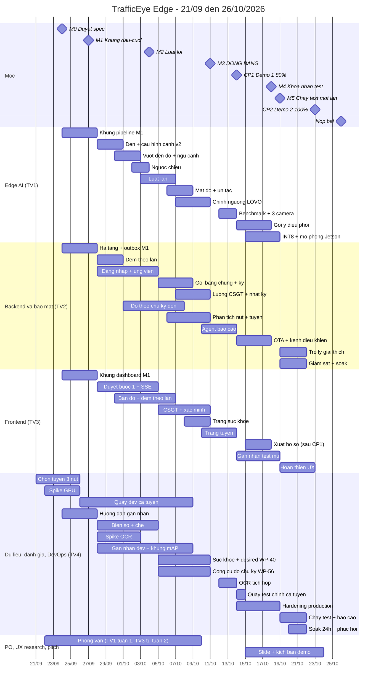

# Kế hoạch và timeline dự án — TrafficEye Edge

> **Phiên bản:** 2.0 · 21/09/2026 · theo spec v1.0 (`docs/spec/trafficeye-spec.md`) · thay bản 1.1.
> - PO đã chốt Q1–Q4 ngày 21/09: vi phạm RL + WW + LN; MQTT làm kênh điều khiển ở CP2; Live URL trước CP2; CP1 14/10, CP2 23/10.
> - PO chốt thêm Q6–Q9 cùng ngày:
>   - sai làn đủ 3 kiểu;
>   - phân tích ùn tắc theo **tuyến 3 nút**, quay thật và quay cùng lúc, xong trước CP1; không tự tính thời gian đèn;
>   - bù tải: FR-AGT-3 xuống COULD, xuất hồ sơ sang CP2, WP-40 sang TV4.
> - Toàn văn spec duyệt tại M0.
> **Thay đổi so với 1.1:**
> - thêm 2 checkpoint: **CP1** (80%) và **CP2** (100%, sẵn sàng production);
> - thêm phạm vi theo đề bài chính thức: đi ngược chiều, sai làn, mật độ/ùn tắc, OCR, mAP, bản đồ, Agent (nâng lên MUST), và các mục nâng cao (nhiều camera, OTA, gợi ý điều phối);
> - mỗi WP trỏ về ID trong spec và có cột nghiệm thu;
> - sắp lại phân vai.
>
> **Plan chi tiết từng task:** M1 đã có (`2026-09-21-m1-skeleton.md`). Các plan sau viết bằng `/write-plan` khi gần tới mốc.
> **Căn cứ:** spec v1.0, báo cáo v0.4, `docs/eval/protocol.md`, CLAUDE.md mục 10–13 và 18.

---

## 1. Quy trình và nguyên tắc chống làm lại

| Bước (CLAUDE.md mục 18) | Trạng thái |
|---|---|
| GRILL ME, BRAINSTORM, RESEARCH | Xong |
| DESIGN | Báo cáo v0.4 |
| DESIGN REVIEW | Xong 21/09: 22 phát hiện, PO đã duyệt |
| **SPEC** | Bản v1.0-draft viết ngày 21/09; PO duyệt tại **M0 (24/09)** |
| WRITE PLAN (`/write-plan`) | Plan M1 xong. Plan M2 viết ngay sau M0 (25/09). Plan M3 viết khoảng 02/10. Plan cho CP2 viết khoảng 12/10 |
| IMPLEMENT → TEST → EVALUATE → DOCUMENT | Theo timeline dưới đây |

**Năm nguyên tắc để không phải đập đi xây lại** (chi tiết ở spec mục 0 và 12):
1. Spec và các hợp đồng (cấu hình cảnh, sự kiện, API) được chốt tại M0. Sau đó chỉ đổi qua Change Request.
2. M1 là khung chạy đầu–cuối; mọi tính năng về sau gắn vào khung này.
3. Làm theo lát dọc: mỗi tính năng chạy đủ edge → trung tâm → giao diện ở mức tối thiểu rồi mới làm sâu.
4. Có dữ liệu mẫu theo hợp đồng, nên edge, backend và frontend làm song song mà không phải chờ nhau.
5. Không bắt đầu việc chưa đạt Definition of Ready. Không đóng việc chưa đạt Definition of Done (spec mục 9).

**Ngoại lệ tuần 1:** các WP không phải code (chọn nút, quay video, hướng dẫn gán nhãn, repo, phỏng vấn) và plan M1 bắt đầu ngay. Plan M1 không bị ảnh hưởng bởi spec v1.0.

---

## 2. Các mốc và checkpoint

| Mốc | Ngày | Điều kiện đạt (chi tiết ở spec) |
|---|---|---|
| **M0** — Duyệt spec | Thứ 5, 24/09 | PO duyệt toàn văn spec v1.0 và câu Q5 (Q1–Q4, Q6–Q9 đã chốt 21/09). Chọn tuyến (WP-02) xong ngày 25/09 |
| **M1** — Khung đầu–cuối | CN, 27/09 | TASK-022 của plan M1 đạt |
| **M2** — Luật lõi | CN, 04/10 | Chạy được trên dev: đèn, vượt đèn đỏ, đi ngược chiều. Luật làn đang làm. Đã có: che biển số, đăng nhập, duyệt bước 1, bản đồ |
| **M3** — **ĐÓNG BĂNG** [Đã chốt] | CN, 11/10 | Mọi luật được đánh giá (RL, WW, LN đủ 3 kiểu) và ngưỡng phân tích tuyến đã chỉnh bằng leave-one-video-out và đóng băng. Đã có: bằng chứng có ký, luồng CSGT, mật độ/ùn tắc, đo theo chu kỳ đèn, phân tích tuyến, trang sức khỏe |
| **CP1 — Demo 1 (80%)** | **Thứ 4, 14/10** | Spec mục 8.1: luồng chính + phô diễn kỹ thuật; hoàn thành ≥ 80% |
| **M4** — Khóa nhãn test | CN, 18/10 | Nhãn test của mọi loại vi phạm, nhãn chu kỳ đèn và tràn hàng chờ, và tập khung mAP test được gán mù, phân xử, khóa |
| **M5** — Chạy test một lần | Thứ 2, 19/10 | Log ghi `status: fresh` |
| **CP2 — Demo 2 (100%, production)** | **Thứ 6, 23/10** | Spec mục 8.2: checklist production xanh; có báo cáo đánh giá tập test |
| **M7** — Tổng duyệt cuối, khóa code | CN, 25/10 | Từ đây chỉ sửa lỗi nghiêm trọng |
| **Nộp bài** | Thứ 2, 26/10 | |

**Vì sao CP1 đặt ngày 14/10:**
- Mọi luật được đánh giá phải xong trước khi đóng băng (11/10). Hai ngày 12–13/10 dành cho các phần không ảnh hưởng tới ngưỡng: Agent, OCR, benchmark, trang Tuyến.
- Theo bảng cỡ việc ở spec mục 2, tới lúc đó đạt 53/65 ≈ 82%.

---

## 3. Sơ đồ Gantt



Nhãn trong Gantt viết không dấu, để tránh lỗi hiển thị trên một số trình render Mermaid.

---

## 4. Gói công việc theo tuần

Cột "Nghiệm thu" là điều kiện riêng của từng WP, **cộng thêm DoD chung** ở spec mục 9.2 (PR được review, CI xanh, có test, đúng hợp đồng, chạy được trong môi trường tích hợp, không commit dữ liệu thô, cập nhật tài liệu). Mỗi WP là một issue trên GitHub Project, có các trường `Spec ID`, `Size`, `Checkpoint`.

### Tuần 1 (21–27/09) — Nền móng và chốt spec

| WP | Việc | Spec | Người | Phụ thuộc | Nghiệm thu | Hạn |
|---|---|---|---|---|---|---|
| WP-01 | Design review và duyệt stack | — | TV1 + cả team | — | Có biên bản duyệt | **Xong 21/09** |
| WP-32 | Duyệt spec v1.0: yêu cầu, hợp đồng, checkpoint, DoD; trả lời Q5 (Q1–Q4, Q6–Q9 đã chốt 21/09) | spec mục 14 | TV1 + cả team | — | PO duyệt; spec gắn tag `spec-v1.0`; tạo `docs/spec/changes.md` | **24/09** |
| WP-02 | Chọn tuyến 3 nút MVP. Tiêu chí C-01 cộng tiêu chí tuyến và tiêu chí cho WW, LN | FR-COR-1, FR-COR-2, FR-VIO-WW, FR-VIO-LN | TV4, TV1 | — | Khảo sát tuyến 3 nút liên tiếp có đèn nhìn thấy từ camera, hay tắc cao điểm chiều; ít nhất 1 nút có làn riêng theo loại xe (hoặc quay thêm điểm riêng cho LN-a), 1 nút có vạch liền + mũi tên, 1 nút có đoạn một chiều / dải phân cách; có quyết định chọn tuyến | 25/09 |
| WP-03 | Quay các phiên dev #1–#2 cả tuyến (3 nút cùng lúc); chuyển sang 15 FPS cố định; khớp giờ qua time.is; lập manifest | FR-CAM-1, FR-MC-1, H-02 | TV4 | WP-02 | `eval/manifests/dev.csv` có SHA-256 (tạo bằng `scripts/make_manifest.py`); quay đủ 3 nút cùng lúc | 30/09 |
| WP-04 | Khung edge | FR-CNT-1, FR-SYNC-1 | TV1 | Plan M1 | TASK-001…007 của plan M1 | 27/09 |
| WP-05 | Hạ tầng trung tâm | FR-SYNC-1 | TV2 | Plan M1 | TASK-008…013 của plan M1 | 27/09 |
| WP-06 | Khung dashboard | FR-UI-1 | TV3 | Plan M1 | TASK-014…016 của plan M1 | 27/09 |
| WP-07 | Repo: README; GitHub Project có các trường Spec ID/Size/Checkpoint; quy tắc branch/PR; chính sách video thô (M-06); kiểm tra luật CODEOWNERS của nhánh `main` | NFR-QA-1 | TV4 | — | Mỗi WP có một issue; PR của team không bị chặn bởi CODEOWNERS của template | 25/09 |
| WP-08 | Phỏng vấn người dùng: danh sách liên hệ, bộ câu hỏi; hỏi BTC định nghĩa "mô phỏng Jetson" (L-04) | — | TV1 | — | Đã gửi liên hệ đầu tiên và câu hỏi cho BTC | 25/09 |
| WP-09 | Hướng dẫn gán nhãn v0 (xem chi tiết bên dưới bảng); gán thử 1 clip; đo thời gian gán | FR-EVAL-1…4, FR-EVAL-8 | TV4 + TV2, TV3 | WP-03 | Có hướng dẫn trong `docs/eval/`; ghi lại kappa và số phút công cho mỗi phút video; chốt số giờ video cần quay | 27/09 |
| WP-31 | Spike GPU trên máy demo: cập nhật driver NVIDIA (máy PO đang dùng 528.25), cài torch CUDA, đo FPS; thử GPU trong Docker | FR-OPT-1, M-04 | TV4 | — | `docs/report/spike-wp31.md` có bảng FPS và quyết định chạy edge bằng Docker hay conda (TASK-020 của plan M1) | 25/09 |

**Tiêu chí chọn tuyến 3 nút (WP-02, chốt 25/09):**
- Tiêu chí chung C-01:
  - quay từ phía sau dòng xe;
  - mặt đèn quay về camera và đủ lớn trong khung;
  - có chỗ quay an toàn cho cả 3 vị trí.
- Tiêu chí tuyến:
  - 3 nút giao có đèn tín hiệu liên tiếp nhau trên cùng một trục đường;
  - thường xuyên có ùn tắc vào giờ cao điểm chiều (để quan sát được tràn hàng chờ `spillback` và chu kỳ thất bại);
  - đồng bộ thời gian quay: 3 camera khớp giờ chuẩn ban đầu (time.is) với sai số ± 1 giây.
- Tiêu chí vi phạm:
  - ít nhất một nút có làn riêng theo loại xe (nếu không có thì quay thêm một điểm riêng cho LN-a);
  - ít nhất một nút có vạch liền trước vạch dừng và mũi tên chỉ hướng trên từng làn (để làm LN-b, LN-c);
  - trong khung có phần đường một chiều hoặc có dải phân cách (để làm WW).

**Nội dung hướng dẫn gán nhãn (WP-09):**
- sự kiện vượt đèn đỏ (RL), đi ngược chiều (WW), sai làn (LN đủ 3 kiểu: LN-a, LN-b, LN-c); dừng đỗ sai (ST) nếu có làm;
- đo chu kỳ đèn thực tế và thời gian xanh, đếm tay xe thoát mỗi chu kỳ, nhận diện chu kỳ thất bại;
- đoạn xảy ra tràn hàng chờ `spillback` (để đánh giá FR-EVAL-8);
- đếm tay hàng chờ;
- vẽ box cho tập khung mAP.

### Tuần 2 (28/09–04/10) — Luật lõi (M2)

| WP | Việc | Spec | Người | Phụ thuộc | Nghiệm thu | Hạn |
|---|---|---|---|---|---|---|
| WP-10 | Máy trạng thái đèn; đọc cấu hình cảnh v2 (làn, vạch phân làn, cạnh ra, các vùng, homography) | FR-LGT-1, spec 6.1 | TV1 | WP-04 | FR-LGT-1 AC1–AC3; cấu hình M1 vẫn đọc được | 30/09 |
| WP-11 | Giao diện luật chung; lớp ngữ cảnh; luật vượt đèn đỏ + mã lý do; xuất `alerts.jsonl` | FR-VIO-0, FR-CTX-1, FR-VIO-RL | TV1 | WP-10 | FR-VIO-0 AC1–AC2; `evaluate.py --split dev` chạy được; có `rejection_summary` | 02/10 |
| WP-33 | Luật đi ngược chiều | FR-VIO-WW | TV1 | WP-11 | Test cho từng điều kiện và từng mã W1–W8; FR-VIO-WW AC1 trên clip dev | 03/10 |
| WP-34 | Động cơ luật làn: LN-a, LN-b, LN-c (đủ 3 kiểu, đều MUST) | FR-VIO-LN | TV1 | WP-11 | Test cho từng kiểu và mã L1–L8; bật đủ 3 kiểu trên clip dev | **06/10** |
| WP-35 | Đếm theo làn (sự kiện count v1.1 có `lane_id`) | FR-CNT-2 | TV2 | WP-10 | FR-CNT-2 AC1; trung tâm nhận count v1.1 | 02/10 |
| WP-12 | Detector biển số + che (bản điều hành viên) | FR-PRV-1 | TV4 | WP-04 | Bộ ảnh kiểm tra không còn lộ biển số. Phương án dự phòng: che nửa dưới bbox | 04/10 |
| WP-13 | Đăng nhập, JWT, 4 vai trò; nhận `violation_candidate` và bằng chứng; API ứng viên | FR-AUTH-1, FR-SYNC-2, FR-EVD-2 | TV2 | WP-05 | Test 401/403 cho mọi endpoint; test chống trùng; thử ngắt mạng giữa lúc tải bằng chứng | 04/10 |
| WP-14 | Màn hình duyệt bước 1 + SSE | FR-HITL-1, FR-UI-2 | TV3 | WP-13 (có dữ liệu mẫu) | FR-HITL-1 AC1–AC2 | 04/10 |
| WP-36 | Bản đồ camera; số đếm theo làn | FR-UI-1, FR-UI-3 | TV3 | WP-35 (có dữ liệu mẫu) | Bản đồ vẫn hiện khi không có Internet (ảnh tĩnh); ảnh chụp mobile và desktop | 06/10 |
| WP-15 | Quay dev #3–#4; gán nhãn dev mọi loại sự kiện: một người gán, 30% gán đôi | FR-EVAL-3 | TV4 + TV2, TV3 | WP-09 | `evaluate.py` đọc được mọi file nhãn; có kappa theo từng loại | 08/10 |
| WP-16 | Quay test dự phòng cả tuyến (3 nút cùng lúc); custodian niêm phong | protocol 2.3, FR-MC-1 | TV4 | WP-02 | Custodian giữ video và SHA-256; quay đủ 3 nút cùng lúc | 03/10 |
| WP-37 | Spike OCR: so sánh fast-plate-ocr và PaddleOCR trên ≥ 100 ảnh biển số Việt Nam cắt từ dev (gồm biển 2 dòng) | FR-OCR-1 | TV4 | WP-12 | Có bảng tỉ lệ khớp hoàn toàn và tốc độ; đã chọn công cụ | 02/10 |
| WP-38 | Tập khung mAP dev (~200 khung) + script mAP | FR-EVAL-1 | TV4 (TV3 hỗ trợ gán) | WP-03 | Có mAP50, mAP50-95 theo lớp cho YOLO26n trên dev → quyết định có tinh chỉnh không (FR-DET-1) | 06/10 |
| WP-08 | Phỏng vấn người dùng (tiếp); ghi chép | — | **TV3** (Q5) | WP-08 tuần 1 | Có ít nhất 1 cuộc phỏng vấn được ghi chép | 04/10 |

### Tuần 3 (05–11/10) — Hoàn thiện phát hiện, bằng chứng và **đóng băng** (M3)

| WP | Việc | Spec | Người | Phụ thuộc | Nghiệm thu | Hạn |
|---|---|---|---|---|---|---|
| WP-39 | Mật độ, hàng chờ, mức ùn tắc, sự kiện ùn tắc theo chu kỳ đèn | FR-DEN-1, FR-DEN-2 | TV1 | WP-10 | FR-DEN-1 AC (hàng chờ); FR-DEN-2 AC trên các đoạn dev đã gán nhãn | 08/10 |
| WP-17 | Gói bằng chứng cho mọi loại vi phạm: 3 khung, clip JPEG, manifest, ký Ed25519, bản đầy đủ giữ trên thiết bị | FR-EVD-1, FR-PRV-2, FR-PRV-3 | **TV2** (chuyển từ TV1, Q5) | WP-11, WP-12 | FR-EVD-1 AC1–AC2 | 08/10 |
| WP-18 | Luồng CSGT: mở quyền sau bước 1; nhật ký nối băm; API xác minh; xóa theo thời hạn lưu giữ | FR-HITL-2, FR-HITL-3 | TV2 | WP-13, WP-17 | FR-HITL-2 AC1–AC2; FR-HITL-3 AC | 10/10 |
| WP-19 | Màn hình CSGT; trang xác minh; thống kê | FR-UI-4 | TV3 | WP-18 | Chạy trọn luồng 2 bước trên giao diện | 10/10 |
| WP-40 | Heartbeat; trang sức khỏe; trạng thái mong muốn (`GET desired`, edge hỏi mỗi 10 giây); nút bật/tắt chế độ điều khiển tay | FR-DEV-1, FR-UI-5, spec 6.7 | **TV4** (API và luồng hỏi trên edge — nhận từ TV2), TV3 (giao diện) | WP-13, WP-11 | FR-DEV-1 AC1–AC3 | 10/10 |
| WP-53 | Đo theo chu kỳ đèn trên edge (sự kiện `signal_cycle` v1: chu kỳ xanh/vàng/đỏ, số xe đến/thoát, hàng chờ lớn nhất, hàng chờ tồn đọng, tốc độ thoát bão hòa) | FR-DEN-4 | **TV2** | WP-10 | FR-DEN-4 AC1–AC3; kiểm tra payload và lưu lượng outbox | 07/10 |
| WP-54 | Phân tích nút và tuyến tại trung tâm: tính q, s, g/C, X, độ trễ d1+d2, LOS A–F theo HCM; phát hiện tràn hàng chờ (spillback) và nút cổ chai (bottleneck); API hiệu năng nút và tuyến | FR-COR-1, FR-COR-2 | **TV2** | WP-53 | FR-COR-1 AC1–AC2; FR-COR-2 AC1–AC3; API trả đúng schema; phát sự kiện tuyến qua SSE | 10/10 |
| WP-55 | Màn hình Tuyến: bản đồ tuyến tô màu mức ùn tắc kèm mũi tên tràn hàng chờ, bản đồ nhiệt nút × thời gian (ô 5 phút), thẻ hiệu năng từng nút (LOS, X, cycle failure, xanh thực tế) | FR-UI-7 | **TV3** | WP-54 | FR-UI-7 AC1–AC3 | 13/10 |
| WP-56 | Công cụ đo chu kỳ đèn và sự kiện tuyến trên dev (chu kỳ đèn, thoát bão hòa, số xe thoát, chu kỳ thất bại, tràn hàng chờ) | FR-EVAL-8 | **TV4** | WP-53, WP-54 | `scripts/evaluate_corridor.py` chạy trên dữ liệu dev; có bảng so khớp | 10/10 |
| WP-20 | Chỉnh ngưỡng leave-one-video-out cho **mọi luật được đánh giá** (RL, WW, LN đủ 3 kiểu) và ngưỡng phân tích tuyến; kiểm tra quy tắc ghép (M-02); ablation lớp ngữ cảnh; commit bản đăng ký trước | FR-CTX-1 AC2, FR-VIO-* AC2, FR-COR-* | TV1 (chỉnh mọi ngưỡng) + TV4 | WP-11, WP-33, WP-34, WP-54, WP-15, WP-56 | Có số dev theo từng loại (Wilson); commit `eval/preregistration.md` | 10/10 |
| **M3** | **Đóng băng:** `configs/frozen/rl-v1.yaml` và `configs/frozen/corridor-v1.yaml` + SHA-256 + tag `eval-freeze-v1` | spec 6.2, 6.8 | TV1 | WP-20 | Tag đã được đẩy lên GitHub | **11/10** |

### Tuần 4 (12–18/10) — CP1, các mục nâng cao, dữ liệu test

Sau M3 **không đổi ngưỡng và không đổi luật** của các loại vi phạm được đánh giá [Đã chốt]. Những thay đổi được phép là: sửa lỗi không ảnh hưởng tới logic phát hiện, và làm các phần không phải luật.

| WP | Việc | Spec | Người | Phụ thuộc | Nghiệm thu | Hạn |
|---|---|---|---|---|---|---|
| WP-41 | Xuất ONNX và TensorRT FP16; benchmark từng tầng | FR-OPT-1, NFR-PERF-3 | TV1 | M3 | Bảng benchmark chạy lại được bằng một lệnh | 13/10 |
| WP-42 | Agent báo cáo ca trực và báo cáo sự cố; bước người duyệt; chế độ không LLM | FR-AGT-1, FR-UI-6 | TV2 (TV3 làm giao diện) | WP-18 | FR-AGT-1 AC1–AC3 | 13/10 |
| WP-43 | Tích hợp OCR chỉ cho xe vi phạm | FR-OCR-1 | TV4 | WP-37, WP-17 | FR-OCR-1 AC1, AC3 | 13/10 |
| WP-44 | 3 camera đồng thời trên một tuyến (3 đường MediaMTX, 3 cấu hình cảnh) | FR-MC-1, FR-COR-2 | TV1 | WP-40 | FR-MC-1 AC1–AC2; cả 3 camera cấp dữ liệu cho phân tích tuyến | 13/10 |
| WP-45 | Xuất hồ sơ vi phạm (PDF + JSON) [Chuyển từ CP1 sang CP2 để đỡ tải] | FR-EXP-1 | TV3 | WP-18 | Bản nháp xuất hồ sơ sau CP1 | 15/10 |
| **CP1** | **Demo 1, hoàn thành ≥ 80% (53/65 điểm ≈ 82%; spec mục 8.1)** | spec 8.1 | Cả team, PO chủ trì | WP-41…44, WP-53…55 | Nghiệm thu CP1; demo tuyến 3 nút, tràn hàng chờ B → A, nút cổ chai, LOS, 3 kiểu sai làn; ghi phản hồi vào `docs/plan/cp1-feedback.md` | **14/10** |
| WP-21 | Quay test chính cả tuyến sau đóng băng (3 nút cùng lúc, chiều 14/10 sau CP1); kiểm tra trùng lặp bằng SHA-256 + pHash | protocol 2.3, FR-MC-1 | TV4 | M3 | Có manifest test đủ 3 nút | 14/10 |
| WP-22 | Gán nhãn mù tập test (mọi loại vi phạm + chu kỳ đèn + tràn hàng chờ + khung mAP test); tính kappa; phân xử; khóa nhãn | FR-EVAL-1, FR-EVAL-3, FR-EVAL-8 | TV2, TV3 gán; TV4 phân xử | WP-21 | Có tag `labels-lock-test-v1` | **18/10** |
| WP-46 | OTA: bản phát hành có ký, canary, tự quay lại bản cũ. Kênh điều khiển MQTT: Mosquitto có TLS và ACL, Last Will, thông báo `desired` (spec 6.7) | FR-OTA-1, FR-DEV-2 | TV2 | WP-40 | FR-OTA-1 AC1–AC3; FR-DEV-2 AC1–AC3 | 17/10 |
| WP-47 | Gợi ý điều phối khi ùn tắc (luật tất định + Agent viết giải thích + người quyết định) | FR-DSP-1 | TV1 | WP-39, WP-42 | FR-DSP-1 AC | 17/10 |
| WP-49 | Hardening production: TLS (reverse proxy), mật khẩu băm, giới hạn tần suất đăng nhập, bí mật, sao lưu DB, job xóa theo thời hạn, giới hạn tài nguyên | NFR-SEC-1, NFR-DEP-1, NFR-PRIV-2 | TV4 | WP-18 | Các mục Bảo mật và Triển khai trong checklist CP2 xanh | 18/10 |
| WP-23 | INT8; mô phỏng Jetson (giới hạn tài nguyên); FPS đầu–cuối khi bật mọi luật | FR-OPT-2, FR-OPT-3, NFR-PERF-1 | TV1 | WP-41 | Có bảng FP32/FP16/INT8 kèm độ lệch mAP; FPS đầu–cuối ≥ 15 | 18/10 |
| WP-52 | Live URL: triển khai phần trung tâm (API, DB, dashboard, broker MQTT) lên cloud, có TLS [Đã chốt Q3] | NFR-DEP-2 | TV4 | WP-49, WP-46 | URL mở được từ mạng ngoài (thử bằng trình duyệt ẩn danh và mạng 4G); edge ở máy local gửi được sự kiện và kết nối được broker; URL sống tới hết Demo Day + 7 ngày | 18/10 |
| WP-26 | Bản nháp slide và kịch bản demo CP2 | spec 8.2 | TV1 | CP1 | Team đọc qua một lượt | 18/10 |

**Tiêu chí chọn nền tảng cloud (WP-52; chọn trước 12/10 để kịp thử):**
- chạy được đủ các thành phần: Postgres, backend, dashboard, Mosquitto;
- broker nhận được kết nối từ Internet, qua cổng 8883 hoặc qua WebSocket TLS ở cổng 443 (spec 6.7);
- không tự ngủ khi vắng truy cập, vì heartbeat và Last Will cần kết nối liên tục;
- sống tới hết Demo Day + 7 ngày (`docs/guide/chapter-09.md`); chi phí nằm trong ngân sách team.

Giới hạn của các gói miễn phí (tự ngủ, cổng TCP, hạn dùng DB) **cần kiểm chứng trên trang của nhà cung cấp** lúc chọn; ở đây chưa kiểm.

### Tuần 5 (19–25/10) — Đánh giá, production, **CP2**

| WP | Việc | Spec | Người | Phụ thuộc | Nghiệm thu | Hạn |
|---|---|---|---|---|---|---|
| WP-27 | **Chạy test một lần**; điền báo cáo đánh giá: precision từng loại vi phạm (sai làn báo riêng 3 kiểu LN-a, LN-b, LN-c), mAP, đếm theo làn, đo chu kỳ đèn và sự kiện tuyến (FR-EVAL-8), che lọt, OCR, hiệu năng | FR-EVAL-1…8 | TV4 (custodian) | M4 | Log `status: fresh`; `eval/results/report.md` đủ các mục | 19/10 chạy · 21/10 báo cáo |
| WP-48 | Trợ lý giải thích ứng viên; hỏi đáp số liệu | FR-AGT-2 (MUST), FR-AGT-3 (COULD) | TV2 | WP-42 | FR-AGT-2 AC; FR-AGT-3 AC | 21/10 |
| WP-45 | Nghiệm thu xuất hồ sơ vi phạm (PDF + JSON) [từ CP1 sang CP2] | FR-EXP-1 | TV3 | WP-18 | FR-EXP-1 AC | 23/10 |
| WP-50 | Soak test 24 giờ; thử phục hồi (edge, backend, DB, mạng); hiệu năng nhiều luồng | NFR-REL-1, NFR-PERF-1 | TV4 + TV2 | WP-49 | Mục Tin cậy trong checklist CP2 xanh; có log soak test | 21/10 |
| WP-51 | Quan sát hệ thống: cảnh báo camera mất kết nối, log có cấu trúc, Prometheus (Grafana nếu kịp) | NFR-OBS-1 | TV2 | WP-40 | Mục Quan sát trong checklist CP2 xanh | 21/10 |
| WP-30 | Tài liệu: runbook, OpenAPI, ARCHITECTURE, mục hạn chế, README, WORKLOG, JOURNAL | NFR-DEP-1 | TV4 + TV1 | — | Mục Tài liệu trong checklist CP2 xanh | 22/10 |
| WP-28 | Slide, video demo, câu trả lời 30 giây, bộ câu hỏi giám khảo | — | TV1 + cả team | WP-26, WP-27 | Slide chốt | 23/10 |
| **CP2** | **Demo 2, hoàn thành 100%, sẵn sàng production** (spec mục 8.2) | spec 8.2 | Cả team | Tất cả | Nghiệm thu CP2; PO ký | **23/10** |
| WP-29 | Sửa lỗi sau CP2; tổng duyệt cuối; máy dự phòng; video ghi sẵn toàn bộ demo (H-08) | — | Cả team | CP2 | Demo chạy trọn trên máy chính và máy dự phòng | 25/10 |

**WP đã bỏ hoặc gộp:**
- WP-24 (Agent tóm tắt ca) gộp vào WP-42 và WP-48.
- WP-25 (hoàn thiện UX) chia vào DoD giao diện của từng WP, và nằm trong phần "Hoàn thiện UX" của TV3 ở tuần 5.

---

## 5. Phân vai (bản 2.0)

| Thành viên | Vai trò | Trách nhiệm chính | Không làm (chống rò rỉ dữ liệu test) |
|---|---|---|---|
| TV1 (PO) | AI lead, kiến trúc, pitch | Đèn, lớp ngữ cảnh, 3 loại luật (RL, WW, LN đủ 3 kiểu), mật độ và ùn tắc, chỉnh mọi ngưỡng đóng băng (cả ngưỡng tuyến), benchmark, nhiều camera (FR-MC-1 MUST), gợi ý điều phối, slide | Không đọc thư mục test [Đã chốt] |
| TV2 | Backend và bảo mật | Outbox và sender, API, đăng nhập và phân quyền, đếm theo làn, gói bằng chứng có ký, luồng CSGT, nhật ký, đo theo chu kỳ đèn (`signal_cycle`, WP-53), phân tích nút và tuyến (WP-54), Agent báo cáo, kênh điều khiển MQTT (WP-46), trợ lý giải thích (FR-AGT-2; FR-AGT-3 xuống COULD), quan sát hệ thống; gán nhãn test | Không xem kết quả hệ thống trên tập test trước khi nhãn được khóa |
| TV3 | Frontend, UI/UX, nghiên cứu người dùng | Dashboard, bản đồ, màn hình duyệt, CSGT, trang xác minh, trang sức khỏe, màn hình Tuyến (WP-55, hạn 13/10), xuất hồ sơ (WP-45, chuyển sang CP2), giao diện Agent, **phỏng vấn người dùng từ tuần 2**; gán nhãn test | Như TV2 |
| TV4 | QA, đánh giá, DevOps, custodian | Dữ liệu tuyến 3 nút, manifest, hướng dẫn gán nhãn, biển số và che, OCR, tập khung mAP, công cụ đo chu kỳ đèn và tuyến (FR-EVAL-8, WP-56), nhận WP-40 từ TV2 (heartbeat, desired, health), phân xử nhãn, Docker/CI, hardening, Live URL, soak test, chạy test, báo cáo đánh giá, tài liệu | Không chỉnh ngưỡng [Đã chốt] |

**Điểm nóng về tải việc:**
- TV1 ở tuần 2–3 phải làm đèn, 3 loại luật, mật độ và chỉnh ngưỡng. Vì vậy gói bằng chứng và đếm theo làn đã chuyển cho TV2, phỏng vấn chuyển cho TV3 (Q5).
- TV2 là điểm nóng mới ở tuần 3 (nhận thêm WP-53 `signal_cycle` và WP-54 phân tích tuyến). Để bù tải: WP-40 chuyển sang TV4, FR-AGT-3 xuống COULD, xuất hồ sơ (WP-45/FR-EXP-1) chuyển sang CP2.
- Nếu tới 04/10 TV1 vẫn trễ, áp dụng điểm kích hoạt ở mục 7.

---

## 6. Đường găng và vùng đệm

**Đường găng:**

```text
chọn tuyến 3 nút (WP-02)
  → dữ liệu dev đủ 3 nút có ca WW/LN (WP-03, WP-15)
  → luật (WP-11, WP-33, WP-34) + phân tích tuyến (WP-53, WP-54)
  → chỉnh ngưỡng LOVO (WP-20)
  → ĐÓNG BĂNG 11/10 (M3)
  → quay test cả tuyến (WP-21)
  → gán nhãn mù (WP-22)
  → CHẠY TEST 19/10 (M5)
  → báo cáo (WP-27)
  → CP2 (23/10)
```

**Đường găng thứ hai, cho CP1:** API ứng viên (WP-13) → gói bằng chứng (WP-17) → luồng CSGT (WP-18) → giao diện CSGT (WP-19) + Màn hình Tuyến (WP-55) → CP1 (14/10).

**Vùng đệm:**
- 12–13/10: hai ngày trước CP1, không đụng tới ngưỡng.
- 19–23/10: năm ngày giữa lúc chạy test và CP2.
- Tập test dự phòng (WP-16).

**Nguyên tắc:** không lùi ngày đóng băng. Nếu tới 11/10 một luật chưa xong thì luật đó chỉ được trình diễn, không báo precision trên tập test.

---

## 7. Danh sách cắt và điểm kích hoạt

Theo spec mục 11.

**Thứ tự cắt khi thiếu thời gian (cắt từ trên xuống):**
1. FR-INT-3, FR-INT-4, FR-INT-5
2. FR-VIO-ST
3. MQTT (FR-DEV-2). Hỏi định kỳ đã có từ CP1 nên cắt MQTT không mất chức năng; chỉ mất việc báo mất kết nối trong ≤ 10 giây và thông báo tức thì
4. FR-OPT-2 (giữ FP16)
5. FR-DSP-1 (chỉ giữ sự kiện ùn tắc và sự kiện tuyến)
6. Bản đồ nhiệt của trang Tuyến (giữ bản đồ và bảng số)
7. Tuyến giảm còn 2 nút (FR-MC-1 còn 2 camera)
8. FR-OTA-1 (chỉ cập nhật cấu hình, vẫn giữ kiểm chữ ký)

**Không bao giờ cắt:**
- vượt đèn đỏ, đi ngược chiều, sai làn đủ 3 kiểu (LN-a, LN-b, LN-c);
- che biển số và khuôn mặt; duyệt 2 bước; chữ ký bằng chứng; đăng nhập;
- đếm theo làn, mật độ, phần lõi của phân tích tuyến (đo theo chu kỳ, hiệu năng từng nút, phát hiện tràn hàng chờ), Agent báo cáo ca trực;
- các metric mAP, độ chính xác đếm, precision vi phạm;
- chạy offline; đo FPS.

| Điểm kiểm tra | Nếu chưa đạt | Hành động |
|---|---|---|
| M1 (27/09): chưa chạy được đầu–cuối | Rủi ro trễ toàn bộ | Dồn người vào đường găng; lùi WP-37 và WP-38 sang tuần 3 |
| 25/09: không tuyến nào có làn riêng theo loại xe | Thiếu dữ liệu tự nhiên cho LN-a | Quay thêm một điểm riêng cho LN-a; báo PO |
| M2 (04/10): luật vượt đèn đỏ chưa qua thử trên dev | TV1 quá tải | Cắt ngay FR-VIO-ST; TV4 hỗ trợ viết test cho luật; FR-DSP-1 xuống COULD để giải phóng TV1 ở tuần 4 |
| 04/10: WP-13 (API ứng viên) trễ | Rủi ro dồn tải TV2 | Chuyển API tuyến (WP-54) sang TV4 |
| 04/10: detector biển số chưa đạt | Không che được biển số đúng | Che nửa dưới bbox (tạm thời); ghi vào mục hạn chế |
| 08/10: luật làn chưa sẵn sàng | Không kịp đóng băng | Luật làn chỉ trình diễn, không báo precision trên test |
| CP1 (14/10): hoàn thành < 70% | Không kịp CP2 | Cắt ngay các mục 1–5 trong danh sách cắt |
| 14/10: quay test chính không được | Không có test prospective | Dùng tập test dự phòng (WP-16) |
| 19/10: có dưới 30 cảnh báo cho một loại vi phạm | Precision của loại đó chỉ minh họa | Gộp tập dự phòng nếu chưa bị mở; nếu vẫn thiếu thì ghi "chỉ minh họa" |

---

## 8. Nhịp làm việc và quy trình GitHub

- **Standup 15 phút mỗi ngày:** hôm qua làm gì, hôm nay làm gì, đang vướng gì.
- **Demo nội bộ tối Chủ nhật** (27/09, 04/10, 11/10, 18/10):
  - PO nghiệm thu các WP theo cột "Nghiệm thu";
  - báo % hoàn thành theo spec mục 8.3.
- **Checkpoint:**
  - CP1 ngày 14/10, CP2 ngày 23/10, theo kịch bản và điều kiện nghiệm thu ở spec mục 8;
  - sau CP1, phản hồi của stakeholder đi qua Change Request.
- **GitHub:**
  - mỗi WP (sau này mỗi TASK) là một issue, có `Spec ID`, `Size`, `Checkpoint`;
  - mỗi issue làm trên một branch riêng, mở PR, cần một người khác review;
  - CI phải xanh mới được merge.
- **Nhật ký:** cập nhật `WORKLOG.md` hằng ngày, `JOURNAL.md` hằng tuần. AI log tự ghi vào `.ai-log/session.jsonl`.

---

## 9. Giả định cần PO xác nhận

1. **Thời gian:** mỗi người khoảng 25 giờ/tuần trong 5 tuần. Nếu có người bận thi hoặc đi làm, báo sớm để áp dụng mục 7.
2. **Máy demo:** laptop của PO có GPU RTX 4050 nhưng driver 528.25 đã cũ. WP-31 cập nhật driver và đo lại. Nếu không dùng được GPU thì chạy ONNX Runtime trên CPU; đã đo được 28 FPS cho detect + track.
3. **Dữ liệu vi phạm tự nhiên:** tại nút đã chọn có đủ ca ngược chiều và sai làn xảy ra tự nhiên. **Không dàn dựng vi phạm trên đường.** Loại nào có n < 30 thì báo cáo là "chỉ minh họa".
4. **Phỏng vấn:** có ít nhất một đầu mối. Nếu không có, dùng ban quản lý khu dân cư làm nguồn dự phòng.
5. **Dữ liệu biển số:** license của bộ dữ liệu biển số cho phép dùng. Nếu không, tự gán nhãn một bộ nhỏ từ video dev.
6. **Quyết định của PO** (spec mục 14): Q1–Q4 đã chốt ngày 21/09. Còn Q5 (phân vai, thời hạn lưu giữ tối đa 7 ngày) sẽ chốt tại M0.
