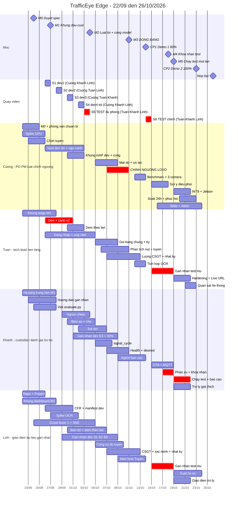

# Kế hoạch và timeline dự án — TrafficEye Edge

> **Phiên bản:** 3.0 · 22/09/2026 · theo spec v1.0 (`docs/spec/trafficeye-spec.md`) · thay bản 2.0.
> **Thay đổi ở 3.0:**
> - chia lại việc theo người thật (mục 5), gán tên vào mọi WP;
> - thêm tải ước lượng theo tuần, ai phụ thuộc ai, và các điểm dễ nghẽn;
> - lịch quay video có tên người đi quay;
> - chốt phương án (a) của Q11: WP-38 xong ngày 02/10;
> - dời vài hạn để khớp phụ thuộc: WP-18 và WP-19 sang 12/10, WP-56 lên 09/10, WP-46 sang 18/10; WP-23, WP-49 và WP-52 sang tuần 5;
> - spike OCR (WP-37) làm trên bộ biển số công khai, xong 01/10.
>
> Các mốc M0–M7, CP1 và CP2 **không đổi**.
>
> **File này là kế hoạch chung của cả team, và là file duy nhất ghi tên người làm từng việc.** Mỗi người có một file việc riêng ở `docs/plan/phan-viec/` (`cuong.md`, `tuan.md`, `khanh.md`, `linh.md`): file đó chỉ nói việc của người đó, theo thứ tự, kèm các bước làm. Khi file riêng lệch với file này thì theo file này.
> **Kiến trúc** (hệ thống gồm 11 phân hệ nào): `docs/architecture_diagram.md`.
> **Plan chi tiết từng task:** M1 đã có (`2026-09-21-m1-skeleton.md`). Các plan sau viết bằng `/write-plan` khi gần tới mốc.
> **Căn cứ:** spec v1.0, báo cáo 1.0-draft, `docs/eval/protocol.md`, CLAUDE.md mục 10–13.

---

## Thuật ngữ trong file này

| Từ | Nghĩa |
|---|---|
| WP-xx | Gói việc số xx (mục 4). Mỗi WP là một issue trên GitHub Project |
| TASK-0xx | Một bước nhỏ trong plan M1 (`2026-09-21-m1-skeleton.md`), có sẵn code và lệnh kiểm tra |
| PH1…PH11 | 11 phân hệ của hệ thống (`docs/architecture_diagram.md` mục 0). Ai phụ trách phân hệ nào: mục 5.1 |
| M0…M7 | Mốc nội bộ (mục 2) |
| CP1, CP2 | Hai buổi demo với ban tổ chức: CP1 ngày 14/10 (80%), CP2 ngày 23/10 (100%, sẵn sàng production) |
| Spec, FR, AC | Spec quy định hệ thống phải làm gì (`docs/spec/trafficeye-spec.md`). FR-xxx là một yêu cầu; AC là tiêu chí nghiệm thu của yêu cầu đó |
| TV1…TV4 | Mã vai dùng trong protocol và spec: TV1 = Cường, TV2 = Tuấn, TV3 = Linh, TV4 = Khánh |
| S1…S6 | Sáu buổi quay video (mục 5.5): S1–S4 cho tập dev, S5 và S6 cho tập test |
| Tập dev, tập test | Tập dev: video để phát triển và chỉnh ngưỡng. Tập test: video quay sau ngày đóng băng, chỉ dùng để đo một lần |
| Chỉnh ngưỡng, đóng băng | Chỉnh ngưỡng: chọn các con số trong luật trên tập dev, bằng cách leave-one-video-out (lần lượt để riêng một video ra kiểm). Đóng băng (M3, 11/10): khóa luật và ngưỡng |
| Người giữ tập test | Người duy nhất cầm video test, niêm phong và chạy đo (protocol gọi là custodian) |
| Gán nhãn mù, kappa | Gán nhãn mù: ghi lại vi phạm thật mà không xem kết quả hệ thống. Kappa: mức hai người gán nhãn đồng ý với nhau; cần từ 0,8 |
| Precision, Wilson 95% | Precision: trong các cảnh báo, bao nhiêu phần trăm là vi phạm thật. Wilson 95%: khoảng tin cậy đi kèm |
| CFR 15 FPS, manifest | Video chuyển về đúng 15 khung hình mỗi giây. Manifest: file CSV liệt kê video kèm SHA-256 |
| Cổng tinh chỉnh model | Quyết định ngày 04/10: nếu AP50 của xe máy < 0,5 thì huấn luyện thêm YOLO trên dữ liệu Việt Nam |
| Đường găng, vùng đệm | Đường găng: chuỗi việc mà trễ một khâu là trễ cả dự án (mục 6). Vùng đệm: khoảng thời gian dự phòng |
| HCM, LOS, tràn hàng chờ | Phương pháp đánh giá nút giao; LOS là mức phục vụ từ A tới F; tràn hàng chờ là hàng xe nút sau kéo dài tới nút trước |
| Hardening, Live URL, soak test | Làm chắc bảo mật trước production; địa chỉ web công khai cho giám khảo; chạy liền 24 giờ để kiểm độ bền |
| DoD, Change Request | DoD: điều kiện "xong" chung (spec mục 9). Change Request: đề nghị đổi spec sau M0 (spec mục 12) |

---

## 1. Quy trình và nguyên tắc chống làm lại

| Bước | Trạng thái |
|---|---|
| GRILL ME, BRAINSTORM, RESEARCH | Xong |
| DESIGN | Báo cáo 1.0-draft (bản hợp nhất) |
| DESIGN REVIEW | Xong 21/09: 22 phát hiện, PO đã duyệt |
| **SPEC** | Bản v1.0-draft; PO duyệt tại **M0 (24/09)** |
| WRITE PLAN (`/write-plan`) | Plan M1 xong. Plan M2 viết ngay sau M0 (25/09). Plan M3 viết khoảng 02/10. Plan cho CP2 viết khoảng 12/10 |
| IMPLEMENT → TEST → EVALUATE → DOCUMENT | Theo timeline dưới đây |

**Năm nguyên tắc để không phải đập đi xây lại** (chi tiết ở spec mục 0 và 12):
1. Spec và các hợp đồng (cấu hình cảnh, sự kiện, API) được chốt tại M0. Sau đó chỉ đổi qua Change Request.
2. M1 là khung chạy đầu–cuối; mọi tính năng về sau gắn vào khung này.
3. Làm theo lát dọc: mỗi tính năng chạy đủ edge → trung tâm → giao diện ở mức tối thiểu rồi mới làm sâu.
4. **Làm trên dữ liệu mẫu theo hợp đồng trước, không ngồi chờ phụ thuộc xong.** Nhờ vậy 4 người làm song song được.
5. Không bắt đầu việc chưa đạt Definition of Ready. Không đóng việc chưa đạt Definition of Done (spec mục 9).

---

## 2. Các mốc và checkpoint

| Mốc | Ngày | Điều kiện đạt (chi tiết ở spec) | Người chịu trách nhiệm |
|---|---|---|---|
| **M0** — Duyệt spec | Thứ 5, 24/09 | PO duyệt toàn văn spec v1.0, phân vai bản 3.0 (mục 5), Q5 (thời hạn lưu giữ), Q10, Q11 | Cường |
| **M1** — Khung đầu–cuối | CN, 27/09 | TASK-022 của plan M1 đạt | Tuấn |
| **M2** — Luật lõi | CN, 04/10 | Chạy được trên dev: đèn, vượt đèn đỏ, đi ngược chiều. Luật làn đang làm. Đã có: che biển số, đăng nhập, duyệt bước 1, bản đồ. **Quyết định cổng tinh chỉnh model (FR-DET-1)** | Cường |
| **M3** — **ĐÓNG BĂNG** [Đã chốt] | CN, 11/10 | Mọi luật được đánh giá (RL, WW, LN đủ 3 kiểu) và ngưỡng phân tích tuyến đã chỉnh bằng leave-one-video-out và đóng băng | Cường |
| **CP1 — Demo 1 (80%)** | **Thứ 4, 14/10** | Spec mục 8.1 | Cường chủ trì, cả team |
| **M4** — Khóa nhãn test | CN, 18/10 | Nhãn test gán mù, phân xử, khóa | Khánh |
| **M5** — Chạy test một lần | Thứ 2, 19/10 | Log ghi `status: fresh` | Khánh |
| **CP2 — Demo 2 (100%, production)** | **Thứ 6, 23/10** | Spec mục 8.2: checklist production xanh; có báo cáo đánh giá tập test | Cường chủ trì, cả team |
| **M7** — Tổng duyệt cuối, khóa code | CN, 25/10 | Từ đây chỉ sửa lỗi nghiêm trọng | Tuấn |
| **Nộp bài** | Thứ 2, 26/10 | | Cường |

---

## 3. Sơ đồ Gantt theo người



Nhãn trong Gantt viết không dấu, để tránh lỗi hiển thị trên một số trình render Mermaid.

---

## 4. Gói công việc theo tuần

Cột "Nghiệm thu" là điều kiện riêng của từng WP, **cộng thêm DoD chung** ở spec mục 9.2 (PR được review, CI xanh, có test, đúng hợp đồng, chạy được trong môi trường tích hợp, không commit dữ liệu thô, cập nhật tài liệu). Mỗi WP là một issue trên GitHub Project, có các trường `Spec ID`, `Size`, `Checkpoint`.

### Tuần 1 (22–27/09) — Nền móng và chốt spec

| WP | Việc | Spec | Người | Phụ thuộc | Nghiệm thu | Hạn |
|---|---|---|---|---|---|---|
| WP-01 | Design review và duyệt stack | — | Cả team | — | Có biên bản duyệt | **Xong 21/09** |
| WP-32 | Duyệt spec v1.0: yêu cầu, hợp đồng, checkpoint, DoD, phân vai 3.0; trả lời Q5 (lưu giữ), Q10, Q11 | spec mục 14 | Cường (chủ trì) + cả team | — | PO duyệt; spec gắn tag `spec-v1.0`; tạo `docs/spec/changes.md` | **24/09** |
| WP-02 | Chọn tuyến 3 nút MVP. Tiêu chí C-01 cộng tiêu chí tuyến và tiêu chí cho WW, LN | FR-COR-1, FR-COR-2, FR-VIO-WW, FR-VIO-LN | Cường, Khánh | — | Khảo sát tuyến 3 nút liên tiếp có đèn nhìn thấy từ camera, hay tắc cao điểm chiều; ít nhất 1 nút có làn riêng theo loại xe (hoặc quay thêm điểm riêng cho LN-a), 1 nút có vạch liền + mũi tên, 1 nút có đoạn một chiều / dải phân cách; có quyết định chọn tuyến | 25/09 |
| WP-31 | Spike GPU trên máy demo: cập nhật driver NVIDIA (máy PO đang dùng 528.25), cài torch CUDA, đo FPS; thử GPU trong Docker (TASK-020) | FR-OPT-1, M-04 | Cường | — | `docs/report/spike-wp31.md` có bảng FPS và quyết định chạy edge bằng Docker hay conda | 25/09 |
| WP-07 | Repo: GitHub Project có các trường Spec ID/Size/Checkpoint; mỗi WP một issue; quy tắc branch/PR; chính sách video thô (M-06); kiểm tra luật CODEOWNERS của nhánh `main` | NFR-QA-1 | Linh (Tuấn cấp quyền) | — | Mỗi WP có một issue có tên người; PR của team không bị chặn bởi CODEOWNERS của template | 25/09 |
| WP-08 | Phỏng vấn người dùng: danh sách liên hệ, bộ câu hỏi; hỏi BTC định nghĩa "mô phỏng Jetson" (L-04) | — | Cường (Linh hỗ trợ lịch hẹn, ghi chép) | — | Đã gửi liên hệ đầu tiên và câu hỏi cho BTC | 25/09 |
| WP-04 | Khung edge (TASK-001…007) + MediaMTX (TASK-017); chủ trì nghiệm thu M1 (TASK-022) | FR-CNT-1, FR-SYNC-1 | Tuấn | Plan M1, WP-31 | TASK-001…007, 017, 022 của plan M1 | 27/09 |
| WP-05 | Hạ tầng trung tâm (TASK-008…013): outbox, sender, lớp dữ liệu, API nhận sự kiện, API dashboard, Docker Compose | FR-SYNC-1 | Khánh | Plan M1 | TASK-008…013 của plan M1 | 27/09 |
| WP-06 | Khung dashboard (TASK-014…016) + README chạy thử (TASK-021) | FR-UI-1 | Linh | Plan M1 | TASK-014…016, 021 của plan M1 | 27/09 |
| WP-09 | Hướng dẫn gán nhãn v0 (xem chi tiết bên dưới bảng); gán thử 1 clip (Linh gán lần hai để tính kappa); đo thời gian gán | FR-EVAL-1…4, FR-EVAL-8 | Khánh (Linh gán thử) | WP-03 (clip S1) | Có hướng dẫn trong `docs/eval/`; ghi lại kappa và số phút công cho mỗi phút video; chốt số giờ video cần quay | 27/09 |
| TASK-019 | Viết `scripts/evaluate.py` theo protocol (nhóm chưa có script này): đọc manifest và nhãn, kiểm `video_sha256` (L-01), khớp cảnh báo, precision + Wilson 95%, log mỗi lần chạy | protocol 2.6, 3.3, 4, 7.2, 10.3 | Khánh | — | TASK-019 của plan M1 | 27/09 |
| WP-03 | Quay dev #1–#2 (S1, S2; tổ quay ở mục 5.5); chuyển sang 15 FPS cố định; khớp giờ qua time.is; lập manifest (TASK-018) | FR-CAM-1, FR-MC-1, H-02 | Linh (chuyển CFR, manifest) + tổ quay S1, S2 | WP-02 | `eval/manifests/dev.csv` có SHA-256 (tạo bằng `scripts/make_manifest.py`); quay đủ 3 nút cùng lúc | 30/09 |

**Tiêu chí chọn tuyến 3 nút (WP-02, chốt 25/09):**
- Tiêu chí chung C-01:
  - quay từ phía sau dòng xe;
  - mặt đèn quay về camera và đủ lớn trong khung;
  - có chỗ quay an toàn cho cả 3 vị trí.
- Tiêu chí tuyến:
  - 3 nút giao có đèn tín hiệu liên tiếp nhau trên cùng một trục đường;
  - thường xuyên có ùn tắc vào giờ cao điểm chiều (để quan sát được tràn hàng chờ `spillback` và chu kỳ thất bại);
  - đồng bộ thời gian quay: 3 camera khớp giờ chuẩn ban đầu (time.is) với sai số ± 1 giây.
- Tiêu chí vi phạm:
  - ít nhất một nút có làn riêng theo loại xe (nếu không có thì quay thêm một điểm riêng cho LN-a);
  - ít nhất một nút có vạch liền trước vạch dừng và mũi tên chỉ hướng trên từng làn (để làm LN-b, LN-c);
  - trong khung có phần đường một chiều hoặc có dải phân cách (để làm WW).

**Nội dung hướng dẫn gán nhãn (WP-09):**
- sự kiện vượt đèn đỏ (RL), đi ngược chiều (WW), sai làn (LN đủ 3 kiểu: LN-a, LN-b, LN-c); dừng đỗ sai (ST) nếu có làm;
- đo chu kỳ đèn thực tế và thời gian xanh, đếm tay xe thoát mỗi chu kỳ, nhận diện chu kỳ thất bại;
- đoạn xảy ra tràn hàng chờ `spillback` (để đánh giá FR-EVAL-8);
- đếm tay hàng chờ;
- vẽ box cho tập khung mAP.

### Tuần 2 (28/09–04/10) — Luật lõi (M2)

| WP | Việc | Spec | Người | Phụ thuộc | Nghiệm thu | Hạn |
|---|---|---|---|---|---|---|
| WP-10 | Máy trạng thái đèn; đọc cấu hình cảnh v2 (làn, vạch phân làn, cạnh ra, các vùng, homography) | FR-LGT-1, spec 6.1 | Tuấn (Cường review) | WP-04 | FR-LGT-1 AC1–AC3; cấu hình M1 vẫn đọc được; cấu hình sai bị từ chối theo spec 6.1 (có test); có ảnh overlay cấu hình của từng camera | **30/09** |
| WP-37 | Spike OCR: so sánh fast-plate-ocr và PaddleOCR trên ≥ 100 ảnh biển số Việt Nam **từ bộ công khai** (có biển 2 dòng); xác nhận lại trên ảnh cắt từ dev khi tích hợp | FR-OCR-1 | Linh | — | Có bảng tỉ lệ khớp hoàn toàn và tốc độ; đã chọn công cụ | 01/10 |
| WP-11 | Giao diện luật chung; lớp ngữ cảnh; luật vượt đèn đỏ + mã lý do; xuất `alerts.jsonl`. Khung giao diện luật có từ 27/09 để Khánh làm song song | FR-VIO-0, FR-CTX-1, FR-VIO-RL | Cường | WP-10 | FR-VIO-0 AC1–AC2; `evaluate.py --split dev` chạy được; có `rejection_summary` | 02/10 |
| WP-35 | Đếm theo làn (sự kiện count v1.1 có `lane_id`) | FR-CNT-2 | Tuấn | WP-10 | FR-CNT-2 AC1; trung tâm nhận count v1.1 | 02/10 |
| WP-38 | Tập khung mAP dev (~200 khung) + script mAP + đếm cặp box trùng khác lớp | FR-EVAL-1, FR-DET-2 | Cường | WP-03 | Có mAP50, mAP50-95 theo lớp cho YOLO26n trên dev; có số cặp box trùng khác lớp (FR-DET-2 AC2) → **quyết định cổng tinh chỉnh ngày 04/10** (Q11, phương án a) | **02/10** |
| WP-33 | Luật đi ngược chiều | FR-VIO-WW | Khánh (Cường review) | WP-10, khung WP-11 | Test cho từng điều kiện và từng mã W1–W8; FR-VIO-WW AC1 trên clip dev | 03/10 |
| WP-16 | Quay test dự phòng cả tuyến (S5, 03/10); custodian niêm phong: SHA-256, 2 bản sao mã hóa, **không mở video trước 11/10** | protocol 2.3, FR-MC-1 | Khánh (custodian) + tổ quay S5 | WP-02 | Custodian giữ video và SHA-256; quay đủ 3 nút cùng lúc | 03/10 |
| WP-12 | Detector biển số + che (bản điều hành viên); phương án dự phòng: che nửa dưới bbox | FR-PRV-1 | Khánh | WP-04 | Bộ ảnh kiểm tra không còn lộ biển số | 04/10 |
| WP-13 | Đăng nhập, JWT, 4 vai trò; nhận `violation_candidate` và bằng chứng; API ứng viên; vé SSE | FR-AUTH-1, FR-SYNC-2, FR-EVD-2 | Tuấn | WP-05 | Test 401/403 cho mọi endpoint; test chống trùng; thử ngắt mạng giữa lúc tải bằng chứng; vé SSE đã dùng hoặc quá hạn trả 401 | 04/10 |
| WP-14 | Màn hình duyệt bước 1 + SSE (làm trên dữ liệu mẫu từ tuần 1) | FR-HITL-1, FR-UI-2 | Linh | WP-13 | FR-HITL-1 AC1–AC3; duyệt được bằng bàn phím; nối lại SSE thì tải lại hàng đợi | 04/10 |
| WP-08 | Phỏng vấn người dùng (tiếp) | — | Cường (Linh ghi chép) | WP-08 tuần 1 | Có ít nhất 1 cuộc phỏng vấn được ghi chép (H-09) | 04/10 |
| WP-34 | Động cơ luật làn: LN-a, LN-b, LN-c (đủ 3 kiểu, đều MUST) | FR-VIO-LN | Khánh (Cường review) | WP-10, WP-11 | Test cho từng kiểu và mã L1–L8; bật đủ 3 kiểu trên clip dev | **06/10** |
| WP-36 | Bản đồ camera; số đếm theo làn | FR-UI-1, FR-UI-3 | Linh | WP-35 | Bản đồ vẫn hiện khi không có Internet (ảnh tĩnh); ảnh chụp mobile và desktop | 06/10 |
| WP-15 | Quay dev #3–#4 (S3, S4); gán nhãn dev mọi loại sự kiện: Linh gán chính S1, S2, S4; Khánh gán chính S3; mỗi người gán lại 30% video của người kia | FR-EVAL-3 | Linh, Khánh + tổ quay S3, S4 | WP-09 | `evaluate.py` đọc được mọi file nhãn; có kappa theo từng loại | 08/10 |

**Cổng tinh chỉnh model (M2, 04/10):** nếu AP50 của `motorcycle` < 0,5 thì:
- Cường tinh chỉnh 04–06/10 (khoảng 10 giờ), rồi chạy lại cache mọi video dev (protocol mục 2.4);
- để bù, WP-39 (mật độ, ùn tắc) chuyển cho Khánh nếu WP-34 xong đúng hạn 06/10;
- nếu Khánh không kịp thì cắt #5 (WP-47), và chấp nhận Cường khoảng 46 giờ ở tuần 3.

Chuỗi "cổng → tinh chỉnh → chạy lại cache → chỉnh ngưỡng" phải đi tuần tự; thêm người không làm nó ngắn lại.

### Tuần 3 (05–11/10) — Hoàn thiện phát hiện, bằng chứng và **đóng băng** (M3)

| WP | Việc | Spec | Người | Phụ thuộc | Nghiệm thu | Hạn |
|---|---|---|---|---|---|---|
| WP-53 | Đo theo chu kỳ đèn trên edge (sự kiện `signal_cycle` v1: chu kỳ xanh/vàng/đỏ, số xe đến/thoát, hàng chờ lớn nhất, hàng chờ tồn đọng, tốc độ thoát bão hòa) | FR-DEN-4 | Khánh | WP-10 | FR-DEN-4 AC1–AC3; kiểm tra payload và lưu lượng outbox | 07/10 |
| WP-39 | Mật độ, hàng chờ, mức ùn tắc, sự kiện ùn tắc theo chu kỳ đèn | FR-DEN-1, FR-DEN-2 | Cường | WP-10 | FR-DEN-1 AC (hàng chờ); FR-DEN-2 AC trên các đoạn dev đã gán nhãn | 08/10 |
| WP-17 | Gói bằng chứng cho mọi loại vi phạm: 3 khung, clip JPEG, manifest, ký Ed25519, bản đầy đủ giữ trên thiết bị | FR-EVD-1, FR-PRV-2, FR-PRV-3 | Tuấn | WP-11, WP-12 | FR-EVD-1 AC1–AC2 | 08/10 |
| WP-56 | Công cụ đo chu kỳ đèn và sự kiện tuyến trên dev (chu kỳ, thoát bão hòa, số xe thoát, chu kỳ thất bại, tràn hàng chờ), viết theo bảng ở protocol mục 13.8 | FR-EVAL-8 | Linh | WP-53; hợp đồng của WP-54 | `scripts/evaluate_corridor.py` chạy trên dữ liệu dev; có bảng so khớp | **09/10** |
| WP-40 | Heartbeat; trang sức khỏe; trạng thái mong muốn (`GET desired`, edge hỏi mỗi 10 giây); nút bật/tắt chế độ điều khiển tay; "đang gửi bù" | FR-DEV-1, FR-UI-5, spec 6.7 | Khánh (API và luồng hỏi trên edge), Linh (giao diện) | WP-13, WP-11 | FR-DEV-1 AC1–AC4 | 10/10 |
| WP-54 | Phân tích nút và tuyến tại trung tâm: q, s, g/C, X, độ trễ d1+d2, LOS A–F theo HCM; tràn hàng chờ và nút cổ chai; API hiệu năng nút và tuyến | FR-COR-1, FR-COR-2 | Tuấn | WP-53 | FR-COR-1 AC1–AC2; FR-COR-2 AC1–AC3; API trả đúng schema; phát sự kiện tuyến qua SSE | 10/10 |
| WP-20 | Chỉnh ngưỡng leave-one-video-out cho **mọi luật được đánh giá** (RL, WW, LN đủ 3 kiểu) và ngưỡng phân tích tuyến; kiểm tra quy tắc ghép (M-02); ablation lớp ngữ cảnh; commit bản đăng ký trước | FR-CTX-1 AC2, FR-VIO-* AC2, FR-COR-* | **Chỉ Cường** (custodian không tham gia) | WP-11, WP-33, WP-34, WP-53, WP-54, WP-56, WP-15 | Có số dev theo từng loại (Wilson); commit `eval/preregistration.md` | 10/10 |
| **M3** | **Đóng băng:** `configs/frozen/rl-v1.yaml` và `configs/frozen/corridor-v1.yaml` + SHA-256 + tag `eval-freeze-v1` | spec 6.2, 6.8 | Cường | WP-20 | Tag đã được đẩy lên GitHub | **11/10** |
| WP-18 | Luồng CSGT: mở quyền sau bước 1; nhật ký nối băm; API xác minh; xóa theo thời hạn lưu giữ | FR-HITL-2, FR-HITL-3 | Tuấn | WP-13, WP-17 | FR-HITL-2 AC1–AC2; FR-HITL-3 AC | **12/10** |
| WP-19 | Màn hình CSGT; trang xác minh; thống kê; trang nhật ký (làm trên dữ liệu mẫu từ 07/10) | FR-UI-4, FR-UI-8 | Linh | WP-18 | Chạy trọn luồng 2 bước trên giao diện; trang nhật ký hiện lượt CSGT xem bản CSGT, và nút kiểm chuỗi báo đúng | **12/10** |
| WP-55 | Màn hình Tuyến: bản đồ tuyến tô màu mức ùn tắc kèm mũi tên tràn hàng chờ, bản đồ nhiệt nút × thời gian (ô 5 phút), thẻ hiệu năng từng nút | FR-UI-7 | Linh | WP-54 | FR-UI-7 AC1–AC3 | 13/10 |

### Tuần 4 (12–18/10) — CP1, dữ liệu test, các mục nâng cao

Sau M3 **không đổi ngưỡng và không đổi luật** của các loại vi phạm được đánh giá [Đã chốt]. Những thay đổi được phép: sửa lỗi không ảnh hưởng tới logic phát hiện, và làm các phần không phải luật. **Sau M3 chỉ Cường được sửa code luật**, vì những người khác sẽ mở tập test.

| WP | Việc | Spec | Người | Phụ thuộc | Nghiệm thu | Hạn |
|---|---|---|---|---|---|---|
| WP-41 | Xuất ONNX và TensorRT FP16; benchmark từng tầng | FR-OPT-1, NFR-PERF-3 | Cường | M3 | Bảng benchmark chạy lại được bằng một lệnh | 13/10 |
| WP-44 | 3 camera đồng thời trên một tuyến (3 đường MediaMTX, 3 cấu hình cảnh) | FR-MC-1, FR-COR-2 | Cường | WP-40 | FR-MC-1 AC1–AC2; cả 3 camera cấp dữ liệu cho phân tích tuyến | 13/10 |
| WP-42 | Agent báo cáo ca trực và báo cáo sự cố; bước người duyệt; chế độ không LLM | FR-AGT-1, FR-UI-6 | Khánh (Linh làm giao diện) | WP-13, WP-54 | FR-AGT-1 AC1–AC3 | 13/10 |
| WP-43 | Tích hợp OCR chỉ cho xe vi phạm | FR-OCR-1 | Tuấn | WP-37, WP-17 | FR-OCR-1 AC1, AC3 | 13/10 |
| CP1-prep | Bộ clip kịch bản (`eval/manifests/demo.csv`, chỉ lấy từ dev) và checklist kiểm tra trước demo | spec 8.1 | Cường | WP-15 | Kiểm tra trước demo đạt 2 lần liên tiếp | 13/10 |
| **CP1** | **Demo 1, hoàn thành ≥ 80% (53/65 điểm ≈ 82%; spec mục 8.1)** | spec 8.1 | Cường chủ trì, cả team | WP-41…44, WP-53…55, WP-19 | Nghiệm thu CP1; demo tuyến 3 nút, tràn hàng chờ B → A, nút cổ chai, LOS, 3 kiểu sai làn; ghi phản hồi vào `docs/plan/cp1-feedback.md` | **14/10** |
| WP-21 | Quay test chính cả tuyến (S6, chiều 14/10 sau CP1); kiểm tra trùng lặp bằng SHA-256 + pHash; lập manifest test | protocol 2.3, FR-MC-1 | Khánh (custodian) + tổ quay S6 | M3 | Có manifest test đủ 3 nút | 14/10 |
| WP-47 | Gợi ý điều phối khi ùn tắc (luật tất định + Agent viết giải thích + người quyết định) | FR-DSP-1 | Cường | WP-39, WP-42, WP-54 | FR-DSP-1 AC | 17/10 |
| WP-22 | Gán nhãn mù tập test (mọi loại vi phạm + chu kỳ đèn + tràn hàng chờ + khung mAP test); tính kappa; phân xử; khóa nhãn | FR-EVAL-1, FR-EVAL-3, FR-EVAL-8 | Tuấn, Linh gán (15–18/10); Khánh phân xử | WP-21 | Có tag `labels-lock-test-v1` | **18/10** |
| WP-46 | OTA: bản phát hành có ký, canary, tự quay lại bản cũ. Kênh điều khiển MQTT: Mosquitto có TLS và ACL, Last Will, thông báo `desired` (spec 6.7) | FR-OTA-1, FR-DEV-2 | Khánh | WP-40 | FR-OTA-1 AC1–AC3; FR-DEV-2 AC1–AC3 | 18/10 |
| WP-26 | Bản nháp slide và kịch bản demo CP2 | spec 8.2 | Cường | CP1 | Team đọc qua một lượt | 18/10 |

**Tiêu chí chọn nền tảng cloud (WP-52; Tuấn chọn trước 12/10 để kịp thử):**
- chạy được đủ các thành phần: Postgres, backend, dashboard, Mosquitto;
- broker nhận được kết nối từ Internet, qua cổng 8883 hoặc qua WebSocket TLS ở cổng 443 (spec 6.7);
- không tự ngủ khi vắng truy cập, vì heartbeat và Last Will cần kết nối liên tục;
- sống tới hết Demo Day + 7 ngày (`docs/guide/chapter-09.md`); chi phí nằm trong ngân sách team.

Giới hạn của các gói miễn phí (tự ngủ, cổng TCP, hạn dùng DB) **cần kiểm chứng trên trang của nhà cung cấp** lúc chọn; ở đây chưa kiểm.

### Tuần 5 (19–25/10) — Đánh giá, production, **CP2**

| WP | Việc | Spec | Người | Phụ thuộc | Nghiệm thu | Hạn |
|---|---|---|---|---|---|---|
| WP-27 | **Chạy test một lần**; điền báo cáo đánh giá: precision từng loại vi phạm (sai làn báo riêng 3 kiểu), mAP, đếm theo làn, đo chu kỳ đèn và sự kiện tuyến (FR-EVAL-8), che lọt, OCR, hiệu năng | FR-EVAL-1…8 | Khánh (custodian) | M4 | Log `status: fresh`; `eval/results/report.md` đủ các mục | 19/10 chạy · 21/10 báo cáo |
| WP-49 | Hardening production: TLS (reverse proxy), mật khẩu băm, giới hạn tần suất đăng nhập, bí mật, sao lưu DB, job xóa theo thời hạn, giới hạn tài nguyên, nhật ký ghi IP thật | NFR-SEC-1, NFR-DEP-1, NFR-PRIV-2 | Tuấn | WP-18 | Các mục Bảo mật và Triển khai trong checklist CP2 xanh | 20/10 |
| WP-52 | Live URL: triển khai phần trung tâm (API, DB, dashboard, broker MQTT) lên cloud, có TLS; tài khoản giám khảo theo Q10 | NFR-DEP-2 | Tuấn | WP-49, WP-46 | URL mở được từ mạng ngoài (trình duyệt ẩn danh, mạng 4G); edge ở máy local gửi được sự kiện và kết nối được broker; URL sống tới hết Demo Day + 7 ngày | 21/10 |
| WP-23 | INT8; mô phỏng Jetson (giới hạn tài nguyên); FPS đầu–cuối khi bật mọi luật | FR-OPT-2, FR-OPT-3, NFR-PERF-1 | Cường | WP-41 | Có bảng FP32/FP16/INT8 kèm độ lệch mAP; FPS đầu–cuối ≥ 15 | 21/10 |
| WP-48 | Trợ lý giải thích ứng viên; hỏi đáp số liệu | FR-AGT-2 (SHOULD), FR-AGT-3 (COULD) | Khánh (Linh làm giao diện) | WP-42 | FR-AGT-2 AC; FR-AGT-3 AC | 21/10 |
| WP-50 | Soak test 24 giờ trên máy demo; thử phục hồi (edge, backend, DB, mạng); hiệu năng nhiều luồng | NFR-REL-1, NFR-PERF-1 | Cường (chạy, ghi log), Tuấn (sửa lỗi) | WP-49 | Mục Tin cậy trong checklist CP2 xanh; có log soak test | 22/10 |
| WP-51 | Quan sát hệ thống: cảnh báo camera mất kết nối, log có cấu trúc, Prometheus (Grafana nếu kịp) | NFR-OBS-1 | Tuấn | WP-40 | Mục Quan sát trong checklist CP2 xanh | 22/10 |
| WP-30 | Tài liệu: runbook, OpenAPI, mục hạn chế, README, WORKLOG, JOURNAL; mỗi người viết phần mình làm | NFR-DEP-1 | Cả team | — | Mục Tài liệu trong checklist CP2 xanh | 22/10 |
| WP-45 | Xuất hồ sơ vi phạm (PDF + JSON) | FR-EXP-1 | Linh | WP-18 | FR-EXP-1 AC | 23/10 |
| WP-28 | Slide, video demo, câu trả lời 30 giây, bộ câu hỏi giám khảo | — | Cường + cả team | WP-26, WP-27 | Slide chốt | 23/10 |
| **CP2** | **Demo 2, hoàn thành 100%, sẵn sàng production** (spec mục 8.2) | spec 8.2 | Cường chủ trì, cả team | Tất cả | Nghiệm thu CP2; PO ký | **23/10** |
| WP-29 | Sửa lỗi sau CP2; tổng duyệt cuối; máy dự phòng; video ghi sẵn toàn bộ demo (H-08) | — | Cả team, Tuấn chủ trì | CP2 | Demo chạy trọn trên máy chính và máy dự phòng | 25/10 |

**WP đã bỏ hoặc gộp:**
- WP-24 (Agent tóm tắt ca) gộp vào WP-42 và WP-48.
- WP-25 (hoàn thiện UX) chia vào DoD giao diện của từng WP.

---

## 5. Phân vai (bản 3.0, 22/09)

### 5.1 Ai phụ trách phân hệ nào

Bản đồ 11 phân hệ: `docs/architecture_diagram.md` mục 0. Mỗi phân hệ có **một người chính** chịu trách nhiệm cuối (thiết kế, review, nghiệm thu nội bộ); người góp phần làm một số WP bên trong.

| Phân hệ | Người chính | Người góp phần |
|---|---|---|
| PH1 · Nhận diện và đếm xe | Tuấn: WP-04, WP-35 | Cường: WP-38 (đo mAP) |
| PH2 · Đèn tín hiệu và cấu hình cảnh | Tuấn: WP-10 | Khánh: WP-53 (đo chu kỳ đèn) |
| PH3 · Luật vi phạm | Cường: WP-11, WP-20 (chỉnh ngưỡng), M3 | Khánh: WP-33 (ngược chiều), WP-34 (sai làn) |
| PH4 · Bằng chứng và riêng tư | Tuấn: WP-17, WP-43 | Khánh: WP-12 (che biển số); Linh: WP-37 (chọn OCR) |
| PH5 · Truyền dữ liệu và quản lý thiết bị | Khánh: WP-05 (outbox, gửi dữ liệu), WP-40, WP-46 | — |
| PH6 · Trung tâm | Tuấn: WP-13, WP-18 | Khánh: WP-05 (khung M1); Linh: WP-45 (xuất hồ sơ) |
| PH7 · Phân tích giao thông | Cường: WP-39, WP-47 | Tuấn: WP-54 (phân tích tuyến); Linh: WP-56 (công cụ đo) |
| PH8 · Giao diện | Linh: mọi trang | — |
| PH9 · Agent AI | Khánh: WP-42, WP-48 | Linh: giao diện của hai WP này |
| PH10 · Đánh giá và dữ liệu | Khánh: WP-09, TASK-019, WP-16, WP-21, WP-22 (phân xử), WP-27 | Cường: WP-38; Linh: WP-03, TASK-018, WP-15, WP-22; Tuấn: WP-22 |
| PH11 · Vận hành và hiệu năng | Tuấn: WP-07 (quyền repo), WP-49, WP-51, WP-52, WP-29 | Cường: WP-31, WP-41, WP-44, WP-23, WP-50; Linh: WP-07 (GitHub Project) |

Vai trò từng người và lý do chọn:

| Người | Vai trò | Vì sao hợp |
|---|---|---|
| **Nguyễn Huy Cường** | PO + PM; **người duy nhất chỉnh ngưỡng** | Soạn danh mục báo nhầm và thiết kế luật; chịu trách nhiệm con số precision trước giám khảo |
| **Tuấn** | Tech lead | Giữ kiến trúc và mọi hợp đồng edge ↔ trung tâm; nắm đường găng CP1 |
| **Khánh** | Người thứ hai về kỹ thuật + người giữ tập test | Tư duy phân tích tốt: hợp với luật có nhiều ca loại trừ, đo chu kỳ đèn, phân xử nhãn, báo cáo đánh giá |
| **Linh** | Giao diện + dữ liệu + gán nhãn | Việc có đặc tả rõ, ít quyết định mở: các trang đã mô tả kỹ ở spec FR-UI; quy trình dữ liệu có lệnh sẵn |

Các mã TV1–TV4 giữ nguyên nghĩa ràng buộc đã ghi trong protocol và spec: TV1 chỉnh ngưỡng, TV4 giữ test, TV2 và TV3 gán nhãn mù. **TV1 = Cường, TV2 = Tuấn, TV3 = Linh, TV4 = Khánh.**

### 5.2 Ràng buộc chống rò rỉ tập test (không đổi so với bản đã chốt, chỉ ghi rõ cách vận hành)

| Ràng buộc đã chốt | Cách vận hành với 4 người |
|---|---|
| Người chỉnh ngưỡng không đọc thư mục test (protocol mục 11) | Cường **không bao giờ** mở thư mục test, **không đi quay** S5, S6, không xem video test. Sau 11/10 chỉ Cường sửa code luật |
| Người giữ test không chỉnh ngưỡng (protocol mục 11) | Khánh không tham gia WP-20. Khánh viết luật WW, LN trước 11/10; ngưỡng do Cường chọn |
| Hai người gán nhãn độc lập, không xem kết quả hệ thống; người thứ ba phân xử (protocol mục 5.1) | Tuấn và Linh gán mù từ 15/10; Khánh phân xử. Hệ thống chỉ chạy trên test sau khi nhãn đã khóa (19/10) |
| Người viết luật không đọc thư mục test (spec DoD 9.3) | Trước 11/10 **không ai** mở video test: tổ quay chỉ bấm máy rồi giao thẻ nhớ cho Khánh; Khánh chỉ băm SHA-256 và mã hóa, không mở video. Sau 11/10 luật đã đóng băng, và chỉ Cường (người chưa từng xem test) được sửa code luật |

Hệ quả phải biết: vì cần 3 người chạm vào test (custodian + 2 người gán nhãn), **chỉ còn đúng 1 người được chỉnh ngưỡng**. Chia việc thế nào cũng không đổi được điều này (mục 5.6).

### 5.3 Ai phụ thuộc ai (bàn giao chính)

| Người giao | Người nhận | Bàn giao | Hạn |
|---|---|---|---|
| Cường | Tuấn | Quyết định Docker hay conda cho edge (WP-31) | 25/09 |
| Khánh | Tuấn, Linh | Hạ tầng trung tâm M1 (WP-05): API nhận sự kiện, API dashboard | 27/09 |
| Cường | Khánh | Khung giao diện luật + lớp ngữ cảnh chạy trên dữ liệu giả (đầu WP-11) | 27/09 |
| Khánh | Linh, Tuấn | Hướng dẫn gán nhãn (WP-09) | 27/09 |
| Khánh | Cường, Linh | `scripts/evaluate.py` (TASK-019): WP-11 cần `--split dev` chạy được, WP-15 cần đọc được nhãn | 27/09 |
| **Tuấn** | **Cường, Khánh** | **Máy trạng thái đèn + cấu hình cảnh v2 (WP-10)**: đầu vào của WP-11, 33, 34, 35, 39, 53 | **30/09** |
| Linh | Cường, Khánh | Video dev S1–S2 đã CFR + manifest (WP-03) | 30/09 |
| Linh | Tuấn | Chọn công cụ OCR (WP-37) | 01/10 |
| Cường | Khánh, Tuấn | Luật vượt đèn đỏ + `Candidate` hoàn chỉnh (WP-11) | 02/10 |
| Khánh | Tuấn | Che biển số (WP-12) cho gói bằng chứng | 04/10 |
| Tuấn | Linh | API ứng viên + vé SSE (WP-13); Linh làm trên dữ liệu mẫu trước | 04/10 |
| Khánh | Tuấn, Cường, Linh | `signal_cycle` (WP-53) | 07/10 |
| **Linh, Khánh** | **Cường** | **Nhãn dev đủ (WP-15)** | **08/10** |
| Linh | Cường | Công cụ đo tuyến (WP-56) | 09/10 |
| **Tuấn** | **Cường, Linh** | **Phân tích tuyến (WP-54)**: đầu vào ngưỡng tuyến và trang Tuyến | **10/10** |
| Khánh | Cường, Linh | Health/desired (WP-40) cho 3 camera và trang sức khỏe | 10/10 |
| Cường | Khánh, Tuấn, Linh | **Đóng băng M3**: sau mốc này mới được quay test chính | 11/10 |
| Tuấn | Linh | Luồng CSGT (WP-18) cho màn CSGT | 12/10 |
| Tuấn, Linh | Khánh | Nhãn test của hai người gán | 17/10 |
| Khánh | Tuấn | OTA + MQTT (WP-46) cho Live URL | 18/10 |
| Tuấn | Cường | Hardening (WP-49) để bắt đầu soak test | 20/10 |
| Khánh | Cường | Báo cáo đánh giá (WP-27) cho slide | 21/10 |

### 5.4 Tải ước lượng theo tuần (giờ)

Đơn vị gốc là ngày công, khoảng 5 giờ tập trung; bảng đã đổi ra giờ. Đây là **ước lượng thô để cân tải**, đã tính việc dùng AI hỗ trợ code. Nó gồm họp và demo nội bộ, review code, đi quay video và gán nhãn.

| Người | Tuần 1 (22–27/09) | Tuần 2 | Tuần 3 | Tuần 4 | Tuần 5 | Tổng |
|---|---|---|---|---|---|---|
| Cường | 23 | 39 | 36 | 42 | 40 | **181** |
| Tuấn | 22 | 42 | 44 | 40 | 39 | **188** |
| Khánh | 31 | 40 | 44 | 46 | 32 | **193** |
| Linh | 35 | 39 | 44 | 42 | 29 | **189** |
| **Cả team** | 111 | 161 | 169 | 170 | 140 | **751** |

- **Các tổng lệch nhau dưới 7%.** Tải của Cường được để thấp hơn một chút, vì việc PM luôn tốn hơn dự tính và Cường là người duy nhất chỉnh ngưỡng.
- **Tuần 3 của Cường được để nhẹ (36 giờ) có chủ đích**: đó là tuần chỉnh ngưỡng; phỏng vấn dời sang tuần 2 và tuần 4.
- Tuần 4 của Tuấn và Linh chủ yếu là gán nhãn test (15–18/10), nên các việc hạ tầng của Tuấn dời sang tuần 5.
- Cập nhật 22/09: tuần 1 của Khánh thêm TASK-019 (viết `evaluate.py`, khoảng 5 giờ). Để giữ cân tải, phần giao diện của WP-48 chuyển sang Linh (khoảng 5 giờ, tuần 5).

### 5.5 Lịch quay video (mỗi buổi cần 3 người, 3 camera cùng lúc)

| Buổi | Ngày | Loại | Tổ quay | Ghi chú |
|---|---|---|---|---|
| S1 | Thứ 7 26/09, chiều | dev #1 | Cường, Khánh, Linh | Clip đầu dùng để gán thử (WP-09) |
| S2 | Thứ 2 28/09, cao điểm chiều | dev #2 | Cường, Tuấn, Linh | |
| S3 | Thứ 4 30/09, cao điểm chiều | dev #3 | Cường, Tuấn, Khánh | |
| S4 | Thứ 6 02/10, tối | dev #4 (điều kiện đêm) | Cường, Khánh, Linh | |
| S5 | Thứ 7 03/10, chiều | **test dự phòng** | Tuấn, Khánh, Linh | **Không có Cường.** Không ai xem lại; Khánh niêm phong |
| S6 | Thứ 4 14/10, chiều (sau CP1) | **test chính** | Tuấn, Khánh, Linh | **Không có Cường**, vì Cường là người chỉnh ngưỡng |

Lịch này thỏa yêu cầu của protocol: dev có ít nhất 4 phiên ở các ngày và khung giờ khác nhau, có giờ cao điểm; test quay ở ngày khác dev.

### 5.6 Nói thẳng: những chỗ phân công chưa khớp năng lực thật

1. **Khối lượng vượt xa 25 giờ/tuần.**
   - Cả team cần khoảng 751 giờ, trong khi mục 9 giả định 25 giờ/người/tuần, tức khoảng 467 giờ: thiếu khoảng 60%.
   - Kể cả khi ước lượng lạc quan hơn 30%, mỗi người vẫn cần khoảng 28 giờ/tuần. Theo đúng phạm vi hiện tại, tuần 2–4 cần khoảng 40–46 giờ/người.
   - **Phải chốt tại M0 một trong hai cách:**
     - mỗi người cam kết khoảng 40 giờ/tuần trong tuần 2–4;
     - hoặc cắt sớm theo mục 7 ngay tại M2, không đợi tới CP1. Nhưng toàn bộ danh sách cắt chỉ bớt được khoảng 50–55 giờ.
2. **Cường vừa là PO/PM vừa là người duy nhất được chỉnh ngưỡng.**
   - Việc này là hệ quả của ràng buộc đã chốt (mục 5.2), không phải do cách chia.
   - Cường nằm trên đường găng đóng băng. Cường ốm hay bận vài ngày trong 07–11/10 là ngày đóng băng bị đe dọa.
   - Cách giảm rủi ro:
     - tuần 3 chỉ họp standup;
     - Khánh điều hành buổi demo nội bộ tối Chủ nhật 11/10 (buổi nghiệm thu thì Cường vẫn ký).
3. **Tuấn là tech lead nhưng phải gán nhãn trọn 4 ngày 15–18/10.** Lý do: Cường không được chạm test, còn Khánh là người phân xử. Kéo theo:
   - hardening, Live URL và quan sát hệ thống dồn vào 19–22/10, sát CP2;
   - không còn chỗ trễ: nếu WP-49 trễ, soak test 24 giờ (WP-50) không kịp.

   Có thể đổi: Tuấn giữ test, Khánh gán nhãn. Tôi không chọn cách này, vì khi đó Tuấn phải viết báo cáo đánh giá đúng tuần CP2, còn tệ hơn.
4. **Linh ôm toàn bộ giao diện (khoảng 14 ngày công), gán nhãn dev chính, và gán nhãn test.**
   - Giao diện có đặc tả chi tiết nên hợp với Linh.
   - Gán nhãn lại cần áp mã lý do đúng. Vì vậy **kết quả gán thử ngày 27/09 là điểm kiểm tra:** nếu kappa giữa Linh và Khánh < 0,8 thì:
     - Linh học lại hướng dẫn rồi gán lại;
     - nếu vẫn thấp thì đổi: Khánh gán chính các sự kiện vi phạm, Linh gán các nhãn đếm (xe thoát mỗi chu kỳ, hàng chờ), vốn ít phải phán đoán hơn.
5. **"Hỗ trợ" của Khánh thực chất là đứng tên việc thật:** WP-05, 12, 33, 34, 40, 46, 53, cộng Agent và custodian. Tải của Khánh cao nhất (193 giờ). Vì vậy:
   - Cường và Tuấn phải review PR của Khánh trong 24 giờ, để Khánh không bị chặn;
   - Khánh là người duy nhất được chạy test. Nếu Khánh vắng trong 14–21/10 thì không ai thay được, vì hai người còn lại là người gán nhãn.
6. **Tổ quay:** 03/10 và chiều 14/10, cả Tuấn, Khánh và Linh bắt buộc có mặt. Nên khóa lịch ngay từ bây giờ.

### 5.7 Điểm dễ nghẽn tiến độ, theo thứ tự nguy hiểm

1. **WP-20 chỉnh ngưỡng, 07–10/10 (Cường): nghẽn nhất.**
   - Chỉ một người được làm (ràng buộc đã chốt).
   - Việc này cần đầu vào của cả 3 người còn lại trước 08–10/10: WP-15, 33, 34, 53, 54, 56.
   - Ngày đóng băng không được lùi. Đầu vào nào trễ một ngày là mất một ngày chỉnh ngưỡng.
   - Cách giữ: đo cổng tinh chỉnh ngày 04/10 (WP-38 xong 02/10); ai trễ đầu vào thì báo ngay trong standup.
2. **WP-10, hạn 30/09 (Tuấn).**
   - 6 WP của Cường, Khánh và chính Tuấn chờ nó.
   - Cách giữ: Cường và Khánh viết luật trên hợp đồng `FrameContext` (spec 6.6) với quỹ đạo tự dựng, không chờ WP-10.
3. **12–13/10, hai ngày trước CP1.** Cả 4 người đều kín việc: WP-41, 42, 43, 44, bộ clip demo, hoàn thiện WP-18 và WP-19. Không còn vùng đệm.
4. **15–18/10.** Tuấn và Linh gán nhãn toàn thời gian; Khánh vừa làm OTA + MQTT vừa phân xử.
5. **19–22/10.** Chuỗi hardening (Tuấn) → Live URL (Tuấn) → soak test 24 giờ (Cường) phải xong trước CP2.

---

## 6. Đường găng và vùng đệm

**Đường găng:**

```text
chọn tuyến (Cường, Khánh · 25/09)
  → video dev + nhãn dev (Linh, Khánh · 30/09 → 08/10)
  → luật RL (Cường · 02/10), WW/LN (Khánh · 03/10, 06/10); signal_cycle (Khánh · 07/10) → phân tích tuyến (Tuấn · 10/10)
  → CHỈNH NGƯỠNG (Cường · 07–10/10)
  → ĐÓNG BĂNG 11/10 (Cường)
  → quay test chính (Tuấn, Khánh, Linh · 14/10)
  → gán nhãn mù (Tuấn, Linh · 15–18/10) → phân xử, khóa nhãn (Khánh · 18/10)
  → CHẠY TEST 19/10 (Khánh)
  → báo cáo đánh giá (Khánh · 21/10)
  → slide (Cường) → CP2 (23/10)
```

**Đường găng thứ hai, cho CP1:**

```text
hạ tầng trung tâm (Khánh · 27/09) → API ứng viên (Tuấn · 04/10) → gói bằng chứng (Tuấn · 08/10)
  → luồng CSGT (Tuấn · 12/10) → màn CSGT (Linh · 12/10) + màn Tuyến (Linh · 13/10) → CP1 (14/10)
```

Tuấn giữ 3 mắt xích liền nhau của đường này. Vì vậy trong tuần 2–3, Tuấn không nhận thêm việc ngoài danh sách.

**Vùng đệm:**
- 12–13/10: hai ngày trước CP1, không đụng tới ngưỡng. Ở bản 3.0 vùng này đã bị WP-18 và WP-19 dùng một phần.
- 19–23/10: năm ngày giữa lúc chạy test và CP2.
- Tập test dự phòng (WP-16).

**Nguyên tắc:** không lùi ngày đóng băng. Nếu tới 11/10 một luật chưa xong thì luật đó chỉ được trình diễn, không báo precision trên tập test.

---

## 7. Danh sách cắt và điểm kích hoạt

Theo spec mục 11. Cột cuối cho biết cắt xong thì ai được bớt việc.

| Thứ tự cắt | Hạng mục | Ai được bớt việc (ước lượng) |
|---|---|---|
| 1 | FR-INT-3, FR-INT-4, FR-INT-5 | Chưa xếp lịch, nên không bớt được gì |
| 2 | FR-VIO-ST | Chưa xếp lịch, nên không bớt được gì |
| 3 | MQTT (FR-DEV-2). Hỏi định kỳ đã có từ CP1 nên cắt MQTT không mất chức năng; chỉ mất việc báo mất kết nối trong ≤ 10 giây và thông báo tức thì | Khánh, khoảng 7 giờ, tuần 4 |
| 4 | FR-OPT-2 (giữ FP16) | Cường, khoảng 5 giờ, tuần 5 |
| 5 | FR-DSP-1 (chỉ giữ sự kiện ùn tắc và sự kiện tuyến) | Cường, khoảng 10 giờ, tuần 4 |
| 6 | Bản đồ nhiệt của trang Tuyến (giữ bản đồ và bảng số) | Linh, khoảng 3 giờ, tuần 4 |
| 7 | Tuyến giảm còn 2 nút (FR-MC-1 còn 2 camera) | Mỗi buổi quay chỉ cần 2 người; nhãn tuyến bớt khoảng 1/3. Cả team bớt khoảng 20–25 giờ |
| 8 | FR-OTA-1 (chỉ cập nhật cấu hình, vẫn giữ kiểm chữ ký) | Khánh, khoảng 5 giờ, tuần 4 |

**Không bao giờ cắt:**
- vượt đèn đỏ, đi ngược chiều, sai làn đủ 3 kiểu (LN-a, LN-b, LN-c);
- che biển số và khuôn mặt; duyệt 2 bước; chữ ký bằng chứng; đăng nhập;
- đếm theo làn, mật độ, phần lõi của phân tích tuyến (đo theo chu kỳ, hiệu năng từng nút, phát hiện tràn hàng chờ), Agent báo cáo ca trực;
- các metric mAP, độ chính xác đếm, precision vi phạm;
- chạy offline; đo FPS.

| Điểm kiểm tra | Nếu chưa đạt | Hành động |
|---|---|---|
| 25/09: không tuyến nào có làn riêng theo loại xe | Thiếu dữ liệu tự nhiên cho LN-a | Quay thêm một điểm riêng cho LN-a (tổ quay dev); báo PO |
| 27/09: kappa gán thử giữa Linh và Khánh < 0,8 | Nhãn dev không đáng tin | Linh học lại hướng dẫn, gán lại; vẫn thấp thì đổi phân công gán nhãn như mục 5.6 |
| M1 (27/09): chưa chạy được đầu–cuối | Rủi ro trễ toàn bộ | Dồn người vào đường găng; lùi WP-37 sang tuần 3 |
| 30/09: WP-10 trễ | Cường và Khánh bị chặn | Cường và Khánh tiếp tục trên hợp đồng `FrameContext`; Tuấn hoãn WP-13 một ngày để xong WP-10 |
| M2 (04/10): cổng tinh chỉnh kích hoạt | Tuần 3 của Cường không đủ chỗ | Cường tinh chỉnh 04–06/10. WP-39 chuyển cho Khánh nếu WP-34 xong 06/10; không thì cắt #5 (WP-47) |
| M2 (04/10): luật vượt đèn đỏ chưa qua thử trên dev | Cường quá tải | Cắt ngay FR-VIO-ST; Khánh viết thêm test cho luật; FR-DSP-1 xuống COULD |
| 04/10: WP-13 (API ứng viên) trễ | Dồn tải Tuấn | Khánh nhận phần API tuyến của WP-54 |
| 04/10: detector biển số chưa đạt | Không che được biển số đúng | Che nửa dưới bbox (tạm thời); ghi vào mục hạn chế |
| 08/10: luật làn chưa sẵn sàng | Không kịp đóng băng | Luật làn chỉ trình diễn, không báo precision trên test |
| CP1 (14/10): hoàn thành < 70% | Không kịp CP2 | Cắt ngay các mục 1–5 (spec mục 11). Mục 1–2 chưa có lịch, nên thực chất là cắt mục 3, 4, 5 |
| 14/10: quay test chính không được | Không có test prospective | Dùng tập test dự phòng (WP-16) |
| 19/10: có dưới 30 cảnh báo cho một loại vi phạm | Precision của loại đó chỉ minh họa | Gộp tập dự phòng nếu chưa bị mở; nếu vẫn thiếu thì ghi "chỉ minh họa" |

---

## 8. Nhịp làm việc và quy trình GitHub

- **Standup 15 phút mỗi ngày:** hôm qua làm gì, hôm nay làm gì, đang vướng gì, **đang chờ ai** (theo bảng mục 5.3).
- **Demo nội bộ tối Chủ nhật** (27/09, 04/10, 11/10, 18/10):
  - PO nghiệm thu các WP theo cột "Nghiệm thu";
  - báo % hoàn thành theo spec mục 8.3.
- **Checkpoint:** CP1 ngày 14/10, CP2 ngày 23/10, theo kịch bản và điều kiện nghiệm thu ở spec mục 8. Sau CP1, phản hồi của stakeholder đi qua Change Request.
- **GitHub:**
  - mỗi WP (sau này mỗi TASK) là một issue, có `Spec ID`, `Size`, `Checkpoint` và **tên người**;
  - mỗi issue làm trên một branch riêng, mở PR, cần một người khác review;
  - **review trong 24 giờ**:
    - Tuấn review mọi PR chạm hợp đồng edge ↔ trung tâm;
    - Cường review mọi PR chạm luật;
  - CI phải xanh mới được merge.
- **Nhật ký:** cập nhật `WORKLOG.md` hằng ngày, `JOURNAL.md` hằng tuần. AI log tự ghi vào `.ai-log/session.jsonl`; chạy công cụ AI **từ trong thư mục `P-014`** để log được ghi.

---

## 9. Giả định cần PO xác nhận

1. **Thời gian:** bản 2.0 giả định mỗi người khoảng 25 giờ/tuần. Theo mục 5.4, phạm vi hiện tại cần khoảng 40 giờ/tuần trong tuần 2–4. **PO chốt số giờ thật của từng người tại M0**, rồi áp dụng mục 7 nếu thiếu.
2. **Máy demo:** laptop của PO có GPU RTX 4050 nhưng driver 528.25 đã cũ. WP-31 cập nhật driver và đo lại. Nếu không dùng được GPU thì chạy ONNX Runtime trên CPU; đã đo được 28 FPS cho detect + track.
3. **Dữ liệu vi phạm tự nhiên:** tại nút đã chọn có đủ ca ngược chiều và sai làn xảy ra tự nhiên. **Không dàn dựng vi phạm trên đường.** Loại nào có n < 30 thì báo cáo là "chỉ minh họa".
4. **Phỏng vấn:** có ít nhất một đầu mối. Nếu không có, dùng ban quản lý khu dân cư làm nguồn dự phòng.
5. **Dữ liệu biển số:** license của bộ dữ liệu biển số công khai cho phép dùng (WP-12, WP-37). Nếu không, tự gán nhãn một bộ nhỏ từ video dev.
6. **Quyết định của PO** (spec mục 14): Q1–Q4 và Q6–Q9 đã chốt ngày 21/09. Chốt tại M0:
   - phân vai 3.0 (thay phần phân vai của Q5);
   - thời hạn lưu giữ (phần còn lại của Q5);
   - Q10;
   - Q11: bản 3.0 áp dụng phương án (a).
