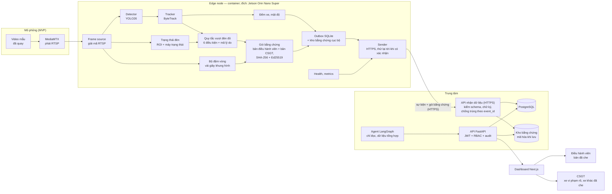
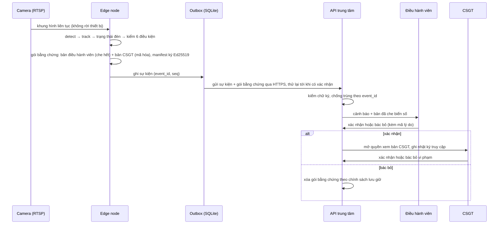
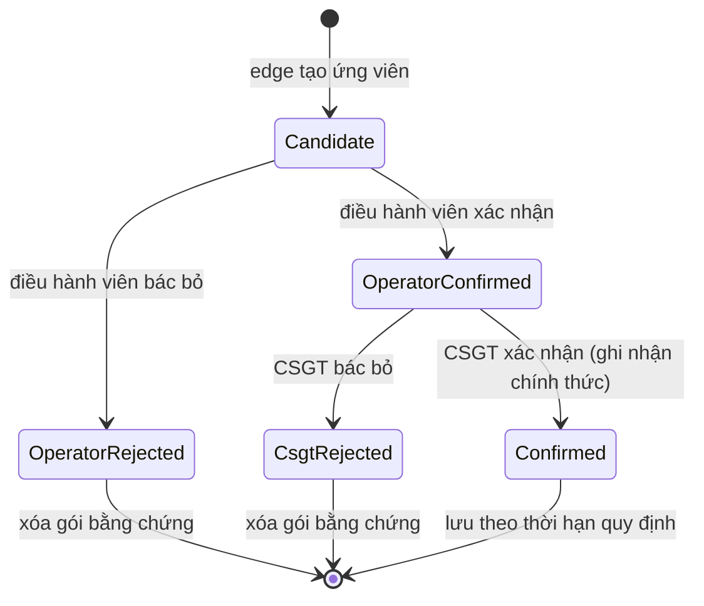

# Báo cáo kỹ thuật — TrafficEye Edge

> **Phiên bản:** 0.4 · 21/09/2026 · đã qua design review, PO duyệt ngày 21/09 (xem `docs/report/design-review.md`).
> **Thay đổi ở v0.4:** đối chiếu với đề bài chính thức và chốt quyết định Q1–Q9 ngày 21/09. Đã thêm:
> - đi ngược chiều, sai làn đủ 3 kiểu (LN-a theo loại xe, LN-b qua vạch liền, LN-c sai mũi tên, đều MUST; dừng đỗ sai ở mức COULD);
> - nâng mật độ/ùn tắc và Agent báo cáo lên MUST;
> - phân tích ùn tắc theo **tuyến 3 nút**: đo chu kỳ đèn trên edge (`signal_cycle` v1, FR-DEN-4), hiệu năng từng nút theo HCM ($d = d_1 + d_2$, v/c, LOS A–F, FR-COR-1), phân tích tuyến: tràn hàng chờ `spillback` và nút cổ chai `bottleneck` (FR-COR-2), màn hình Tuyến (FR-UI-7), công cụ đo FR-EVAL-8;
> - 3 camera trên cùng một tuyến (FR-MC-1) lên MUST;
> - OCR biển số xe vi phạm, mAP, bản đồ;
> - các mục nâng cao: OTA, kênh điều khiển MQTT (CP2), gợi ý điều phối;
> - hai checkpoint: **CP1** (53/65 điểm ≈ 82%) và **CP2** (100%, sẵn sàng production).
>
> Yêu cầu có ID, tiêu chí nghiệm thu, hợp đồng dữ liệu và Definition of Done nằm trong **`docs/spec/trafficeye-spec.md`** (v1.0; PO đã chốt Q1–Q4, Q6–Q9 ngày 21/09, toàn văn duyệt tại M0). Khi báo cáo và spec khác nhau thì theo spec.
> **Phạm vi:** nghiên cứu, kiến trúc, lựa chọn công nghệ, lộ trình. Chưa có code hệ thống; hiện chỉ có script đánh giá.
> **Ký hiệu:**
> - **[Đã chốt]**: PO đã quyết trong buổi GRILL ME ngày 21/09.
> - **[Đề xuất]**: thiết kế chờ team duyệt.
> - **[S#]**: nguồn đã kiểm chứng, liệt kê ở mục 22.
> - **[Cần kiểm chứng]**: chưa có nguồn trong đợt này.
>
> **Tài liệu liên quan:**
> - `docs/spec/trafficeye-spec.md`: spec, yêu cầu và nghiệm thu;
> - `docs/survey/false-positives.md`: các tình huống báo nhầm, mã A1–E5, W1–W8, L1–L8, S1–S6;
> - `docs/eval/protocol.md`: giao thức đánh giá, đã duyệt;
> - `docs/plan/timeline.md`: timeline v2.0;
> - `scripts/evaluate.py`.

---

## 1. Tóm tắt điều hành

TrafficEye Edge là hệ thống camera giao thông xử lý AI **ngay tại biên**. Ở mỗi nút giao, một thiết bị edge làm các việc sau:
- phát hiện, theo dõi, đếm xe theo làn, hướng và loại xe;
- ước tính mật độ, hàng chờ, đo theo chu kỳ đèn (sự kiện `signal_cycle` v1);
- xác định **ứng viên** vi phạm: vượt đèn đỏ, đi ngược chiều, sai làn (đủ 3 kiểu: theo loại xe, qua vạch liền, sai mũi tên);
- chỉ gửi **sự kiện, số liệu và gói bằng chứng tối thiểu** về trung tâm, không bao giờ gửi video liên tục.

Con người đưa ra quyết định cuối cùng qua hai bước duyệt; AI chỉ tạo ứng viên. Điều hành viên xem bản đã che biển số. Sau khi điều hành viên xác nhận, cán bộ CSGT mới được xem bản dành cho CSGT: xe vi phạm hiện rõ, các xe khác đã che biển số và khuôn mặt. Mọi lần xem đều được ghi nhật ký.

**Kiến trúc trong một dòng:**
Camera (RTSP) → Edge node [YOLO26 + ByteTrack + máy trạng thái đèn + lớp ngữ cảnh + các luật vi phạm dạng plugin + đo chu kỳ đèn + đóng gói bằng chứng có chữ ký + OCR cho xe vi phạm] → outbox cục bộ → HTTPS → FastAPI + PostgreSQL + kho bằng chứng (trên cloud từ CP2, tức Live URL) → Dashboard có bản đồ, màn hình Tuyến (điều hành viên, CSGT) + Agent soạn báo cáo, giải thích và gợi ý điều phối (chỉ đọc, người duyệt).

Chiều ngược lại, trung tâm → edge: edge hỏi định kỳ trạng thái mong muốn; từ CP2 có thêm kênh điều khiển MQTT.

**Năm quyết định chính:**
1. **MVP chạy mô phỏng** [Đã chốt]. Camera là video mẫu phát qua RTSP. Edge là một container trên laptop, thiết kế để chuyển sang Jetson Orin Nano Super mà không phải đổi kiến trúc.
2. **AI chỉ dùng ở chỗ thật sự cần** [Đề xuất]. AI dùng cho phát hiện xe và phát hiện biển số để che. Tracking, đếm, trạng thái đèn và quyết định vi phạm dùng hình học, máy trạng thái và quy tắc. Agent không tham gia quyết định vi phạm.
3. **Precision trước recall.** Một ứng viên phải thỏa 6 điều kiện rồi mới qua 2 bước duyệt của người. Việc đo theo giao thức đã duyệt, báo kèm khoảng tin cậy Wilson 95%.
4. **Quyền riêng tư theo thiết kế** [Đã chốt]. Video thô liên tục không rời thiết bị. Bằng chứng được giữ ở mức tối thiểu và niêm phong bằng SHA-256 + Ed25519 ngay tại edge.
5. **Phạm vi** (chi tiết ở spec mục 2):
   - **CP1, ngày 14/10, 80% (53/65 điểm ≈ 82%):**
     - Tuyến 3 nút giao (3 camera cùng lúc, FR-MC-1 MUST);
     - đếm theo làn; mật độ và ùn tắc;
     - đo theo chu kỳ đèn (`signal_cycle` v1, FR-DEN-4);
     - phân tích nút và tuyến: v/c, độ trễ, LOS theo HCM, phát hiện tràn hàng chờ (spillback) và nút cổ chai (bottleneck) (FR-COR-1, FR-COR-2);
     - vượt đèn đỏ (RL), đi ngược chiều (WW), sai làn đủ 3 kiểu (LN-a, LN-b, LN-c);
     - duyệt 2 bước; trang xác minh;
     - OCR biển số xe vi phạm; Agent báo cáo ca trực;
     - bản đồ; màn hình Tuyến (FR-UI-7);
     - benchmark FP16; đo mAP, độ chính xác đếm, precision;
     - demo mất mạng rồi đồng bộ lại.
   - **CP2, ngày 23/10, 100%:**
     - OTA; kênh điều khiển MQTT; gợi ý điều phối; trợ lý giải thích;
     - xuất hồ sơ vi phạm (FR-EXP-1);
     - INT8; mô phỏng Jetson;
     - kết quả trên tập test (gồm cả đo chu kỳ đèn và sự kiện tuyến FR-EVAL-8);
     - checklist sẵn sàng production; Live URL (trung tâm trên cloud).

**Không làm trong giai đoạn này:** phần cứng thật (không bắt buộc), nhận diện khuôn mặt, đo tốc độ để xử phạt, phát hiện mũ bảo hiểm và dây an toàn, điều khiển đèn tự động.

**Vì sao cách dùng AI này mạnh ở tiêu chí 1 (mức độ ứng dụng AI):**
- AI nằm đúng chỗ mà thuật toán cố định không làm được, tức là nhìn và nhận ra xe.
- Phần còn lại giải thích được: mỗi ứng viên bị loại đều có mã lý do, và precision có số đo kèm khoảng tin cậy.
- Giám khảo thấy được cả "AI làm gì" lẫn "vì sao tin được AI".

---

## 2. Bài toán, người dùng và giả định

| Hạng mục | Nội dung | Trạng thái |
|---|---|---|
| Người dùng chính | Điều hành viên ca trực ở trung tâm điều hành giao thông, theo dõi nhiều camera cùng lúc | Giả định, cần phỏng vấn [Đã chốt là giả định] |
| Người dùng thứ hai | Cán bộ CSGT duyệt vi phạm (HITL) | Giả định |
| Có thể thêm | Ban quản lý khu dân cư (VinOcean Park…) | Nằm trong phạm vi nhưng **không phải trọng tâm MVP** [Đã chốt]; xem hướng mở rộng #8 |
| Nỗi đau (giả định) | Không thể canh hàng chục luồng video; dễ bỏ sót sự việc; duyệt vi phạm tốn công | Cần bằng chứng |
| Người trả tiền | Tổ chức vận hành hệ thống, khác với người dùng | Cần tách riêng khi pitch |

**Giá trị theo từng bên** (rút ra từ buổi GRILL):
- **Điều hành viên:** làm việc theo *cảnh báo có bằng chứng* thay vì canh cả tường màn hình. Lợi ích này đến từ việc lọc sự kiện; AI chạy ở trung tâm cũng làm được.
- **Tổ chức vận hành** (đây mới là lợi ích riêng của edge):
  - ít tốn băng thông và máy chủ GPU tập trung;
  - khi mất mạng vẫn không mất số liệu và bằng chứng;
  - dữ liệu thô không rời thiết bị.
- **Người dân:** ít bị lộ hình ảnh và biển số; người không vi phạm không bị gửi biển số đi.

**Giả định kỹ thuật cần kiểm chứng sớm:**
1. Khi tích hợp, nguồn camera **phải là video liên tục** [Đã chốt]; ảnh tĩnh không dùng được vì cần tracking. MVP dùng video quay sẵn nên không phụ thuộc vào điểm này, nhưng phải kiểm tra lại trước khi tích hợp camera thật (mục 20).
2. Góc camera thấy cùng lúc đèn, vạch dừng và các làn.
3. Video có đủ vi phạm để đo: ít nhất 60 cảnh báo trên tập test (protocol, mục 7.2).
4. Video bao phủ đủ các pha đèn và nhiều tình huống giao thông, gồm cả các ca khó A1–E5 [Đã chốt].

---

## 3. Phân rã bài toán

| # | Bài toán con | Loại lời giải | Mức |
|---|---|---|---|
| 1 | Nhận và giải mã video (RTSP/file) | Kỹ thuật | MUST |
| 2 | Phát hiện và phân loại xe | **ML** (detector) | MUST |
| 3 | Theo dõi xe qua các khung | Thuật toán liên kết (Kalman + IoU) | MUST |
| 4 | Hiệu chuẩn cảnh: vạch dừng, vùng giao lộ, làn, vùng đèn | Cấu hình + hình học | MUST |
| 5 | Trạng thái đèn tín hiệu | Phân loại màu trong ROI + **máy trạng thái** | MUST |
| 6 | Đếm xe theo làn, loại và hướng | Hình học (xe cắt qua vạch theo đúng hướng; gán làn bằng polygon) | MUST |
| 7 | Mật độ, hàng chờ, đo theo chu kỳ đèn (`signal_cycle` v1) và phân tích nút/tuyến (v/c, độ trễ, LOS theo HCM, tràn hàng chờ `spillback`, nút cổ chai `bottleneck`) | Hình học + thống kê theo chu kỳ đèn + công thức HCM | MUST (spec v1.0) |
| 8 | Ứng viên vi phạm: vượt đèn đỏ (RL), đi ngược chiều (WW), sai làn đủ 3 kiểu (LN-a, LN-b, LN-c); dừng đỗ sai ở mức COULD | **Bộ quy tắc cố định dạng plugin** trên một mô hình cảnh chung; mã A1–E5, W1–W8, L1–L8, S1–S6 | MUST |
| 9 | Đóng gói bằng chứng, che biển số, niêm phong | ML (phát hiện biển số) + mật mã | MUST |
| 10 | Hàng đợi cục bộ, đồng bộ khi có mạng | Kỹ thuật (outbox) | MUST |
| 11 | Backend, lưu trữ, phân quyền, nhật ký truy cập | Kỹ thuật | MUST |
| 12 | Dashboard và duyệt 2 bước | Kỹ thuật + UX | MUST |
| 13 | Agent: báo cáo ca trực và báo cáo sự cố (MUST); trợ lý giải thích ứng viên, gợi ý điều phối (SHOULD); hỏi đáp số liệu (COULD) | **LLM + công cụ chỉ đọc**, người duyệt | MUST / SHOULD / COULD |
| 14 | Giám sát FPS, độ trễ, tài nguyên | Kỹ thuật | Bản cơ bản MUST, đầy đủ SHOULD |
| 15 | Đánh giá precision có khoảng tin cậy | Thống kê | MUST (đã có script) |
| 16 | OCR biển số xe vi phạm; bản đồ; 3 camera trên cùng một tuyến (FR-MC-1); màn hình Tuyến | ML + kỹ thuật | MUST (spec v1.0) |
| 17 | OTA có ký và tự quay lại bản cũ; INT8; mô phỏng Jetson | Kỹ thuật | SHOULD (CP2) |

Chỉ có 3/16 bài toán con cần ML hoặc LLM. Đây là cách áp dụng đúng quy tắc "không nhét AI vào mọi chỗ" trong `CLAUDE.md`.

---

## 4. Kiến trúc tổng thể



**Khi demo MVP:** toàn bộ chạy bằng Docker Compose trên một máy, gồm MediaMTX, 1 container edge (1 nút giao), API, PostgreSQL, dashboard, và (tùy chọn) Prometheus + Grafana. Nếu chạy GPU trong Docker trên Windows gặp khó, edge chạy trực tiếp trong môi trường conda (M-04). Ranh giới edge ↔ trung tâm vẫn giữ nguyên: chỉ sự kiện và gói bằng chứng đi qua mạng. Nhờ vậy lượng dữ liệu truyền đi đo được thật.

---

## 5. Luồng dữ liệu đầu–cuối



**Vòng đời một vi phạm:**



**Số đếm xe** được tổng hợp theo phút tại edge (theo loại xe và hướng) rồi gửi qua HTTPS; dashboard vẽ biểu đồ từ đó.

**Băng thông:** sẽ đo bằng số byte thực gửi qua HTTPS, so với bitrate của video nguồn.
- *Ví dụ giả định, không phải số đo:* 20 vi phạm/giờ × 2 MB bằng chứng = 40 MB/giờ, tức khoảng 0,09 Mbps trung bình.
- So với "vài Mbps" liên tục của một luồng 1080p.

---

## 6. So sánh công nghệ và quyết định

Mỗi quyết định đi theo trình tự: yêu cầu → các lựa chọn → đánh đổi → quyết định → lý do.

### 6.1 Thiết bị edge

**Yêu cầu:**
- suy luận tại chỗ ít nhất 15 FPS mỗi luồng, để tracking xe máy ổn định;
- còn dư tài nguyên cho ảnh độ phân giải cao;
- bộ công cụ trưởng thành, vì team chưa làm edge bao giờ.

| | Jetson Orin Nano Super 8GB | Pi 5 + AI HAT+ 26 TOPS | RK3588 | Mini PC x86 + OpenVINO |
|---|---|---|---|---|
| Giá | **399 USD**, tăng từ 249 USD ngày 22/07/2026 [S1] | Pi 5 4GB ~110 USD (sau 3 đợt tăng giá) + HAT 110 USD [S8] | Rẻ nhất [Cần kiểm chứng] | Chưa khảo sát |
| Hiệu năng đã kiểm chứng | YOLO26n TensorRT FP16: 4,57 ms/ảnh ở 640, chưa tính tiền/hậu xử lý [S2] | Chủ yếu là số của các model có sẵn từ Hailo | NPU ~6 TOPS [Cần kiểm chứng] | Chưa có số |
| Chạy model | GPU + TensorRT; gần như model nào xuất ra ONNX cũng chạy | Phải compile bằng Hailo Dataflow Compiler | Toolkit RKNN, quantize dễ tụt độ chính xác | OpenVINO |
| Video | Có giải mã phần cứng, **không có mã hóa phần cứng** (DeepStream 9.1 có tùy chọn dùng encoder phần mềm cho Orin Nano) [S7] | Chỉ giải mã phần cứng H.265 [Cần kiểm chứng] | Giải mã phần cứng H.264/H.265 | Quick Sync |

**Quyết định:** Jetson Orin Nano Super là **thiết bị mục tiêu**; MVP **mô phỏng trên PC** [Đã chốt việc mô phỏng; Đề xuất về thiết bị].

**Lý do:** TensorRT và DeepStream 9.1 hỗ trợ cả Jetson Orin lẫn máy x86 có GPU rời [S7]. Vì vậy cùng một pipeline chạy được trên PC lúc phát triển và trên Jetson khi triển khai.

### 6.2 Khung pipeline video: tự viết bằng Python/OpenCV hay dùng DeepStream?

**Yêu cầu:**
- MVP: xong trong 5 tuần với team mới.
- Production: nhiều luồng trên một thiết bị, giải mã bằng phần cứng.

**Ba lựa chọn:**
- **(a)** Python + OpenCV/FFmpeg + Ultralytics, chạy bằng TensorRT hoặc ONNX.
- **(b)** Tự viết pipeline GStreamer.
- **(c)** NVIDIA DeepStream 9.1, phát hành 14/07/2026: có nvinfer, nvtracker, giải mã phần cứng, Python bindings cài bằng pip trên cả x86 và Jetson [S7].

**Đánh đổi:**
- **(a)** cho kết quả nhanh nhất, dễ debug, dễ viết bộ quy tắc. Đổi lại, giải mã và tiền xử lý tốn CPU, khó mở rộng lên nhiều luồng.
- **(c)** cho hiệu năng tốt nhất trên Jetson (không chép dữ liệu qua lại, chạy batch). Đổi lại, phải học nhiều, debug khó, và metadata phải đi qua pyds. YOLO và RF-DETR đều đã có hướng dẫn chạy trong DeepStream [S6].
- **(b)** linh hoạt nhưng phải tự làm nhiều thứ.

**Quyết định:** MVP dùng **(a)**, đặt sau các interface rõ ràng (`FrameSource`, `Detector`, `Tracker`). **DeepStream là hướng ADVANCED** khi chạy nhiều luồng trên Jetson thật [Đề xuất].

**Lý do:** rủi ro lớn nhất của MVP là thời gian và độ ổn định khi demo, không phải thông lượng. Với 1–2 luồng mô phỏng, (a) là đủ. Các interface cho phép đổi phần xử lý video sau này mà giữ nguyên bộ quy tắc.

→ Trả lời câu hỏi trong `role.md`: **nên dùng DeepStream cho production nhiều luồng trên Jetson, không nên dùng cho MVP 5 tuần.**

### 6.3 Detector

**Yêu cầu:**
- xe máy dày đặc, vật thể nhỏ;
- chạy thời gian thực trên edge;
- xuất được sang TensorRT hoặc ONNX;
- giấy phép phù hợp.

| Lựa chọn | Điểm mạnh | Điểm yếu |
|---|---|---|
| **YOLO26** (Ultralytics, phát hành 01/2026) [S3] | Hệ sinh thái mạnh nhất: train, xuất TensorRT, tracking tích hợp sẵn [S4], có benchmark trên Jetson [S2] | Giấy phép **AGPL-3.0 hoặc Enterprise**: phải công khai mã nguồn phần kết nối với model; dùng thương mại thì phải mua license [S3] |
| YOLO27 | Đã công bố, bản lớn vượt 60 mAP COCO [S3] | **Chưa phát hành trọng số** [S3] |
| **RF-DETR** (Roboflow, ICLR 2026) | Apache 2.0 cho các bản mở; RF-DETR-L đạt 56,5 AP, 6,8 ms trên T4 với TensorRT FP16 [S6] | Chưa có benchmark trên Orin Nano trong đợt kiểm chứng này |

**Quyết định** [Đề xuất]:
- MVP dùng **YOLO26n hoặc YOLO26s** qua Ultralytics, bắt đầu từ trọng số COCO.
- Chỉ fine-tune bằng dữ liệu Việt Nam khi số đo cho thấy cần.
- Ưu tiên **FP16** hơn INT8 nếu đủ nhanh. Trên Orin Nano Super, INT8 làm mAP COCO của YOLO26n giảm từ 0,480 xuống 0,449 [S2], ngược với ưu tiên precision.

**Hướng thương mại:** đánh giá RF-DETR (Apache 2.0) hoặc mua license Enterprise.

### 6.4 Tracker

**Yêu cầu:** ít đổi ID (E1 là một nguồn báo nhầm), nhẹ, dễ tích hợp.

| Tracker | MOTA | IDF1 | HOTA | Ghi chú |
|---|---|---|---|---|
| ByteTrack | 80,3 | 77,3 | 63,1 | Nhẹ, có sẵn trong Ultralytics (`bytetrack.yaml`) [S4] |
| OC-SORT | 78,0 | 77,5 | 63,2 | Tốt khi xe bị che khuất |
| BoT-SORT | 80,5 | 80,2 | 65,0 | Có ReID tùy chọn, tốn tính toán hơn; tracker mặc định của Ultralytics (`botsort.yaml`) [S4] |

Số liệu trên là MOT17 [S5]. MOT17 là bộ **người đi bộ**, không phải giao thông Việt Nam.

**Quyết định:** MVP dùng **ByteTrack**. Chuyển sang BoT-SORT nếu phần tách nguồn lỗi (protocol, mục 6) cho thấy đổi ID là nguồn báo nhầm hoặc cảnh báo trùng lớn nhất [Đề xuất].

**Lý do:** chọn theo số đo trên dữ liệu của chính team, không theo bảng xếp hạng người đi bộ.

### 6.5 Trạng thái đèn

**Ba lựa chọn:**
- **(a)** ROI cố định + phân loại màu (HSV hoặc CNN nhỏ) + máy trạng thái;
- **(b)** detector đèn giao thông tổng quát;
- **(c)** lấy tín hiệu trực tiếp từ bộ điều khiển đèn.

**Quyết định:** dùng (a) cho MVP; (c) là mục tiêu khi lên production [Đề xuất].

**Lý do:**
- Camera đứng yên nên vị trí đèn cố định, không cần detector.
- Máy trạng thái có thêm các trạng thái KHÔNG RÕ, NHẤP NHÁY, TẮT, và các trạng thái này chặn gắn cờ (nhóm D1–D6).
- (c) loại gần hết lỗi nhóm D, nhưng cần tích hợp với hạ tầng mà team không có.

### 6.6 Truyền thông

**Đã chốt sau design review (H-01):** MVP dùng **HTTPS + outbox** cho mọi luồng từ edge về trung tâm; MQTT chuyển sang lộ trình. Lý do: chỉ có 1 edge node, và client MQTT chỉ đệm tin trong RAM nên dù dùng MQTT vẫn phải có outbox. Tức là MQTT thêm broker, ACL và dịch vụ ingest mà không bớt được việc nào.

**Bổ sung ngày 21/09 (Q2, đối chiếu với đề bài):** ở CP2, MQTT vào hệ thống nhưng chỉ làm **kênh điều khiển**. Dữ liệu vẫn đi HTTPS + outbox như trên.
- MQTT có hai việc:
  - Last Will báo thiết bị rớt kết nối trong ≤ 10 giây;
  - thông báo "trạng thái mong muốn vừa đổi", để edge hỏi lại ngay.
- Lý do chọn cách này: MQTT làm tốt đúng hai việc mà hỏi định kỳ làm kém, còn độ bền dữ liệu vẫn nằm ở outbox.
- Hỏi định kỳ có từ CP1 và luôn chạy. Mất broker thì hệ thống chỉ chậm lại.
- Hợp đồng chi tiết ở spec mục 6.7.

| Luồng | MVP | Production | Lý do |
|---|---|---|---|
| Camera → edge | RTSP. Khi mô phỏng, MediaMTX phát lặp video mẫu (`ffmpeg -re -stream_loop -1 ... -f rtsp`) [S17] | RTSP từ camera thật (bắt buộc là video liên tục) | Chuẩn của camera IP |
| Edge → trung tâm: sự kiện, số đếm, health | HTTPS POST từ outbox SQLite, thử lại theo backoff, chống trùng bằng `event_id` | MQTT 5, QoS 1, giữ phiên (Session Expiry), qua TLS [S11] | MVP: một giao thức, dễ test. Production: nhiều thiết bị, đẩy dữ liệu chủ động |
| Edge → trung tâm: gói bằng chứng (cỡ MB) | HTTPS upload, kiểm tra mã băm | Như MVP | Dữ liệu lớn cần xác thực |
| Trung tâm → edge: cấu hình, chế độ điều khiển tay | CP1: edge tự hỏi định kỳ (polling) mỗi 10 giây. CP2: thêm thông báo qua MQTT, nội dung vẫn lấy qua HTTPS | Như CP2, thêm mTLS cho MQTT | Không cần mở cổng vào thiết bị |
| Trung tâm → trình duyệt | WebSocket hoặc SSE | Như MVP | Cảnh báo hiện ngay trên dashboard |

**Không dùng Kafka hay NATS:** chỉ cân nhắc khi lên hàng trăm camera [Đề xuất].

### 6.7 Lưu trữ

| Loại dữ liệu | MVP | Production |
|---|---|---|
| Giao dịch: camera, vi phạm, lượt duyệt, người dùng, nhật ký | PostgreSQL | PostgreSQL |
| Chuỗi thời gian: số đếm theo phút | PostgreSQL, bảng thường | TimescaleDB. Lõi là Apache 2.0; continuous aggregates và retention theo Timescale License, miễn phí khi tự host [S13] |
| Bằng chứng (ảnh, clip) | Thư mục trên đĩa + đường dẫn lưu trong DB | Kho tương thích S3. **Không dùng MinIO bản cộng đồng**: đã ngừng phát hành bản build từ 10/2025 và bị archive từ 04/2026 [S12] |
| Hàng đợi trên edge | SQLite | SQLite |
| Vector DB | Không cần | Chỉ khi thật sự có nhu cầu tìm kiếm ngữ nghĩa |

### 6.8 Các lựa chọn còn lại

| Thành phần | Chọn | Lý do | Hướng nâng cấp |
|---|---|---|---|
| Backend | FastAPI (có sẵn trong template) | Team đã quen, async, tự sinh OpenAPI | Tách service khi tải tăng |
| Frontend | Next.js + bản đồ (Leaflet hoặc MapLibre) | Có sẵn trong template | — |
| Agent | LangGraph: `interrupt()` + `Command(resume=...)`, bắt buộc có checkpointer [S14] | Có sẵn trong template, hỗ trợ bước người duyệt | Thêm công cụ đọc nhiều nguồn |
| Triển khai | Docker Compose; trung tâm deploy lên cloud trước CP2 (Live URL) [Đã chốt]; trên Jetson dùng NVIDIA container runtime | Một lệnh cho mỗi vai; edge ở máy local nối lên trung tâm trên cloud | K3s hoặc công cụ quản lý đội thiết bị |
| Giám sát | Endpoint `/metrics` + Prometheus/Grafana; jetson-stats (jtop) khi chạy thiết bị thật [S15] | Chuẩn phổ biến | Cảnh báo tự động |
| Ký model và container | cosign `sign-blob` / `verify-blob`, có chế độ keyless [S16] | Chuẩn mở | Registry + triển khai dần |

---

## 7. Stack đề xuất

| Lớp | MVP | Khi lên production |
|---|---|---|
| Camera | Video mẫu → MediaMTX (RTSP) | Camera IP thật (RTSP) |
| Edge: pipeline | Python 3.11, OpenCV/FFmpeg, Ultralytics YOLO26 + ByteTrack, TensorRT hoặc ONNX Runtime | DeepStream 9.1 trên Jetson Orin |
| Edge: quy tắc và bằng chứng | Quy tắc tự viết, SQLite outbox, `cryptography` (Ed25519) | Khóa trong secure element |
| Truyền thông | Dữ liệu: HTTPS + outbox SQLite [Đã chốt]. Điều khiển: hỏi định kỳ từ CP1; thêm MQTT (Mosquitto) từ CP2 [Đã chốt] | Dữ liệu cũng qua MQTT 5 + mTLS khi có nhiều thiết bị |
| Trung tâm | FastAPI, PostgreSQL, bằng chứng lưu trên đĩa (mã hóa khi lưu) | TimescaleDB, kho S3 |
| Giao diện | Next.js | + SSO |
| Agent | LangGraph, công cụ chỉ đọc | Thêm nhiều nguồn dữ liệu |
| DevOps | Docker Compose, GitHub Actions (đã có CI: ruff + pytest) | K3s, OTA có ký |
| Đánh giá | `scripts/evaluate.py` theo `docs/eval/protocol.md` | Đo định kỳ, theo dõi drift |

---

## 8. Pipeline thị giác máy tính

1. **Frame source:** giải mã RTSP 1080p và giữ timestamp của từng khung. Mọi video được chuyển về **15 FPS cố định** trước khi gán nhãn và xử lý (H-02). Khi đánh giá, pipeline đọc thẳng file nên không rơi khung. FPS xử lý nằm trong config đóng băng.
2. **Detector:** YOLO26 với các lớp car, motorcycle, bus, truck, bicycle, person. Độ phân giải đầu vào chọn theo số đo: tăng từ 640 lên 960 hoặc 1280 nếu hay sót xe máy nhỏ.
3. **Tracker:** ByteTrack với `persist=True` cho từng luồng [S4].
4. **Cấu hình cảnh:** mỗi nút giao một file YAML, được băm và đóng băng cùng config. Gồm:
   - vạch dừng (đoạn có hướng, gắn với từng làn) và **vùng giao lộ** (polygon, thay cho vạch xác nhận — M-03);
   - polygon làn và hướng được phép đi;
   - ROI từng đầu đèn và đầu đèn nào điều khiển làn nào;
   - làn được rẽ phải khi đèn đỏ;
   - vạch đếm.
5. **Điểm tham chiếu của xe** (H-05): camera nhìn từ phía sau nên cạnh dưới bbox là **đuôi xe**.
   - Đếm xe dùng điểm giữa cạnh dưới bbox.
   - Thời điểm qua vạch dùng **điểm đầu xe ước lượng** = điểm đuôi + chiều dài theo loại xe, tính dọc hướng làn trên mặt phẳng đường (homography), cộng thêm biên an toàn.
   - Các ca "đầu xe đã qua vạch lúc đèn vàng" được đưa vào mẫu âm khó của tập dev.
6. **Máy trạng thái đèn:**
   - chuỗi chuyển hợp lệ: XANH → VÀNG → ĐỎ → XANH;
   - thêm NHẤP NHÁY, TẮT, KHÔNG RÕ;
   - bỏ phiếu đa số trong cửa sổ trượt để chống nhấp nháy LED (D4);
   - ROI bị che thì trạng thái là KHÔNG RÕ (D5).
7. **Đếm và mật độ:** đếm xe cắt vạch theo đúng hướng, theo từng loại, tổng hợp theo phút. Mật độ = số xe trong polygon làn.
8. **Đo theo chu kỳ đèn và phân tích tuyến 3 nút:**
   - **Đo chu kỳ đèn trên edge (FR-DEN-4, `signal_cycle` v1):** mỗi chu kỳ đèn (1–2 phút), edge phát một sự kiện gồm: độ dài các pha xanh/vàng/đỏ thực tế; số xe đến và xe thoát theo từng loại xe; hàng chờ lớn nhất và hàng chờ tồn đọng (`residual_queue`); thời gian và số xe thoát trong điều kiện bão hòa (`discharge`).
   - **Đánh giá hiệu năng từng nút theo Highway Capacity Manual (HCM 2010/2016, FR-COR-1):** trung tâm tổng hợp theo khung 15 phút:
     - Quy đổi lưu lượng theo xe con tương đương (PCU) theo TCVN 13592:2022 Bảng 3: xe máy 0.3, ô tô con 1.0, xe tải 2.5, xe buýt 3.0.
     - Tốc độ thoát bão hòa $s$ (PCU/h xanh), tỉ số xanh $g/C$, năng lực thông hành $c = s \cdot (g/C)$.
     - Tỉ số lưu lượng trên năng lực $X = v/c$.
     - Độ trễ điều khiển đồng đều: $d_1 = \frac{0.5 C (1 - g/C)^2}{1 - \min(1, X)(g/C)}$.
     - Độ trễ gia tăng (do hàng chờ ngẫu nhiên và vượt bão hòa): $d_2 = 900 T \left[ (X - 1) + \sqrt{(X - 1)^2 + \frac{8 k I X}{c T}} \right]$.
     - Tổng độ trễ điều khiển $d = d_1 + d_2$.
     - Mức phục vụ (LOS) A–F: A $\le 10$ s, B $\le 20$ s, C $\le 35$ s, D $\le 55$ s, E $\le 80$ s, F $> 80$ s hoặc $X > 1.0$.
   - **Phân tích tuyến 3 nút (FR-COR-2):**
     - Tràn hàng chờ (`spillback`): khi hàng chờ tại nút hạ lưu kéo dài gây cản trở thoát xe ở nút thượng lưu (dù đèn nút thượng lưu đang xanh).
     - Nút cổ chai (`bottleneck`): nút có $X$ cao nhất hoặc tỉ lệ chu kỳ thất bại (`cycle failure`) cao nhất trên trục đường.
     - Màn hình Tuyến (FR-UI-7): bản đồ tuyến tô màu mức ùn tắc kèm mũi tên tràn hàng chờ, bản đồ nhiệt nút × thời gian (ô 5 phút) để thấy ùn tắc lan ngược, thẻ hiệu năng từng nút.
9. **Quy tắc phát hiện vi phạm (plugin trên mô hình cảnh chung):**
   - **Vượt đèn đỏ (RL) — MUST:** 6 điều kiện trong `false-positives.md` mục 1; mã loại trừ A1–E5.
   - **Đi ngược chiều (WW) — MUST:** xét xe đi ngược hướng cho phép của làn hoặc phần đường một chiều; lệch góc > ngưỡng trong các cửa sổ liên tiếp; tốc độ và quãng đường đủ lớn; mã loại trừ W1–W8.
   - **Sai làn (LN) — MUST, đủ 3 kiểu (Q8):**
     - `LN-a`: sai làn theo loại xe (`allowed_classes`).
     - `LN-b`: chuyển làn qua vạch liền (`solid`).
     - `LN-c`: đi sai hướng theo mũi tên phân làn (`allowed_exits`).
     - Mã loại trừ L1–L8.
   - **Dừng, đỗ sai (ST) — COULD:** dừng trong vùng cấm > T giây lúc đèn xanh và không có hàng chờ; mã loại trừ S1–S6.
10. **Mã lý do:** mọi ứng viên bị loại đều có mã lý do. Mã này dùng cho phân tích lỗi và cho phần demo giải thích.
11. **Bằng chứng** [Đề xuất]:
    - Bộ đệm vòng giữ khoảng 5 giây khung hình dạng JPEG trong RAM.
    - Khi có ứng viên, lấy 3 khung chính: đèn đỏ + xe còn trước vạch; xe đã qua vạch; ảnh cắt biển số. Kèm clip [t−3 s, t+2 s].
    - Clip lưu dạng chuỗi JPEG thay vì mã hóa H.264, vì Orin Nano không có encoder phần cứng [S7].
    - Bản cho điều hành viên che biển số và khuôn mặt của mọi xe. Biển số dùng detector fine-tune từ dữ liệu Việt Nam (mục 16); khuôn mặt che bằng vùng đầu người lái.
    - Bản cho CSGT: xe bị đánh dấu vi phạm hiện rõ; các xe khác được che biển số và khuôn mặt [Đã chốt].
    - Bản đầy đủ không che gì: niêm phong và giữ trên thiết bị, không gửi đi [Đề xuất].
    - Manifest ghi riêng `captured_at` (giờ quay gốc) và `processed_at`, kèm cờ `source: replay` khi phát lại video mô phỏng (M-08).

---

## 9. Agent: làm gì và không làm gì

| Không dùng Agent | Lý do |
|---|---|
| Phát hiện, tracking, đếm, trạng thái đèn, quyết định vi phạm | Là phần cố định, đo được, phải tái lập được. LLM không làm precision tốt hơn |
| Xác nhận hay bác bỏ vi phạm | Đây là thẩm quyền của con người |

| Dùng Agent | Mức (spec v1.0) | Giá trị |
|---|---|---|
| Tóm tắt ca trực, ví dụ "trong ca có X cảnh báo, Y được xác nhận; tuyến cor-01 ùn tắc lan từ B về A lúc 17:15" | MUST (FR-AGT-1) | Điều hành viên bàn giao ca nhanh hơn; phục vụ thẳng người dùng chính |
| Soạn báo cáo sự cố từ nhiều nguồn (sự kiện, số đếm, tình trạng camera, sự kiện tuyến) | MUST (FR-AGT-1) | Tiết kiệm thời gian viết báo cáo |
| Trợ lý giải thích ứng viên: "vì sao xe này bị gắn cờ?" — Agent gọi công cụ lấy điều kiện đo được, dòng thời gian đèn và các cờ rủi ro tất định | SHOULD (FR-AGT-2) | Người duyệt hiểu nhanh; Agent không xác nhận, không bác bỏ |
| Viết phần giải thích cho gợi ý điều phối. Hành động do luật tất định tính (dựa trên nguyên nhân nút cổ chai và tràn hàng chờ); điều hành viên quyết định | SHOULD (FR-DSP-1) | Đáp ứng mục nâng cao "ùn tắc + gợi ý điều phối" của đề |
| Hỏi đáp bằng ngôn ngữ tự nhiên, ví dụ "nút nào có nhiều vượt đèn đỏ nhất tuần này?" | COULD (FR-AGT-3) | Tiện ích bổ sung; không cần viết SQL |

**"Lập luận ngữ cảnh để giảm cảnh báo sai"** (theo đề bài) được làm ở **lớp ngữ cảnh tất định** trên edge (FR-CTX-1): pha đèn, cửa sổ xe ưu tiên, chế độ điều khiển tay, mức mật độ, khung giờ; mỗi lần loại đều có mã lý do. Lớp này đo được bằng ablation.

Agent không tham gia quyết định. Như vậy vừa đúng đề bài, vừa giữ nguyên tắc ở CLAUDE.md mục 7–8.

Khi không gọi được LLM, báo cáo được sinh theo mẫu cố định từ cùng số liệu, để demo không phụ thuộc Internet.

**Công cụ của Agent** (mức khái niệm) [Đề xuất]:

```json
[
  {"name": "query_events", "args": {"camera_id": "str?", "type": "count|violation|health", "from": "iso8601", "to": "iso8601", "status": "str?"}},
  {"name": "get_traffic_stats", "args": {"camera_id": "str", "window": "15m|1h|1d"}},
  {"name": "get_camera_health", "args": {"camera_id": "str?"}},
  {"name": "draft_incident_report", "args": {"event_ids": ["str"], "summary": "str"}}
]
```

**Giới hạn an toàn:**
- Mọi công cụ chỉ được đọc, trừ công cụ tạo bản nháp báo cáo.
- Công cụ chỉ trả dữ liệu tổng hợp; không trả biển số, ảnh hay đường dẫn tới bằng chứng, vì dữ liệu được gửi tới một dịch vụ LLM bên ngoài (M-05).
- Không có công cụ nào mở bản bằng chứng chưa che hay đổi trạng thái vi phạm.
- Báo cáo chỉ được phát hành sau khi người duyệt, qua `interrupt()` của LangGraph [S14].
- Mỗi câu trả lời kèm ID các sự kiện nguồn để người đọc tự kiểm tra lại.

---

## 10. Kiến trúc edge

- **Tiến trình và luồng xử lý:** capture → inference → analytics/quy tắc → ghi bằng chứng → outbox publisher. Chạy song song: báo cáo health và nhận lệnh. Docker restart policy đóng vai watchdog.
- **Lưu trữ cục bộ:** `outbox.sqlite`, thư mục `evidence/<event_id>/`, log. Có hạn mức dung lượng.
- **Khi đĩa đầy:** xóa dữ liệu phụ trước (số đếm đã gửi, log cũ). **Không bao giờ** xóa gói bằng chứng mà trung tâm chưa xác nhận đã nhận [Đề xuất].
- **Khóa** [Đề xuất]:
  - Thiết bị có khóa ký Ed25519 riêng: MVP lưu dạng file, production lưu trong secure element.
  - Bản CSGT (xe vi phạm rõ, xe khác đã che) được gửi lên trung tâm qua HTTPS và **mã hóa khi lưu**. Quyền xem do server kiểm soát bằng RBAC + nhật ký truy cập (H-03, đã chốt). Phát biểu trung thực: về mặt kỹ thuật, người vận hành server vẫn có thể đọc được. Mã hóa đầu–cuối (CSGT giải mã ngay trên trình duyệt) để vào lộ trình.
  - Bản đầy đủ không che gì được niêm phong, mã hóa và **giữ lại trên thiết bị** trong thời hạn lưu giữ, không gửi đi. Bản này chỉ dùng để làm lại bản che hoặc để giải quyết khiếu nại, qua một yêu cầu có ghi nhật ký.
- **Mục tiêu tài nguyên khi chạy Jetson thật:** 1–2 luồng 1080p ở 15 FPS, đo bằng jetson-stats [S15].

---

## 11. Kiến trúc trung tâm

- **Dữ liệu** [Đề xuất]:
  - `intersections`, `cameras`, `devices` (lưu khóa công khai của thiết bị);
  - `count_minutely`;
  - `violation_candidates`: `event_id` là UNIQUE; kèm `device_id`, `seq`, thời gian thiết bị, độ lệch đồng hồ, mã băm config, phiên bản model, mã lý do, trạng thái;
  - `evidence_packages`: loại bản (bản điều hành viên / bản CSGT, cả hai mã hóa khi lưu), sha256, chữ ký, `parent_hash` trỏ tới bản đầy đủ nằm trên thiết bị;
  - `reviews`, `access_log` (nối băm), `users` (vai trò).
- **Ingest:** kiểm schema → kiểm chữ ký Ed25519 bằng khóa công khai lấy từ danh bạ thiết bị → ghi theo `event_id` (gửi lặp không tạo bản trùng) → phát hiện lỗ hổng `seq` để yêu cầu gửi lại.
- **API:** `/cameras`, `/stats`, `/alerts`, `/reviews`, `/evidence/{id}` (kiểm quyền ở backend và ghi nhật ký mỗi lần truy cập), `/verify/{id}`, `/agent/*`.
- **Trang xác minh:** theo thiết kế chuỗi giám sát bằng chứng đã chốt. Trang kiểm chữ ký và mã băm của hai bản dẫn xuất rồi báo khớp hoặc không khớp. Tính năng chạy lại thao tác che từ bản đầy đủ không làm trong MVP, để vào lộ trình.

---

## 12. Quyền riêng tư

**Đã chốt:**
- Video thô liên tục không rời thiết bị.
- Chỉ ứng viên vi phạm mới có gói bằng chứng, và gói này ở mức tối thiểu. Xe không vi phạm không bị gửi biển số.
- Điều hành viên xem bản đã che biển số và khuôn mặt của mọi xe. Sau khi điều hành viên xác nhận, CSGT xem **bản CSGT**: xe bị đánh dấu vi phạm hiện rõ, các xe không vi phạm đã che biển số và khuôn mặt. Mọi lần xem đều có nhật ký truy cập.
- AI chỉ tạo ứng viên; vi phạm chỉ được ghi nhận chính thức sau khi người xác nhận.
- Chuỗi giám sát bằng chứng: SHA-256 + Ed25519, bản dẫn xuất ghi `parent_hash`, nhật ký chỉ ghi thêm và nối băm. Mã băm đầu chuỗi được commit vào repo hằng ngày (L-02).
- Bảo vệ bản CSGT trong MVP: mã hóa khi lưu + RBAC + nhật ký truy cập; server kiểm soát quyền xem (H-03).
- Đo **tỉ lệ biển số và khuôn mặt bị lọt** (không được che) trên tập test, kèm Wilson 95% (H-04).
- Video thô của dự án lưu trên drive có phân quyền và bị xóa sau khi nộp bài; chỉ giữ lại bản đã che (M-06).

**Che ở edge hay ở trung tâm?** (câu hỏi trong `role.md`)
- **Nên che ở edge.** Bản gốc không bao giờ rời thiết bị ở dạng đọc được, và trung tâm không cần khả năng nhìn dữ liệu thô.
- Cái giá là tốn thêm tính toán ở edge. Nếu che sai thì vẫn làm lại được từ bản đầy đủ giữ trên thiết bị.

**Còn mở:** thời hạn xóa gói bằng chứng của ứng viên bị bác bỏ, và thời hạn giữ bản đầy đủ trên thiết bị. Đề xuất tối đa 7 ngày, chờ chốt [Đề xuất].

**Pháp lý:**
- Luật Bảo vệ dữ liệu cá nhân số 91/2025/QH15 có hiệu lực từ 01/01/2026. Dữ liệu sinh trắc học thuộc nhóm dữ liệu cá nhân nhạy cảm [S19].
- TrafficEye **không** nhận diện khuôn mặt.
- Các cơ chế trên là biện pháp kỹ thuật, không thay thế tư vấn pháp lý.

---

## 13. Hoạt động khi mất mạng

- Mỗi sự kiện có `event_id` (UUIDv7, sắp xếp được theo thời gian) và `seq` tăng dần theo thiết bị.
- Sender gửi theo thứ tự `seq` qua HTTPS. Sự kiện chỉ bị xóa khỏi outbox khi trung tâm trả xác nhận; thử lại theo backoff tăng dần.
- Outbox gửi theo kiểu "ít nhất một lần", nên trung tâm ghi theo `event_id` để gửi lặp không sinh bản ghi trùng. Nếu thấy lỗ hổng `seq` thì yêu cầu gửi lại.
- Gói bằng chứng được tải lên sau metadata, có checksum, và tiếp tục tải khi mạng có lại.
- Đồng hồ: ghi độ lệch NTP lúc tạo sự kiện. Nếu mất mạng lâu thì gắn cờ "đồng hồ chưa đồng bộ" (giới hạn này đã được đưa vào slide).
- **Demo:** ngắt mạng container edge 2 phút (`docker network disconnect`, L-03) → sự kiện dồn trong outbox → nối mạng lại → đồng bộ đủ, không mất, không trùng.

---

## 14. Bảo mật

| Lớp | MVP | Production |
|---|---|---|
| Thiết bị | Khóa Ed25519 dạng file; mỗi thiết bị có token riêng, gửi qua HTTPS | Secure element/TPM, chứng chỉ client (mTLS), secure boot |
| Mạng | HTTPS (TLS) | Mạng riêng (VPN hoặc APN riêng) |
| API | JWT với các vai trò operator, csgt, admin, auditor; **kiểm quyền ở backend**, không chỉ ẩn trên giao diện | SSO, MFA cho CSGT |
| Dữ liệu | Bằng chứng mã hóa khi lưu, quyền xem theo vai; nhật ký truy cập nối băm, mã băm đầu chuỗi commit vào repo hằng ngày | KMS/HSM; mã hóa đầu–cuối cho bản CSGT; lưu nhật ký ở nơi độc lập |
| Phần mềm | Cố định phiên bản thư viện; không commit secret (`.env`) | Ký image và model bằng cosign [S16], quét lỗ hổng |

---

## 15. Giám sát hệ thống

- **Edge:**
  - FPS;
  - thời gian từng tầng: giải mã, detect, track, quy tắc;
  - độ trễ từ khung hình tới cảnh báo;
  - số khung bị rơi, độ sâu outbox;
  - CPU, GPU, RAM, nhiệt độ (dùng jtop trên Jetson [S15]).
- **AI:**
  - số ứng viên mỗi giờ;
  - tỉ lệ ứng viên bị loại theo mã lý do;
  - tỉ lệ bị bác bỏ ở bước duyệt, đây là tín hiệu drift sớm;
  - precision đo định kỳ theo protocol.
- **Hệ thống:** heartbeat camera, độ trễ giao nhận sự kiện, backlog, số lỗi chữ ký.
- **Công cụ:** Prometheus + Grafana (SHOULD). Trang "sức khỏe hệ thống" đơn giản trên dashboard là MUST.

---

## 16. Chiến lược dữ liệu

- **Baseline:** trọng số COCO, đã có sẵn các lớp car, motorcycle, bus, truck, bicycle, person.
- **Nguồn chính:** video tự quay [Đã chốt].
  - Tập phát triển gồm nhiều phiên quay tại nút giao MVP, dùng để chỉnh ngưỡng.
  - Tập test quay mới sau khi đóng băng: cùng nút giao, nhưng khác ngày, khác khung giờ và, nếu có thể, khác thời tiết.
  - Video phải bao phủ đủ các pha đèn (nhiều chu kỳ, có các lần chuyển vàng → đỏ) và nhiều tình huống giao thông, gồm cả các ca khó A1–E5 [Đã chốt].
- **Tiêu chí chọn nút và góc quay (C-01, đã chốt):**
  - quay **từ phía sau dòng xe**, vì xe máy ở Việt Nam chỉ có biển số sau;
  - mặt đèn của hướng đang giám sát phải quay về phía camera và đủ lớn trong khung;
  - trước khi chốt nút, quay thử 10 phút ban ngày và 10 phút buổi tối, kiểm tra đọc được đèn và biển số.
- **Chuẩn hóa video (H-02, đã chốt):** chuyển mọi video sang 15 FPS cố định (`ffmpeg -fps_mode cfr -r 15`) trước khi gán nhãn. Gán nhãn và xử lý trên cùng một file, có SHA-256 trong manifest.
- **Tham khảo:**
  - UIT-VinaDeveS22: 1.364 ảnh CCTV Việt Nam, 7 lớp, xe máy chiếm 61% số đối tượng [S9]. Phải xin dữ liệu từ nhóm tác giả.
  - UA-DETRAC: 10 giờ video camera cố định tại 24 địa điểm ở Trung Quốc [S10]. Chủ yếu là ô tô, có thể thiếu lớp xe máy [Cần kiểm chứng].
- **Biển số (để che):** bộ VNLicensePlate trên Kaggle (khoảng 1.000 ảnh, biển 1 và 2 dòng) và các repo cộng đồng [S20]. Phải kiểm tra giấy phép trước khi dùng.
- **Gán nhãn (H-07, đã chốt):** dùng CVAT hoặc Label Studio.
  - Đo thời gian gán nhãn thực tế ở tuần 1, rồi mới chốt số giờ video cần quay.
  - Tập dev: một người gán, người thứ hai gán ngẫu nhiên 30% để tính kappa.
  - Tập test: hai người gán độc lập toàn bộ.
- **Quyền riêng tư của dữ liệu:** video thô không commit (`data/` đã có trong `.gitignore`); chỉ clip đã che mới được đưa vào repo hoặc slide. Video thô lưu trên drive có phân quyền và bị xóa sau khi nộp bài (M-06). Tập test có hai bản sao mã hóa ở hai nơi (M-07).

---

## 17. Chiến lược đo và benchmark

- **Độ chính xác:** theo `docs/eval/protocol.md`:
  - precision và recall ở cấp sự kiện, kèm Wilson 95%;
  - số báo nhầm mỗi giờ mỗi camera;
  - kết quả theo từng điều kiện;
  - tách nguồn lỗi theo thành phần.

  Script đo: `scripts/evaluate.py`.
- **Quyền riêng tư (H-04):** soát tay các gói bằng chứng của tập test, đếm biển số và khuôn mặt bị lọt (không được che) trên bản điều hành viên và bản CSGT; báo tỉ lệ kèm Wilson 95%.
- **Đếm xe (M-01):** đếm tay 2 đoạn, mỗi đoạn 10 phút, trên tập test theo loại xe và hướng; báo sai số tuyệt đối và sai số phần trăm.
- **Hiệu năng:** FPS và độ trễ từng tầng, đo trên máy mô phỏng và ghi rõ cấu hình máy. Tham chiếu trên Jetson: YOLO26n TensorRT FP16 mất 4,57 ms/ảnh ở 640 trên Orin Nano Super, chưa gồm tiền/hậu xử lý [S2].
- **Băng thông:** số byte thực gửi đi so với bitrate video nguồn. Đây là lợi ích của edge mà đo được thật.
- **Tái lập:** cùng tập video (manifest có SHA-256), cùng config (có mã băm), ghi lại cấu hình phần cứng.
- **mAP:** bắt buộc theo mục "Cơ bản" của đề bài.
  - Đo trên tập khung dev (khoảng 200 khung) để chọn model.
  - Đo trên tập khung test (khoảng 150 khung, gán nhãn không dùng model gợi ý) để báo cáo (spec FR-EVAL-1).
  - IDF1 vẫn ở mức SHOULD, vì cần nhãn theo dõi đầy đủ từng khung.

---

## 18. MVP

### 18.1 Phạm vi

Theo spec v1.0 mục 2, có tính cỡ việc và checkpoint (tổng 65 điểm).

| MUST | SHOULD | COULD / lộ trình |
|---|---|---|
| Tuyến 3 nút giao (3 camera cùng lúc, FR-MC-1) | OCR biển số xe vi phạm (có chế độ người đọc) | Dừng, đỗ sai (FR-VIO-ST) |
| Phát hiện + tracking + đếm theo làn, loại, hướng | Xuất hồ sơ vi phạm (FR-EXP-1, chuyển sang CP2) | Hỏi đáp số liệu (FR-AGT-3) |
| Đo theo chu kỳ đèn trên edge (`signal_cycle` v1, FR-DEN-4) | OTA có ký, canary, tự quay lại bản cũ | API dữ liệu mở; bot Telegram; bộ điều khiển đèn giả lập (FR-INT-3..5) |
| Phân tích nút và tuyến theo HCM: v/c, độ trễ, LOS, tràn hàng chờ `spillback`, nút cổ chai (FR-COR-1, FR-COR-2) | Gợi ý điều phối khi ùn tắc (người quyết định, FR-DSP-1) | Tích hợp camera thật; chạy trên Jetson thật |
| Vượt đèn đỏ (RL), đi ngược chiều (WW), sai làn đủ 3 kiểu (LN-a, LN-b, LN-c) | Trợ lý giải thích ứng viên (FR-AGT-2) | DeepStream nhiều luồng |
| Trạng thái đèn + lớp ngữ cảnh + mã lý do | INT8; mô phỏng Jetson bằng giới hạn tài nguyên | Mã hóa đầu–cuối cho CSGT; chạy lại thao tác che |
| Gói bằng chứng 3 bản, có ký; che biển số và khuôn mặt | Kênh điều khiển MQTT (đã chốt Q2, FR-DEV-2) | Mũ bảo hiểm, dây an toàn (cần model riêng) |
| Outbox + đồng bộ khi có mạng; heartbeat; hỏi định kỳ trạng thái mong muốn | Prometheus/Grafana | |
| Đăng nhập 4 vai trò; duyệt 2 bước; nhật ký nối băm | | |
| Dashboard, bản đồ, màn hình Tuyến (FR-UI-7), trang xác minh, trang sức khỏe | | |
| Agent báo cáo ca trực, có người duyệt và chế độ không LLM | | |
| Benchmark ONNX / TensorRT FP16 (FPS, độ trễ, kích thước model) | | |
| Đo mAP, độ chính xác đếm, precision từng loại vi phạm (Wilson 95%), đo chu kỳ đèn và sự kiện tuyến (FR-EVAL-8), tỉ lệ che lọt | | |
| Checklist sẵn sàng production (CP2), gồm Live URL (đã chốt Q3); máy dự phòng + video ghi sẵn | | |

### 18.2 Kế hoạch 5 tuần, khớp với lịch trong protocol [Đề xuất]

Bản chi tiết nằm ở `docs/plan/timeline.md` v2.0: gói công việc có ID spec và cột nghiệm thu, mốc, checkpoint, Gantt, đường găng, danh sách cắt.

| Tuần | Trọng tâm | Mốc |
|---|---|---|
| 1 (21–27/09) | Khung đầu–cuối (plan M1); duyệt spec v1.0 (24/09); chọn tuyến 3 nút MVP (25/09); quay dev 3 nút cùng lúc (30/09); spike GPU | M0 (24/09), M1 (27/09) |
| 2 (28/09–04/10) | Đèn; lớp ngữ cảnh; vượt đèn đỏ, ngược chiều, luật làn đủ 3 kiểu (06/10); đếm theo làn; che biển số; đăng nhập; duyệt bước 1; bản đồ; quay test dự phòng 3 nút (03/10); spike OCR; tập khung mAP dev | M2 (04/10) |
| 3 (05–11/10) | Mật độ/hàng chờ; đo chu kỳ đèn edge (WP-53, 07/10); phân tích nút & tuyến (WP-54, 10/10); màn hình Tuyến (WP-55, 13/10); công cụ đo FR-EVAL-8 (WP-56, 10/10); gói bằng chứng có ký; luồng CSGT; trang xác minh; trang sức khỏe; chỉnh mọi ngưỡng LOVO gồm cả ngưỡng tuyến; **đóng băng 11/10** | M3 (11/10) |
| 4 (12–18/10) | Benchmark, Agent báo cáo, OCR, 3 camera trên tuyến, màn hình Tuyến → **CP1 ngày 14/10 (53/65 điểm ≈ 82%)**; quay test chính 3 nút cùng lúc (14/10 chiều); gán nhãn mù; OTA; xuất hồ sơ nháp; gợi ý điều phối; hardening; Live URL; INT8 | CP1, M4 (18/10) |
| 5 (19–25/10) | **Chạy test một lần 19/10**; báo cáo đánh giá; trợ lý giải thích; xuất hồ sơ vi phạm nghiệm thu; soak 24 giờ; thử phục hồi; tài liệu → **CP2 ngày 23/10 (100%)** | M5, CP2, M7, Nộp bài (26/10) |

TV4 kiêm người giữ tập test, và không tham gia chỉnh ngưỡng [Đã chốt]. TV1 không đọc thư mục test [Đã chốt].

### 18.3 Kịch bản demo khoảng 5 phút [Đề xuất]

1. **(30 s) Vấn đề và người dùng:** một điều hành viên không thể canh hàng chục màn hình; ùn tắc lan truyền giữa các nút khó phát hiện nguyên nhân gốc nếu chỉ nhìn từng camera riêng lẻ.
2. **(60 s) Dashboard và Tuyến 3 nút:** tuyến 3 nút chạy trực tiếp, số đếm theo làn; màn hình Tuyến hiện bản đồ nhiệt nút × thời gian, phát hiện tràn hàng chờ B → A; một cảnh báo vượt đèn đỏ xuất hiện kèm bản đã che biển số.
3. **(60 s) Duyệt 2 bước:** điều hành viên xác nhận → đăng nhập tài khoản CSGT → mở bản CSGT (chỉ xe vi phạm hiện rõ) → nhật ký truy cập hiện ra.
4. **(30 s) Trang xác minh:** sửa 1 byte trong file bằng chứng → trang báo "không khớp".
5. **(45 s) Mất mạng:** ngắt mạng edge → sự kiện dồn trong hàng đợi → nối lại → đồng bộ đủ, không trùng.
6. **(45 s) Số đo:** precision X% [Wilson L–U] trên N cảnh báo, với tập test quay sau khi đóng băng; đo chu kỳ đèn và tràn hàng chờ; chạy lại `evaluate.py` ngay trước giám khảo.
7. **(30 s)** Agent báo cáo ca trực (có bước người duyệt) và các hướng mở rộng.

Kịch bản đầy đủ cho CP1 (khoảng 10 phút) và CP2 (khoảng 12 phút) nằm ở spec mục 8.

**Phương án dự phòng (H-08):** máy thứ hai đã cài sẵn image, và một video ghi sẵn toàn bộ kịch bản demo.

---

## 19. Hướng mở rộng

Từ v0.4, một phần các hướng dưới đây đã vào phạm vi của spec v1.0:

| Hướng | Phần đã vào phạm vi | Phần còn là hướng mở rộng |
|---|---|---|
| #3 | Đi ngược chiều, sai làn đủ 3 kiểu (MUST); dừng đỗ sai (COULD) | Mũ bảo hiểm, dây an toàn, dùng điện thoại |
| #4 | OCR biển số xe vi phạm (SHOULD) | Biển số nhiều dạng khác |
| #6 | 3 camera trên cùng một tuyến; phân tích tràn hàng chờ và nút cổ chai (MUST) | Hành lang nhiều nút giao phức tạp (> 3 nút), mạng lưới diện rộng |
| #7 | Gợi ý điều phối có giải thích (SHOULD) | Tự động tính toán và điều chỉnh chu kỳ đèn (Webster, SUMO) |
| #10 | OTA có ký, canary, tự quay lại bản cũ (SHOULD) | Quản lý đội hàng trăm thiết bị |
| #12 | MQTT làm kênh điều khiển ở CP2 (đã chốt Q2) | Chuyển cả luồng dữ liệu sang MQTT 5; mã hóa đầu–cuối cho bản CSGT |

| # | Hướng | Giá trị | Điều kiện cần | Độ khó |
|---|---|---|---|---|
| 1 | Tích hợp camera thật, rồi chạy trên Jetson thật; đo FPS, điện năng, nhiệt | Chứng minh hệ thống chạy được với dữ liệu và phần cứng thật | Camera cấp được **video liên tục** [Đã chốt]; mua thiết bị (399 USD [S1]) | Thấp–TB |
| 2 | DeepStream 9.1 nhiều luồng (nvinfer, nvtracker, giải mã phần cứng) [S7] | Nhiều camera trên một thiết bị | Pipeline MVP đã ổn định | Cao |
| 3 | Thêm vi phạm: dừng/đỗ sai (thời gian dừng trong vùng cấm), không đội mũ bảo hiểm (cần model phân loại) | Tăng giá trị cho CSGT | Dữ liệu có nhãn và giao thức đo riêng cho từng loại | TB–Cao |
| 4 | Đọc biển số Việt Nam 1–2 dòng (OCR) | Tự động tra cứu | Dữ liệu và đánh giá độ chính xác OCR; rủi ro riêng tư cao hơn | Cao |
| 5 | Lấy trạng thái đèn từ bộ điều khiển | Loại bỏ nhóm lỗi D | Hợp tác với đơn vị quản lý đèn | TB (kỹ thuật) / Cao (hợp tác) |
| 6 | Mạng lưới đô thị thông minh: tương quan ùn tắc đa tuyến; Agent phân tích lan truyền toàn thành phố | Điều hành cả khu vực | Nhiều nút giao chạy cùng lúc | Cao |
| 7 | Tự động điều chỉnh chu kỳ đèn bằng mô phỏng SUMO và công thức Webster | Tối ưu hóa giao thông tự động | Thử nghiệm mô phỏng và giấy phép cơ quan chức năng | Cao |
| 8 | Phiên bản khu dân cư (VinOcean Park…): đỗ sai chỗ, tốc độ nội khu, hàng chờ ở cổng. Nằm trong phạm vi nhưng không phải trọng tâm MVP [Đã chốt] | Khách hàng tư nhân, dễ tiếp cận | Phỏng vấn ban quản lý | TB |
| 9 | Vòng học chủ động: ca bị bác bỏ → mẫu âm khó → huấn luyện lại; theo dõi drift | Precision tăng dần theo thời gian | Model registry, quy trình gán nhãn | TB |
| 10 | Vận hành đội thiết bị: OTA có ký (cosign [S16]), triển khai dần, rollback | Quản lý hàng trăm thiết bị | CI/CD, hạ tầng | Cao |
| 11 | Con đường pháp lý để dùng xử phạt thật (kiểm định thiết bị, quy trình bằng chứng) | Dùng được trong thực thi | Cơ quan có thẩm quyền | Ngoài phạm vi team |
| 12 | Chuyển cả luồng dữ liệu sang MQTT 5 khi có nhiều thiết bị (kênh điều khiển MQTT đã làm ở CP2); mã hóa đầu–cuối cho bản CSGT; chạy lại thao tác che từ trang xác minh (đưa ra khỏi MVP ở design review) | Đúng kiến trúc production, tăng bảo mật | Có nhiều edge node; hệ thống quản lý khóa cho người dùng | TB |

---

## 20. Rủi ro và điểm nghẽn

Các mức dưới đây là **mức rủi ro kỹ thuật**, không phải đánh giá chất lượng dự án.

| Mức | Rủi ro | Hệ quả | Giảm thiểu |
|---|---|---|---|
| HIGH | Video test không đủ vi phạm | Precision chỉ mang tính minh họa (dưới 30 cảnh báo) | Đếm tay số vi phạm mỗi giờ ở tuần 1; quay ở nút đông xe; gộp thêm tập test dự phòng |
| HIGH | Góc quay không thấy đèn, vạch và làn cùng lúc | Nút giao đó không làm được vượt đèn đỏ | Khảo sát góc quay trước; đặt tiêu chí chọn nút |
| HIGH | Xe máy dày, bị che → tracker đổi ID | Báo nhầm hoặc cảnh báo trùng | Điều kiện 4; tách nguồn lỗi; chuyển BoT-SORT nếu cần; tăng độ phân giải |
| HIGH | Phạm vi phình to (thêm vi phạm, Agent, OTA) | Không kịp có demo ổn định | Khóa phạm vi MVP; mọi thứ khác đưa vào mục 19 |
| MEDIUM | Camera thật không cấp được video liên tục (chỉ có ảnh tĩnh) | Không dùng được camera đó để phát hiện vượt đèn đỏ | Yêu cầu video liên tục đã chốt; MVP dùng video quay sẵn nên không bị chặn; kiểm tra trước khi tích hợp |
| MEDIUM | Nền tảng cloud cho Live URL không mở được cổng MQTT, hoặc tự ngủ khi vắng truy cập | Last Will và thông báo tức thì không chạy trên Live URL | Chọn nền tảng theo tiêu chí ở timeline WP-52; dùng MQTT qua WebSocket TLS ở cổng 443; hỏi định kỳ vẫn chạy nên không mất chức năng |
| MEDIUM | Tràn hàng chờ có thể hiếm trong các buổi quay | Dữ liệu đánh giá phân tích tuyến bị ít mẫu | Chọn tuyến hay tắc vào giờ cao điểm chiều và quay ≥ 90 phút; n < 30 thì ghi "chỉ minh họa" |
| MEDIUM | MVP chỉ có 1 tuyến 3 nút | Chưa đo được khả năng tổng quát sang nút giao khác | Ghi vào mục hạn chế; nếu kịp, quay thêm một clip ngắn ở nút khác để minh họa |
| MEDIUM | Ban đêm, mưa, chói | Precision giảm | Báo riêng theo điều kiện; cổng chất lượng |
| MEDIUM | Hiệu năng đo trên PC khác trên Jetson | Tuyên bố "real-time" thiếu căn cứ | Ghi rõ đo trên máy nào; dẫn benchmark Jetson công khai [S2]; mượn hoặc mua 1 thiết bị nếu có thể |
| MEDIUM | Team mới với CV và edge | Chậm tiến độ | Interface rõ ràng; bắt đầu từ Ultralytics; cuối tuần 1 phải chạy được đầu–cuối |
| MEDIUM | Giấy phép AGPL-3.0 của Ultralytics [S3] | Ổn cho repo thi công khai; vướng khi thương mại | Ghi vào slide; phương án thay thế là RF-DETR (Apache 2.0) [S6] |
| LOW | Repo còn tài liệu cũ chưa đồng bộ | Giám khảo thấy repo không nhất quán | Đồng bộ toàn bộ docs theo spec v1.0 |

Danh sách đầy đủ 22 phát hiện của design review nằm ở `docs/report/design-review.md`. Các biện pháp đã được duyệt đã đưa vào mục 6.6, 8, 10–14, 16, 17 và 18.

---

## 21. Quyết định kiến trúc cuối cùng

**Đã chốt:**
- Mô phỏng camera bằng video mẫu, mô phỏng thiết bị edge.
- Người dùng: điều hành viên và CSGT (vẫn là giả định, cần phỏng vấn).
- Bằng chứng tối thiểu, phân quyền theo vai.
- Chuỗi giám sát bằng chứng.
- Giao thức đánh giá và script đánh giá.
- Khi tích hợp, camera phải cấp video liên tục; không dùng ảnh tĩnh.
- MVP có 1 tuyến gồm 3 nút giao liên tiếp (FR-MC-1 MUST). Phát triển bằng video quay sẵn trước (cả 3 nút cùng lúc), rồi mới tích hợp camera thật. Video phải bao phủ đủ các pha đèn và nhiều tình huống.
- Khu dân cư nằm trong phạm vi nhưng không phải trọng tâm MVP. MVP tập trung vào nút giao và tuyến đường có đèn, làn rõ ràng.
- Đóng băng cấu hình ngày 11/10 (cả ngưỡng luật vi phạm và ngưỡng phân tích tuyến). Sau mốc này chỉ đổi kiến trúc hoặc công nghệ lớn khi có lý do kỹ thuật rõ ràng.
- Bản cho CSGT: xe vi phạm hiện rõ, các xe khác được che biển số và khuôn mặt. AI chỉ tạo ứng viên; người xác nhận thì vi phạm mới được ghi nhận chính thức.

**Đã chốt sau design review** (PO duyệt ngày 21/09, xem `docs/report/design-review.md`):
- Jetson Orin Nano Super là thiết bị mục tiêu.
- Pipeline Python cho MVP; DeepStream để sau.
- YOLO26 (FP16) + ByteTrack.
- Trạng thái đèn: ROI + máy trạng thái.
- **HTTPS + outbox** cho mọi luồng dữ liệu edge → trung tâm (H-01). Q2 bổ sung MQTT làm kênh điều khiển từ CP2.
- Bản CSGT: mã hóa khi lưu + RBAC + nhật ký; mã hóa đầu–cuối để vào lộ trình (H-03).
- PostgreSQL + thư mục bằng chứng.
- FastAPI + Next.js + LangGraph (công cụ chỉ đọc, chỉ trả dữ liệu tổng hợp).
- Docker Compose; edge có thể chạy trực tiếp bằng conda nếu dùng GPU trong Docker trên Windows gặp khó.
- Video chuẩn hóa 15 FPS cố định; ước lượng điểm đầu xe; dùng vùng giao lộ thay cho vạch xác nhận.
- Phân vai: detector biển số chuyển sang TV4, đo hiệu năng và băng thông chuyển sang TV2 (H-06).

**Đã chốt ngày 21/09, sau khi đối chiếu với đề bài và chốt Q1–Q9** (spec mục 14):
- Q1: MUST gồm vượt đèn đỏ, đi ngược chiều, sai làn. Dừng, đỗ sai là COULD.
- Q2: dữ liệu vẫn đi HTTPS + outbox. Ở CP2 thêm MQTT làm kênh điều khiển: Last Will, thông báo trạng thái mong muốn. Hỏi định kỳ có từ CP1 và luôn chạy.
- Q3: trung tâm deploy lên cloud trước CP2 (Live URL); edge chạy local.
- Q4: CP1 ngày thứ Tư 14/10; CP2 ngày thứ Sáu 23/10.
- Q6: Mức "chỉnh đèn": chỉ phân tích ùn tắc; không tự tính hay tự đổi thời gian đèn. Webster + SUMO để ở hướng mở rộng.
- Q7: Dữ liệu cho phân tích tuyến: quay thật 3 nút liên tiếp, cùng lúc, bằng 3 camera của FR-MC-1.
- Q8: Làm full cả 3 vấn đề: 3 loại vi phạm của đề; sai làn đủ 3 kiểu (LN-a, LN-b, LN-c), đều MUST. Dừng/đỗ sai vẫn là COULD.
- Q9: Phân tích tuyến vào checkpoint nào: xong trước CP1; đánh giá trên tập test ở CP2. Bù tải: FR-AGT-3 xuống COULD, FR-EXP-1 sang CP2, WP-40 sang TV4. Cỡ việc CP1 = 53/65 ≈ 82%.

**Đề xuất theo đề bài chính thức** (spec v1.0, toàn văn duyệt tại M0 ngày 24/09):
- Thêm luật đi ngược chiều và luật làn (LN-a, LN-b, LN-c) trên cùng mô hình cảnh v2 và cùng giao diện luật dạng plugin.
- Nâng mật độ/ùn tắc, phân tích tuyến 3 nút, 3 camera và Agent báo cáo ca trực lên MUST.
- Thêm lớp ngữ cảnh tất định có mã lý do.
- Thêm OCR chỉ cho xe vi phạm, đo mAP, bản đồ, màn hình Tuyến.
- Mục nâng cao cho CP2: OTA có ký, gợi ý điều phối, xuất hồ sơ vi phạm, INT8, mô phỏng Jetson.
- Hợp đồng sự kiện mở rộng không phá vỡ v1: `count` v1.1, `density`, `congestion`, `signal_cycle` v1, `violation_candidate`, `rejection_summary`, `health`, `ota_status`.
- Checkpoint đo bằng cỡ việc: CP1 = 53/65 ≈ 82%; Definition of Ready/Done và checklist production ở spec mục 8–9.

**Còn mở:**
1. Chọn tuyến 3 nút MVP theo tiêu chí (hạn 25/09).
2. Q5: phân vai và thời hạn lưu giữ (đề xuất tối đa 7 ngày); chốt tại M0.
3. Chọn nền tảng cloud cho Live URL theo tiêu chí ở timeline WP-52 (trước 12/10).
4. Hỏi BTC định nghĩa "mô phỏng Jetson" (L-04).

---

## 22. Nguồn

- **[S1]** Jetson Orin Nano Super Developer Kit — [NVIDIA](https://www.nvidia.com/en-us/autonomous-machines/embedded-systems/jetson-orin/nano-super-developer-kit/); tăng giá 22/07/2026 — [CNX Software](https://www.cnx-software.com/2026/07/22/nvidia-increases-the-price-of-jetson-modules-and-devkits-by-up-to-101/)
- **[S2]** YOLO26 trên NVIDIA Jetson, benchmark — [Ultralytics Docs](https://docs.ultralytics.com/guides/nvidia-jetson)
- **[S3]** YOLO26 — [Ultralytics Docs](https://docs.ultralytics.com/models/yolo26); giấy phép — [Ultralytics License](https://www.ultralytics.com/license); YOLO27 — [Ultralytics Docs](https://docs.ultralytics.com/models/yolo27)
- **[S4]** Tracker tích hợp sẵn — [botsort.yaml](https://github.com/ultralytics/ultralytics/blob/main/ultralytics/cfg/trackers/botsort.yaml), [bytetrack.yaml](https://github.com/ultralytics/ultralytics/blob/main/ultralytics/cfg/trackers/bytetrack.yaml)
- **[S5]** So sánh tracker trên MOT17 — [Roboflow Trackers](https://trackers.roboflow.com/latest/trackers/comparison/); [BoT-SORT (arXiv 2206.14651)](https://arxiv.org/abs/2206.14651)
- **[S6]** RF-DETR — [GitHub](https://github.com/roboflow/rf-detr); chạy trong DeepStream trên Jetson — [Roboflow Blog](https://blog.roboflow.com/rf-detr-nvidia-deepstream/)
- **[S7]** DeepStream SDK 9.1 — [Release notes](https://docs.nvidia.com/metropolis/deepstream/dev-guide/text/DS_Release_notes.html); [Python bindings](https://github.com/NVIDIA-AI-IOT/deepstream_python_apps)
- **[S8]** Raspberry Pi AI HAT+ — [Raspberry Pi](https://www.raspberrypi.com/news/raspberry-pi-ai-hat/); tăng giá: [12/2025](https://www.raspberrypi.com/news/1gb-raspberry-pi-5-now-available-at-45-and-memory-driven-price-rises/), [02/2026](https://www.raspberrypi.com/news/more-memory-driven-price-rises/), [04/2026](https://www.raspberrypi.com/news/a-new-3gb-raspberry-pi-4-for-83-75-and-more-memory-driven-price-increases/)
- **[S9]** Trinh & Nguyen (2022), UIT-VinaDeveS22 — [CTU Journal of Science](https://ctujs.ctu.edu.vn/index.php/ctujs/article/download/461/612/3091)
- **[S10]** UA-DETRAC — [arXiv 1511.04136](https://arxiv.org/abs/1511.04136)
- **[S11]** MQTT Version 5.0 — [OASIS Standard](https://docs.oasis-open.org/mqtt/mqtt/v5.0/mqtt-v5.0.html); session và message expiry — [HiveMQ](https://www.hivemq.com/blog/mqtt5-essentials-part4-session-and-message-expiry/)
- **[S12]** MinIO chuyển sang maintenance mode rồi bị archive — [GitHub issue #21714](https://github.com/minio/minio/issues/21714); [tóm tắt](https://alexandre-vazquez.com/minio-maintenance-mode-s3-open-source-alternatives/)
- **[S13]** Các phiên bản TimescaleDB — [Tiger Data Docs](https://docs.timescale.com/about/latest/timescaledb-editions/)
- **[S14]** Human-in-the-loop trong LangGraph/LangChain — [Docs](https://docs.langchain.com/oss/python/langchain/human-in-the-loop)
- **[S15]** jetson-stats (jtop) — [GitHub](https://github.com/rbonghi/jetson_stats)
- **[S16]** Ký file bằng cosign — [Sigstore Docs](https://docs.sigstore.dev/cosign/signing/signing_with_blobs/)
- **[S17]** Phát luồng bằng FFmpeg lên MediaMTX — [MediaMTX Docs](https://mediamtx.org/docs/publish/ffmpeg)
- **[S18]** Luật TTATGTĐB 2024 — [Thư viện Pháp luật](https://thuvienphapluat.vn/van-ban/Giao-thong-Van-tai/Luat-trat-tu-an-toan-giao-thong-duong-bo-2024-so-36-2024-QH15-444251.aspx); các điểm pháp lý về vượt đèn đỏ có nguồn chi tiết trong `docs/survey/false-positives.md`
- **[S19]** Luật Bảo vệ dữ liệu cá nhân 91/2025/QH15 — [Thư viện Pháp luật](https://thuvienphapluat.vn/van-ban/Bo-may-hanh-chinh/Luat-Bao-ve-du-lieu-ca-nhan-2025-so-91-2025-QH15-625628.aspx); hiệu lực từ 01/01/2026 — [Bộ Công an](https://bocongan.gov.vn/chinh-sach-phap-luat/bai-viet/luat-bao-ve-du-lieu-ca-nhan-chinh-thuc-co-hieu-luc-thi-hanh-tu-ngay-01-01-2026-1767186124)
- **[S20]** Dữ liệu biển số Việt Nam — [VNLicensePlate (Kaggle)](https://www.kaggle.com/datasets/bomaich/vnlicenseplate); [repo cộng đồng](https://github.com/haminhthong/Vietnamese-License-Plate-Recognition)
- **[S21]** TCVN 13592:2022 Đường đô thị — Yêu cầu thiết kế, Bảng 3 (Hệ số quy đổi ra xe con tương đương PCU, Điều 6.2.1) — [atld.vn](https://www.atld.vn/law/3304/content)
- **[S22]** Highway Capacity Manual (HCM) — Công thức tính độ trễ d1, d2 cho nút có đèn — [NACTO](https://nacto.org/wp-content/uploads/control_delay_variability_at_signalized_intersection_darma.pdf); Ngưỡng mức phục vụ LOS A–F cho nút giao có đèn — [Loudoun County](https://www.loudoun.gov/DocumentCenter/View/161296/Existing-Conditions-Delay-and-Level-of-Service)
- **[S23]** fast-plate-ocr (giấy phép MIT, ONNX runtime) — [GitHub](https://github.com/ankandrew/fast-plate-ocr)
- Nguồn cho giao thức đánh giá (rò rỉ dữ liệu, khoảng tin cậy, cỡ mẫu): `docs/eval/protocol.md`, mục 12.
