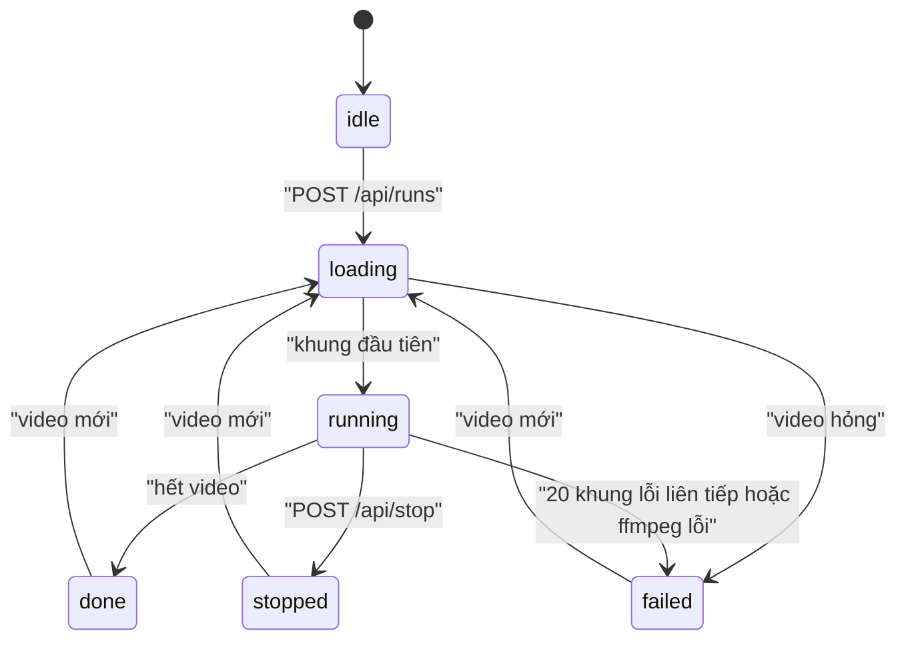

# RoadWatch: vận hành, độ tin cậy và quản trị AI

Tài liệu này mô tả server demo `src/roadwatch/web.py` và luồng xử lý `src/roadwatch/job.py`. Kiến trúc, hợp đồng dữ liệu và tiêu chí nghiệm thu vẫn lấy từ [spec](specs/roadwatch-architecture.md). BT-B trong server demo là bản rút gọn `src/roadwatch/decide.py`, không thay cho engine MVP của spec 3.3–3.7.

## 1. Đối chiếu với Technical Book (chương 07–12)

| Chương | Trong RoadWatch | Ở đâu |
|---|---|---|
| 07 Workflow Design & Reliability | Luồng từng khung có trạng thái rõ ràng; khung lỗi bị bỏ qua; heartbeat; phát hiện treo; fail-safe theo năng lực | Mục 2, 3; `src/roadwatch/job.py` |
| 08 Phát triển API với FastAPI | API REST + SSE + MJPEG, model Pydantic, kiểm tra tham số, OpenAPI tại `/docs` | Mục 4; `src/roadwatch/web.py` |
| 09 Giao diện người dùng | Trang 3 khu BT-A/B/C, cập nhật từng khung, sáng/tối, `aria-live` cho cảnh báo, bàn phím, lịch sử lần chạy | `src/roadwatch/web.html` |
| 10 Kiểm thử và Đánh giá | Test BT-B, test API (validate, path traversal, xóa dữ liệu), test luồng; đánh giá BT-A trên dữ liệu comma | `tests/roadwatch/`; `eval/results/` |
| 11 Privacy, Security & AI Governance | Chỉ chạy trên máy; giới hạn upload; header bảo mật; xóa dữ liệu; nguồn gốc model; giới hạn đã biết | Mục 5, 6 |
| 12 DevOps và Triển khai | Docker không chạy root, healthcheck, compose, biến môi trường, log JSON, CI có build image | Mục 7 |

## 2. Luồng xử lý một lần chạy



Mỗi khung đi qua: giải mã ffmpeg (20 Hz) → BT-A `Pipeline.step` → BT-B `Decider.step` → vẽ HUD → ghi video kết quả → đẩy trạng thái qua SSE. BT-B lấy thời gian từ chỉ số khung, không từ đồng hồ hệ thống. Khi nhập `fy`, chạy lại cùng video cho cùng quyết định; khi `fy` học ở luồng nền, khung đổi `fy` phụ thuộc tốc độ máy nên quyết định có thể khác.

## 3. Độ tin cậy

| Tình huống | Hệ thống làm gì |
|---|---|
| Một khung làm model lỗi | Bỏ khung đó, không cảnh báo từ khung đó, đếm `bad_frames`. 20 khung lỗi liên tiếp (1 s) thì lần chạy `failed` |
| Chưa biết `fy` | Chạy ngay với `fy` tạm; học `fy` ở luồng nền rồi đổi. Trong lúc đó cảnh báo khoảng cách tắt, cảnh báo TTC vẫn bật |
| Học `fy` thất bại (xe chậm, video cắt ghép) | Giữ `fy` tạm, cảnh báo khoảng cách tắt suốt lần chạy, giao diện báo lý do |
| Ảnh không phủ đủ khung model (`coverage` < 95 %) | Trạng thái `unreliable`, không cảnh báo khoảng cách và TTC |
| Lần chạy không ra khung mới trong 2 s | `/health` trả `degraded`, `hung: true` |
| ffmpeg ghi video lỗi | Lần chạy `failed`, có thông báo lỗi |
| Server tắt giữa chừng | `runs/demo/heartbeat.json` ngừng cập nhật (ghi mỗi giây, ghi nguyên tử) |

## 4. API

Hợp đồng API cho frontend (endpoint, `LiveStatus`, SSE, lỗi, phiên bản): [specs/roadwatch-api.md](specs/roadwatch-api.md). Tài liệu tự sinh: `http://127.0.0.1:8765/docs`.

## 5. Privacy và security

- **Dữ liệu không rời máy.** Không gọi mạng khi chạy; không có LLM hay dịch vụ ngoài (ADR-12). Server mặc định chỉ nghe `127.0.0.1`; trong Docker, compose chỉ mở cổng trên `127.0.0.1`.
- **Video dashcam chứa biển số, khuôn mặt của người khác.** Video tải lên nằm trong `runs/demo/<run_id>/`, không được commit (`.gitignore`), không được phục vụ lại qua API. Chỉ giữ `RW_KEEP_RUNS` lần chạy mới nhất; người dùng xóa được từng lần chạy ở giao diện hoặc `DELETE /api/runs/{run_id}`. Không đăng video của người khác lên mạng khi chưa làm mờ.
- **Kiểm tra đầu vào:** chỉ nhận đuôi video; giới hạn `RW_MAX_UPLOAD_MB`; từ chối file rỗng; tham số có khoảng hợp lệ; `run_id` và tên file theo danh sách cho phép, nên không đọc được file ngoài thư mục lần chạy.
- **Header:** `Content-Security-Policy` chỉ cho tài nguyên cùng nguồn, `X-Frame-Options: DENY`, `X-Content-Type-Options: nosniff`, `Referrer-Policy: no-referrer`.
- **Container** chạy bằng user `roadwatch`, model gắn chỉ đọc.
- **Chưa có:** đăng nhập hai vai trò tài xế và kỹ sư (spec 11.5). Server demo một người dùng, chỉ trên máy; không mở ra mạng LAN khi chưa có đăng nhập.

## 6. Quản trị AI

- **Chỉ cảnh báo** (NG1): không điều khiển xe, không đọc dữ liệu xe.
- **Nguồn gốc model:** openpilot supercombo, MIT, commit `c933446…`, SHA-256 bản gốc `65a08adc…`; bản tỉa `models/gr14VinAI.onnx` (spec I-26). Không huấn luyện lại. Mã openpilot đi kèm ở `src/roadwatch/vendor/g01T014VinAI/` với `LICENSE.openpilot`.
- **Giải thích được:** mỗi quyết định nói hay im lặng có lý do, lưu trong `decisions.json` và hiện trên giao diện.
- **Con người kiểm soát ngưỡng:** tham số BT-B là giá trị tạm của `config/proposals/v0.yaml`; đổi qua HITL (spec 3.10). Giao diện demo không sửa cấu hình.
- **Giới hạn đã biết:** dữ liệu đánh giá là của comma (Mỹ), chưa có dữ liệu Việt Nam; học `fy` sai trên 3/10 video calib_challenge; video zoom hẹp, cắt ghép hoặc mưa to làm số đo kém tin cậy; câu nói tiếng Việt là bản nháp chưa duyệt (OQ-B5). Số liệu ở `eval/results/`.

## 7. Triển khai

Chạy trực tiếp (cần `ffmpeg`):

```bash
uv venv && uv pip install -r requirements-roadwatch.txt
python scripts/roadwatch/download_model.py
python -m src.roadwatch.web
```

Bằng Docker (model đã tải vào `models/`):

```bash
docker compose up --build roadwatch
```

**Live URL từ laptop demo (Cloudflare Tunnel).** Laptop chạy server như trên; `cloudflared` mở một URL HTTPS công khai trỏ về `127.0.0.1:8765`. Không cần tài khoản Cloudflare, nhưng URL đổi mỗi lần khởi động và chỉ sống khi laptop bật.

```bash
# URL cố định: tên miền tĩnh miễn phí của tài khoản ngrok (dashboard.ngrok.com, Domains); ngrok đã có authtoken
RW_NGROK_DOMAIN=<tên>.ngrok-free.dev RW_PASSWORD='<mật khẩu>' scripts/roadwatch/serve_tunnel.sh
# Không có ngrok: Cloudflare quick tunnel, URL mới mỗi lần
RW_PASSWORD='<mật khẩu>' scripts/roadwatch/serve_tunnel.sh
```

Script in URL và thông tin đăng nhập; Ctrl+C dừng cả server lẫn tunnel. Với ngrok: URL giữ nguyên sau khi tắt máy, SSE không bị gom khối, upload tối đa `RW_MAX_UPLOAD_MB=500`. Gói ngrok miễn phí hiện một trang cảnh báo ở lần đầu mở bằng trình duyệt.

- Bắt buộc có `RW_PASSWORD`; không đặt thì script tự sinh một mật khẩu ngẫu nhiên và in ra. Mọi đường dẫn trừ `/health` cần đăng nhập HTTP Basic, kể cả WebSocket.
- Cloudflare gói miễn phí chặn request lớn hơn 100 MB, nên script đặt `RW_MAX_UPLOAD_MB=100` và chỉ giữ `RW_KEEP_RUNS=5` lần chạy.
- Quick tunnel gom luồng SSE lại thành khối và gửi trễ nhiều giây. Vì vậy giao diện nhận cập nhật qua WebSocket `/api/ws`; đo qua tunnel được khoảng 21 tin/s, khoảng cách lớn nhất giữa hai tin 0,06 s.
- Cài `cloudflared`: tải bản `cloudflared-linux-amd64` từ trang phát hành GitHub của Cloudflare, so SHA-256 với ghi chú phát hành, đặt vào `PATH`.
- Muốn URL cố định thì cần tài khoản Cloudflare và một tên miền (named tunnel); quick tunnel không cho chọn tên.

Biến môi trường: `.env.example`, mục RoadWatch. Mật khẩu không nằm trong image hay trong `docker-compose.yml`: compose đọc `RW_PASSWORD` từ `.env`.

**Image** (`docker/roadwatch.Dockerfile`): multi-stage. Stage builder cài dependency vào venv và gỡ công cụ test; stage production chỉ có runtime và ffmpeg, chạy bằng user `roadwatch`, gắn tag phiên bản (`--build-arg VERSION=…`, nhãn OCI). Kích thước khoảng 930 MB: phần lớn là ONNX Runtime, OpenCV và ffmpeg.

**Tài nguyên** (đo ngày 07/10/2026 trên laptop demo, video comma2k19, có học `fy` ở luồng nền): tối đa khoảng 12,4 lõi CPU và 1,55 GiB RAM, giữ 20 FPS, P95 44,7 ms/khung. Compose đặt giới hạn `RW_CPUS` (mặc định 12) và 3 GB; cấp ít CPU hơn thì `fy` được học chậm hơn, không học sai.

**Health:** `/health/live` (process còn trả lời; dùng cho Docker HEALTHCHECK), `/health/ready` (có model, sẵn sàng chạy; 503 nếu thiếu), `/health` (tổng hợp, có `timestamp`; 503 khi thiếu model hoặc lần chạy bị treo quá 2 s). Ba đường này không cần đăng nhập, để công cụ giám sát gọi được.

**Log:** mỗi dòng một object JSON trên stdout (`timestamp`, `level`, `logger`, `message`, `module`, `line`, kèm `exception` khi có lỗi). Xem bằng `docker compose logs -f roadwatch`.

**CI/CD** (`.github/workflows/roadwatch.yml`): `lint` (ruff, chú thích thẳng trên PR) → `test` (pytest có coverage, upload `coverage.xml`; kiểm tài liệu và schema API) → `build` (image multi-stage có cache, chạy thử: live trả 200, ready trả 503 khi không có model, kiểm user không phải root) → `publish` (chỉ khi push vào `main`: đẩy image lên GHCR với tag commit SHA và `main`). Không có bước deploy lên server: bản demo chạy trên laptop qua tunnel.

**Chưa làm theo sách:** `ruff format --check` (code hiện chưa theo định dạng của ruff; bật thì phải định dạng lại 18 file trong một commit riêng). LangSmith không áp dụng vì sản phẩm không có LLM (ADR-12); log việc nhóm dùng AI nằm ở `.ai-log/`, quyết định của BT-B nằm ở `decisions.json` của từng lần chạy.
