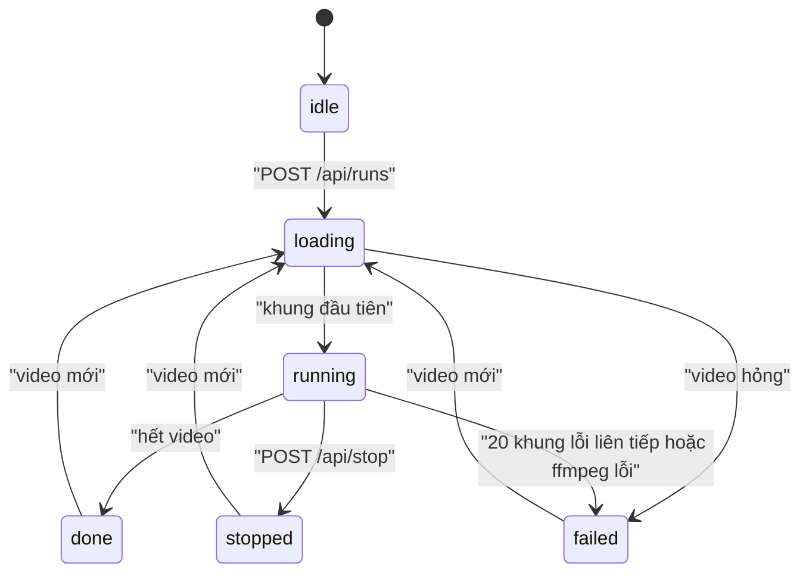

# RoadWatch: vận hành, độ tin cậy và quản trị AI

Tài liệu này mô tả server demo `src/roadwatch/web.py` và luồng xử lý `src/roadwatch/job.py`. Kiến trúc, hợp đồng dữ liệu và tiêu chí nghiệm thu vẫn lấy từ [spec](specs/roadwatch-architecture.md). BT-B trong server demo là bản rút gọn `src/roadwatch/decide.py`, không thay cho engine MVP của spec 3.3–3.7. Các điểm bản demo khác spec: spec 12.4 (D-20…D-26).

## 1. Đối chiếu với Technical Book (chương 07–12)

| Chương | Trong RoadWatch | Ở đâu |
|---|---|---|
| 07 Workflow Design & Reliability | Luồng từng khung có trạng thái rõ ràng; khung lỗi bị bỏ qua; heartbeat; phát hiện treo; fail-safe theo năng lực | Mục 2, 3; `src/roadwatch/job.py` |
| 08 Phát triển API với FastAPI | API REST + SSE + MJPEG, model Pydantic, kiểm tra tham số, OpenAPI tại `/docs` | Mục 4; `src/roadwatch/web.py` |
| 09 Giao diện người dùng | Màn buồng lái mở đầu; web app tập trung vào phát hiện, đo và cảnh báo khoảng cách (Chạy video, Lái thử, Lịch sử có xem lại) với bản đồ 3D quanh xe, cập nhật từng khung, `aria-live` cho cảnh báo, bàn phím, chạy offline không CDN | `src/roadwatch/ui/`; trang cũ `judge.html`, `web.html` |
| 10 Kiểm thử và Đánh giá | Test BT-B, test API (validate, path traversal, xóa dữ liệu), test luồng; đánh giá gr14VinAI so với radar trên đường Việt Nam, Comma2k19 và human baseline | `tests/roadwatch/`; `eval/` |
| 11 Privacy, Security & AI Governance | Chỉ chạy trên máy; giới hạn upload; header bảo mật; xóa dữ liệu; nguồn gốc model; giới hạn đã biết | Mục 5, 6 |
| 12 DevOps và Triển khai | Docker không chạy root, healthcheck, compose, biến môi trường, log JSON, CI có build image | Mục 7 |

## 2. Luồng xử lý một lần chạy



Mỗi khung đi qua: giải mã ffmpeg (20 Hz) → BT-A `Pipeline.step` → BT-B `Decider.step` → vẽ HUD → ghi video kết quả → đẩy trạng thái qua SSE. BT-B lấy thời gian từ chỉ số khung, không từ đồng hồ hệ thống. Khi nhập `fy`, chạy lại cùng video cho cùng quyết định; `fy` mặc định do người dùng nhập. Khi `fy` tự học (chọn `lens=learn`) hoặc chỉnh theo GPS (`auto_focal`), khung đổi `fy` phụ thuộc tốc độ máy nên quyết định có thể khác.

## 3. Độ tin cậy

| Tình huống | Hệ thống làm gì |
|---|---|
| Một khung làm model lỗi | Bỏ khung đó, không cảnh báo từ khung đó, đếm `bad_frames`. 20 khung lỗi liên tiếp (1 s) thì lần chạy `failed` |
| Chưa nhập tiêu cự và không chọn tự học | API trả 422, lần chạy không bắt đầu |
| Chọn tự học (`lens=learn`) | Chạy ngay với `fy` tạm; học `fy` ở luồng nền rồi đổi. Trong lúc đó cảnh báo khoảng cách tắt, cảnh báo TTC vẫn bật |
| Học `fy` thất bại (xe chậm, video cắt ghép) | Giữ `fy` tạm, cảnh báo khoảng cách tắt suốt lần chạy, giao diện báo lý do |
| `auto_focal` bật nhưng chưa hội tụ | Cảnh báo khoảng cách tắt tới khi `fy` ổn định theo GPS, cảnh báo TTC vẫn bật |
| Ảnh không phủ đủ khung model (`coverage` < 95 %) | Trạng thái `unreliable`, không cảnh báo khoảng cách và TTC |
| Lần chạy không ra khung mới trong 2 s | `/health` trả `degraded`, `hung: true` |
| ffmpeg ghi video lỗi | Lần chạy `failed`, có thông báo lỗi |
| Server tắt giữa chừng | `runs/demo/heartbeat.json` ngừng cập nhật (ghi mỗi giây, ghi nguyên tử) |

## 4. API

Hợp đồng API cho frontend (endpoint, `LiveStatus`, SSE, lỗi, phiên bản): [specs/roadwatch-api.md](specs/roadwatch-api.md). Tài liệu tự sinh: `http://127.0.0.1:8765/docs`.

## 5. Privacy và security

- **Dữ liệu không rời máy.** Không gọi mạng khi chạy; không có LLM hay dịch vụ ngoài (ADR-12). Server mặc định chỉ nghe `127.0.0.1`; trong Docker, compose chỉ mở cổng trên `127.0.0.1`.
- **Video dashcam chứa biển số, khuôn mặt của người khác.** Video tải lên nằm trong `runs/demo/<run_id>/`, không được commit (`.gitignore`), không được phục vụ lại qua API. Chỉ giữ `RW_KEEP_RUNS` lần chạy mới nhất; người dùng xóa được từng lần chạy ở giao diện hoặc `DELETE /api/runs/{run_id}`. Không đăng video của người khác lên mạng khi chưa làm mờ.
- **Kiểm tra đầu vào:** chỉ nhận đuôi video; giới hạn `RW_MAX_UPLOAD_MB`; từ chối file rỗng; tham số có khoảng hợp lệ; `run_id` và tên file theo danh sách cho phép, nên không đọc được file ngoài thư mục lần chạy.
- **Header:** `Content-Security-Policy` chỉ cho tài nguyên cùng nguồn, `X-Frame-Options: DENY`, `X-Content-Type-Options: nosniff`, `Referrer-Policy: no-referrer`.
- **Container** chạy bằng user `roadwatch`, model gắn chỉ đọc.
- **Tài khoản cục bộ:** giao diện `/login`, `/register`, SQLite tại `RW_ACCOUNTS_DB` (mặc định `runs/demo/accounts.db`). Đăng ký cho chọn tài xế hoặc kỹ sư, mặc định tài xế; `RW_USER` / `RW_PASSWORD` tạo kỹ sư khi khởi động lần đầu, không đổi mật khẩu hay vai trò tài khoản đã tồn tại. Mật khẩu băm PBKDF2-SHA256 (600.000 vòng, salt riêng); database chỉ chủ file đọc/ghi. Phiên 12 giờ, token chỉ lưu bản băm, cookie HttpOnly và SameSite=Lax. Sau 5 lần đăng nhập sai, khóa tên đăng nhập 5 phút.
- **Triển khai HTTPS:** đặt `RW_ACCOUNTS=1`, `RW_COOKIE_SECURE=1`; trên localhost HTTP dùng `RW_COOKIE_SECURE=0`. `RW_ACCOUNTS=0` giữ chế độ HTTP Basic cũ. SQLite có sẵn trong Python, không cần dịch vụ database ngoài.
- **Lưu trữ:** giữ và sao lưu `accounts.db` cùng volume `runs/demo`; không commit, không xóa file này khi dọn video. Có thể sao lưu nhất quán bằng API `sqlite3.Connection.backup` khi server đang chạy. Khởi động lại giữ tài khoản và phiên còn hạn.
- **Phạm vi demo:** các tài khoản dùng chung một job và lịch sử. `/engineer` và API Lab chỉ cho kỹ sư; người đăng ký có thể chọn kỹ sư để truy cập Lab. Quyền HITL vẫn theo `configstore`, không cấp bởi đăng nhập web.

## 6. Quản trị AI

- **Chỉ cảnh báo** (NG1): không điều khiển xe, không đọc dữ liệu xe.
- **Nguồn gốc model:** model tự train của RoadWatch; bản triển khai `models/gr14VinAI.onnx`. Model được đóng gói cho suy luận offline trên CPU.
- **Giải thích được:** mỗi quyết định nói hay im lặng có lý do, lưu trong `decisions.json` và hiện trên giao diện.
- **Con người kiểm soát ngưỡng:** tham số BT-B là hằng số trong `src/roadwatch/decide.py`, cùng giá trị tạm với `config/proposals/v0.yaml` (chép tay; server không đọc file này). Quy trình HITL của spec 3.10 chưa có trên `main` (spec D-22); giao diện demo không sửa cấu hình.
- **Giới hạn đã biết:** model chưa thấy video đường Việt Nam khi train; trên 60 m sai số tăng rõ (MAE 9,8-13,8 m, `eval/`); học `fy` sai trên 3/10 video calib_challenge (nên mặc định là nhập tay); video zoom hẹp, cắt ghép hoặc mưa to làm số đo kém tin cậy; câu nói tiếng Việt là bản nháp chưa duyệt (OQ-B5). Số liệu ở [`eval/`](../eval/README.md).

## 7. Triển khai

Chạy trực tiếp (cần `ffmpeg`):

```bash
uv venv && uv pip install -r requirements.txt
python scripts/roadwatch/download_model.py
python -m src.roadwatch.web
```

Bằng Docker (model đã tải vào `models/`):

```bash
docker compose up --build roadwatch
```

**Live URL từ laptop demo (Cloudflare Tunnel).** Laptop chạy server như trên; `cloudflared` mở một URL HTTPS công khai trỏ về `127.0.0.1:8765`. Không cần tài khoản Cloudflare, nhưng URL đổi mỗi lần khởi động và chỉ sống khi laptop bật.

```bash
# URL cố định: tên miền tĩnh miễn phí của tài khoản ngrok (dashboard.ngrok.com, Domains); ngrok đã có authtoken
RW_NGROK_DOMAIN=<tên>.ngrok-free.dev RW_PASSWORD='<mật khẩu>' scripts/roadwatch/serve_tunnel.sh
# Không có ngrok: Cloudflare quick tunnel, URL mới mỗi lần
RW_PASSWORD='<mật khẩu>' scripts/roadwatch/serve_tunnel.sh
```

Script in URL và thông tin đăng nhập; Ctrl+C dừng cả server lẫn tunnel. Với ngrok: URL giữ nguyên sau khi tắt máy, SSE không bị gom khối, upload tối đa `RW_MAX_UPLOAD_MB=500`. Gói ngrok miễn phí hiện một trang cảnh báo ở lần đầu mở bằng trình duyệt.

- Bắt buộc có `RW_PASSWORD`; không đặt thì script tự sinh một mật khẩu ngẫu nhiên và in ra. Mặc định đăng nhập ở `/login` bằng tài khoản cục bộ; đặt `RW_COOKIE_SECURE=1` khi dùng URL HTTPS. `RW_ACCOUNTS=0` dùng HTTP Basic cũ.
- Cloudflare gói miễn phí chặn request lớn hơn 100 MB, nên script đặt `RW_MAX_UPLOAD_MB=100` và chỉ giữ `RW_KEEP_RUNS=5` lần chạy.
- Quick tunnel gom luồng SSE lại thành khối và gửi trễ nhiều giây. Vì vậy giao diện nhận cập nhật qua WebSocket `/api/ws`; đo qua tunnel được khoảng 21 tin/s, khoảng cách lớn nhất giữa hai tin 0,06 s.
- Cài `cloudflared`: tải bản `cloudflared-linux-amd64` từ trang phát hành GitHub của Cloudflare, so SHA-256 với ghi chú phát hành, đặt vào `PATH`.
- Muốn URL cố định thì cần tài khoản Cloudflare và một tên miền (named tunnel); quick tunnel không cho chọn tên.

Biến môi trường: `.env.example`, mục RoadWatch. Mật khẩu không nằm trong image hay trong `docker-compose.yml`: compose đọc `RW_PASSWORD` từ `.env`.

**Image** (`docker/roadwatch.Dockerfile`): multi-stage. Stage builder cài dependency vào venv và gỡ công cụ test; stage production chỉ có runtime và ffmpeg, chạy bằng user `roadwatch`, gắn tag phiên bản (`--build-arg VERSION=…`, nhãn OCI). Kích thước khoảng 930 MB: phần lớn là ONNX Runtime, OpenCV và ffmpeg.

**Tài nguyên** (đo ngày 07/10/2026 trên laptop demo, video comma2k19): tối đa khoảng 12,4 lõi CPU và 1,55 GiB RAM, giữ 20 FPS, P95 44,7 ms/khung. Compose đặt giới hạn `RW_CPUS` (mặc định 12) và 3 GB; cấp ít CPU hơn thì `fy` được học chậm hơn, không học sai.

**Health:** `/health/live` (process còn trả lời; dùng cho Docker HEALTHCHECK), `/health/ready` (có model, sẵn sàng chạy; 503 nếu thiếu), `/health` (tổng hợp, có `timestamp`; 503 khi thiếu model hoặc lần chạy bị treo quá 2 s). Ba đường này không cần đăng nhập, để công cụ giám sát gọi được.

**Log:** mỗi dòng một object JSON trên stdout (`timestamp`, `level`, `logger`, `message`, `module`, `line`, kèm `exception` khi có lỗi). Xem bằng `docker compose logs -f roadwatch`.

**CI/CD** (`.github/workflows/roadwatch.yml`): `lint` (ruff, chú thích thẳng trên PR) → `test` (pytest có coverage, upload `coverage.xml`; kiểm schema API) → `build` (image multi-stage có cache, chạy thử: live trả 200, ready trả 503 khi không có model, kiểm user không phải root) → `publish` (chỉ khi push vào `main`: đẩy image lên GHCR với tag commit SHA và `main`). Không có bước deploy lên server: bản demo chạy trên laptop qua tunnel.

**Chưa làm theo sách:** `ruff format --check` (code hiện chưa theo định dạng của ruff; bật thì phải định dạng lại 18 file trong một commit riêng). LangSmith không áp dụng vì sản phẩm không có LLM (ADR-12); log việc nhóm dùng AI nằm ở `.ai-log/`, quyết định của BT-B nằm ở `decisions.json` của từng lần chạy.

**Video live qua WebRTC.** Web app ở `/app` dùng WebRTC, thay cho tải JPEG từng ảnh. Cần `aiortc` trong `requirements.txt` và kết nối media trực tiếp giữa trình duyệt với server. Tailscale Funnel/Cloudflare HTTPS chỉ chuyển signaling; chúng không chuyển UDP media. STUN mặc định là `stun:stun.cloudflare.com:3478`; không có TURN mặc định. Nếu trình duyệt không nối được (NAT/firewall), cấu hình TURN riêng bằng `RW_RTC_ICE_SERVERS`, ví dụ `[{"urls":["turn:turn.example.org:3478"],"username":"demo","credential":"<secret>"}]`; giữ credential trong môi trường local, không commit. Dùng `[]` khi chỉ xem trong LAN/offline. Docker bridge cũng cần đường ICE có thể tới được hoặc TURN; chỉ publish cổng HTTP không đủ cho media.

**Đo trên điện thoại (`/phone`).** Điện thoại làm camera và GPS; model vẫn chạy trên laptop. API ở [roadwatch-api.md](specs/roadwatch-api.md), mục 3a. Cách dùng với iPhone khi laptop ở nhà và điện thoại dùng 4G:

1. Laptop chạy server như trên, rồi mở URL HTTPS bằng Tailscale Funnel: `tailscale funnel --bg 8765`. Lần đầu cần bật Funnel cho tailnet (lệnh in link) và quyền điều khiển cho user: `sudo tailscale set --operator=$USER`. URL Funnel công khai: đặt mật khẩu tài khoản mạnh; tắt bằng `tailscale funnel reset` khi không dùng. Laptop không được ngủ.
2. Trên iPhone, mở Safari tới URL đó, đăng nhập rồi vào `/phone` (hoặc mục "Đo trên điện thoại" trên thanh điều hướng của `/app`). Safari chỉ cho dùng camera và vị trí trên HTTPS.
3. Gắn điện thoại nằm ngang, nhập khoảng cách camera tới cản trước và tiêu cự (iPhone 13, camera chính: 26 mm), giữ đường truyền "Qua trang web", bấm "Bắt đầu đo". Cho phép camera và vị trí khi Safari hỏi. Lần chạm này cũng mở khoá âm thanh.

- `tailscale serve` (URL chỉ trong tailnet) cần iPhone bật VPN Tailscale và dùng DNS của Tailscale. Ngày 12/10/2026, iPhone dùng 4G không mở được URL `serve` dù đã nối thẳng (`direct`) tới laptop; chưa rõ nguyên nhân phía iPhone, nên tài liệu này dùng Funnel.
- Đường "WebRTC" trên trang chỉ nối được khi hai máy cùng mạng (ví dụ laptop bắt hotspot của iPhone); qua 4G tới router nhà thì cần TURN, chưa có.
- Trang, kết quả và ảnh camera đi qua Internet. Điều này khác NG5 của spec ("không Internet"): chọn theo yêu cầu người dùng ngày 12/10/2026; suy luận vẫn chạy trên laptop.
- Đo ngày 12/10/2026 trên laptop demo bằng điện thoại giả gửi ảnh qua WebSocket (comma2k19 đoạn 3, 640 px, JPEG 70): 18 khung/s, ảnh trung bình 15 KB, khoảng 2,2 Mbit/s (khoảng 1 GB/giờ); hiệu chuẩn xong, tốc độ lấy từ GPS, phiên lưu đủ file. Ảnh thật của iPhone nhiều chi tiết hơn nên có thể nặng hơn.
- Đo ngày 12/10/2026 với đường WebRTC, bằng một điện thoại giả (aiortc phát video comma2k19 đoạn 3 qua WebRTC, kèm GPS 25 m/s): kết nối được, hiệu chuẩn xong sau khoảng 2,5 s, tốc độ lấy từ GPS, phiên lưu đủ file. Model chạy khoảng 16 khung/s chứ không đạt 20; chạy file video không giới hạn tốc độ cũng chỉ đạt 16,6 khung/s, nên giới hạn nằm ở vòng xử lý (model khoảng 36 ms/khung cộng vẽ HUD và ghi video), không ở đường truyền. Khi model chậm hơn 20 Hz, khung bị bỏ và model thấy khoảng cách giữa hai khung dài hơn 50 ms.
- Chưa thử trên iPhone thật: chưa kiểm hướng ảnh khi gửi qua WebRTC, độ trễ và tiêu cự thực của ảnh WebRTC.

**Chạy model ngay trên điện thoại** (`/phone`, đường "Chạy trên điện thoại"; chỉ local, người dùng báo PO đồng ý 13/10/2026, khác NG7 của spec). Trang tải onnxruntime-web và `gr14VinAI.mixed.onnx` từ `/ortweb/` (lần đầu khoảng 70 MB, tải từng đoạn và lưu trong Cache Storage), chạy model bằng WebGPU, rồi chạy bản JS của pipeline, hiệu chuẩn, Kalman/temporal và BT-B (`src/roadwatch/ui/onphone/`); không gửi ảnh về laptop. File cần có trong `models/` (không vào git): `ort-web/` (onnxruntime-web 1.30.0, `npm pack`, kiểm sha512), `gr14VinAI.mixed.onnx` (bản FP16, riêng chuẩn hoá L2 tính FP32: tổng bình phương tới ~81 nghìn vượt FP16 trên GPU iPhone). Đo trên iPhone 13 (Safari, WebGPU): model trung vị 37 ms, p95 50 ms, đầu ra khớp ONNX Runtime CPU (xe dẫn đầu lệch tối đa 0,19). Thử trên Chrome headless (CPU, camera giả comma2k19): chạy trọn đường, hiệu chuẩn, đo xe dẫn đầu; khoảng 8 khung/s vì không có GPU. Khác bản server: đầu vào góc rộng `dup`; camera xin 16:9 như đường gửi về laptop (từ 14/10/2026; trước đó 4:3, chịu được điện thoại chúc xuống tới khoảng −12° thay vì −8°); vận tốc của model và bước Kalman theo khoảng thời gian thật giữa hai khung; chưa lưu phiên, chưa tự chỉnh tiêu cự theo GPS; câu nói vẫn tải từ laptop.

Trên `/phone`, chọn "Trên điện thoại: chỉ CPU" để thử suy luận bằng WebAssembly (WASM) với `gr14VinAI.fp32.onnx`; cần thêm file model FP32 trong `models/` (không vào git). Chế độ GPU mặc định tự chuyển sang CPU nếu **nạp** WebGPU lỗi. Nếu Safari đóng tab khi GPU đang chạy, mở lại trang và chọn CPU trực tiếp; trang không thể bắt sự kiện tab bị hệ điều hành đóng. Màn đo hiện CPU/GPU và thời gian model từng khung, nhật ký gửi về `runs/demo/bench.jsonl`.
Lượt CPU trên iPhone ngày 13/10/2026 đạt khoảng 3,0–3,4 khung/s rồi tab tải lại sau khoảng 47 s (log cuối ở khung 137); chưa xác định nguyên nhân tải lại. Vòng suy luận đã được sửa để giải phóng tensor sau mỗi khung, cần thử lại trên iPhone để biết thay đổi này có cải thiện độ bền hay không. Tốc độ CPU đo được không đủ cho đường đo trực tiếp của RoadWatch; dùng đường gửi ảnh về laptop khi cần đo liên tục.

**Vì sao `/phone` chạy bằng graph capture và onnxruntime-web 1.20.1** (đo trên iPhone 13, Safari 26.6.1, 13–14/10/2026; công cụ dò đã bỏ, số liệu giữ lại để biết lý do thiết kế). Chạy gr14VinAI trong Safari theo cách thường làm tab bị đóng sau khoảng 30–70 s (`/bench?leak=1`: mọi chế độ bộ nhớ đệm đều sập). Dò từng lớp cho thấy:
- WebGPU thuần và model nhỏ cùng đầu vào chạy hết 3000 lần, 2 ms mỗi lần: lỗi không nằm ở WebGPU cơ bản hay ở ONNX Runtime nói chung;
- model thật (226 phép) chạy thường làm tab bị đóng sau khoảng 350–950 lần ở mọi biến thể, kể cả bộ WebGPU viết bằng JS (JSEP) và bộ viết bằng C++, trạng thái trên GPU hay nghỉ giữa các lần chạy;
- WebGPU thuần gửi 230 lệnh mỗi lần, mỗi lệnh một bind group, lỗi `getMappedRange failed` sau khoảng 80 nghìn bind group: WebGPU của Safari hỏng sau vài chục nghìn bind group, kể cả khi không có ONNX Runtime. Chạy thường, ONNX Runtime tạo một bind group cho mỗi phép mỗi lần chạy;
- graph capture của JSEP (`enableGraphCapture`) ghi lại chuỗi lệnh GPU ở lần đầu rồi phát lại, không tạo bind group mới. Điều kiện: không phép nào ở CPU, nên model dùng ảnh và hàng đợi khung float16 (với uint8 các phép đầu chạy ở CPU và JSEP từ chối);
- onnxruntime-web 1.30.0 với graph capture vẫn đóng tab sau khoảng 3450 lần. [onnxruntime #26827](https://github.com/microsoft/onnxruntime/issues/26827) báo trình biên dịch WebAssembly của WebKit ngốn bộ nhớ với các hàm rất lớn của bản jsep từ 1.21 (hàm lớn nhất trong file wasm: 1.30.0 jsep 1526 KB, 1.20.1 jsep 1205 KB);
- **onnxruntime-web 1.20.1 với graph capture chạy hết 12000 lần (6 phút 8 s), không đóng tab**, 27–30 ms mỗi lần, đầu ra đúng; 1.20.1 chạy thường vẫn đóng tab sau khoảng 950 lần. Vậy cần cả hai: graph capture và bản 1.20.1. Bench này chưa có camera, nắn ảnh và vẽ.

**`/phone` chạy theo cách này** (từ 14/10/2026, đường "Trên điện thoại: GPU"):
- thư viện: onnxruntime-web 1.20.1 ở `models/ort-web/1.20.1/` (`ort.webgpu.min.js`, `ort-wasm-simd-threaded.jsep.{mjs,wasm}`, từ `npm pack onnxruntime-web@1.20.1`); đường CPU cũng dùng bản này;
- model cùng bản laptop: `python -m scripts.roadwatch.make_phone_models` dựng từ `gr14VinAI.onnx` ba bản `gr14VinAI.mixed.onnx` (hai `ReduceL2` tính FP32; hai phép JSEP 1.20.1 để lại CPU nên graph capture bị từ chối được viết lại cho cùng kết quả: `ReduceMax` thành `Slice` + `Greater`/`Where`, `GatherND` hằng thành `Slice`; `Concat` hơn 6 đầu vào tách thành cây `Concat` nhỏ, vì mỗi đầu vào là một storage buffer và WebGPU mặc định chỉ cho 8 mỗi shader: vượt thì shader không tạo được, cả khung bị bỏ và đầu ra toàn 0, như trên iPhone 14/10/2026; bản `fp32` cũng được viết lại như vậy), `gr14VinAI.capture.onnx` (bản `mixed`, ảnh và hàng đợi khung float16; GPU) và `gr14VinAI.fp32.onnx` (CPU), rồi so với model gốc trên ONNX Runtime CPU (capture trùng mixed, mixed trùng gốc; fp32 lệch dưới 1 % giá trị). Các bản cũ 707 số và `reference.json` cũ ở `models/phone-707/`. `models/ort-web/reference.json` (đầu ra mẫu cho `/bench`) dựng lại bằng model mới: 707 số đầu trùng bản cũ (lệch 1e-6), tức các head cũ không đổi;
- `src/roadwatch/ui/onphone/captured.mjs` (GPU, graph capture) và `inference.mjs` (`FrameModel`, CPU) cấp `desire` = 0, `traffic_convention` = [1, 0] và chuyền các hàng đợi trạng thái như `model.Gr14VinAI`. Với graph capture, bộ đệm GPU cố định; mỗi khung: ảnh đã nắn (uint8) đổi sang float16, ghi lên GPU, chạy, chép trạng thái ngay trên GPU, đọc 1961 số về CPU;
- BT-A và hình làn như laptop: `lanes.mjs` chép phần chọn làn của `pipeline.py` (độ cong, xe đè vạch, `lane_center`, `predicted_path`, mép đường), `geometry.mjs` chép `hud.lane_geometry`, `LaneSmoother`, `overlay` (thảm làn, dải đường đi). Kiểm bằng golden xuất từ Python: comma2k19 đoạn 3 (400 khung), `lane_c02` (đoạn cong không vạch, 300 khung) và 32 ca từng hàm (có xe đè vạch trái, phải);
- màn đo: video kích thước thật (`object-fit: contain`; đã thử phủ kín màn hình nhưng hình phóng khoảng 1,6 lần làm thảm làn rung trông to hơn, bỏ theo yêu cầu người dùng); một khung góc trên trái như HUD của Lái thử: khoảng cách `m ± sai số` và tốc độ, ghi "Tốc độ theo GPS" hoặc "Không có GPS: model ước đoán"; khung cảnh báo chỉ hiện khi có cảnh báo; nút "Hiệu chuẩn" ẩn / hiện ô hiệu chuẩn góc phải (nhớ lựa chọn trên máy); bỏ khối "Đo khoảng cách" và dòng radar;
- vòng đo ghi lỗi WebGPU (`uncapturederror`, 5 lỗi đầu) vào `bench.jsonl` và dừng với thông báo khi model trả về toàn 0 ba khung liền;
- nhật ký 5 s một dòng có thêm `lane_jitter` (`onphone/jitter.mjs`, tính từng khung): độ rung mép trái / phải thảm làn ở 15 m, `accel_rms` (m/s², căn bậc hai trung bình bình phương gia tốc, so được giữa các tốc độ khung) và `rate_p95` (m/s), cùng số khung theo nguồn tâm làn (`refs`: `lane_lines`, `both_lanes`, `ego_path`);
- **Chạy video có sẵn trên điện thoại (thử nghiệm, 14/10/2026):** ở màn bắt đầu của `/phone`, mục "Video có sẵn" cho chọn một tệp video (từ Ảnh hoặc Tệp); với đường "Trên điện thoại" video thay camera (phát từ đầu sau khi model nạp xong, hết video thì tự dừng). Mỗi khung ghi giờ của video, khoảng cách, tốc độ model, mép làn ở 15 m và nguồn tâm làn; hết video trang gửi về `POST /api/phone/clip-result` (lưu `runs/<dir>/phone_clips/<mã>.json`, tối đa 8 MB). So với cùng tệp đã chạy ở Lái thử: `python -m scripts.roadwatch.compare_phone_clip runs/demo/phone_clips/<mã>.json runs/demo/<run_id>` (đối chiếu khoảng cách và xe dẫn đầu theo giờ video, tốc độ model, độ rung mép làn so với pipeline laptop chạy lại trên chính `input.*` của phiên ở cùng tốc độ khung). `python -m scripts.roadwatch.lane_jitter_ref` chỉ lấy số của laptop. Chrome headless (CPU, 7 khung/s, `curve_2_clip` qua chọn tệp) so với Lái thử `2261b0fdb5d2`: xe dẫn đầu cùng có ở 45 % số khung, chỉ điện thoại 2 %, chỉ laptop 11 %; khoảng cách lệch trung vị 2,2 m (p90 7,7 m); tốc độ model 23 so 27 km/h; `accel_rms` mép làn trái 1,8 (laptop 1,5), phải 4,4 (laptop 1,7), nguồn tâm làn cùng tỉ lệ. Chưa chạy trên GPU iPhone;
- `?model=fp32` vẫn chạy bản FP32 không ghi lại. Đường CPU chậm hơn trước (Chrome headless: model 180–370 ms so với khoảng 90 ms) vì có nhánh policy và bản FP32 121 MB.

iPhone 13, 14/10/2026: graph capture với bản `capture` cũ (707 số) chạy liên tục 15,5 phút (7495 khung, khoảng 8 khung/s, model khoảng 115 ms) trên `/phone` có camera; nhật ký dừng ở 06:55:50 không có dòng `stop`, chưa rõ tab bị đóng hay trang bị đóng tay. Bản mới trước khi viết lại hai phép: graph capture bị từ chối, trang tự chạy CPU (khoảng 5 khung/s).

Chrome headless (SwiftShader, camera giả comma2k19 đoạn 3): đường GPU (`capture: true`) chạy đều 20 khung/s, nhưng không hiệu chuẩn vì SwiftShader không có f16 (`'f16' type used without 'f16' extension`). Đường CPU hiệu chuẩn sau khoảng 16 s, đo được xe dẫn đầu và vẽ thảm làn mới. Chưa chạy `/phone` trên iPhone theo cách này.

**Dịch vụ laptop hiện tại.** `roadwatch-front-end.service` (systemd user) chạy repo này ở `127.0.0.1:8000`; Tailscale Funnel giữ URL `https://c4-app-014.tail426219.ts.net/`. Cấu hình riêng ở `~/.local/state/roadwatch/front-end.env`, có `PATH` chứa thư mục cài `ffmpeg` và `ffprobe`. Sau khi cập nhật code/dependency: `systemctl --user restart roadwatch-front-end.service`; kiểm `/health/ready` và kết nối video WebRTC trong trình duyệt. Xem log bằng `journalctl --user -u roadwatch-front-end.service`.
