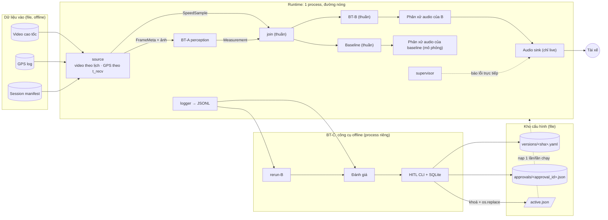

# RoadWatch Copilot: kiến trúc tổng thể và hợp đồng dữ liệu

> **TRẠNG THÁI: APPROVED (PO duyệt ngày 28/09/2026).** Hợp đồng dữ liệu chốt v0.1 vào ngày 1 triển khai và đóng băng v1.0 cuối tuần 1 (4.6). Thay đổi sau khi duyệt phải ghi lại trong tài liệu này, kèm lý do.
>
> Tài liệu này hợp nhất phiên thiết kế ngày 28/09/2026. Mọi sửa đổi trong phiên đã được viết thẳng vào từng mục. Khi các mục khác nhau, mục này là nguồn đúng cho kiến trúc, còn ba file trong `docs/requirements/` là nguồn đúng cho bài toán và phạm vi.
>
> **Đầu vào:** `RoadWatch_Copilot_1_Tong_quan_du_an (1).md` (tổng quan, lộ trình mục 10), `RoadWatch_Copilot_2_Bai_toan_chinh (1).md` (ba bài toán), `RoadWatch_Copilot_3_Cau_hinh_lap_dat.md` (cấu hình lắp cố định, ADR-04). File Word `tai_lieu_viet_bao_cao.docx` **đang lỗi thời**, phải đồng bộ trước khi dùng để nộp.

**Quy ước**
- **TBD** là tham số cấu hình, sẽ chốt bằng số đo hoặc thử nghiệm (mục 10).
- Mọi con số hiệu năng là giả định ban đầu, phải đo lại trên máy demo.
- Vai trò phụ trách: **R-A** (BT-A), **R-B** (BT-B), **R-C** (BT-C: `contracts`, HITL, công cụ), **R-D** (dữ liệu và đánh giá), **PO**. Việc gán vai trò cho từng người ghi ở `docs/plan/`, không ghi ở đây.
- Dự án kéo dài 4 tuần. **Hạn nộp MVP là cuối tuần 1**; tuần 2–4 là phần mở rộng (lộ trình: file 1, mục 10).

---

## 1. Mục tiêu và Non-goals

### 1.1 Mục tiêu

| Mã | Mục tiêu | Căn cứ |
|---|---|---|
| G1 | Cảnh báo khoảng cách/headway theo TT38 và cảnh báo va chạm theo TTC cho tài xế mới trên cao tốc, bằng câu tiếng Việt thu sẵn. Chỉ cảnh báo | P1, P2, P8 |
| G2 | Đo khoảng cách từ cản trước tới xe phía trước bằng một camera, với cấu hình lắp cố định; công bố sai số theo dải | ADR-04 |
| G3 | Giảm số cảnh báo không khớp sự kiện so với baseline, trong khi recall toàn hệ thống không giảm | ADR-03; P6, P7 |
| G4 | Chạy offline 100% trên CPU laptop (ONNX Runtime FP32, chuẩn đo 4 thread). Throughput ≥ 10 Hz và P95 latency < 300 ms là **hai chỉ số đo riêng** | ADR-02, ADR-07; P10 |
| G5 | Tái lập được, trong phạm vi cam kết của từng chế độ chạy (5.4) | ADR-01 |
| G6 | An toàn: chỉ cảnh báo; fail-safe theo năng lực cảnh báo; mọi thay đổi cấu hình qua HITL, có phiên bản, quay lui được | ADR-05, ADR-10, ADR-11 |
| G7 | Bốn người làm song song trên cùng hợp đồng dữ liệu | ADR-08 |

### 1.2 Non-goals

| Mã | Không làm |
|---|---|
| NG1 | Điều khiển xe (phanh, lái, ga); đọc dữ liệu xe qua CAN/OBD. Schema cấu hình không có trường nào để điều khiển |
| NG2 | Thiết bị đo phục vụ xử phạt |
| NG3 | Chứng nhận ISO 26262/ASIL |
| NG4 | Hồ sơ theo mẫu xe, màn hình chọn xe, tự hiệu chỉnh hoàn toàn (ADR-04) |
| NG5 | Cloud, Internet, OTA |
| NG6 | Camera thật trong MVP. Nguồn vào là video phát lại như luồng camera |
| NG7 | Phần cứng edge thật; bắt buộc INT8 (INT8 là tùy chọn, thuộc MR-4) |
| NG8 | MR-1 lệch làn, MR-2 tổng kết chuyến, MR-3 biển tốc độ, MR-4 tối ưu INT8. Chỉ làm nếu còn thời gian |
| NG9 | PT-1 tốc độ thấp, PT-2 camera phụ, PT-3 biển báo theo bản đồ, PT-4 HUD/dashcam, PT-5 người thân, đội xe, Jetson |
| NG10 | Ùn tắc và dừng–đi ở tốc độ thấp: nằm **ngoài phạm vi hỗ trợ** của MVP (F17) |
| NG11 | Cam kết báo bằng âm thanh khi runtime hoặc audio lỗi (ADR-10) |

---

## 2. Kiến trúc: sơ đồ, thành phần, ranh giới

Ở live, chỉ **một** bộ quyết định (mặc định là B) được nối ra loa. Bộ còn lại chạy shadow qua một bộ phân xử audio mô phỏng giống hệt.

| Thành phần | Làm | Không làm |
|---|---|---|
| `contracts` | Model Pydantic, fixture, JSON Schema | Phụ thuộc thành phần khác |
| `source` | Phát video theo lịch `process_hz` (live theo PTS; replay không chờ). Phát GPS theo `t_recv`. Phát bản ghi giữ chỗ khi biết chắc không có khung | Xử lý ảnh |
| BT-A | Phát hiện, theo dõi, chọn xe dẫn đầu kèm bằng chứng đổi xe, khoảng cách, TTC, `mount_check`, `observation` | Biết tốc độ hay ngưỡng; quyết định cảnh báo |
| `join` | Ghép số đo với tốc độ theo mốc cắt thông tin; tính độ mới tốc độ, headway, dải ngưỡng | I/O, đọc đồng hồ |
| BT-B | Năng lực cảnh báo, các đợt cảnh báo, điều phối, lời báo trạng thái | I/O, đọc đồng hồ, đọc file, nhận phản hồi từ sink |
| Baseline | Cảnh báo theo sườn lên (ADR-03), cùng đầu vào với B | Phát âm thanh thật |
| Phân xử audio | Một câu đang phát và một ô chờ (3.6) | Phát âm thanh thật |
| Audio sink | Phát WAV thu sẵn; bỏ lệnh đã quá hạn | Chọn nội dung câu nói |
| Supervisor | Theo dõi nhịp tim các thread, ghi `system_fault`, phát câu báo lỗi khi `decision` chết | Tự khởi động lại thread |
| BT-C | `rerun-B`, đánh giá, HITL CLI. Web UI thuộc phần mở rộng | Nằm trên đường nóng |

**Luật ranh giới**
1. `contracts` là gốc, không phụ thuộc thành phần nào.
2. A và B không import lẫn nhau.
3. `join`, B, baseline và bộ phân xử audio là hàm thuần. Cùng một code chạy trong runtime và trong `rerun-B`.
4. Runtime không phụ thuộc C, cũng không phụ thuộc SQLite. Runtime chỉ đọc `active.json`, `versions/`, `approvals/`.
5. Cấu hình vào runtime qua một cửa duy nhất: nạp một lần lúc bắt đầu, rồi đóng băng cho tới hết lần chạy.

---

## 3. Mô hình chạy

### 3.1 Thread và tần số

| Thread | Việc | Tần số |
|---|---|---|
| `source.video` | Ở mỗi mốc lịch `s_n = n/process_hz`, lấy khung có PTS lớn nhất và ≤ `s_n`. Nếu biết chắc không có khung (decode lỗi, hết video, mất nguồn), phát bản ghi giữ chỗ | `process_hz` = 10 (giả định) |
| `source.gps` | Phát mẫu khi tới `t_recv` | Khoảng 1 Hz, cần đo |
| `perception` | ONNX Runtime (`intra_op` = 4 là chuẩn đo, `inter_op` = 1), ByteTrack, hình học, các bước kiểm tra | Tối đa bằng `process_hz` |
| `decision` | `join`, B, baseline, các bộ phân xử audio | Mỗi khi có đầu vào hoặc tick |
| Audio sink | Phát WAV | Theo sự kiện |
| `logger` | Ghi JSONL | Liên tục |
| `supervisor` | Kiểm tra nhịp tim; ghi `heartbeat.json` | TBD |

### 3.2 Hàng đợi

Quy tắc chung: ở **live**, đường nóng không bao giờ bị chặn; khi đầy thì bỏ bớt và ghi lại. Ở **replay**, luôn chặn và không bao giờ bỏ.

| Hàng đợi | Sức chứa | Live, khi đầy | Replay |
|---|---|---|---|
| Khung | 1 | Bỏ khung cũ, ghi `frame_dropped` | Chặn |
| Số đo | Nhỏ (TBD) | Bỏ bản ghi cũ nhất, ghi `measurement_dropped` | Chặn |
| GPS | Nhỏ (TBD) | Bỏ mẫu cũ nhất, ghi `speed_dropped`; không chặn `source` | Chặn |
| Log | Lớn (TBD) | Tràn thì lần chạy bị đánh dấu không hợp lệ để đánh giá | Chặn |

### 3.3 Đồng hồ, nhật ký đầu vào, tick, độ mới

- **Đồng hồ phiên** tính từ PTS. Ở live: `t_now = t0 + (mono − mono_t0)`. B chỉ thấy đồng hồ phiên.
- **Ba mốc thời gian của GPS (ADR-06):**
  - `t_fix`: thời điểm máy thu GNSS đo.
  - `t_recv`: thời điểm mẫu có mặt trong hệ thống. Lấy từ log nếu có; nếu không thì bằng `t_fix + recv_delay_ms` (giả định, phải đo).
  - Độ lệch với video: `video_start_utc = creation_time_guess + gps_offset_ms`.
- **Nhật ký đầu vào** `decision_inputs.jsonl` ghi từng đầu vào mà `decision` *thực sự* xử lý, đúng thứ tự xử lý. Số đo bị bỏ không có trong nhật ký; chỉ xuất hiện trong `events.jsonl`.
  - Live: ghi theo thứ tự thực tế.
  - Replay: theo thứ tự chuẩn. Sắp theo thời gian; nếu trùng thì speed, rồi event, rồi tick, rồi measurement. Trước khi xử lý khung *k*, `decision` chờ nhận hết các mẫu có `t_recv ≤ t_k`.
  - `rerun-B`: đọc nhật ký như đã ghi, không sắp xếp lại.
- **Mốc cắt thông tin:** `join` chỉ dùng một mẫu tốc độ khi mẫu đó đứng trước số đo trong nhật ký **và** có `t_recv ≤ t_k`. Tuổi của tốc độ là `t_k − t_fix`.
- **Độ mới của tốc độ:**
  - `fresh`: tuổi ≤ `fresh_max_ms`.
  - `stale`: tuổi ≤ `lost_after_ms`.
  - `lost`: tuổi lớn hơn `lost_after_ms`.
  - **Mặc định của MVP là chỉ dùng mẫu `fresh`.** Với `stale`, khung đó không có ngưỡng và headway. Với `lost`, tắt `cap_distance`.
  - Việc có được dùng mẫu `stale` hay không, và giá trị các ngưỡng, sẽ chốt bằng thử nghiệm của ADR-06.
- **Hai mốc thời gian của một số đo:**
  - `t_k`: thời điểm đo. Với bản ghi giữ chỗ thì `t_k = s_n`. Mốc này dùng cho các luật mô tả thế giới (`T_confirm`, `T_clear`, xu hướng).
  - `t_consumed`: thời điểm xử lý. Ở replay, `t_consumed = t_k`.
  - `age = t_consumed − t_k`. Nếu `age > max_measurement_age`, số đo không hợp lệ với lý do `stale_measurement`.
- **Tick định kỳ:** mỗi `tick_period` theo đồng hồ phiên, dù có số đo hay không. Tick được ghi vào nhật ký kèm `tick_n`. Ở live, các tick bị trễ được phát lần lượt, không gộp. Mọi luật theo thời gian được xét ở mỗi tick và mỗi đầu vào: hết hạn, debounce, nhắc lại, `T_hold`, `trust_window`.
- **Hết hạn:** khi `t − t_k(số đo cuối cùng) > max_measurement_gap`, tắt cả hai năng lực với lý do `measurement_gap`.

### 3.4 Năng lực cảnh báo và thông báo trạng thái (ADR-10)

- Hai năng lực **độc lập**: `cap_distance` và `cap_ttc`. Mỗi năng lực là `on` hoặc `off`, kèm `reasons` và `capability_epoch`.
- Năng lực chỉ đổi theo nguyên nhân mang tính hệ thống. Một khung đơn lẻ không hợp lệ chỉ có nghĩa là khung đó không sinh cảnh báo, và đợt cảnh báo có thể chuyển sang `HOLD`.

| Nguyên nhân | `cap_distance` | `cap_ttc` |
|---|---|---|
| `mount_check = suspect`, hoặc `unknown` đã hết `trust_window` | off | Chỉ on khi TTC `ok` **và** `lead.basis = lane_markings` |
| Tốc độ `stale` | Không đổi. Khung đó không có ngưỡng và headway | Không đổi |
| Tốc độ `lost` | off | Không bị ảnh hưởng, vì TTC không dùng tốc độ. Cảnh báo vẫn chỉ phát khi đủ guardrail (3.7) |
| `observation` là `unavailable` hoặc `unreliable` | off | off |
| `measurement_gap`, `system_fault` | off | off |
| Tốc độ xử lý thực tế < `min_ttc_rate_hz` (live quá tải) | Không đổi | off |
| Không có xe dẫn đầu | Không phải suy giảm | Không phải suy giảm |

- **Chặn cảnh báo ngay, báo bằng lời sau:** dữ liệu không hợp lệ bị loại khỏi logic cảnh báo ngay ở khung đó. Chỉ riêng lời báo phải chờ debounce `T_notify`, trừ `system_fault` thì báo ngay.
- **Câu báo theo tổ hợp năng lực thực tế**, không theo nguyên nhân:

| `cap_distance` | `cap_ttc` | Câu báo |
|---|---|---|
| on | on | Im lặng |
| off | on | "Cảnh báo khoảng cách tạm tắt" |
| on | off | "Cảnh báo va chạm tạm tắt" |
| off | off | "Hệ thống cảnh báo tạm dừng" |

  Khi phục hồi thì báo một lần.
- **Nhắc lại** trong lúc còn suy giảm: `remind_interval` để `null` cho tới khi thử nghe (phần mở rộng). Lời báo mang epoch cũ bị huỷ, không phát dồn.
- **Đường thông báo:** câu báo đi theo đường B → bộ phân xử → audio sink. Riêng khi `decision` chết thì đi theo đường supervisor → audio sink. Nếu audio sink lỗi thì không còn âm thanh (3.8).

### 3.5 Các đợt cảnh báo

**Đợt khoảng cách** theo danh tính xe dẫn đầu (`lead.identity_id`), có cơ chế chống nhấp nháy của MVP:

| Từ | Điều kiện | Sang | Phát câu |
|---|---|---|---|
| `IDLE` | `d < ngưỡng`, dữ liệu `ok` | `PENDING` | — |
| `PENDING` | Giữ ≥ `T_confirm` (chỉ đếm thời gian có dữ liệu hợp lệ) | `ALERTED` | Cảnh báo |
| `PENDING` | `d ≥ ngưỡng` | `IDLE` | — |
| `ALERTED` | `d > ngưỡng + h` | `CLEARING` | — |
| `CLEARING` | `d < ngưỡng` | `ALERTED` | Không (vẫn là đợt cũ) |
| `CLEARING` | Giữ ≥ `T_clear` | `IDLE` | — |
| Bất kỳ, trừ `IDLE` | Dữ liệu của đợt không hợp lệ, thiếu, quá tuổi; ngưỡng không có (tốc độ `stale`); hoặc `cap_distance = off` | `HOLD` | — |
| Bất kỳ | Danh tính xe dẫn đầu đổi, không phải `likely_id_switch` | `IDLE` với xe mới | — |

**Đợt khẩn cấp** (TTC):

| Từ | Điều kiện | Sang | Phát câu |
|---|---|---|---|
| `IDLE` | Đủ 3 điều kiện guardrail (3.7) | `ACTIVE` | **Khẩn cấp, ngay tại khung đó** |
| `ACTIVE` | Điều kiện nguy hiểm không còn đúng | `CLEARING_E` | — |
| `CLEARING_E` | Điều kiện đúng lại trong `T_clear_e` | `ACTIVE` | Không (vẫn là đợt cũ) |
| `CLEARING_E` | Liên tục ≥ `T_clear_e` có `TTC > ngưỡng + h_ttc` | `IDLE` | — |
| Bất kỳ, trừ `IDLE` | Dữ liệu không hợp lệ, thiếu, quá tuổi, hoặc `cap_ttc = off` | `HOLD_E` | — |
| Bất kỳ | Danh tính xe đổi, không phải `likely_id_switch` | Xét xe mới từ `IDLE` | Khẩn cấp nếu đủ điều kiện |

**`HOLD` và `HOLD_E`: giữ đợt qua lần mất dữ liệu ngắn**
- Trong `HOLD`, chỉ **bộ nhớ của đợt** được giữ: mức đã báo, cooldown, danh tính xe. Không phát gì mới. Thời gian nằm trong `HOLD` không tính vào `T_confirm`, `T_clear`, `T_clear_e`.
- Nếu dữ liệu hợp lệ trở lại trong `T_hold` (có biên cứng) và **vẫn cùng danh tính xe**, điều kiện được **tính lại từ dữ liệu hiện tại**. Kết luận cũ không được khôi phục:

| Trạng thái trước `HOLD` | Dữ liệu lúc phục hồi | Sang |
|---|---|---|
| `PENDING` | `d < ngưỡng` | `PENDING`, tiếp tục đếm |
| `PENDING` | `d ≥ ngưỡng` | `IDLE` |
| `ALERTED` hoặc `CLEARING` | `d ≤ ngưỡng + h` | `ALERTED`, không nói lại |
| `ALERTED` hoặc `CLEARING` | `d > ngưỡng + h` | `CLEARING`, đếm lại từ lúc phục hồi |
| `ACTIVE` hoặc `CLEARING_E` | Đủ điều kiện guardrail | `ACTIVE`, không bíp lại |
| `ACTIVE` hoặc `CLEARING_E` | Không đủ điều kiện | `CLEARING_E`, đếm lại từ lúc phục hồi |
| Bất kỳ | Danh tính xe khác, không phải `likely_id_switch` | Xét lại từ `IDLE` như một đợt mới |

- Nếu quá `T_hold`: chuyển `SUSPENDED`, đóng đợt và ghi lý do. Khi dữ liệu trở lại: về `IDLE`, bắt đầu đợt mới.
- **Chưa chứng minh được** thời gian tối đa mà một đợt khẩn cấp mới có thể bị gộp nhầm vào đợt cũ khi `HOLD` xảy ra lặp lại trong lúc `CLEARING_E`. Xem OQ-A5.

### 3.6 Phân xử audio

- **Hai lớp lệnh:**
  - Nguy hiểm: Khẩn cấp (ưu tiên 1), Cảnh báo (2), Thông tin (5).
  - Trạng thái: tạm dừng hệ thống (3), tắt một năng lực (4), phục hồi (6), nhắc lại (7).
- **Luật phân xử:**
  - Chỉ lệnh **lớp nguy hiểm** có ưu tiên **cao hơn** mới được ngắt câu đang phát. Lệnh lớp trạng thái không bao giờ ngắt.
  - Có một câu đang phát và một ô chờ. Ô chờ giữ lệnh có ưu tiên cao nhất; bằng nhau thì giữ lệnh mới hơn.
  - Khi `t ≥ until` (tính từ độ dài WAV), phát lệnh trong ô chờ nếu lệnh đó vẫn hợp lệ.
  - Lệnh nguy hiểm đang chờ bị huỷ khi năng lực tương ứng tắt, hoặc khi đợt rời `ALERTED`/`ACTIVE`. Lệnh trạng thái đang chờ bị huỷ khi epoch đổi. Lệnh chờ quá `max_cmd_age` bị huỷ.
- **Kết quả phân xử** ghi vào `AudioPlan`: `started`, `preempted`, `cancelled` hoặc `expired`. Tái lập được.
- **Audio sink** (chỉ live) có ba trạng thái `READY`, `PLAYING`, `FAULT`. Lệnh quá hạn theo đồng hồ monotonic bị bỏ và ghi `dropped_stale`; mỗi lần như vậy là một vi phạm latency. Sink **không** gửi phản hồi về B.

### 3.7 Guardrail cảnh báo Khẩn cấp

B **phải** phát Khẩn cấp ngay ở khung *k* khi đủ ba điều kiện:
1. `cap_ttc = on`.
2. TTC của xe dẫn đầu có `status = ok`.
3. `TTC ≤ ttc_emergency_s`, với ngưỡng này nằm trong biên cứng `[min, max]`.

Khi đó không tham số nào được chặn hay hoãn cảnh báo: ân hạn, `T_confirm`, cooldown, chế độ người mới, debounce đều không. `T_clear_e`, `h_ttc`, `T_hold` có biên cứng. Nếu một trong ba điều kiện không đúng thì không phát; đây là fail-safe (ADR-10), không phải vi phạm guardrail. Bất biến này được kiểm tra bằng test thuộc tính trên fixture.

### 3.8 Supervisor và giới hạn cam kết

- Mỗi thread có `hang_timeout` riêng. Thread chết hoặc treo thì ghi `system_fault`.
- Khi `decision` chết, supervisor gửi câu báo lỗi thẳng tới audio sink.
- Không tự khởi động lại thread. `heartbeat.json` được cập nhật định kỳ.
- **Giới hạn cam kết:** hệ thống chỉ cam kết báo bằng âm thanh khi runtime và audio còn hoạt động. **MVP chưa có màn hình tài xế** (thuộc tuần 2). Vì vậy khi audio lỗi hoặc runtime sập, MVP chỉ còn console và log, không có kênh nào báo cho tài xế.

### 3.9 Ngân sách latency (giả định)

| Khâu | P95 giả định | Mốc đo (monotonic) |
|---|---|---|
| Chờ mốc lịch + decode | 15 ms | `t_arrive` → `t_decoded` |
| Hàng đợi khung | 20 ms | → `t_infer_start` |
| Tiền xử lý + ONNX Runtime | 80 ms | → `t_infer_end` |
| Hậu xử lý, tracker, hình học, kiểm tra | 10 ms | → `t_measure_out` |
| Hàng đợi, `join`, B, phân xử | 5 ms | → `t_decision` |
| Đưa buffer cho audio + độ trễ đầu ra của thiết bị | 50 ms | → `t_audio_start` |
| **Tổng** | **~180 ms** | `L_alert` |

### 3.10 Kho cấu hình, kích hoạt, phê duyệt (ADR-11)

- **File cấu hình:**
  - `configs/versions/<sha256>.yaml`: bất biến.
  - `configs/approvals/<approval_id>.json`: bất biến. `approval_id` là sha256 của nội dung phê duyệt đã chuẩn hoá.
  - `configs/active.json`: `{config_sha256, approval_id, activation_id}`.
  - SQLite chỉ C dùng: đề xuất, phê duyệt, kích hoạt, audit.
- **Runtime khởi động:** kiểm tra hash của file phiên bản; file phê duyệt khớp `approval_id` và `config_sha256`; người đề xuất khác người duyệt. Thiếu bất kỳ điều nào thì từ chối khởi động.
- **Kích hoạt** `activate <approval_id>`, giữ **khoá độc quyền cấp hệ điều hành** `configs/.hitl.lock` suốt cả giao dịch. Khoá dùng `msvcrt.locking` hoặc `fcntl.flock`, tự nhả khi process chết.
  1. **T1** (SQLite `BEGIN IMMEDIATE`):
     - phục hồi bản `pending` cũ nếu có;
     - compare-and-swap: con trỏ phải đang trỏ `base_config_sha256` của báo cáo;
     - không còn `pending` nào khác;
     - commit code, hash bộ dev, model, ONNX Runtime và (nếu có kiểm tra live) dấu vân tay máy đều khớp hiện tại; working tree sạch;
     - ghi `pending`; COMMIT.
  2. **Điểm commit:** ghi file tạm, `fsync`, `os.replace` file `active.json`.
  3. **T2:** đánh dấu `committed`.
- **Phục hồi** (chỉ chạy khi đang giữ khoá): con trỏ đang trỏ bản mới thì `committed`; trỏ bản cũ thì `aborted`; không phải cả hai thì khoá mọi lệnh HITL và báo lỗi.
- **Cấu hình active đổi sau khi đã tạo báo cáo:** báo cáo coi là cũ, kích hoạt bị từ chối. Phải chạy `report --rebase` rồi duyệt lại, sinh `approval_id` mới.
- **Quay lui** `rollback <approval_id>`: dùng một phê duyệt cũ đã từng active; người có quyền duyệt thực hiện; không cần báo cáo mới; vẫn qua khoá và compare-and-swap. Nếu commit code khác lúc duyệt thì gắn cờ `unapproved_code`.
- **Báo cáo tác động theo `affects` của mục cấu hình bị đổi:**
  - `[B]`: chạy `rerun-B` trên bộ dev.
  - `[A]`: chạy `replay` A trên bộ dev, rồi chấm B.
  - `[A, live]`: như `[A]`, cộng một lần chạy live trên máy demo, gắn dấu vân tay máy.
- Công cụ **từ chối** dùng split `test_*` trong luồng HITL.
- Lần chạy đang diễn ra không bị ảnh hưởng vì cấu hình đã đóng băng.

---

## 4. Hợp đồng dữ liệu và schema (DRAFT, chưa đóng băng)

### 4.0 Kiểu dữ liệu dùng chung

- **Phần đầu của mọi bản ghi luồng:** `schema`, `schema_version` (SemVer), `run_id`, `seq`, `t_ns`, `clock = "session"`.
  - `seq` bắt đầu từ 0, tăng đúng 1 trong một luồng của một lần chạy. Có khoảng trống nghĩa là mất bản ghi.
  - `t_ns` là thời gian phiên. Mỗi schema định nghĩa rõ `t_ns` là mốc gì.
  - Các mốc khác ghi rõ đồng hồ trong tên trường: `_mono_ns` chỉ có ở live (là `null` ở replay), `_utc_ns`.
- **Kiểu `Q` cho đại lượng đo:** `{value, status, sigma, reasons[]}`, với `status` ∈ `ok`, `not_applicable`, `unavailable`, `unreliable`. Đơn vị nằm trong tên trường.
  - `ok` thì phải có `value`. `not_applicable` và `unavailable` thì `value = null`.
  - Khác `ok` thì `reasons` không được rỗng.
  - `sigma` ≥ 0 hoặc `null`. Chưa có phương pháp thì để `null`.
  - Cấm NaN và ±∞ (`allow_inf_nan=False`). Cấm dùng 0 thay cho dữ liệu thiếu.
- `reasons[]` và `why[]` là tập mở: thêm mã là MINOR. Mọi enum khác là tập đóng: thêm giá trị là MAJOR.
- **Trường lạ:** bên ghi dùng `extra = forbid`. Bên đọc bỏ qua trường lạ và ghi log một lần nếu cùng MAJOR; khác MAJOR thì từ chối.

### 4.1 Hợp đồng 1: Input → A và `join`

**`FrameMeta`** (`frames.jsonl`; `t_ns = t_k`, hoặc `s_n` nếu là bản ghi giữ chỗ)

| Trường | Kiểu |
|---|---|
| `sched_n` | int, luôn có |
| `status`, `reasons` | `ok` hoặc `unavailable` (bản ghi giữ chỗ) |
| `frame_idx`, `pts_ns` | int; `null` khi `status = unavailable` |
| `t_arrive_mono_ns` | int hoặc `null` (chỉ live) |
| `video_sha256` | str |

**`SpeedSample`** (`speed.jsonl`; `t_ns = t_recv`): `gps_idx`, `t_fix_ns`, `t_recv_ns`, `t_recv_basis` (`logged`/`modeled`), `speed_mps: Q`, `source` (`gps`/`simulated`), `session_id`.

### 4.2 Hợp đồng 2: A → B

**`Measurement`** (`measurements.jsonl`): mỗi `FrameMeta` có đúng một bản ghi, kể cả bản ghi giữ chỗ; `t_ns = t_k`.

| Trường | Kiểu và luật |
|---|---|
| `sched_n`, `frame_idx` | `frame_idx` là `null` với bản ghi giữ chỗ |
| `observation` | `{status: ok \| unavailable \| unreliable, reasons}` |
| `mount_check` | `{state: ok \| suspect \| unknown, since_t_ns}`. `deviation_px: Q` là MINOR |
| `lead.status` | `ok \| not_applicable \| unavailable \| unreliable`. `not_applicable` chỉ hợp lệ khi `observation = ok` |
| `lead.identity_id`, `track_id`, `since_t_ns`, `basis`, `bbox_px`, `det_score`, `change` | `null` khi `lead.status ≠ ok`. `identity_id` do A ước lượng và giữ nguyên qua `likely_id_switch`. `det_score` ∈ [0, 1], không phải độ tin cậy của khoảng cách |
| `lead.change` | `{reason (enum ADR-09; v0.1 chấp nhận unknown), t_ns, evidence}`. `evidence = {observed_frames_before, crossed_boundary, lane_ref, status}` là MINOR; không xác định được thì để `null` |
| `lead.lateral_offset_m` | `Q`, MINOR. Chưa đo được thì `unavailable`, không ghi 0 |
| `distance_m` | `Q`, tính từ cản trước |
| `ttc_s` | `Q`. Hai xe không đang lại gần nhau thì `not_applicable` |

**Bảng giá trị `null`:**

| Trường hợp | `frame_idx` | `observation` | Các trường định danh `lead.*` | `distance_m`, `ttc_s` |
|---|---|---|---|---|
| Có khung, có xe | có | `ok` | có | Theo tình huống |
| Có khung, không có xe | có | `ok` | `null` | `not_applicable` |
| Bản ghi giữ chỗ | `null` | `unavailable` | `null` | `unavailable` |
| Ảnh hỏng (tối, lóa, bị che) | có | `unreliable` | `null` | `unavailable` |

### 4.3 Hợp đồng 3: B → Output

| Bản ghi | Trường chính |
|---|---|
| `AlertDecision` (`alerts.jsonl`) | `alert_id`, `arbiter` (B/baseline), `class` (nguy hiểm/trạng thái), `kind`, `phrase_id`, `episode_id`, `trigger = {source: frame \| tick \| event, input_seq}`, `trace_ref = (input_seq, arbiter)`, `t_trigger_ns` (theo nguồn kích hoạt), `t_decided_ns` (= `t_consumed`), `capability_epoch`, `expires_t_ns`. Mức ưu tiên suy ra từ `kind` |
| `AudioPlan` (`audio_plan.jsonl`) | `alert_id`, `arbiter`, `outcome` (`started`, `preempted`, `cancelled`, `expired`), `t_ns`, `preempted_by`, `reasons` |
| `AudioEvent` (`audio_events.jsonl`, chỉ live) | `alert_id`, `outcome` (`started`, `dropped_stale`, `fault`), `t_mono_ns`, `output_latency_ms: Q` |

`L_alert` = `AudioEvent.t_mono_ns` (started) trừ `FrameMeta.t_arrive_mono_ns` của khung kích hoạt. Chỉ tính cho cảnh báo nguy hiểm có `trigger.source = frame`.

### 4.4 Hợp đồng 4: A, B → C

| File | Nội dung |
|---|---|
| `decision_inputs.jsonl` | `seq` (= `input_seq`), `kind` (`measurement`, `speed`, `event`, `tick`), `ref = {stream, seq}` (`null` với tick), `tick_n` (chỉ tick), `t_ns`, `t_consumed_ns` |
| `decisions.jsonl` (`DecisionTrace`) | Đúng một dòng cho mỗi cặp (`input_seq`, `arbiter`): năng lực và epoch; trạng thái các đợt, kể cả `HOLD`; `speed_used = {gps_idx, age_ms, status: fresh \| stale \| lost}`; `headway_s: Q`; `threshold_m: Q`; `why[]`; `measurement_age_ms` |
| `events.jsonl` | `SystemEvent.kind` (tập đóng): `run_start`, `run_stop`, `config_loaded`, `frame_dropped`, `measurement_dropped`, `speed_dropped`, `system_fault`, `mount_rechecked`, `capability_changed`, `audio_fault`, `log_overflow` |
| `perf.jsonl` (chỉ live) | Các mốc monotonic của từng khâu (3.9) |
| `run_manifest.json` | `mode`; hash các đầu vào; `config_sha256`, `approval_id`, `activation_id`; commit code và cờ `dirty`; hash model; phiên bản ONNX Runtime, Python, hệ điều hành; CPU và số thread; dấu vân tay máy; `process_hz`; chế độ người lái; phiên bản `contracts`; các cờ `unapproved_code`, `log_incomplete`; `source_run_id` |
| `heartbeat.json` | `t_mono_ns`, trạng thái các thread, cặp năng lực |

**Session manifest** (thuộc bộ dữ liệu):
- File video và GPS, kèm hash.
- `video_start_utc_guess`, `gps_offset_ms`.
- `gps_offset_uncertainty_ms`: `null` cho tới khi đo được.
- `sync_method`, `recv_time_basis`.
- `car_model_note`: chỉ là ghi chú, không vào phép tính.
- `mount_checklist`.
- `split`: `dev`, `test_small` hoặc `test_final`.

### 4.5 Hợp đồng 5: C → A, B

| Mục `rw.config` | `affects` | Nội dung |
|---|---|---|
| `camera`, `mount` | `[A]` | Intrinsics, `h_cam_m`, `d_cam_bumper_m`, góc lắp, `y_horizon_px`, `provisional_keys` (giá trị nào là giả định) |
| `perception` (ngưỡng, tracker, kiểm tra) | `[A]` | Có cả tham số ổn định của `ttc.valid` |
| `perception.model`, `imgsz` | `[A, live]` | — |
| `runtime` | `[A, live]` | `process_hz`, `tick_period`, kích thước hàng đợi, `hang_timeout`, `max_measurement_gap`, `max_measurement_age` |
| `legal_table` | `[B]` | Các dải ngưỡng; bắt buộc có `legal_ref` |
| `ttc` | `[B]` | `ttc_emergency_s`, `T_clear_e`, `h_ttc` (có biên cứng); `min_ttc_rate_hz` |
| `dispatch` | `[B]` | `T_confirm`, `h`, `T_clear`, cooldown, `T_hold` (có biên cứng), biên an toàn ≥ 0 |
| `speed` | `[B]` | `fresh_max_ms`, `lost_after_ms`, chính sách xử lý `stale` |
| `status_msgs` | `[B]` | `T_notify`, `remind_interval` (`null`) |
| `audio` | `[B]` | `max_cmd_age`, hash thư viện câu nói |

- **Phê duyệt** `approvals/<approval_id>.json` gồm: `config_sha256`, `proposer`, `approver`, `approved_at`, `report_sha256`, `base_config_sha256`, `dataset_manifest_sha256`, `code_commit`, `model_sha256`, `ort_version`, và `machine_fingerprint` (khi có kiểm tra live).
- **Validator cấu hình chặn:** giá trị nằm ngoài biên cứng, ngưỡng thấp hơn bảng pháp lý, thiếu `legal_ref`. Schema không có trường điều khiển xe.

### 4.6 Phiên bản, fixture, validation

- Đổi ngữ nghĩa là MAJOR, kể cả khi tên và kiểu dữ liệu giữ nguyên. Thêm trường tuỳ chọn là MINOR, và giá trị mặc định phải là `null`. Chỉ sửa mô tả là PATCH. Ý nghĩa của trường viết ở `Field(description=…)`.
- **Mốc chốt:** v0.1 vào ngày 1 của giai đoạn triển khai, v1.0 đóng băng cuối tuần 1. Cả hai chỉ diễn ra sau khi thiết kế được duyệt.
- **Hai loại fixture:**
  - *Sai hợp đồng, phải bị từ chối:* `status = ok` mà `value = null`; NaN; sai MAJOR; bên ghi có trường thừa; `t_ns` đi lùi; `seq` có khoảng trống; `lead.status = not_applicable` khi `observation ≠ ok`; `AudioPlan` trỏ tới `alert_id` không tồn tại; thiếu hoặc trùng `DecisionTrace`.
  - *Hợp lệ nhưng mô tả tình huống lỗi:* các kịch bản ở mục 6.
- **Phạm vi validation:** chỉ xác nhận hình dạng và bất biến của hợp đồng. Validation **không** xác nhận độ hợp lý hay độ chính xác của phép đo.

---

## 5. Record/replay và so sánh với baseline

### 5.1 Luồng dữ liệu và chia bộ

Phiên quay → session manifest → nhãn (gán mù, đóng băng theo phiên bản) → dataset manifest.
- Chia theo **phiên quay**: `dev`, `test_small` (bản nộp MVP), `test_final` (tuần 4, gồm các phiên quay mới).
- Nếu tuần 1 chỉ quay được một phiên, chia theo các khối thời gian liền nhau, không chồng lên nhau, và ghi đây là một giới hạn.
- Sau khi nộp MVP, `test_small` được gộp vào `dev`.
- **Phiên bị loại khỏi chỉ số chính** (vẫn báo cáo riêng):
  - `gps_offset_uncertainty_ms` là `null`, hoặc vượt mục tiêu (đề xuất 0,5 s, cần kiểm chứng);
  - `speed.source = simulated`.

### 5.2 Nhãn và quy tắc khớp

**Nhãn sự kiện:** `event_id`, `clip_id`, `t_start_s`, `t_end_s`, `type`, `expect`, `min_level`, `target`.
- `type = tailgating`: bám sát dưới ngưỡng.
- `type = collision_risk`: nguy cơ va chạm, kèm `cause` ∈ `lead_hard_brake`, `closing_on_slower`, `cut_in_close`, `queue_tail`, `unknown`.
- `type = cut_in` hoặc `congestion`: đây là **ngữ cảnh**, thường có `expect = exempt`.
- `expect` là `must_alert` hoặc `exempt`.
- `target = {key_frame_idx, bbox_px}`: xe liên quan tại một khung chốt trong sự kiện. Với `congestion`, `target` là `null`, nghĩa là áp dụng cho mọi xe.

**Một cảnh báo khớp một sự kiện** (cảnh báo lấy ở tầng `audio_plan`, dùng thời điểm `started`) khi đủ bốn điều kiện:
1. **Loại nguy cơ tương thích:** cảnh báo khoảng cách (Thông tin, Cảnh báo) với `tailgating`; cảnh báo Khẩn cấp (TTC) với `collision_risk`.
2. **Cùng đối tượng:** danh tính xe dẫn đầu của cảnh báo trùng với danh tính mà tại `key_frame_idx` có IoU ≥ τ với `bbox_px`. Nếu `target` là `null` thì bỏ qua điều kiện này.
3. **Thời gian:** nằm trong `[t_start − lead_max, t_end]`. Riêng `collision_risk` là `[t_start − lead_max, t_start + max_late]`.
4. **Mức:** mức nào cũng được tính là *khớp*. Nhưng sự kiện chỉ tính là *đã bắt được* khi có cảnh báo khớp với mức ≥ `min_level`.

**Sự kiện chồng nhau:** xét cảnh báo lần lượt theo thời gian. Mỗi cảnh báo gán cho **tối đa một** sự kiện, chọn theo thứ tự:
1. sự kiện `must_alert` chưa được bắt ở mức của cảnh báo này;
2. loại nguy cơ nặng hơn (`collision_risk` trước `tailgating`);
3. `t_start` sớm hơn;
4. `event_id` nhỏ hơn.

Nếu cảnh báo vừa nằm trong ngữ cảnh `exempt` vừa khớp một sự kiện `must_alert` tương thích, cùng đối tượng, thì tính là *khớp*.

**Mỗi cảnh báo thuộc đúng một nhóm:** *khớp lần đầu* (cảnh báo đầu tiên ở mỗi mức của một sự kiện), *lặp* (các cảnh báo khớp sau đó), *không khớp* (còn lại). Báo cáo tách riêng số chẩn đoán `object_unresolved`: cảnh báo đúng loại, đúng thời gian nhưng không khớp đối tượng.

**Recall toàn hệ thống** tính trên **tất cả** sự kiện `must_alert`, kể cả những lần bỏ sót khi hệ thống đang suy giảm. Báo cáo kèm bảng phân rã: bỏ sót khi đủ năng lực, và bỏ sót khi suy giảm theo từng lý do. Recall chỉ tính lúc đủ năng lực là số chẩn đoán, không thay thế recall toàn hệ thống.

### 5.3 Các loại lần chạy

| Chế độ | Đầu ra trong `runs/<run_id>/` |
|---|---|
| `live` | Đủ các luồng của mục 4, kể cả `perf` và `audio_events` |
| `replay` | Như live, trừ `perf` và `audio_events` |
| `rerun-B` | `decisions`, `alerts`, `audio_plan`, `run_manifest` (có `source_run_id`) |

### 5.4 Tái lập trên dữ liệu nghiệp vụ đã chuẩn hoá

- Không so hash file, vì file có `run_id` và các mốc monotonic.
- `normalize(record)`: bỏ `run_id`, mọi trường `*_mono_ns` và `output_latency_ms`; giữ `seq`, `schema_version` và các trường nghiệp vụ. Ghi ra JSON chuẩn: khoá sắp xếp, không có khoảng trắng, float dùng `repr`.
- So từng luồng, từng bản ghi. Khi khác nhau, báo bản ghi đầu tiên khác, trường nào khác, lệch tuyệt đối lớn nhất của trường số, và số lần `status` khác.

| Chế độ | Cam kết | Cách kiểm |
|---|---|---|
| `rerun-B` | Các luồng đã chuẩn hoá giống hệt, với cùng nhật ký đầu vào, cấu hình, commit, phiên bản Python | `--verify` |
| `replay` | Mong đợi giống hệt **trên cùng môi trường** (máy, ONNX Runtime, số thread, model, bộ decode). Khác môi trường thì không cam kết; mức lệch được công bố | So `measurements` đã chuẩn hoá |
| `live` | Không tái lập. Chỉ cam kết log của lần chạy đó tái lập được B qua `rerun-B` | `--verify` trên log live |

### 5.5 Quy trình so sánh B với baseline

1. Chạy `replay` với cấu hình đã duyệt. B và baseline chạy cùng nhau, mỗi bên qua bộ phân xử audio riêng.
2. Chỉ trên `dev`: quét tham số bằng `rerun-B` và làm báo cáo tác động cho HITL.
3. Khớp nhãn ở tầng `audio_plan` theo 5.2. Bỏ các phiên bị loại theo 5.1.
4. Báo cáo:
   - **Chỉ số chính:** số cảnh báo *không khớp*, B so với baseline (mục tiêu đề xuất giảm ≥ 50%); recall toàn hệ thống (`recall_B ≥ recall_baseline`).
   - **Chỉ số phụ:** số cảnh báo *lặp*; tổng số cảnh báo mỗi giờ; số thông báo trạng thái mỗi giờ; P50/P95 của `perceived_delay` theo mức; lead time; `object_unresolved`; một dòng riêng cho các đoạn `congestion`; bảng đối chiếu tầng `decision`; danh sách sự kiện có kết quả khác nhau giữa B và baseline; số liệu theo từng clip.
5. Gắn hash: cấu hình, dataset manifest (có phiên bản nhãn), commit, model, ONNX Runtime, `contracts`.

| Tầng chỉ số | Dùng cho |
|---|---|
| `decision` | Ý định của bộ quyết định; số lệnh bị huỷ hoặc hết hạn trước khi phát |
| `audio_plan` | Các chỉ số chính và phụ ở trên |
| `audio_live` | Latency, `dropped_stale`, lỗi thiết bị, tỷ lệ câu `plan.started` thực sự được phát |

**Quy tắc cho split kiểm thử:**
- Mọi lần chạy trên `test_*` được ghi vào `eval/test_runs.jsonl`, và báo cáo phải công bố tất cả.
- Cấu hình dùng để chạy phải đã được duyệt và đang active.
- Nếu có quá ít sự kiện (ngưỡng ở OQ-A1): báo cáo ghi "sơ bộ", không kết luận đạt hay không đạt mục tiêu.

### 5.6 Đo hiệu năng (live, máy demo)

- **Điều kiện đo:** 4 thread, cắm sạc; ghi chế độ nguồn và dấu vân tay máy.
- **Throughput:** năng lực xử lý đo bằng `replay` không giới hạn tốc độ; mức duy trì đo bằng tỷ lệ bỏ khung khi chạy live.
- **Latency của B** (dùng để nghiệm thu):
  - `L_alert` lấy từ các lần chạy live có B là bộ quyết định chính. Chỉ tính cảnh báo nguy hiểm có `trigger.source = frame`. Mỗi `dropped_stale` là một vi phạm.
  - Nếu ít hơn 200 mẫu: công bố số mẫu và ghi "chưa kết luận". Kèm P95 latency theo từng khung của B làm số chẩn đoán.
- **Latency của baseline** đo trong các lần chạy live riêng. Chỉ để tham khảo, **không gộp** với B.

### 5.7 Kiểm chứng khoảng cách

| Phép kiểm | Làm gì | Đo được gì |
|---|---|---|
| **Hình học** (chẩn đoán) | Mép dưới xe được gán tay trên ảnh; chỉ chạy công thức với cấu hình | Sai số do cấu hình và mô hình camera |
| **Đầu ra `distance_m` của toàn bộ A** (dùng để nghiệm thu) | Clip xe demo đứng yên ở các khoảng cách đo bằng thước, chạy `replay` qua detector, chọn xe dẫn đầu, tracker, bộ lọc, hình học | Sai số của khoảng cách mà hệ thống thực sự xuất ra, trong điều kiện đứng yên |

Báo cáo theo dải, kèm số mẫu. Dải nào không có mẫu thì ghi "chưa kiểm chứng". Khi xe đang chạy thì chưa có nhãn khoảng cách thật; KITTI và DDAD thuộc phần mở rộng.

---

## 6. Failure modes và edge cases

Mục này chỉ tổng hợp những hành vi đã chốt ở mục 3 và các ADR.
- Cột "Thông báo" mô tả điều tài xế nghe được **khi đường thông báo còn hoạt động**: B → bộ phân xử → audio sink (F1–F18), hoặc supervisor → audio sink (F19).
- Câu báo luôn theo **tổ hợp năng lực thực tế** (3.4), không theo nguyên nhân.
- MVP chưa có màn hình tài xế, nên mất audio là mất mọi kênh báo cho tài xế.

### 6.1 Bảng tra cứu

| # | Tình huống | Phát hiện | Hành vi | Thông báo (khi đường thông báo còn hoạt động) | Giới hạn MVP |
|---|---|---|---|---|---|
| F1 | Mất khung mà hệ thống biết chắc | Bản ghi giữ chỗ → `observation = unavailable` | Tắt cả hai năng lực ngay; đợt chuyển `HOLD`, quá `T_hold` thì `SUSPENDED` | Sau `T_notify`: câu báo theo năng lực (thường là "Hệ thống cảnh báo tạm dừng"), rồi câu phục hồi | — |
| F2 | Bỏ khung vì quá tải (live) | `frame_dropped` | Luật tuổi và khoảng trống xét ở tick; đợt chuyển `HOLD` nếu thiếu dữ liệu | Chỉ khi năng lực thay đổi | Live có thể khác replay |
| F3 | `source` hoặc `perception` treo | `max_measurement_gap`, `hang_timeout` | Tắt cả hai năng lực | Câu báo theo năng lực | Không tự khởi động lại |
| F4 | Số đo tới trễ | `age > max_measurement_age` | Không hợp lệ (`stale_measurement`), đợt chuyển `HOLD` | Chỉ khi năng lực thay đổi | — |
| F5 | Ảnh tối, lóa, bị che | `observation = unreliable` | Tắt cả hai năng lực | Câu báo theo năng lực | Chưa kiểm chứng riêng ban đêm và trời mưa |
| F6 | Không có xe phía trước | `lead = not_applicable`, `observation = ok` | Không phải suy giảm | Im lặng | — |
| F7a | Tốc độ `stale` | `speed_used.status = stale` | MVP chỉ dùng mẫu `fresh`: khung đó có `threshold_m` và `headway_s` là `unreliable` (`speed_stale`); đợt khoảng cách chuyển `HOLD`. Năng lực không đổi | Không nói gì | Việc có dùng mẫu `stale` hay không và các ngưỡng: chờ thử nghiệm ADR-06 |
| F7b | Tốc độ `lost` | `speed_used.status = lost` | Tắt `cap_distance`. TTC không dùng tốc độ nên không bị tắt vì lý do này, nhưng vẫn chỉ cảnh báo khi đủ ba điều kiện guardrail | Câu báo theo năng lực (thường là "Cảnh báo khoảng cách tạm tắt") | — |
| F8 | Hàng đợi GPS đầy (live) | Hàng đợi báo đầy | Bỏ mẫu cũ nhất, ghi `speed_dropped` | — | Là dấu hiệu của F3 |
| F9 | Phiên có đồng bộ video–GPS kém | `gps_offset_uncertainty_ms` là `null` hoặc vượt mục tiêu | Runtime không đổi hành vi. Phiên bị **loại khỏi chỉ số chính**, báo cáo riêng (5.1) | — | Chưa cam kết độ chính xác đồng bộ |
| F10 | Camera lệch giữa chuyến | `mount_check = suspect` | Tắt `cap_distance`; `cap_ttc` chỉ bật khi TTC `ok` và `lead.basis = lane_markings` | Câu báo theo năng lực | Nếu phương pháp không đạt ở đợt kiểm chứng đầu tuần 1: tắt bằng cờ, chỉ dựa vào checklist, ghi "chưa đạt" |
| F11 | Chưa đủ bằng chứng về lắp đặt | `mount_check = unknown` | Tin tạm trong `trust_window`; hết hạn thì như F10 | Như F10 | Không có checklist thì không cảnh báo khoảng cách |
| F12 | Lắp đặt chập chờn | Hơn N lần `suspect` trong M phút | Khoá ở `suspect` tới khi có `mount_rechecked` | Như F10 | — |
| F13 | Bị chen làn | `entered_from_*` | **Chưa có ân hạn** (tuần 2); vẫn có chống nhấp nháy; guardrail không đổi | Cảnh báo nếu đủ điều kiện | Cảnh báo phát ra lúc bị chen có thể bị tính là không khớp |
| F14 | Bị che khuất rồi đổi ID | `likely_id_switch` | Giữ đợt cũ, không nói lại | — | Nếu A chưa nhận ra thì có thể nói lại; theo dõi qua `object_unresolved` |
| F15 | **TTC thấp: nguy cơ va chạm.** Có thể do xe trước phanh gấp, xe mình lao tới xe chậm hơn, xe chen vào ở cự ly gần, hoặc gặp đuôi dòng xe đang dừng | TTC `ok`, ≤ ngưỡng, `cap_ttc = on` | Khẩn cấp ngay (guardrail). **Hệ thống không phân biệt nguyên nhân**, không nhận biết "phanh gấp" (không có tín hiệu đèn phanh) | Bíp + "Phanh! Xe trước" | Có trễ nội tại do `ttc.valid`; đo bằng `perceived_delay`. Nhãn dùng `collision_risk` với `cause` |
| F16 | Chen làn ở cự ly gần rồi TTC thấp | F13 rồi F15 | Khẩn cấp vẫn phát | Như F15 | — |
| F17 | **Ùn tắc, dừng–đi, tốc độ thấp: NGOÀI PHẠM VI HỖ TRỢ của MVP** | — | Không được thiết kế hay kiểm chứng cho tình huống này; **không có tuyên bố hiệu năng**. Hành vi còn lại chỉ là hệ quả của luật chung: tốc độ nằm ngoài dải của `legal_table` thì `threshold_m = not_applicable` và không cảnh báo khoảng cách; TTC vẫn theo guardrail nhưng chưa kiểm chứng ở tốc độ thấp | Không có câu báo riêng | Đoạn `congestion` vẫn là ngữ cảnh `exempt` (ADR-03) và có dòng báo cáo riêng. Chế độ ùn tắc thuộc phần mở rộng. OQ-B4 |
| F18 | CPU quá tải (live) | Tỷ lệ bỏ khung, tuổi số đo, tốc độ xử lý thực tế | F2 và F4; tắt `cap_ttc` nếu tốc độ xử lý < `min_ttc_rate_hz`; lệnh audio quá hạn thành `dropped_stale` | Câu báo theo năng lực, **chỉ khi** `decision` và audio sink còn chạy. Chính câu báo cũng có thể bị trễ hoặc bị bỏ | Throughput và latency báo cáo riêng |
| F19 | `decision` chết | Supervisor | Tắt cả hai năng lực | Supervisor phát "Hệ thống cảnh báo tạm dừng" **chỉ khi audio sink còn chạy**. Nếu không, không có âm thanh | — |
| F20 | Audio lỗi | `audio_fault` | Sink chuyển `FAULT`; B vẫn chạy và ghi log | **Không có âm thanh.** MVP không có kênh nào khác để báo tài xế; chỉ console và log | Không cam kết |
| F21 | Cả runtime sập hoặc treo | `heartbeat.json` quá hạn | — | **Không có âm thanh.** MVP chỉ phát hiện được khi xem log hoặc chạy công cụ; màn hình tài xế thuộc tuần 2 | Không cam kết |
| F22 | Log tràn | `log_overflow` | Đường nóng không đổi; lần chạy không hợp lệ để đánh giá | Không báo tài xế, vì cảnh báo vẫn hoạt động | — |
| F23 | Cấu hình sai hoặc chưa được duyệt lúc khởi động | Kiểm tra hash và file phê duyệt | Từ chối khởi động | **Không có âm thanh** (runtime chưa chạy); lỗi in ra console | Không có cấu hình dự phòng |
| F24 | HITL bị ngắt giữa lúc kích hoạt | Còn bản ghi `pending` khi đang giữ khoá | Hoàn tất nốt hoặc huỷ; nếu không nhất quán thì khoá HITL | — (việc của kỹ sư) | Xử lý bằng tay |

### 6.2 Kiểm thử cho từng tình huống

| Tình huống | Fixture cho B | Dữ liệu cho A | Kiểm tra live |
|---|---|---|---|
| F1 | Luồng có bản ghi giữ chỗ | Video bị cắt hoặc hỏng | Ngắt nguồn khi đang chạy |
| F2, F4, F18 | Khoảng trống, số đo quá tuổi | — | Chạy live trong khi CPU bị chiếm bởi tải nền |
| F3, F19 | Khoảng trống kèm tick | — | Test đơn vị với thread giả treo hoặc giả chết |
| F5 | — | Clip tối hoặc bị che | — |
| F7a, F7b, F8 | Chuỗi tốc độ `stale`, `lost` | Cắt GPS giả lập trên bộ dev | — |
| F10–F12 | Chuỗi `suspect`, `unknown`, phục hồi, khoá | Lệch giả lập trên clip | Chạm cho camera lệch khi xe đứng yên |
| F13–F16 | Các kịch bản của ADR-09; TTC thấp do nhiều nguyên nhân | Clip có nhãn | — |
| F17 | Tốc độ nằm ngoài dải | Clip ùn tắc, nếu có | — |
| F20, F21 | — | — | Audio sink giả ném lỗi; rút loa; kill process |
| F23, F24 | — | — | Test đơn vị giả lập crash giữa các bước |
| Guardrail; OQ-A5 | Test thuộc tính; kịch bản `HOLD` lặp lại trong `CLEARING_E` | — | — |

---

## 7. Tiêu chí nghiệm thu

### 7.1 Bản nộp MVP (hạn cuối tuần 1)

| Mã | Tiêu chí | Điều kiện đạt | Cách kiểm chứng | Phụ trách |
|---|---|---|---|---|
| AC-M1 | Chạy offline xuyên suốt | `live` và `replay` chạy trên ít nhất 1 clip dev khi **mạng đã tắt**; có đủ các luồng của mục 4.4; `rerun-B --verify` đạt | Chạy trên máy demo ở chế độ máy bay, rồi dùng script kiểm tra thư mục `runs/` | R-C (R-A, R-B cùng làm) |
| AC-M2 | Hợp đồng dữ liệu v1.0 | Mọi fixture hợp lệ đều qua; mọi fixture sai đều bị từ chối; test hợp đồng của từng thành phần đều đạt | Bộ pytest của `contracts` | R-C |
| AC-M3 | Throughput | Năng lực xử lý ≥ 10 Hz (replay không giới hạn, 4 thread); tỷ lệ bỏ khung ở live ≤ ngưỡng của OQ-A4 | Báo cáo hiệu năng có dấu vân tay máy | R-A |
| AC-M4 | Latency của B | P95 `L_alert(B)` < 300 ms với n ≥ 200. Nếu n < 200 thì kết quả là **"chưa kết luận"** (không tính là đạt), kèm P95 theo khung | Các lần chạy live có B là bộ quyết định chính; `audio_events`, `perf` | R-A, R-B |
| AC-M5 | Ít nhất một cơ chế điều phối chứng minh được giá trị (sơ bộ) | Trên `test_small`, chạy **đúng một lần**: số cảnh báo không khớp của B nhỏ hơn baseline, **và** `recall_B ≥ recall_baseline` (toàn hệ thống). Công bố số sự kiện, mức giảm so với mục tiêu 50% (MVP không bắt buộc đạt 50%), số cảnh báo lặp, `perceived_delay` | Báo cáo đánh giá có gắn hash; `eval/test_runs.jsonl` | R-B, R-D |
| AC-M6 | Kiểm chứng khoảng cách sơ bộ | Có bảng sai số của `distance_m` (toàn bộ A) theo dải trên cấu hình demo, kèm số mẫu; có bảng hình học để chẩn đoán; dải không có mẫu ghi "chưa kiểm chứng". MVP chưa đặt ngưỡng sai số (OQ-A2) | Clip xe đứng yên, khoảng cách đo bằng thước (5.7) | R-A, R-D |
| AC-M7 | Guardrail và fail-safe | Test thuộc tính guardrail đạt; test schema xác nhận không có trường điều khiển xe; các fixture F1–F16 thuộc MVP đều đạt; đã chạy kiểm tra live cho F1 và F18, có biên bản | pytest và biên bản kiểm tra live | R-B (fixture), R-A (live) |
| AC-M8 | Kiểm tra lắp đặt (ADR-05) | Có kết quả kiểm chứng đầu tuần, so với ngưỡng đạt/không đạt đã chốt **trước khi chạy**. Đạt thì bật; không đạt thì tắt bằng cờ và ghi "chưa đạt" | Báo cáo lệch giả lập và lần chạm lệch thật | R-A |
| AC-M9 | HITL qua CLI | Chạy trọn vòng: đề xuất → báo cáo (đúng đường chạy theo `affects`) → người khác duyệt → kích hoạt (có khoá và compare-and-swap) → lần chạy sau có `approval_id` mới trong manifest → quay lui. Runtime từ chối cấu hình chưa duyệt (F23). Test crash giữa các bước đạt (F24) | Kịch bản demo CLI và pytest | R-C |
| AC-M10 | Tái lập | `rerun-B --verify` đạt với mọi lần chạy dùng trong báo cáo. Replay hai lần trên máy demo cho `measurements` đã chuẩn hoá giống nhau trên ít nhất 1 clip; nếu không giống thì công bố mức lệch | Công cụ so sánh (5.4) | R-C |
| AC-M11 | Danh sách giới hạn đã biết | Liệt kê mọi tiêu chí chưa đạt hoặc chưa kết luận, mọi mục "chưa kiểm chứng", F17 (ngoài phạm vi), giới hạn cam kết âm thanh, trạng thái file Word | PO rà soát | PO |
| AC-M12 | Demo | Một buổi chạy hoặc video offline có âm thanh cảnh báo trên clip thật, kèm bảng so sánh B với baseline (sơ bộ) | Xem trực tiếp | PO (cả nhóm cùng làm) |

### 7.2 Định hướng tiêu chí tuần 4 (phần mở rộng; chi tiết ở spec BT-A/B/C)

| Mã | Tiêu chí |
|---|---|
| AC-F1 | Sai số khoảng cách theo dải 0–30 / 30–60 / 60–100 m, dùng cùng cấu hình cố định trên ≥ 2 mẫu xe, để xác định phạm vi áp dụng. Ngưỡng theo OQ-A2 |
| AC-F2 | Trên `test_final`: số cảnh báo không khớp giảm ≥ 50% (mục tiêu có thể chỉnh), recall toàn hệ thống không giảm |
| AC-F3 | P95 `L_alert(B)` < 300 ms với n ≥ 200; throughput ≥ 10 Hz |
| AC-F4 | Ân hạn khi bị chen, nhắc sớm, chế độ người mới: kiểm bằng fixture và clip có nhãn |
| AC-F5 | Luồng HITL trên web UI; màn hình trạng thái cho tài xế |

---

## 8. Bảng truy vết

| Pain point | Thành phần | ADR | Tiêu chí | Tình huống lỗi |
|---|---|---|---|---|
| P1: chưa cảm nhận được khoảng cách, bám sát | BT-A khoảng cách; B đợt khoảng cách | 03, 04 | AC-M5, AC-M6, AC-F1 | F7a, F7b, F10, F11 |
| P2: phát hiện nguy hiểm muộn | BT-A TTC; guardrail Khẩn cấp | 02, 11 | AC-M4, AC-M7 | F15, F16 |
| P4: ngại khoan đục, mất bảo hành | Lắp cố định; không đọc dữ liệu xe | 04; NG1 | AC-M7 (không có trường điều khiển) | — |
| P5: thiết bị không biết kích thước xe | **Ngoài MVP** | 04 | — | — |
| P6: nói nhiều, dồn dập | Chống nhấp nháy; phân xử audio; lời báo trạng thái | 03, 10 | AC-M5 | F2, F12 |
| P7: thiếu ngữ cảnh, bị chen vẫn kêu | Bằng chứng chen làn và ân hạn (tuần 2) | 09 | AC-F4 | F13, F14 |
| P8: chỉ kêu khi đã vi phạm | Nhắc sớm (tuần 2) | 03 | AC-F4 | — |
| P10: phụ thuộc mạng, có độ trễ | Offline; runtime; đo hiệu năng | 02, 07 | AC-M1, AC-M3, AC-M4 | F18 |
| P11: ỷ lại, tưởng xe tự lái | Chỉ cảnh báo; báo và nhắc khi suy giảm | 10 | AC-M7 | F1–F5, F19–F21 |
| P12: ngưỡng cứng | Cấu hình có phiên bản; HITL | 11 | AC-M9 | F23, F24 |
| P13: thiếu số liệu đánh giá | Log, đánh giá, tái lập | 01, 03 | AC-M5, AC-M10 | F9, F22 |
| P14: lỗi đầu vào, gắn lệch | `observation`, `mount_check`, fail-safe | 05, 10 | AC-M7, AC-M8 | F1–F5, F10–F12 |
| P3, P9 | **Ngoài MVP** (MR-1, MR-2) | — | — | — |

---

## 9. ADR

| ADR | Quyết định | Đã sửa trong phiên |
|---|---|---|
| 01 | Ba chế độ chạy `live`/`replay`/`rerun-B`; ghi tại biên A→B; baseline chạy shadow; B là hàm thuần; có `run_manifest` | Nhật ký đầu vào của `decision` (3.3); tái lập trên dữ liệu chuẩn hoá (5.4) |
| 02 | Latency tính từ khung kích hoạt tới lúc audio bắt đầu phát; câu nói render sẵn; `perceived_delay` đo riêng | Chỉ tính cảnh báo nguy hiểm có nguồn là khung; latency của B báo cáo riêng với baseline |
| 03 | Baseline theo sườn lên; nhãn gán mù; ba nhóm khớp lần đầu/lặp/không khớp; chỉ số chính là số cảnh báo không khớp | Khớp theo loại nguy cơ, đối tượng, mức, thời gian; xử lý sự kiện chồng nhau; `collision_risk` thay cho `hard_brake`; recall toàn hệ thống; loại phiên GPS kém khỏi chỉ số chính |
| 04 | Không có hồ sơ xe; dùng cấu hình lắp cố định | File 3 trong `docs/requirements/` |
| 05 | Kiểm tra lắp đặt khi chạy: chỉ phát hiện và hạ cấp; kiểm chứng đầu tuần 1 | — |
| 06 | `t_fix`/`t_recv`; mốc cắt thông tin; chỉ dùng mẫu `fresh`; không cam kết độ chính xác đồng bộ khi chưa đo | Tách `stale` với `lost` |
| 07 | Một process nhiều thread; supervisor; cấu hình đóng băng trong mỗi lần chạy; throughput và latency báo cáo riêng | Hàng đợi GPS; tick định kỳ |
| 08 | Pydantic; bốn giá trị `status`; quy tắc `null`; `sigma`; `seq`; quy tắc phiên bản | Chưa đóng băng |
| 09 | A đưa bằng chứng đổi xe, B quyết định ân hạn; `likely_id_switch` giữ đợt | Ân hạn thuộc tuần 2 |
| 10 | Hai năng lực độc lập; phân biệt không có xe với không quan sát được; giới hạn cam kết âm thanh | Thông báo phụ thuộc đường thông báo còn hoạt động |
| 11 | HITL tối giản qua CLI; báo cáo tác động; guardrail TTC | Khoá cả giao dịch; `approval_id`; kiểm tra live; runtime không phụ thuộc SQLite |

---

## 10. Open Questions

### 10.1 Chặn triển khai (phải trả lời trước hoặc ngay ngày 1)

| Mã | Câu hỏi | Phụ trách |
|---|---|---|
| OQ-B1 | Gán vai trò R-A…R-D cho từng người (ghi ở `docs/plan/`) | PO |
| OQ-B2 | Giá trị tạm cho mọi tham số TBD và các biên cứng, để chạy được walking skeleton. Đánh dấu bằng `provisional_keys` | R-A, R-B; PO duyệt |
| OQ-B3 | Làm sao có phê duyệt cho cấu hình khởi tạo trước khi HITL CLI hoàn thành, trong khi runtime từ chối cấu hình chưa duyệt | R-C, PO |
| OQ-B4 | Nội dung `legal_table` và `legal_ref`. Bảng có dải cho tốc độ dưới 60 km/h không (ảnh hưởng F17)? | R-B, PO |
| OQ-B5 | Danh sách câu nói của MVP (văn bản), để render WAV bằng Piper | R-B |
| OQ-B6 | Máy demo là máy nào (cố định để đo và lấy dấu vân tay) | PO |
| OQ-B7 | Tài khoản người đề xuất và người duyệt cho demo | PO |

### 10.2 Cần đo hoặc thử ngay đầu tuần 1

| Mã | Việc | Phụ trách |
|---|---|---|
| OQ-M1 | KS-1: xe nào nhóm tiếp cận được; thiết bị quay | R-D |
| OQ-M2 | KS-2…KS-5: `h_cam`, `d_cam_cản` (đang giả định 1,5 m), góc lắp và chân trời, intrinsics | R-D, R-A |
| OQ-M3 | Phương pháp kiểm tra lắp đặt, và ngưỡng đạt/không đạt chốt trước khi chạy (AC-M8) | R-A |
| OQ-M4 | Đặc tính GPS: chu kỳ lấy mẫu, khoảng hở, log có ghi `t_recv` không, độ bất định đồng bộ | R-D |
| OQ-M5 | Hiệu năng trên máy demo: ONNX Runtime 4 thread, thời gian từng khâu, `output_latency` của audio | R-A |
| OQ-M6 | Tham số ổn định của `ttc.valid` và `min_ttc_rate_hz` | R-A |
| OQ-M7 | KS-6: clip xe đứng yên cho AC-M6 | R-D |

### 10.3 Chặn nghiệm thu (phải chốt trước khi chạy test hoặc báo cáo)

| Mã | Câu hỏi | Phụ trách |
|---|---|---|
| OQ-A1 | Mục tiêu giảm (đề xuất 50%) và số sự kiện tối thiểu để được kết luận đạt hay không | PO, cùng mentor |
| OQ-A2 | Sai số cho phép theo từng dải. MVP chỉ công bố, chưa đặt ngưỡng | PO, cùng mentor |
| OQ-A3 | τ, `lead_max`, `max_late`: chốt **trước** khi gán nhãn `test_small` | R-D |
| OQ-A4 | Ngưỡng tỷ lệ bỏ khung (đề xuất 2%) | R-A, PO |
| OQ-A5 | `HOLD` lặp lại trong `CLEARING_E`: kết quả test, rồi quyết định thêm luật hay ghi thành giới hạn | R-B, PO |
| OQ-A6 | Đồng bộ file Word trước khi nộp | PO |
| OQ-A7 | Ngày cụ thể của hạn nộp MVP | PO |
| OQ-A8 | Ngưỡng `perceived_delay` theo mức và `remind_interval`, sau khi thử nghe. Chỉ chặn nghiệm thu tuần 4 | R-B |
