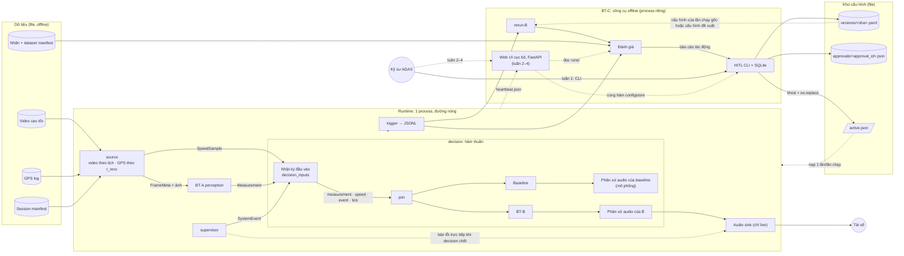

# RoadWatch Copilot: kiến trúc tổng thể và hợp đồng dữ liệu

> **[v1.3 đề xuất, chờ PO duyệt, 06/10/2026]** BT-A đo bằng camera tự hiệu chuẩn và model gr14VinAI (2, 3.1, 4.2, 4.5, 5.7, 6.1, 7.1, mục 12); hợp đồng `Measurement` 2.0.0. Các mục khác giữ nguyên bản v1.1.
>
> **[Ghi nhận 09/10/2026, PO chưa quyết]** `main` hiện chỉ có bản core demo, không có engine của mục 2–5. Các điểm khác và nơi chứa code engine: 12.4.
>
> **`docs/plan/` đã gỡ khỏi repo ngày 09/10/2026** (bảng task, checklist, sơ đồ phối hợp, biên bản duyệt v1.1) vì không còn khớp code. Các ID `WP-…` và chữ "plan" trong tài liệu này là tham chiếu lịch sử; nội dung cũ đọc bằng `git show de4611f:docs/plan/<file>`.
>
> **v1.1 được PO duyệt 29/09/2026.** v1.0 được PO duyệt 28/09/2026. Bản v1.1 bổ sung:
> - vai trò R-A…R-D (Quy ước);
> - phần bổ sung vào sơ đồ mục 2 (không đổi hành vi);
> - giao diện theo giai đoạn (ADR-13);
> - đối chiếu yêu cầu môn học (mục 11);
> - giả định đã chọn khi triển khai (mục 12);
> - guardrail Khẩn cấp khi đợt tiếp diễn (3.7, OQ-B12: phương án (b));
> - chạy thử cấu hình đề xuất để làm báo cáo tác động (3.10, OQ-B13).
>
> ADR-12 (không dùng LLM) do PO chốt ngày 29/09. Các quyết định khác của PO ngày 29/09: biên bản duyệt v1.1, mục 5 (`git show de4611f:docs/plan/review-v1.1.md`).
>
> Hợp đồng dữ liệu chốt v0.1 vào ngày 1 triển khai, đóng băng v1.0 cuối tuần 1 (4.6). Thay đổi sau khi duyệt phải ghi lại trong tài liệu này, kèm lý do.
>
> Tài liệu này hợp nhất phiên thiết kế ngày 28/09/2026. Mọi sửa đổi trong phiên đã được viết thẳng vào từng mục. Khi các mục khác nhau, mục này là nguồn đúng cho kiến trúc, còn ba file trong `docs/requirements/` là nguồn đúng cho bài toán và phạm vi.
>
> **Đầu vào:** `RoadWatch_Copilot_1_Tong_quan_du_an (1).md` (tổng quan, lộ trình mục 10), `RoadWatch_Copilot_2_Bai_toan_chinh (1).md` (ba bài toán), `RoadWatch_Copilot_3_Cau_hinh_lap_dat.md` (lắp đặt camera, ADR-04). File Word `tai_lieu_viet_bao_cao.docx` được sinh lại từ ba file này ngày 29/09/2026 (OQ-A6).

**Quy ước**
- **TBD** là tham số cấu hình, sẽ chốt bằng số đo hoặc thử nghiệm (mục 10).
- Mọi con số hiệu năng là giả định ban đầu, phải đo lại trên máy demo.
- Vai trò phụ trách. Việc gán vai trò cho từng người không ghi ở đây.
  - **R-A:** BT-A, gồm CV, khoảng cách và TTC.
  - **R-B:** BT-B, gồm luật và máy trạng thái cảnh báo, câu cảnh báo, phương pháp đánh giá hành vi cảnh báo.
  - **R-C:** BT-C, gồm cấu hình và HITL, runtime, log, `rerun-B`, CLI, CI.
  - **R-D:** dữ liệu thực địa, gán nhãn, vận hành đánh giá và tổng hợp báo cáo. Từ tuần 2, R-D làm thêm web UI.
  - **PO:** kiến trúc, `contracts`, tích hợp, deliverables.

  **Người phụ trách một thành phần chịu trách nhiệm phương pháp và tính đúng của số liệu thuộc thành phần đó.** R-D chỉ tổng hợp.

  Vai trò mô tả phần trách nhiệm. Một task cụ thể có thể giao cho người thuộc vai trò khác, ví dụ việc CI do người hỗ trợ backend làm. Owner của từng task do PO giao.
- Dự án kéo dài 4 tuần. **Hạn nộp MVP là cuối tuần 1**; tuần 2–4 là phần mở rộng (lộ trình: file 1, mục 10).

---

## 1. Mục tiêu và Non-goals

### 1.1 Mục tiêu

| Mã | Mục tiêu | Căn cứ |
|---|---|---|
| G1 | Cảnh báo khoảng cách/headway theo TT38 và cảnh báo va chạm theo TTC cho tài xế mới trên cao tốc, bằng câu tiếng Việt thu sẵn. Chỉ cảnh báo | P1, P2, P8 |
| G2 | Đo khoảng cách từ cản trước tới xe phía trước bằng một camera tự hiệu chuẩn; người dùng chỉ nhập khoảng cách camera–cản trước; công bố sai số theo dải | ADR-04 |
| G3 | Giảm số cảnh báo không khớp sự kiện so với baseline, trong khi recall toàn hệ thống không giảm | ADR-03; P6, P7 |
| G4 | Chạy offline 100% trên CPU laptop (ONNX Runtime FP32, chuẩn đo 4 thread). Throughput ≥ 10 Hz và P95 latency < 300 ms là **hai chỉ số đo riêng** | ADR-02, ADR-07; P10 |
| G5 | Tái lập được, trong phạm vi cam kết của từng chế độ chạy (5.4) | ADR-01 |
| G6 | An toàn: chỉ cảnh báo; fail-safe theo năng lực cảnh báo; mọi thay đổi cấu hình qua HITL, có phiên bản, quay lui được | ADR-05, ADR-10, ADR-11 |
| G7 | Bốn người làm song song trên cùng hợp đồng dữ liệu | ADR-08 |
| G8 | Đáp ứng 10 deliverables và 5 tiêu chí của môn học (mục 11) bằng chính BT-A/B/C, không thêm thành phần ngoài requirements | ADR-12, ADR-13 |

### 1.2 Non-goals

| Mã | Không làm |
|---|---|
| NG1 | Điều khiển xe (phanh, lái, ga); đọc dữ liệu xe qua CAN/OBD. Schema cấu hình không có trường nào để điều khiển |
| NG2 | Thiết bị đo phục vụ xử phạt |
| NG3 | Chứng nhận ISO 26262/ASIL |
| NG4 | Hồ sơ theo mẫu xe, màn hình chọn xe (ADR-04) |
| NG5 | Cloud, Internet, OTA |
| NG6 | Camera thật trong MVP. Nguồn vào là video phát lại như luồng camera |
| NG7 | Phần cứng edge thật; bắt buộc INT8 (INT8 là tùy chọn, thuộc MR-4) |
| NG8 | MR-1 lệch làn, MR-2 tổng kết chuyến, MR-3 biển tốc độ, MR-4 tối ưu INT8. Chỉ làm nếu còn thời gian |
| NG9 | PT-1 tốc độ thấp, PT-2 camera phụ, PT-3 biển báo theo bản đồ, PT-4 HUD/dashcam, PT-5 người thân, đội xe, Jetson |
| NG10 | Ùn tắc và dừng–đi ở tốc độ thấp: nằm **ngoài phạm vi hỗ trợ** của MVP (F17) |
| NG11 | Cam kết báo bằng âm thanh khi runtime hoặc audio lỗi (ADR-10) |
| NG12 | LLM hay agent sinh ngôn ngữ ở bất kỳ đâu trong sản phẩm. BT-B là luật và máy trạng thái viết bằng Python (ADR-12) |

**[v1.2] PO nêu ngày 02/10/2026:** phần mở rộng tuần 2–4 chuẩn bị thêm phát hiện người, cảnh báo va chạm với người hoặc xe trong vùng rủi ro, và cảnh báo lệch làn (MR-1). Tuần 1 chỉ làm hợp đồng dữ liệu và điểm nối (4.2); luật cảnh báo, ngưỡng và câu nói chưa được quyết (OQ-A13, OQ-A14). NG8 vẫn đúng với bản nộp MVP.

---

## 2. Kiến trúc: sơ đồ, thành phần, ranh giới



- Ở live, chỉ **một** bộ quyết định (mặc định là B) được nối ra loa. Bộ còn lại chạy shadow qua một bộ phân xử audio mô phỏng giống hệt.
- Tick do chính `decision` sinh ra theo đồng hồ phiên (3.3).
- So với bản v1.0, sơ đồ bổ sung các giao tiếp mà mục 3.3, 3.8 và 5.2 đã mô tả nhưng hình còn thiếu: nhật ký đầu vào, tick, `SystemEvent`, nhãn, và cấu hình đầu vào của `rerun-B`. Hành vi không đổi.
- Sơ đồ theo thread, hàng đợi, trình tự xử lý và ranh giới triển khai nằm ở [`docs/architecture_diagram.md`](../architecture_diagram.md). Đó là bản trực quan dẫn chiếu tới spec này; nếu hai nơi khác nhau thì spec thắng.

| Thành phần | Làm | Không làm |
|---|---|---|
| `contracts` | Model Pydantic, fixture, JSON Schema | Phụ thuộc thành phần khác |
| `source` | Phát video theo lịch `process_hz` (live theo PTS; replay không chờ). Phát GPS theo `t_recv`. Phát bản ghi giữ chỗ khi biết chắc không có khung | Xử lý ảnh |
| BT-A | Tự hiệu chuẩn camera, warp ảnh vào khung model, chạy gr14VinAI; xe dẫn đầu kèm bằng chứng đổi xe, khoảng cách, TTC, làn, `calibration`, `mount_check`, `observation` | Biết tốc độ hay ngưỡng; quyết định cảnh báo |
| `join` | Ghép số đo với tốc độ theo mốc cắt thông tin; tính độ mới tốc độ, headway, dải ngưỡng | I/O, đọc đồng hồ |
| BT-B | Năng lực cảnh báo, các đợt cảnh báo, điều phối, lời báo trạng thái | I/O, đọc đồng hồ, đọc file, nhận phản hồi từ sink |
| Baseline | Cảnh báo theo sườn lên (ADR-03), cùng đầu vào với B | Phát âm thanh thật |
| Phân xử audio | Một câu đang phát và một ô chờ (3.6) | Phát âm thanh thật |
| Audio sink | Phát WAV thu sẵn; bỏ lệnh đã quá hạn | Chọn nội dung câu nói |
| Supervisor | Theo dõi nhịp tim các thread, ghi `system_fault`, phát câu báo lỗi khi `decision` chết | Tự khởi động lại thread |
| BT-C | `rerun-B`, đánh giá, HITL CLI | Nằm trên đường nóng |
| Web UI (BT-C, tuần 2–4) | Màn hình kỹ sư và màn hình trạng thái cho tài xế (ADR-13, mục 11.5) | Chạy trong runtime; là điều kiện để runtime chạy; có đường HITL thứ hai khác CLI |

**Luật ranh giới**
1. `contracts` là gốc, không phụ thuộc thành phần nào.
2. A và B không import lẫn nhau.
3. `join`, B, baseline và bộ phân xử audio là hàm thuần. Cùng một code chạy trong runtime và trong `rerun-B`.
4. Runtime không phụ thuộc C, cũng không phụ thuộc SQLite. Runtime chỉ đọc `active.json`, `versions/`, `approvals/`.
5. Cấu hình vào runtime qua một cửa duy nhất: nạp một lần lúc bắt đầu, rồi đóng băng cho tới hết lần chạy.
6. Web UI chỉ đọc `runs/` và `heartbeat.json`. Mọi lệnh HITL của web UI gọi đúng các hàm `configstore` mà CLI dùng. Runtime không import web UI.

---

## 3. Mô hình chạy

### 3.1 Thread và tần số

| Thread | Việc | Tần số |
|---|---|---|
| `source.video` | Ở mỗi mốc lịch `s_n = n/process_hz`, lấy khung có PTS lớn nhất và ≤ `s_n`. Nếu biết chắc không có khung (decode lỗi, hết video, mất nguồn), phát bản ghi giữ chỗ | `process_hz` = 20 (tần số model gr14VinAI) |
| `source.gps` | Phát mẫu khi tới `t_recv` | Khoảng 1 Hz, cần đo |
| `perception` | Warp ảnh vào khung model, ONNX Runtime chạy gr14VinAI (`intra_op` = 4 là chuẩn đo, `inter_op` = 1) với hàng đợi trạng thái theo thời gian, hiệu chuẩn, các bước kiểm tra | Mỗi khung, ở `process_hz` = 20 (tần số model) |
| `decision` | `join`, B, baseline, các bộ phân xử audio | Mỗi khi có đầu vào hoặc tick |
| Audio sink | Phát WAV | Theo sự kiện |
| `logger` | Ghi JSONL | Liên tục |
| `supervisor` | Kiểm tra nhịp tim; ghi `heartbeat.json` | TBD |

### 3.2 Hàng đợi

Quy tắc chung: ở **live**, đường nóng không bao giờ bị chặn; khi đầy thì bỏ bớt và ghi lại. Ở **replay**, luôn chặn và không bao giờ bỏ.

| Hàng đợi | Sức chứa | Live, khi đầy | Replay |
|---|---|---|---|
| Khung | 1 | Bỏ khung cũ, ghi `frame_dropped` | Chặn |
| Số đo | Nhỏ (TBD) | Bỏ bản ghi cũ nhất, ghi `measurement_dropped` | Chặn |
| GPS | Nhỏ (TBD) | Bỏ mẫu cũ nhất, ghi `speed_dropped`; không chặn `source` | Chặn |
| Log | Lớn (TBD) | Tràn thì lần chạy bị đánh dấu không hợp lệ để đánh giá | Chặn |

### 3.3 Đồng hồ, nhật ký đầu vào, tick, độ mới

- **Đồng hồ phiên** tính từ PTS. Ở live: `t_now = t0 + (mono − mono_t0)`. B chỉ thấy đồng hồ phiên.
- **Ba mốc thời gian của GPS (ADR-06):**
  - `t_fix`: thời điểm máy thu GNSS đo.
  - `t_recv`: thời điểm mẫu có mặt trong hệ thống. Lấy từ log nếu có; nếu không thì bằng `t_fix + recv_delay_ms` (giả định, phải đo).
  - Độ lệch với video: `video_start_utc = creation_time_guess + gps_offset_ms`.
- **Nhật ký đầu vào** `decision_inputs.jsonl` ghi từng đầu vào mà `decision` *thực sự* xử lý, đúng thứ tự xử lý. Số đo bị bỏ không có trong nhật ký; chỉ xuất hiện trong `events.jsonl`.
  - Live: ghi theo thứ tự thực tế.
  - Replay: theo thứ tự chuẩn. Sắp theo thời gian; nếu trùng thì speed, rồi event, rồi tick, rồi measurement. Trước khi xử lý khung *k*, `decision` chờ nhận hết các mẫu có `t_recv ≤ t_k`.
  - `rerun-B`: đọc nhật ký như đã ghi, không sắp xếp lại.
- **Mốc cắt thông tin:** `join` chỉ dùng một mẫu tốc độ khi mẫu đó đứng trước số đo trong nhật ký **và** có `t_recv ≤ t_k`. Tuổi của tốc độ là `t_k − t_fix`.
- **Độ mới của tốc độ:**
  - `fresh`: tuổi ≤ `fresh_max_ms`.
  - `stale`: tuổi ≤ `lost_after_ms`.
  - `lost`: tuổi lớn hơn `lost_after_ms`.
  - **Mặc định của MVP là chỉ dùng mẫu `fresh`.** Với `stale`, khung đó không có ngưỡng và headway. Với `lost`, tắt `cap_distance`.
  - Việc có được dùng mẫu `stale` hay không, và giá trị các ngưỡng, sẽ chốt bằng thử nghiệm của ADR-06.
- **Hai mốc thời gian của một số đo:**
  - `t_k`: thời điểm đo. Với bản ghi giữ chỗ thì `t_k = s_n`. Mốc này dùng cho các luật mô tả thế giới (`T_confirm`, `T_clear`, xu hướng).
  - `t_consumed`: thời điểm xử lý. Ở replay, `t_consumed = t_k`.
  - `age = t_consumed − t_k`. Nếu `age > max_measurement_age`, số đo không hợp lệ với lý do `stale_measurement`.
- **Tick định kỳ:** mỗi `tick_period` theo đồng hồ phiên, dù có số đo hay không. Tick được ghi vào nhật ký kèm `tick_n`. Ở live, các tick bị trễ được phát lần lượt, không gộp. Mọi luật theo thời gian được xét ở mỗi tick và mỗi đầu vào: hết hạn, debounce, nhắc lại, `T_hold`.
- **Hết hạn:** khi `t − t_k(số đo cuối cùng) > max_measurement_gap`, tắt cả hai năng lực với lý do `measurement_gap`.

### 3.4 Năng lực cảnh báo và thông báo trạng thái (ADR-10)

- Hai năng lực **độc lập**: `cap_distance` và `cap_ttc`. Mỗi năng lực là `on` hoặc `off`, kèm `reasons` và `capability_epoch`.
- Năng lực chỉ đổi theo nguyên nhân mang tính hệ thống. Một khung đơn lẻ không hợp lệ chỉ có nghĩa là khung đó không sinh cảnh báo, và đợt cảnh báo có thể chuyển sang `HOLD`.

| Nguyên nhân | `cap_distance` | `cap_ttc` |
|---|---|---|
| `mount_check = suspect` hoặc `unknown` (đang hiệu chuẩn) | off | Không đổi: TTC gần như không phụ thuộc sai số tỉ lệ của hiệu chuẩn (4.2, OQ-A16) |
| Tốc độ `stale` | Không đổi. Khung đó không có ngưỡng và headway | Không đổi |
| Tốc độ `lost` | off | Không bị ảnh hưởng, vì TTC không dùng tốc độ. Cảnh báo vẫn chỉ phát khi đủ guardrail (3.7) |
| `observation` là `unavailable` hoặc `unreliable` | off | off |
| `measurement_gap`, `system_fault` | off | off |
| Tốc độ xử lý thực tế < `min_ttc_rate_hz` (live quá tải) | Không đổi | off |
| Không có xe dẫn đầu | Không phải suy giảm | Không phải suy giảm |

- **Chặn cảnh báo ngay, báo bằng lời sau:** dữ liệu không hợp lệ bị loại khỏi logic cảnh báo ngay ở khung đó. Chỉ riêng lời báo phải chờ debounce `T_notify`, trừ `system_fault` thì báo ngay.
- **Câu báo theo tổ hợp năng lực thực tế**, không theo nguyên nhân:

| `cap_distance` | `cap_ttc` | Câu báo |
|---|---|---|
| on | on | Im lặng |
| off | on | "Cảnh báo khoảng cách tạm tắt" |
| on | off | "Cảnh báo va chạm tạm tắt" |
| off | off | "Hệ thống cảnh báo tạm dừng" |

  Khi phục hồi thì báo một lần.
- **Nhắc lại** trong lúc còn suy giảm: `remind_interval` để `null` cho tới khi thử nghe (phần mở rộng). Lời báo mang epoch cũ bị huỷ, không phát dồn.
- **Đường thông báo:** câu báo đi theo đường B → bộ phân xử → audio sink. Riêng khi `decision` chết thì đi theo đường supervisor → audio sink. Nếu audio sink lỗi thì không còn âm thanh (3.8).

### 3.5 Các đợt cảnh báo

**Đợt khoảng cách** theo danh tính xe dẫn đầu (`lead.identity_id`), có cơ chế chống nhấp nháy của MVP:

| Từ | Điều kiện | Sang | Phát câu |
|---|---|---|---|
| `IDLE` | `d < ngưỡng`, dữ liệu `ok` | `PENDING` | — |
| `PENDING` | Giữ ≥ `T_confirm` (chỉ đếm thời gian có dữ liệu hợp lệ) | `ALERTED` | Cảnh báo |
| `PENDING` | `d ≥ ngưỡng` | `IDLE` | — |
| `ALERTED` | `d > ngưỡng + h` | `CLEARING` | — |
| `CLEARING` | `d < ngưỡng` | `ALERTED` | Không (vẫn là đợt cũ) |
| `CLEARING` | Giữ ≥ `T_clear` | `IDLE` | — |
| Bất kỳ, trừ `IDLE` | Dữ liệu của đợt không hợp lệ, thiếu, quá tuổi; ngưỡng không có (tốc độ `stale`); hoặc `cap_distance = off` | `HOLD` | — |
| Bất kỳ | Danh tính xe dẫn đầu đổi, không phải `likely_id_switch` | `IDLE` với xe mới | — |

**Đợt khẩn cấp** (TTC):

| Từ | Điều kiện | Sang | Phát câu |
|---|---|---|---|
| `IDLE` | Đủ 3 điều kiện guardrail (3.7) | `ACTIVE` | **Khẩn cấp, ngay tại khung đó** |
| `ACTIVE` | Điều kiện nguy hiểm không còn đúng | `CLEARING_E` | — |
| `CLEARING_E` | Điều kiện đúng lại trong `T_clear_e` | `ACTIVE` | Không (vẫn là đợt cũ) |
| `CLEARING_E` | Liên tục ≥ `T_clear_e` có `TTC > ngưỡng + h_ttc` | `IDLE` | — |
| Bất kỳ, trừ `IDLE` | Dữ liệu không hợp lệ, thiếu, quá tuổi, hoặc `cap_ttc = off` | `HOLD_E` | — |
| Bất kỳ | Danh tính xe đổi, không phải `likely_id_switch` | Xét xe mới từ `IDLE` | Khẩn cấp nếu đủ điều kiện |

**`HOLD` và `HOLD_E`: giữ đợt qua lần mất dữ liệu ngắn**
- Trong `HOLD`, chỉ **bộ nhớ của đợt** được giữ: mức đã báo, cooldown, danh tính xe. Không phát gì mới. Thời gian nằm trong `HOLD` không tính vào `T_confirm`. Với `T_clear` và `T_clear_e` thì ngược lại: xem luật "`HOLD` khi đợt đang rời" bên dưới.
- Nếu dữ liệu hợp lệ trở lại trong `T_hold` (có biên cứng) và **vẫn cùng danh tính xe**, điều kiện được **tính lại từ dữ liệu hiện tại**. Kết luận cũ không được khôi phục:

| Trạng thái trước `HOLD` | Dữ liệu lúc phục hồi | Sang |
|---|---|---|
| `PENDING` | `d < ngưỡng` | `PENDING`, tiếp tục đếm |
| `PENDING` | `d ≥ ngưỡng` | `IDLE` |
| `ALERTED` hoặc `CLEARING` | `d ≤ ngưỡng + h` | `ALERTED`, không nói lại |
| `ALERTED` hoặc `CLEARING` | `d > ngưỡng + h` | `CLEARING`. Trước `HOLD` là `ALERTED`: đếm từ lúc phục hồi. Trước `HOLD` là `CLEARING`: đếm tiếp từ mốc cũ |
| `ACTIVE` hoặc `CLEARING_E` | Đủ điều kiện guardrail | `ACTIVE`, không bíp lại |
| `ACTIVE` hoặc `CLEARING_E` | Không đủ điều kiện | `CLEARING_E`. Trước `HOLD` là `ACTIVE`: đếm từ lúc phục hồi. Trước `HOLD` là `CLEARING_E`: đếm tiếp từ mốc cũ |
| Bất kỳ | Danh tính xe khác, không phải `likely_id_switch` | Xét lại từ `IDLE` như một đợt mới |

- Hai chỗ "không phát" của đợt khẩn cấp (quay lại `ACTIVE` từ `CLEARING_E`, và phục hồi từ `HOLD_E`) có một ngoại lệ: nếu đợt chưa có lệnh Khẩn cấp nào `started` thì B phát lại theo guardrail ở 3.7 (OQ-B12, phương án (b)).
- Nếu quá `T_hold`: chuyển `SUSPENDED`, đóng đợt và ghi lý do. Khi dữ liệu trở lại: về `IDLE`, bắt đầu đợt mới.
- **`HOLD` khi đợt đang rời (OQ-A5, PO quyết 01/10).** Khoảng thời gian không có dữ liệu không được kéo dài sự im lặng.
  - Khi đợt đang `CLEARING` hoặc `CLEARING_E`, `HOLD` không xoá và không dừng mốc đếm.
  - Ở khung hợp lệ đầu tiên sau `HOLD`: nếu đã đủ `T_clear` (đợt khẩn cấp: `T_clear_e`) kể từ mốc đếm thì đợt đóng trước khi xét khung đó, và khung đó được xét từ `IDLE` như một đợt mới. Trace ghi lý do `cleared_in_hold`. Nếu chưa đủ thì dùng bảng trên.
- **Giới hạn gộp nhầm.** Nhờ luật trên, `HOLD` không kéo dài thời gian một nguy hiểm mới bị gộp vào đợt cũ.
  - Đợt khẩn cấp: sau `T_clear_e` kể từ khung đầu tiên cho thấy hết nguy hiểm, nguy hiểm mới là đợt mới. Đợt khoảng cách: sau `T_clear` kể từ khung đầu tiên có `d > ngưỡng + h`.
  - Ngoại lệ vẫn như khi không mất dữ liệu: trong thời gian đó có khung hợp lệ cho thấy nguy hiểm trở lại, hoặc số đo nằm trong vùng trễ.
  - Trước 01/10 không có giới hạn này: mỗi lần phục hồi đếm lại từ đầu, nên dữ liệu chập chờn giữ đợt mở mãi và nguy hiểm mới với cùng xe không được phát.

### 3.6 Phân xử audio

- **Hai lớp lệnh:**
  - Nguy hiểm: Khẩn cấp (ưu tiên 1), Cảnh báo (2), Thông tin (5).
  - Trạng thái: tạm dừng hệ thống (3), tắt một năng lực (4), phục hồi (6), nhắc lại (7).
- **Luật phân xử:**
  - Chỉ lệnh **lớp nguy hiểm** có ưu tiên **cao hơn** mới được ngắt câu đang phát. Lệnh lớp trạng thái không bao giờ ngắt.
  - Có một câu đang phát và một ô chờ. Ô chờ giữ lệnh có ưu tiên cao nhất; bằng nhau thì giữ lệnh mới hơn.
  - Khi `t ≥ until` (tính từ độ dài WAV), phát lệnh trong ô chờ nếu lệnh đó vẫn hợp lệ.
  - Lệnh nguy hiểm đang chờ bị huỷ khi năng lực tương ứng tắt, hoặc khi đợt rời `ALERTED`/`ACTIVE`. Lệnh trạng thái đang chờ bị huỷ khi epoch đổi. Lệnh chờ quá `max_cmd_age` bị huỷ.
- **Kết quả phân xử** ghi vào `AudioPlan`: `started`, `preempted`, `cancelled` hoặc `expired`. Tái lập được.
- **Audio sink** (chỉ live) có ba trạng thái `READY`, `PLAYING`, `FAULT`. Lệnh quá hạn theo đồng hồ monotonic bị bỏ và ghi `dropped_stale`; mỗi lần như vậy là một vi phạm latency. Sink **không** gửi phản hồi về B.

**[v1.2] Thứ tự ưu tiên đề xuất khi có cảnh báo cho Người và Làn** (R-C đề xuất ngày 02/10/2026; PO chưa quyết). Bảng hai lớp lệnh ở trên vẫn là luật có hiệu lực và code không đổi. Đề xuất chỉ nêu thứ tự, chưa đổi số ưu tiên:

| Thứ tự | Lệnh | Lớp | Lý do và điểm cần PO quyết |
|---|---|---|---|
| 1 | Khẩn cấp với xe dẫn đầu (TTC) | Nguy hiểm | Giữ nguyên, đứng riêng ở mức cao nhất: ngắt mọi câu khác và không câu nào ngắt nó. Guardrail 3.7 không đổi |
| 2 | Va chạm với người hoặc xe trong vùng rủi ro (mới) | Nguy hiểm | Ngay dưới Khẩn cấp: ngắt mọi câu trừ Khẩn cấp. Phương án khác: cùng mức với Khẩn cấp; khi đó theo luật phân xử hiện tại hai lệnh không ngắt nhau, nên lệnh đến sau phải chờ hết câu đang phát, kể cả khi lệnh đến sau là Khẩn cấp. OQ-A13 |
| 3 | Cảnh báo khoảng cách | Nguy hiểm | Giữ nguyên vị trí so với Khẩn cấp |
| 4 | Lệch làn (mới) | Nguy hiểm | Đặt dưới Cảnh báo khoảng cách vì dễ báo sai khi vạch mờ và khi không có tín hiệu xi-nhan (requirements file 1, mục 6.3). Phương án khác: đặt trên Cảnh báo khoảng cách, vì lệch làn cần sửa lái ngay. OQ-A14 |
| 5 đến 9 | Tạm dừng hệ thống, tắt một năng lực, Thông tin, phục hồi, nhắc lại | Như hiện tại | Giữ nguyên thứ tự tương đối. Lệnh lớp trạng thái vẫn không bao giờ ngắt |

### 3.7 Guardrail cảnh báo Khẩn cấp

**Quyết định có hiệu lực:** OQ-B12, phương án (b), PO chọn ngày 29/09/2026. Lịch sử lựa chọn ở biên bản duyệt v1.1, mục 5, quyết định 18 (`git show de4611f:docs/plan/review-v1.1.md`).

Một khung *k* đủ điều kiện Khẩn cấp khi có cả ba điều kiện:
1. `cap_ttc = on`.
2. TTC của xe dẫn đầu có `status = ok`.
3. `TTC ≤ ttc_emergency_s`, với ngưỡng nằm trong biên cứng `[min, max]`.

**B phải phát lệnh Khẩn cấp ngay tại khung *k* đủ điều kiện** nếu:
- khung đó bắt đầu một đợt mới; hoặc
- đợt chưa có lệnh Khẩn cấp nào `started`, và lệnh gần nhất đã bị `cancelled` hoặc `expired` (không còn lệnh nào của đợt đang chờ).

Trong các trường hợp còn lại, đợt đã có lệnh `started` hoặc đang chờ thì không phát lại. Không nhắc theo chu kỳ khi đợt kéo dài. Ân hạn, `T_confirm`, cooldown, chế độ người mới và debounce không được chặn hai trường hợp bắt buộc phát trên. `T_clear_e`, `h_ttc`, `T_hold` có biên cứng. Thiếu một trong ba điều kiện thì không phát: đây là fail-safe (ADR-10).

**Bất biến kiểm thử:** ở mỗi khung đủ ba điều kiện, B phát tại khung đó, hoặc đợt đã có lệnh Khẩn cấp `started` hay đang chờ. B đọc kết quả `AudioPlan` từ bộ phân xử là hàm thuần, nên `rerun-B` vẫn tái lập được. `started` ở đây là kế hoạch của bộ phân xử, không phải xác nhận từ loa. Audio sink không gửi phản hồi về B; `dropped_stale` ở live không làm B phát lại (3.6).

| Trường hợp | Định nghĩa |
|---|---|
| Bắt đầu đợt mới | `IDLE` → `ACTIVE`, kể cả sau `SUSPENDED`, hoặc khi danh tính xe đổi mà không phải `likely_id_switch` |
| Duy trì đợt | Đang `ACTIVE`, hoặc quay lại `ACTIVE` từ `CLEARING_E` trong `T_clear_e` |
| Phục hồi từ `HOLD_E` | Dữ liệu hợp lệ trở lại trong `T_hold`, cùng danh tính xe, đủ ba điều kiện |
| Phát lại | Thêm một lệnh Khẩn cấp trong cùng đợt theo luật ở trên |

**Kịch bản kiểm chứng (WP-B9):** mọi TTC và khoảng thời gian dưới đây là dữ liệu minh họa cho test.

| Mã | Đầu vào | Kết quả bắt buộc |
|---|---|---|
| S1 | `IDLE`; khung *k* có `cap_ttc = on`, TTC `ok` là 1,5 s, dưới ngưỡng | Phát ở *k* |
| S2 | Lệnh ở *k* đã `started`; 20 khung sau vẫn đủ điều kiện | Chỉ phát một lần, ở *k* |
| S3 | Lệnh đã `started`; TTC lên trên ngưỡng trong 300 ms, ngắn hơn `T_clear_e`, rồi xuống lại | Quay về `ACTIVE`, không phát lại |
| S4 | Lệnh đợt mới chờ sau câu Khẩn cấp của xe trước; `cap_ttc` tắt khiến lệnh bị `cancelled`; trong `T_hold`, cùng xe đủ lại điều kiện tại *m* | Phát lại ở *m* |
| S5 | Lệnh đã `started`; mất dữ liệu 400 ms; phục hồi trong `T_hold`, cùng xe, đủ điều kiện | Quay về `ACTIVE`, không phát lại |
| S6 | Xe 1 đang `ACTIVE`, lệnh đã `started`; đổi sang xe 2, không phải `likely_id_switch`, đủ điều kiện | Đợt mới, phát ngay |
| S7 | Lệnh đang chờ bị `expired` vì quá `max_cmd_age`; chưa lệnh nào của đợt `started`; khung *m* sau đó đủ điều kiện | Phát lại ở *m* |

Tình trạng triển khai và bằng chứng kiểm thử thuộc WP-B9; bảng này không khẳng định code đã đạt.

### 3.8 Supervisor và giới hạn cam kết

- Mỗi thread có `hang_timeout` riêng. Thread chết hoặc treo thì ghi `system_fault`.
- Khi `decision` chết, supervisor gửi câu báo lỗi thẳng tới audio sink.
- Không tự khởi động lại thread. `heartbeat.json` được cập nhật định kỳ.
- **Giới hạn cam kết:** hệ thống chỉ cam kết báo bằng âm thanh khi runtime và audio còn hoạt động. **MVP chưa có màn hình tài xế** (thuộc tuần 2). Vì vậy khi audio lỗi hoặc runtime sập, MVP chỉ còn dòng lỗi in ra terminal và log, không có kênh nào báo cho tài xế.

### 3.9 Ngân sách latency (giả định)

| Khâu | P95 giả định | Mốc đo (monotonic) |
|---|---|---|
| Chờ mốc lịch + decode | 15 ms | `t_arrive` → `t_decoded` |
| Hàng đợi khung | 20 ms | → `t_infer_start` |
| Tiền xử lý + ONNX Runtime | 80 ms | → `t_infer_end` |
| Giải mã đầu ra model, hiệu chuẩn, kiểm tra | 5 ms | → `t_measure_out` |
| Hàng đợi, `join`, B, phân xử | 5 ms | → `t_decision` |
| Đưa buffer cho audio + độ trễ đầu ra của thiết bị | 50 ms | → `t_audio_start` |
| **Tổng** | **~180 ms** | `L_alert` |

### 3.10 Kho cấu hình, kích hoạt, phê duyệt (ADR-11)

- **File cấu hình:**
  - `configs/versions/<sha256>.yaml`: bất biến.
  - `configs/approvals/<approval_id>.json`: bất biến. `approval_id` là sha256 của nội dung phê duyệt đã chuẩn hoá.
  - `configs/active.json`: `{config_sha256, approval_id, activation_id}`.
  - `configs/reports/<sha256>.json`: báo cáo tác động (D-12).
  - `configs/roles.json`: danh sách người duyệt (D-12).
  - File cấu hình đề xuất, là đầu vào của `hitl propose`, được commit ở `config/proposals/` để reviewer xem diff. `configs/` là kho của máy demo, không commit.
  - SQLite chỉ C dùng: đề xuất, phê duyệt, kích hoạt, audit.
- **Runtime khởi động:** kiểm tra hash của file phiên bản; file phê duyệt khớp `approval_id` và `config_sha256`; người đề xuất khác người duyệt. Thiếu bất kỳ điều nào thì từ chối khởi động.
- **Kích hoạt** `activate <approval_id>`, giữ **khoá độc quyền cấp hệ điều hành** `configs/.hitl.lock` suốt cả giao dịch. Khoá dùng `msvcrt.locking` hoặc `fcntl.flock`, tự nhả khi process chết.
  1. **T1** (SQLite `BEGIN IMMEDIATE`):
     - phục hồi bản `pending` cũ nếu có;
     - compare-and-swap: con trỏ phải đang trỏ `base_config_sha256` của báo cáo;
     - không còn `pending` nào khác;
     - commit code, hash bộ dev, model, ONNX Runtime và (nếu có kiểm tra live) dấu vân tay máy đều khớp hiện tại; working tree sạch;
     - ghi `pending`; COMMIT.
  2. **Điểm commit:** ghi file tạm, `fsync`, `os.replace` file `active.json`.
  3. **T2:** đánh dấu `committed`.
- **Phục hồi** (chỉ chạy khi đang giữ khoá): con trỏ đang trỏ bản mới thì `committed`; trỏ bản cũ thì `aborted`; không phải cả hai thì khoá mọi lệnh HITL và báo lỗi.
- **Cấu hình active đổi sau khi đã tạo báo cáo:** báo cáo coi là cũ, kích hoạt bị từ chối. Phải chạy `report --rebase` rồi duyệt lại, sinh `approval_id` mới.
- **Quay lui** `rollback <approval_id>`: dùng một phê duyệt cũ đã từng active; người có quyền duyệt thực hiện; không cần báo cáo mới; vẫn qua khoá và compare-and-swap. Nếu commit code khác lúc duyệt thì gắn cờ `unapproved_code`.
- **Báo cáo tác động theo `affects` của mục cấu hình bị đổi:**
  - `[B]`: chạy `rerun-B` trên bộ dev.
  - `[A]`: chạy `replay` A trên bộ dev, rồi chấm B.
  - `[A, live]`: như `[A]`, cộng một lần chạy live trên máy demo, gắn dấu vân tay máy.
- Công cụ **từ chối** dùng split `test_*` trong luồng HITL.
- Lần chạy đang diễn ra không bị ảnh hưởng vì cấu hình đã đóng băng.
- **Chạy thử cấu hình đề xuất (OQ-B13, PO duyệt 29/09).** Đường `[A]` và `[A, live]` cần chạy A với cấu hình **chưa duyệt**, trong khi runtime từ chối cấu hình chưa duyệt (F23). Cách làm:
  - **Lệnh.** `run replay --proposed <proposal_id>` trên bộ dev; `run live --proposed <proposal_id>` trên máy demo, chỉ cho đường `[A, live]`. CLI tra `proposal_id` trong SQLite ra `config_sha256`, rồi đưa runtime file `versions/<sha256>.yaml`. Runtime vẫn chỉ gọi hàm đọc, không đọc SQLite.
  - **Không kích hoạt.** Lệnh không ghi `active.json`, `approvals/` hay SQLite, không giữ khoá HITL, và không cần người duyệt. Ai có tên trong danh sách người dùng HITL cũng chạy được.
  - **Đánh dấu.** `run_manifest` có cờ `proposed_config`, cùng `proposal_id` và `config_sha256` của đề xuất; `approval_id` và `activation_id` là `null`.
  - **Giới hạn dùng:**
    - từ chối split `test_*`, như mọi lệnh của luồng HITL;
    - `hitl report` chỉ nhận lần chạy thử có đúng `proposal_id` và `config_sha256` của đề xuất đang làm báo cáo. Lần chạy live phải có dấu vân tay máy, và dấu này đi vào phê duyệt;
    - không bao giờ là bằng chứng nghiệm thu; không vào `eval/test_runs.jsonl` hay các chỉ số của báo cáo đánh giá;
    - chạy thường, không có `--proposed`, vẫn từ chối cấu hình chưa duyệt (F23).
  - **Hợp đồng.** Thêm `proposal_id` (MINOR, mặc định `null`) và cờ `proposed_config` vào `run_manifest` (4.4).

---

## 4. Hợp đồng dữ liệu và schema

**Trạng thái:** ngữ nghĩa thiết kế thuộc spec v1.1 đã duyệt. Từ 01/10/2026, code `contracts` mang phiên bản 1.0.0 (WP-P4); từ 02/10/2026 là 1.1.0, thêm hai trường tuỳ chọn cho tuần 2–4 (WP-C11, mục 4.2). Việc đóng băng chỉ hoàn tất khi hai reviewer của WP-P4 xác nhận và có thẻ git `contracts-v1.0`. **[v1.3 đề xuất]** `Measurement` nâng lên 2.0.0 (4.2); chưa có code Pydantic cho bản này (D-10). Không dùng trạng thái duyệt tài liệu để suy ra code đã khớp hay đã nghiệm thu.

**Cách đọc cho agent:**
- Mục 4.0–4.6 quy định ngữ nghĩa và bất biến cần đạt.
- JSON Schema sẽ sinh từ model Pydantic khi có code `contracts` 2.0.0 (D-10); tới lúc đó bảng ở mục 4 là nguồn duy nhất.
- `required` nói trường phải có; nhánh `type: "null"` nói trường được nhận `null`. Hai điều này độc lập. `default` chỉ là mặc định của model, không phải số đo.
- JSON Schema không xuất đầy đủ `model_validator`, kiểm tra liên luồng hay luật thời gian. Vẫn phải đọc mục 4.6 và chạy test hợp đồng.
- Chỗ code lệch thiết kế nằm ở mục 12.3; không tự sửa thiết kế theo JSON Schema.

### 4.0 Kiểu dữ liệu dùng chung

- **Phần đầu của mọi bản ghi luồng:** `schema`, `schema_version` (SemVer), `run_id`, `seq`, `t_ns`, `clock = "session"`.
  - `seq` bắt đầu từ 0, tăng đúng 1 trong một luồng của một lần chạy. Có khoảng trống nghĩa là mất bản ghi.
  - `t_ns` là thời gian phiên. Mỗi schema định nghĩa rõ `t_ns` là mốc gì.
  - Các mốc khác ghi rõ đồng hồ trong tên trường: `_mono_ns` chỉ có ở live (là `null` ở replay), `_utc_ns`.
- **Kiểu `Q` cho đại lượng đo:** `{value, status, sigma, reasons[]}`, với `status` ∈ `ok`, `not_applicable`, `unavailable`, `unreliable`. Đơn vị nằm trong tên trường.
  - `ok` thì phải có `value`. `not_applicable` và `unavailable` thì `value = null`.
  - Khác `ok` thì `reasons` không được rỗng.
  - `sigma` ≥ 0 hoặc `null`. Chưa có phương pháp thì để `null`.
  - Cấm NaN và ±∞ (`allow_inf_nan=False`). Cấm dùng 0 thay cho dữ liệu thiếu.
- `reasons[]` và `why[]` là tập mở: thêm mã là MINOR. Mọi enum khác là tập đóng: thêm giá trị là MAJOR.
- **Trường lạ:** bên ghi dùng `extra = forbid`. Bên đọc bỏ qua trường lạ và ghi log một lần nếu cùng MAJOR; khác MAJOR thì từ chối.

### 4.1 Hợp đồng 1: Input → A và `join`

**`FrameMeta`** (`frames.jsonl`; `t_ns = t_k`, hoặc `s_n` nếu là bản ghi giữ chỗ)

| Trường | Kiểu |
|---|---|
| `sched_n` | int, luôn có |
| `status`, `reasons` | `ok` hoặc `unavailable` (bản ghi giữ chỗ) |
| `frame_idx`, `pts_ns` | int; `null` khi `status = unavailable` |
| `t_arrive_mono_ns` | int hoặc `null` (chỉ live) |
| `video_sha256` | str |

**`SpeedSample`** (`speed.jsonl`; `t_ns = t_recv`): `gps_idx`, `t_fix_ns`, `t_recv_ns`, `t_recv_basis` (`logged`/`modeled`), `speed_mps: Q`, `source` (`gps`/`simulated`), `session_id`.

### 4.2 Hợp đồng 2: A → B

**[v1.3 đề xuất, chờ PO duyệt] `Measurement` 2.0.0** (`measurements.jsonl`): mỗi `FrameMeta` có đúng một bản ghi, kể cả bản ghi giữ chỗ; `t_ns = t_k`. Nguồn số đo là A (2.1): camera tự hiệu chuẩn, ảnh được warp vào khung ảnh của model gr14VinAI, rồi lấy xe dẫn đầu, làn và chuyển động của xe từ đầu ra của model.

**Trường**

| Trường | Kiểu | Bắt buộc | `null` | Đơn vị | Ràng buộc và nguồn |
|---|---|---|---|---|---|
| Phần đầu chung (4.0) | | Có | Không | | `schema = "rw.measurement"`, `schema_version = "2.0.0"` |
| `sched_n`, `frame_idx` | int | Có | `frame_idx` khi giữ chỗ | | |
| `observation` | `{status, reasons}` | Có | Không | | `ok`, `unavailable` (giữ chỗ), `unreliable` (bảng `observation`) |
| `mount_check` | `{state, since_t_ns, deviation_mrad: Q}` | Có | Không | | Bảng `calibration` |
| `calibration` | object `Calibration` | Có | Không | | Bảng dưới |
| `lead.status` | `ok`, `not_applicable`, `unavailable`, `unreliable` | Có | Không | | Bảng `lead` |
| `lead.identity_id`, `track_id` | int | Có | Có | | `track_id = identity_id`. Có giá trị khi và chỉ khi `lead.status = ok` |
| `lead.since_t_ns` | int | Có | Có | ns, phiên | Mốc identity hiện tại bắt đầu |
| `lead.basis` | `model` | Có | Có | | Luôn `model` khi `lead.status = ok` |
| `lead.bbox_px` | 4 number | Có | Có | px | `[x1, y1, x2, y2]`, hộp **chiếu ước lượng** từ vị trí xe dẫn đầu; `null` nếu điểm chiếu nằm ngoài ảnh. Chỉ dùng để khớp nhãn (5.2), không dùng để quyết định |
| `lead.det_score` | number [0, 1] | Có | Có | | Xác suất có xe dẫn đầu của model, không phải độ tin cậy của khoảng cách |
| `lead.change` | `LeadChange` | Có | Có | | Bảng `lead` |
| `lead.lateral_offset_m` | `Q` | Có | Không | m | Dương sang phải; `sigma` từ std của model |
| `lead.speed_mps` | `Q` | Có | Không | m/s | Tốc độ tuyệt đối của xe dẫn đầu |
| `lead.accel_mps2` | `Q` | Có | Không | m/s² | Âm là giảm tốc |
| `distance_m` | `Q` | Có | Không | m | Từ cản trước: khoảng cách từ camera trừ `d_cam_bumper_m`; `sigma` từ std của model |
| `ttc_s` | `Q` | Có | Không | s | Bảng `ttc_s` |
| `ego_motion` | `{speed_mps: Q, yaw_rate_rps: Q}` | Không (MINOR) | Có | | Ước lượng từ ảnh. **Không thay GPS** trong `join` |
| `lane` | `LaneState` | Không (MINOR) | Có | | Bảng `lane` |
| `risk_objects` | `null` | Không (MINOR) | Có | | Dành chỗ cho đối tượng khác xe dẫn đầu; A chưa có nguồn nên luôn `null` (OQ-A13) |

**`Calibration`**

| Trường | Kiểu | Ràng buộc |
|---|---|---|
| `status` | `bootstrapping`, `calibrating`, `calibrated`, `recalibrating` | Bảng `calibration` |
| `valid_blocks` | int ≥ 0 | Số block hiệu chuẩn đã hoàn tất; cần 5 |
| `fy_px` | number > 0 | Tiêu cự đang dùng để warp |
| `fy_source` | `device`, `learned`, `assumed` | `device`: đọc từ thiết bị; `learned`: học bằng model; `assumed`: chưa học xong |
| `pitch_rad`, `yaw_rad` | number | Góc đang dùng để warp; roll = 0 |
| `height_m` | `Q` | Chiều cao camera so với mặt đường, do model ước lượng |
| `coverage` | number [0, 1] | Tỉ lệ khung ảnh của model lấy từ ảnh thật |
| `resets` | int ≥ 0 | Số lần phát hiện camera bị lắp lại |
| `warp_version` | int ≥ 0 | Tăng mỗi lần dựng lại phép warp |
| `d_cam_bumper_m` | number ≥ 0 | Tham số duy nhất do người dùng nhập; ghi lại để tái lập |

**Bảng `observation`**

| Điều kiện | `status` | `reasons` |
|---|---|---|
| Không có khung | `unavailable` | `placeholder` |
| `calibration.coverage < 0,95` | `unreliable` | `low_fov_coverage` |
| Ảnh hỏng (tối, lóa, bị che) | `unreliable` | lý do tương ứng |
| Còn lại | `ok` | `[]` |

**Bảng `calibration`**

| `calibration.status` | Khi nào | `mount_check.state` |
|---|---|---|
| `bootstrapping` | Đang học `fy` (`fy_source = assumed`) | `unknown` |
| `calibrating` | Có `fy`, `valid_blocks < 5` | `unknown` |
| `calibrated` | `valid_blocks ≥ 5` | `ok` |
| `recalibrating` | Vừa phát hiện camera bị lắp lại | `suspect` |

- **Học `fy`:** quét `fy`, giữ giá trị mà model tự tin nhất (std của `pose` và `road_transform` nhỏ nhất); cần khoảng 10 s xe chạy. Thiết bị báo được tiêu cự thì dùng giá trị đó (`fy_source = device`).
- **Pitch, yaw:** từ hướng chuyển động mà model ước lượng, gom theo block 100 khung khi xe chạy nhanh hơn 15 mph, gần như thẳng, và model đủ chắc. Phép warp dựng lại khi góc đổi quá 2 mrad.
- **Lắp lại camera:** độ dao động giữa các block vượt 2° (yaw) hoặc 4° (pitch), hoặc 2 block liên tiếp lệch quá 10 mrad so với góc đang dùng. Khi đó xoá các block cũ và hiệu chuẩn lại.
- `mount_check.deviation_mrad` là độ lệch lớn nhất giữa block mới nhất và góc đang dùng; trước block đầu tiên là `unavailable`, `reasons = [no_block_yet]`. `since_t_ns` là mốc `state` bắt đầu.

**Bảng `lead`**

| Điều kiện | `lead.status` | `distance_m` | `ttc_s` |
|---|---|---|---|
| `observation ≠ ok` | `unavailable` | `unavailable` | `unavailable` |
| `det_score < 0,5` | `not_applicable` | `not_applicable` | `not_applicable` |
| `det_score ≥ 0,5`, `mount_check = ok` | `ok` | `ok` | bảng `ttc_s` |
| `det_score ≥ 0,5`, `mount_check ≠ ok` | `ok` | `unreliable`, `calibration_not_converged` | bảng `ttc_s` |

- **Identity:** `identity_id` tăng khi giữa hai khung liên tiếp có `lead.status = ok`, khoảng cách đổi quá `max(5 m, 3·sigma)`, hoặc độ lệch ngang đổi quá 1,5 m, hoặc có quãng `lead.status ≠ ok` dài hơn 1 s. Ngưỡng là giá trị tạm, đo lại trên `dev`.
- **`lead.change.reason`** khi `identity_id` tăng: `entered_from_left` hoặc `entered_from_right` khi xe mới xuất hiện lệch quá 1,0 m về phía tương ứng và đang tiến vào giữa; `previous_lead_left` khi xe cũ lệch ngang dần ra trước khi mất; `appeared_ahead` khi xe mới xa hơn xe cũ; còn lại `unknown`. `evidence = {observed_frames_before, crossed_boundary, lane_ref = "model_lane_lines", status}` (MINOR).

**Bảng `ttc_s`**

- `closing = ego_motion.speed_mps − lead.speed_mps`. Dùng tốc độ ước lượng từ ảnh để TTC không phụ thuộc GPS, giữ `cap_ttc` độc lập (3.4).
- `closing ≤ 0,5 m/s`: `not_applicable`, `reasons = [not_closing]`.
- Còn lại: `value = distance_m / closing`, `status = ok`, **kể cả khi `mount_check ≠ ok`**. Khi tiêu cự sai một tỉ lệ thì khoảng cách và tốc độ ước lượng đều lệch xấp xỉ cùng tỉ lệ đó, nên tỉ số gần như không đổi. Phải kiểm chứng trước khi duyệt (5.7, OQ-A16).
- `sigma` lan truyền từ std của model.

**Bảng `lane`** (lấy tại điểm ngang camera)

| Trường | Luật |
|---|---|
| `status` | `ok` khi ít nhất một vạch có xác suất ≥ 0,5; khác `ok` thì `reasons` không rỗng |
| `t_ns` | Bằng `t_ns` của bản ghi (model chạy mỗi khung) |
| `left_m`, `right_m` | Khoảng cách ngang từ trục camera tới vạch trái, vạch phải của làn đang đi; vạch có xác suất < 0,5 là `unavailable`, không ghi 0. Trục camera có thể lệch trục xe: khi `ok`, `reasons = [camera_axis]` |

**Bảng giá trị `null`:**

| Trường hợp | `frame_idx` | `observation` | Các trường định danh `lead.*` | `distance_m`, `ttc_s` |
|---|---|---|---|---|
| Có khung, có xe | có | `ok` | có | Theo bảng `lead` |
| Có khung, không có xe | có | `ok` | `null` | `not_applicable` |
| Bản ghi giữ chỗ | `null` | `unavailable` | `null` | `unavailable` |
| Ảnh hỏng hoặc độ phủ thấp | có | `unreliable` | `null` | `unavailable` |

**Điều B cần biết**
1. B đọc `distance_m`, `ttc_s`, `lead.status`, `lead.change`, `mount_check` theo đúng luật 3.4–3.7; không đổi luật quyết định.
2. Bảng pháp lý dùng tốc độ GPS (`SpeedSample`). `ego_motion.speed_mps` chỉ dùng trong A để tính TTC; dùng nó làm dự phòng khi mất GPS là đổi luật năng lực (OQ-A17).
3. `sigma`, `lead.accel_mps2` và `lane` là thông tin B chưa dùng; luật dùng chúng do PO quyết.

**Ví dụ: khung đã hiệu chuẩn, có xe dẫn đầu**

```json
{
  "schema": "rw.measurement", "schema_version": "2.0.0", "run_id": "r-20261006-01",
  "seq": 1000, "t_ns": 50000000000, "clock": "session",
  "sched_n": 1000, "frame_idx": 1000,
  "observation": {"status": "ok", "reasons": []},
  "mount_check": {"state": "ok", "since_t_ns": 29900000000,
                  "deviation_mrad": {"value": 1.4, "status": "ok", "sigma": null, "reasons": []}},
  "calibration": {"status": "calibrated", "valid_blocks": 7, "fy_px": 931.2, "fy_source": "learned",
                  "pitch_rad": 0.0334, "yaw_rad": 0.0298,
                  "height_m": {"value": 1.21, "status": "ok", "sigma": 0.004, "reasons": []},
                  "coverage": 1.0, "resets": 0, "warp_version": 6, "d_cam_bumper_m": 1.5},
  "lead": {"status": "ok", "identity_id": 4, "track_id": 4, "since_t_ns": 44200000000, "basis": "model",
           "bbox_px": [560.0, 402.0, 604.0, 438.0], "det_score": 0.99,
           "change": {"reason": "appeared_ahead", "t_ns": 44200000000,
                      "evidence": {"observed_frames_before": 0, "crossed_boundary": false,
                                   "lane_ref": "model_lane_lines", "status": "ok"}},
           "lateral_offset_m": {"value": -0.06, "status": "ok", "sigma": 0.3, "reasons": []},
           "speed_mps": {"value": 28.4, "status": "ok", "sigma": 0.9, "reasons": []},
           "accel_mps2": {"value": -0.4, "status": "ok", "sigma": 0.6, "reasons": []}},
  "distance_m": {"value": 54.1, "status": "ok", "sigma": 3.2, "reasons": []},
  "ttc_s": {"value": 9.8, "status": "ok", "sigma": 2.1, "reasons": []},
  "ego_motion": {"speed_mps": {"value": 33.9, "status": "ok", "sigma": 0.3, "reasons": []},
                 "yaw_rate_rps": {"value": 0.001, "status": "ok", "sigma": 0.002, "reasons": []}},
  "lane": {"status": "ok", "reasons": [], "t_ns": 50000000000,
           "left_m": {"value": 1.7, "status": "ok", "sigma": 0.1, "reasons": ["camera_axis"]},
           "right_m": {"value": 1.9, "status": "ok", "sigma": 0.1, "reasons": ["camera_axis"]}},
  "risk_objects": null
}
```

**Ví dụ: đang học `fy`, có xe dẫn đầu** (chỉ các trường khác ví dụ trên)

```json
{
  "mount_check": {"state": "unknown", "since_t_ns": 0,
                  "deviation_mrad": {"value": null, "status": "unavailable", "sigma": null, "reasons": ["no_block_yet"]}},
  "calibration": {"status": "bootstrapping", "valid_blocks": 0, "fy_px": 931.2, "fy_source": "assumed",
                  "pitch_rad": 0.0, "yaw_rad": 0.0,
                  "height_m": {"value": 1.25, "status": "unreliable", "sigma": 0.02, "reasons": ["calibration_not_converged"]},
                  "coverage": 1.0, "resets": 0, "warp_version": 0, "d_cam_bumper_m": 1.5},
  "distance_m": {"value": 41.0, "status": "unreliable", "sigma": 4.0, "reasons": ["calibration_not_converged"]},
  "ttc_s": {"value": 2.9, "status": "ok", "sigma": 0.6, "reasons": []}
}
```

### 4.3 Hợp đồng 3: B → Output

| Bản ghi | Trường chính |
|---|---|
| `AlertDecision` (`alerts.jsonl`) | `alert_id`, `arbiter` (B/baseline), `class` (`hazard`/`status`), `kind`, `phrase_id`, `episode_id`, `trigger = {source: frame \| tick \| event, input_seq}`, `t_trigger_ns` (theo nguồn kích hoạt), `t_decided_ns` (= `t_consumed`), `capability_epoch`, `expires_t_ns`. Mức ưu tiên suy ra từ `kind` |
| `AudioPlan` (`audio_plan.jsonl`) | `alert_id`, `arbiter`, `outcome` (`started`, `preempted`, `cancelled`, `expired`), `t_ns`, `preempted_by`, `reasons` |
| `AudioEvent` (`audio_events.jsonl`, chỉ live) | `alert_id`, `outcome` (`started`, `dropped_stale`, `fault`), `t_mono_ns`, `output_latency_ms: Q` |

**Chi tiết `AlertDecision` trên JSON** (ngoài phần đầu chung ở 4.0):

| Trường | Kiểu/literal | Bắt buộc | Cho phép `null` | Đơn vị | Ràng buộc |
|---|---|---|---|---|---|
| `alert_id` | string | Có | Không | — | Định danh lệnh |
| `arbiter` | `B`, `baseline` | Có | Không | — | Bộ quyết định |
| `class` | `hazard`, `status` | Có | Không | — | Tên trên JSON là `class`, thuộc tính Python là `cls` |
| `kind` | `emergency`, `warning`, `info`, `system_off`, `cap_distance_off`, `cap_ttc_off`, `recovery`, `reminder` | Có | Không | — | Mức ưu tiên theo 3.6 |
| `phrase_id` | string | Có | Không | — | Câu trong thư viện audio của cấu hình |
| `episode_id` | string | Có | Có | — | `null` với lệnh không thuộc đợt nguy hiểm |
| `trigger.source` | `frame`, `tick`, `event` | Có | Không | — | Nguồn kích hoạt |
| `trigger.input_seq` | integer | Có | Không | — | ≥ 0; tham chiếu nhật ký đầu vào |
| `t_trigger_ns` | integer | Có | Không | ns, phiên | Mốc nguồn kích hoạt |
| `t_decided_ns` | integer | Có | Không | ns, phiên | Bằng `t_consumed` |
| `capability_epoch` | integer | Có | Không | — | ≥ 0 |
| `expires_t_ns` | integer | Có | Không | ns, phiên | Hạn hiệu lực |

`trace_ref` là cặp suy ra từ `(trigger.input_seq, arbiter)`, **không phải trường JSON riêng** (D-3). Kiểm liên luồng phải xác nhận trace tương ứng tồn tại đúng một lần.

`L_alert` = `AudioEvent.t_mono_ns` (started) trừ `FrameMeta.t_arrive_mono_ns` của khung kích hoạt. Chỉ tính cho cảnh báo nguy hiểm có `trigger.source = frame`.

### 4.4 Hợp đồng 4: A, B → C

| File | Nội dung |
|---|---|
| `decision_inputs.jsonl` | `seq` (= `input_seq`), `kind` (`measurement`, `speed`, `event`, `tick`), `ref = {stream, seq}` (`null` với tick), `tick_n` (chỉ tick), `t_ns`, `t_consumed_ns` |
| `decisions.jsonl` (`DecisionTrace`) | Đúng một dòng cho mỗi cặp (`input_seq`, `arbiter`): năng lực và epoch; trạng thái các đợt, kể cả `HOLD`; `speed_used = {gps_idx, age_ms, status: fresh \| stale \| lost}`; `headway_s: Q`; `threshold_m: Q`; `why[]`; `measurement_age_ms` |
| `events.jsonl` | `SystemEvent.kind` (tập đóng): `run_start`, `run_stop`, `config_loaded`, `frame_dropped`, `measurement_dropped`, `speed_dropped`, `system_fault`, `mount_rechecked`, `capability_changed`, `audio_fault`, `log_overflow` |
| `perf.jsonl` (chỉ live) | Các mốc monotonic của từng khâu (3.9) |
| `run_manifest.json` | `run_id`, `mode` (`live`, `replay`, `rerun-B`), `created_utc`; `inputs` (hash các đầu vào); `session_id`; `config_sha256`, `approval_id`, `activation_id`; `code_commit` và `code_dirty`; `model_sha256`; phiên bản ONNX Runtime, Python, hệ điều hành; CPU và số thread; dấu vân tay máy; `process_hz`; `driver_mode`; `active_arbiter` (bộ quyết định điều khiển loa ở live); `contracts_version`; `source_run_id` (chỉ `rerun-B`). Các cờ trong `flags[]`: `unapproved_code`, `log_incomplete`, `dirty_tree`, `proposed_config`, `measurements_input` (đầu vào là `measurements.jsonl` do A giao, 5.3), `simulated_audio` (sink giả lập: `audio_events` không phải âm thanh đã phát). `proposal_id` chỉ có ở lần chạy thử cấu hình đề xuất; khi đó `approval_id` và `activation_id` là `null` (3.10, OQ-B13) |
| `heartbeat.json` | `t_mono_ns`, trạng thái các thread, cặp năng lực |
| `run_stats.json` (replay, live; PO chốt 30/09) | Tóm tắt đếm lại từ các luồng đã ghi, sau khi chạy xong: `run_id`, `duration_s` (mốc `run_stop`); `frames`: `read`, `processed`, `dropped` (sự kiện `frame_dropped`), `drop_ratio`; `streams`: `measurements_count`, `measurements_dropped`, `speed_samples_count`, `speed_dropped`; `decision`: `ticks_count`, `alerts_total`, `alerts_by_kind` (của arbiter điều khiển loa, đủ mọi `kind`); `audio`: `commands_issued` (`audio_plan` `started`), `played_successfully`, `dropped_stale` (chỉ `live` có loa thật; replay và `live` với sink giả lập ghi `null`, không ghi 0). `frames.read` là `null` khi lần chạy không có log khung (5.3). Không phải bản ghi luồng, không có schema riêng |

**Session manifest** (thuộc bộ dữ liệu):
- `session_id`.
- File video và GPS, kèm hash: `video_file`, `video_sha256`, `gps_file`, `gps_sha256` (hai trường GPS là `null` khi phiên không có GPS).
- `video_start_utc_guess_ns`, `gps_offset_ms`.
- `gps_offset_uncertainty_ms`: `null` cho tới khi đo được.
- `sync_method`; `recv_time_basis` (`logged` hoặc `modeled`); `recv_delay_ms` (`null` khi không dùng).
- `speed_source`: `gps` hoặc `simulated`.
- `car_model_note`: chỉ là ghi chú, không vào phép tính.
- `split`: `dev`, `test_small` hoặc `test_final`.

### 4.5 Hợp đồng 5: C → A, B

| Mục `rw.config` | `affects` | Nội dung |
|---|---|---|
| `mount` | `[A]` | `d_cam_bumper_m` (tham số duy nhất người dùng nhập); `fy_px` tuỳ chọn khi thiết bị báo được tiêu cự |
| `calibration` | `[A]` | Lưới quét `fy`, số khung học `fy`, ngưỡng dựng lại warp, ngưỡng phát hiện lắp lại, ngưỡng độ phủ |
| `model` | `[A, live]` | `model_path`, `model_sha256` của gr14VinAI; ngưỡng xác suất xe dẫn đầu và vạch làn; ngưỡng đổi identity |
| `runtime` | `[A, live]` | `process_hz`, `tick_period`, kích thước hàng đợi, `hang_timeout`, `max_measurement_gap`, `max_measurement_age` |
| `legal_table` | `[B]` | Các dải ngưỡng; bắt buộc có `legal_ref` |
| `ttc` | `[B]` | `ttc_emergency_s`, `T_clear_e`, `h_ttc` (có biên cứng); `min_ttc_rate_hz` |
| `dispatch` | `[B]` | `T_confirm`, `h`, `T_clear`, cooldown, `T_hold` (có biên cứng), biên an toàn ≥ 0 |
| `speed` | `[B]` | `fresh_max_ms`, `lost_after_ms`, chính sách xử lý `stale` |
| `status_msgs` | `[B]` | `T_notify`, `remind_interval` (`null`) |
| `audio` | `[B]` | `max_cmd_age`; `phrase_dir`; `phrases` (độ dài từng câu, ms); `phrases_sha256`: hash thư viện câu nói, `null` là chưa ghim. Khi có giá trị, live từ chối khởi động nếu thư viện có hash khác |
| `provisional_keys` (cấp gốc) | — | Danh sách `mục.trường` của mọi giá trị còn là giả định (OQ-B2). Validator từ chối khoá không trỏ tới trường có thật. Thay đổi chỉ đụng danh sách này đi đường báo cáo `[B]`. |

- **Phê duyệt** `approvals/<approval_id>.json` gồm: `config_sha256`, `proposer`, `approver`, `approved_at`, `report_sha256`, `base_config_sha256`, `dataset_manifest_sha256`, `code_commit`, `model_sha256`, `ort_version`, và `machine_fingerprint` (khi có kiểm tra live).
- **Validator cấu hình chặn:** giá trị nằm ngoài biên cứng, ngưỡng thấp hơn bảng pháp lý, thiếu `legal_ref`. Schema không có trường điều khiển xe.

### 4.6 Phiên bản, fixture, validation

- Đổi ngữ nghĩa là MAJOR, kể cả khi tên và kiểu dữ liệu giữ nguyên. Thêm trường tuỳ chọn là MINOR, và giá trị mặc định phải là `null`. Chỉ sửa mô tả là PATCH. Ý nghĩa của trường viết ở `Field(description=…)`.
- **Mốc chốt:** v0.1 vào ngày 1 của giai đoạn triển khai, v1.0 đóng băng cuối tuần 1. Cả hai chỉ diễn ra sau khi thiết kế được duyệt.
- **Một số phiên bản:** `CONTRACTS_VERSION` trong `contracts/base.py` là `schema_version` của mọi bản ghi luồng và là `contracts_version` của `run_manifest`. Code mang 1.0.0 từ 01/10/2026 (WP-P4): PO quyết nâng trước khi có lần chạy thật, vì bên đọc từ chối bản ghi khác MAJOR, nên lần chạy ghi ở 0.x sẽ không đọc lại được.
- **1.1.0 (02/10/2026, WP-C11):** thêm `Measurement.risk_objects` và `Measurement.lane` (MINOR, mục 4.2). Bản ghi viết ở 1.0.0 vẫn đọc được và giữ nguyên nghĩa; lần chạy ghi lại số đo với phiên bản của chính nó. Chưa review, chưa gắn thẻ; gắn thẻ ở phiên bản nào là việc PO quyết (OQ-A15).
- **Hai loại fixture:**
  - *Sai hợp đồng, phải bị từ chối:* `status = ok` mà `value = null`; NaN; sai MAJOR; bên ghi có trường thừa; `t_ns` đi lùi; `seq` có khoảng trống; `lead.status = not_applicable` khi `observation ≠ ok`; `AudioPlan` trỏ tới `alert_id` không tồn tại; thiếu hoặc trùng `DecisionTrace`.
  - *Hợp lệ nhưng mô tả tình huống lỗi:* các kịch bản ở mục 6.
- **Phạm vi validation:** chỉ xác nhận hình dạng và bất biến của hợp đồng. Validation **không** xác nhận độ hợp lý hay độ chính xác của phép đo.

---

## 5. Record/replay và so sánh với baseline

### 5.1 Luồng dữ liệu và chia bộ

Phiên quay → session manifest → nhãn (gán mù, đóng băng theo phiên bản) → dataset manifest.
- Chia theo **phiên quay**: `dev`, `test_small` (bản nộp MVP), `test_final` (tuần 4, gồm các phiên quay mới).
- Nếu tuần 1 chỉ quay được một phiên, chia theo các khối thời gian liền nhau, không chồng lên nhau, và ghi đây là một giới hạn.
- Sau khi nộp MVP, `test_small` được gộp vào `dev`.
- **Phiên bị loại khỏi chỉ số chính** (vẫn báo cáo riêng):
  - `gps_offset_uncertainty_ms` là `null`, hoặc vượt mục tiêu (đề xuất 0,5 s, cần kiểm chứng);
  - `speed.source = simulated`.

### 5.2 Nhãn và quy tắc khớp

**Nhãn sự kiện:** `event_id`, `clip_id`, `t_start_s`, `t_end_s`, `type`, `expect`, `min_level`, `target`.
- `type = tailgating`: bám sát dưới ngưỡng.
- `type = collision_risk`: nguy cơ va chạm, kèm `cause` ∈ `lead_hard_brake`, `closing_on_slower`, `cut_in_close`, `queue_tail`, `unknown`.
- `type = cut_in` hoặc `congestion`: đây là **ngữ cảnh**, thường có `expect = exempt`.
- `expect` là `must_alert` hoặc `exempt`.
- `target = {key_frame_idx, bbox_px}`: xe liên quan tại một khung chốt trong sự kiện; so với `lead.bbox_px` (hộp chiếu ước lượng, 4.2). Với `congestion`, `target` là `null`, nghĩa là áp dụng cho mọi xe.

**Một cảnh báo khớp một sự kiện** (cảnh báo lấy ở tầng `audio_plan`, dùng thời điểm `started`) khi đủ bốn điều kiện:
1. **Loại nguy cơ tương thích:** cảnh báo khoảng cách (Thông tin, Cảnh báo) với `tailgating`; cảnh báo Khẩn cấp (TTC) với `collision_risk`.
2. **Cùng đối tượng:** danh tính xe dẫn đầu của cảnh báo trùng với danh tính mà tại `key_frame_idx` có IoU ≥ τ với `bbox_px`. Nếu `target` là `null` thì bỏ qua điều kiện này.
3. **Thời gian:** nằm trong `[t_start − lead_max, t_end]`. Riêng `collision_risk` là `[t_start − lead_max, t_start + max_late]`.
4. **Mức:** mức nào cũng được tính là *khớp*. Nhưng sự kiện chỉ tính là *đã bắt được* khi có cảnh báo khớp với mức ≥ `min_level`.

**Sự kiện chồng nhau:** xét cảnh báo lần lượt theo thời gian. Mỗi cảnh báo gán cho **tối đa một** sự kiện, chọn theo thứ tự:
1. sự kiện `must_alert` chưa được bắt ở mức của cảnh báo này;
2. loại nguy cơ nặng hơn (`collision_risk` trước `tailgating`);
3. `t_start` sớm hơn;
4. `event_id` nhỏ hơn.

Nếu cảnh báo vừa nằm trong ngữ cảnh `exempt` vừa khớp một sự kiện `must_alert` tương thích, cùng đối tượng, thì tính là *khớp*.

**Mỗi cảnh báo thuộc đúng một nhóm:** *khớp lần đầu* (cảnh báo đầu tiên ở mỗi mức của một sự kiện), *lặp* (các cảnh báo khớp sau đó), *không khớp* (còn lại). Báo cáo tách riêng số chẩn đoán `object_unresolved`: cảnh báo đúng loại, đúng thời gian nhưng không khớp đối tượng.

**Recall toàn hệ thống** tính trên **tất cả** sự kiện `must_alert`, kể cả những lần bỏ sót khi hệ thống đang suy giảm. Báo cáo kèm bảng phân rã: bỏ sót khi đủ năng lực, và bỏ sót khi suy giảm theo từng lý do. Recall chỉ tính lúc đủ năng lực là số chẩn đoán, không thay thế recall toàn hệ thống.

### 5.3 Các loại lần chạy

| Chế độ | Đầu ra trong `runs/<run_id>/` |
|---|---|
| `live` | Đủ các luồng của mục 4, kể cả `perf` và `audio_events` |
| `replay` | Như live, trừ `perf` và `audio_events` |
| `rerun-B` | `decisions`, `alerts`, `audio_plan`, `run_manifest` (có `source_run_id`) |
| `replay` hoặc `live`, đầu ra A giao sẵn [v1.2] | Như chế độ tương ứng, trừ `frames` và `perf`. `run_manifest` mang cờ `measurements_input`, có `inputs.measurements_sha256` thay cho hash video, và `model_sha256` là `null` |

**[v1.2] Lần chạy trên đầu ra A giao sẵn** (PO yêu cầu 02/10/2026 để bàn giao B+C; chi tiết dưới đây chờ PO duyệt, liên quan OQ-A12). Lệnh `run --measurements` nhận file `measurements.jsonl` do một A chạy ngoài runtime ghi theo hợp đồng 2:
- File được kiểm như đầu ra của một bên ghi (4.6): trường thừa, sai MAJOR, `seq` hở hoặc `t_ns` lùi đều bị từ chối trước khi ghi bất cứ gì.
- Ở replay, B nhận số đo theo thứ tự chuẩn của 3.3. Ở live, mỗi số đo đến đúng `t_ns` của nó.
- Runtime không đọc video và không ghi `frames`, vì nó không thấy khung nào. Do đó lần chạy không cho số liệu throughput hay `L_alert`.
- Tốc độ vẫn lấy từ file GPS của session manifest. `rerun-B` và kiểm tra hợp đồng dùng được như mọi lần chạy.
- Đây là luồng **đọc file đã ghi xong**, không phải streaming: chưa có đường nhận số đo trực tiếp từ A hay từ camera. Với đầu vào này, chế độ `live` chỉ phát lại file theo thời gian của từng bản ghi.

### 5.4 Tái lập trên dữ liệu nghiệp vụ đã chuẩn hoá

- Không so hash file, vì file có `run_id` và các mốc monotonic.
- `normalize(record)`: bỏ `run_id`, mọi trường `*_mono_ns` và `output_latency_ms`; giữ `seq`, `schema_version` và các trường nghiệp vụ. Ghi ra JSON chuẩn: khoá sắp xếp, không có khoảng trắng, float dùng `repr`.
- So từng luồng, từng bản ghi. Khi khác nhau, báo bản ghi đầu tiên khác, trường nào khác, lệch tuyệt đối lớn nhất của trường số, và số lần `status` khác.

| Chế độ | Cam kết | Cách kiểm |
|---|---|---|
| `rerun-B` | Các luồng đã chuẩn hoá giống hệt, với cùng nhật ký đầu vào, cấu hình, commit, phiên bản Python | `--verify` |
| `replay` | Mong đợi giống hệt **trên cùng môi trường** (máy, ONNX Runtime, số thread, model, bộ decode). Khác môi trường thì không cam kết; mức lệch được công bố | So `measurements` đã chuẩn hoá |
| `live` | Không tái lập. Chỉ cam kết log của lần chạy đó tái lập được B qua `rerun-B` | `--verify` trên log live |

### 5.5 Quy trình so sánh B với baseline

1. Chạy `replay` với cấu hình đã duyệt. B và baseline chạy cùng nhau, mỗi bên qua bộ phân xử audio riêng.
2. Chỉ trên `dev`: quét tham số bằng `rerun-B` và làm báo cáo tác động cho HITL.
3. Khớp nhãn ở tầng `audio_plan` theo 5.2. Bỏ các phiên bị loại theo 5.1.
4. Báo cáo:
   - **Chỉ số chính:** số cảnh báo *không khớp*, B so với baseline (mục tiêu đề xuất giảm ≥ 50%); recall toàn hệ thống (`recall_B ≥ recall_baseline`).
   - **Chỉ số phụ:** số cảnh báo *lặp*; tổng số cảnh báo mỗi giờ; số thông báo trạng thái mỗi giờ; P50/P95 của `perceived_delay` theo mức; lead time; `object_unresolved`; một dòng riêng cho các đoạn `congestion`; bảng đối chiếu tầng `decision`; danh sách sự kiện có kết quả khác nhau giữa B và baseline; số liệu theo từng clip.
5. Gắn hash: cấu hình, dataset manifest (có phiên bản nhãn), commit, model, ONNX Runtime, `contracts`.

| Tầng chỉ số | Dùng cho |
|---|---|
| `decision` | Ý định của bộ quyết định; số lệnh bị huỷ hoặc hết hạn trước khi phát |
| `audio_plan` | Các chỉ số chính và phụ ở trên |
| `audio_live` | Latency, `dropped_stale`, lỗi thiết bị, tỷ lệ câu `plan.started` thực sự được phát |

**Quy tắc cho split kiểm thử:**
- Mọi lần chạy trên `test_*` được ghi vào `eval/test_runs.jsonl`, và báo cáo phải công bố tất cả.
  - **[v1.2] (WP-C4, chờ PO duyệt)** Lệnh `run` tự ghi một dòng cho mỗi lần chạy, không ai sửa tay. Mỗi dòng gồm `run_id`, `session_id`, `split`, `mode`, `created_utc`, `config_sha256`, `approval_id`, `code_commit`, `flags`, `source_run_id`, `error`. Lần chạy hỏng giữa chừng vẫn được ghi: `error` nêu lỗi, các trường chưa có là `null`. Với lần chạy đã có trong sổ, `rerun-b` từ chối thử cấu hình khác; chạy lại bằng chính cấu hình của lần chạy (`--verify`) vẫn được.
- Cấu hình dùng để chạy phải đã được duyệt và đang active.
- Nếu có quá ít sự kiện (ngưỡng ở OQ-A1): báo cáo ghi "sơ bộ", không kết luận đạt hay không đạt mục tiêu.

### 5.6 Đo hiệu năng (live, máy demo)

- **Điều kiện đo:** 4 thread, cắm sạc; ghi chế độ nguồn và dấu vân tay máy.
- **Throughput:** năng lực xử lý đo bằng `replay` không giới hạn tốc độ; mức duy trì đo bằng tỷ lệ bỏ khung khi chạy live.
- **Latency của B** (dùng để nghiệm thu):
  - `L_alert` lấy từ các lần chạy live có B là bộ quyết định chính. Chỉ tính cảnh báo nguy hiểm có `trigger.source = frame`. Mỗi `dropped_stale` là một vi phạm.
  - Nếu ít hơn 200 mẫu: công bố số mẫu và ghi "chưa kết luận". Kèm P95 latency theo từng khung của B làm số chẩn đoán.
- **Latency của baseline** đo trong các lần chạy live riêng. Chỉ để tham khảo, **không gộp** với B.

### 5.7 Kiểm chứng khoảng cách

| Phép kiểm | Làm gì | Đo được gì |
|---|---|---|
| **Hiệu chuẩn** (chẩn đoán) | Video có tiêu cự và góc lắp đã biết (comma `calib_challenge`; KITTI raw); so `fy_px`, `pitch_rad`, `yaw_rad`, `height_m` | Sai số của hiệu chuẩn tự động |
| **Đầu ra `distance_m` của toàn bộ A** (dùng để nghiệm thu) | KITTI raw: khoảng cách LiDAR trong hộp xe dẫn đầu; clip của nhóm: xe đứng yên ở khoảng cách đo bằng thước. Chạy `replay` qua toàn bộ A | Sai số của khoảng cách mà hệ thống thực sự xuất ra |
| **TTC không phụ thuộc tiêu cự** | Chạy cùng video với `fy_px` lệch ±20% | Sai khác tương đối của `ttc_s` (OQ-A16) |
| **Lắp lại camera** | Ghép hai video có góc lắp khác nhau thành một luồng | Độ trễ phát hiện và thời gian hiệu chuẩn lại |

Báo cáo theo dải, kèm số mẫu. Dải nào không có mẫu thì ghi "chưa kiểm chứng". Kết quả đã đo (06/10/2026, video comma, CPU 4 thread): `fy_px` học được 931 so với 910 thật; pitch, yaw cuối lệch 0,5 và 2,2 mrad; lắp lại camera được phát hiện sau 10,2 s. Khoảng cách chưa có số đo.

---

## 6. Failure modes và edge cases

Mục này chỉ tổng hợp những hành vi đã chốt ở mục 3 và các ADR.
- Cột "Thông báo" mô tả điều tài xế nghe được **khi đường thông báo còn hoạt động**: B → bộ phân xử → audio sink (F1–F18), hoặc supervisor → audio sink (F19).
- Câu báo luôn theo **tổ hợp năng lực thực tế** (3.4), không theo nguyên nhân.
- MVP chưa có màn hình tài xế, nên mất audio là mất mọi kênh báo cho tài xế.

### 6.1 Bảng tra cứu

| # | Tình huống | Phát hiện | Hành vi | Thông báo (khi đường thông báo còn hoạt động) | Giới hạn MVP |
|---|---|---|---|---|---|
| F1 | Mất khung mà hệ thống biết chắc | Bản ghi giữ chỗ → `observation = unavailable` | Tắt cả hai năng lực ngay; đợt chuyển `HOLD`, quá `T_hold` thì `SUSPENDED` | Sau `T_notify`: câu báo theo năng lực (thường là "Hệ thống cảnh báo tạm dừng"), rồi câu phục hồi | — |
| F2 | Bỏ khung vì quá tải (live) | `frame_dropped` | Luật tuổi và khoảng trống xét ở tick; đợt chuyển `HOLD` nếu thiếu dữ liệu | Chỉ khi năng lực thay đổi | Live có thể khác replay |
| F3 | `source` hoặc `perception` treo | `max_measurement_gap`, `hang_timeout` | Tắt cả hai năng lực | Câu báo theo năng lực | Không tự khởi động lại |
| F4 | Số đo tới trễ | `age > max_measurement_age` | Không hợp lệ (`stale_measurement`), đợt chuyển `HOLD` | Chỉ khi năng lực thay đổi | — |
| F5 | Ảnh tối, lóa, bị che | `observation = unreliable` | Tắt cả hai năng lực | Câu báo theo năng lực | Chưa kiểm chứng riêng ban đêm và trời mưa |
| F6 | Không có xe phía trước | `lead = not_applicable`, `observation = ok` | Không phải suy giảm | Im lặng | — |
| F7a | Tốc độ `stale` | `speed_used.status = stale` | MVP chỉ dùng mẫu `fresh`: khung đó có `threshold_m` và `headway_s` là `unreliable` (`speed_stale`); đợt khoảng cách chuyển `HOLD`. Năng lực không đổi | Không nói gì | Việc có dùng mẫu `stale` hay không và các ngưỡng: chờ thử nghiệm ADR-06 |
| F7b | Tốc độ `lost` | `speed_used.status = lost` | Tắt `cap_distance`. TTC không dùng tốc độ nên không bị tắt vì lý do này, nhưng vẫn chỉ cảnh báo khi đủ ba điều kiện guardrail | Câu báo theo năng lực (thường là "Cảnh báo khoảng cách tạm tắt") | — |
| F8 | Hàng đợi GPS đầy (live) | Hàng đợi báo đầy | Bỏ mẫu cũ nhất, ghi `speed_dropped` | — | Là dấu hiệu của F3 |
| F9 | Phiên có đồng bộ video–GPS kém | `gps_offset_uncertainty_ms` là `null` hoặc vượt mục tiêu | Runtime không đổi hành vi. Phiên bị **loại khỏi chỉ số chính**, báo cáo riêng (5.1) | — | Chưa cam kết độ chính xác đồng bộ |
| F10 | Camera bị lắp lại hoặc xê dịch giữa chuyến | `calibration.status = recalibrating`, `mount_check = suspect` | Tắt `cap_distance` tới khi hiệu chuẩn xong; `cap_ttc` không đổi | Câu báo theo năng lực | Lệch nhỏ hơn 10 mrad không được phát hiện |
| F11 | Đang hiệu chuẩn (đầu chuyến) | `calibration.status` ∈ `bootstrapping`, `calibrating`; `mount_check = unknown` | Như F10 | Như F10 | Khoảng 30 s đầu (khi xe chạy đủ nhanh, gần thẳng) không có cảnh báo khoảng cách |
| F12 | Hiệu chuẩn chập chờn | Hơn N lần `recalibrating` trong M phút | Khoá ở `suspect` tới khi có `mount_rechecked` | Như F10 | — |
| F13 | Bị chen làn | `entered_from_*` | **Chưa có ân hạn** (tuần 2); vẫn có chống nhấp nháy; guardrail không đổi | Cảnh báo nếu đủ điều kiện | Cảnh báo phát ra lúc bị chen có thể bị tính là không khớp |
| F14 | Bị che khuất rồi đổi ID | `likely_id_switch` | Giữ đợt cũ, không nói lại | — | Nếu A chưa nhận ra thì có thể nói lại; theo dõi qua `object_unresolved` |
| F15 | **TTC thấp: nguy cơ va chạm.** Có thể do xe trước phanh gấp, xe mình lao tới xe chậm hơn, xe chen vào ở cự ly gần, hoặc gặp đuôi dòng xe đang dừng | TTC `ok`, ≤ ngưỡng, `cap_ttc = on` | Khẩn cấp ngay (guardrail). **Hệ thống không phân biệt nguyên nhân**, không nhận biết "phanh gấp" (không có tín hiệu đèn phanh) | Bíp + "Phanh! Xe trước" | Có trễ nội tại do `ttc.valid`; đo bằng `perceived_delay`. Nhãn dùng `collision_risk` với `cause` |
| F16 | Chen làn ở cự ly gần rồi TTC thấp | F13 rồi F15 | Khẩn cấp vẫn phát | Như F15 | — |
| F17 | **Ùn tắc, dừng–đi, tốc độ thấp: NGOÀI PHẠM VI HỖ TRỢ của MVP** | — | Không được thiết kế hay kiểm chứng cho tình huống này; **không có tuyên bố hiệu năng**. Hành vi còn lại chỉ là hệ quả của luật chung: tốc độ nằm ngoài dải của `legal_table` thì `threshold_m = not_applicable` và không cảnh báo khoảng cách; TTC vẫn theo guardrail nhưng chưa kiểm chứng ở tốc độ thấp | Không có câu báo riêng | Đoạn `congestion` vẫn là ngữ cảnh `exempt` (ADR-03) và có dòng báo cáo riêng. Chế độ ùn tắc thuộc phần mở rộng. OQ-B4 |
| F18 | CPU quá tải (live) | Tỷ lệ bỏ khung, tuổi số đo, tốc độ xử lý thực tế | F2 và F4; tắt `cap_ttc` nếu tốc độ xử lý < `min_ttc_rate_hz`; lệnh audio quá hạn thành `dropped_stale` | Câu báo theo năng lực, **chỉ khi** `decision` và audio sink còn chạy. Chính câu báo cũng có thể bị trễ hoặc bị bỏ | Throughput và latency báo cáo riêng |
| F19 | `decision` chết | Supervisor | Tắt cả hai năng lực | Supervisor phát "Hệ thống cảnh báo tạm dừng" **chỉ khi audio sink còn chạy**. Nếu không, không có âm thanh | — |
| F20 | Audio lỗi | `audio_fault` | Sink chuyển `FAULT`; B vẫn chạy và ghi log | **Không có âm thanh.** MVP không có kênh nào khác để báo tài xế; chỉ còn terminal và log | Không cam kết |
| F21 | Cả runtime sập hoặc treo | `heartbeat.json` quá hạn | — | **Không có âm thanh.** MVP chỉ phát hiện được khi xem log hoặc chạy công cụ; màn hình tài xế thuộc tuần 2 | Không cam kết |
| F22 | Log tràn | `log_overflow` | Đường nóng không đổi; lần chạy không hợp lệ để đánh giá | Không báo tài xế, vì cảnh báo vẫn hoạt động | — |
| F23 | Cấu hình sai hoặc chưa được duyệt lúc khởi động | Kiểm tra hash và file phê duyệt | Từ chối khởi động | **Không có âm thanh** (runtime chưa chạy); lỗi in ra terminal | Không có cấu hình dự phòng |
| F24 | HITL bị ngắt giữa lúc kích hoạt | Còn bản ghi `pending` khi đang giữ khoá | Hoàn tất nốt hoặc huỷ; nếu không nhất quán thì khoá HITL | — (việc của kỹ sư) | Xử lý bằng tay |

### 6.2 Kiểm thử cho từng tình huống

| Tình huống | Fixture cho B | Dữ liệu cho A | Kiểm tra live |
|---|---|---|---|
| F1 | Luồng có bản ghi giữ chỗ | Video bị cắt hoặc hỏng | Ngắt nguồn khi đang chạy |
| F2, F4, F18 | Khoảng trống, số đo quá tuổi | — | Chạy live trong khi CPU bị chiếm bởi tải nền |
| F3, F19 | Khoảng trống kèm tick | — | Test đơn vị với thread giả treo hoặc giả chết |
| F5 | — | Clip tối hoặc bị che | — |
| F7a, F7b, F8 | Chuỗi tốc độ `stale`, `lost` | Cắt GPS giả lập trên bộ dev | — |
| F10–F12 | Chuỗi `suspect`, `unknown`, phục hồi, khoá | Lệch giả lập trên clip | Chạm cho camera lệch khi xe đứng yên |
| F13–F16 | Các kịch bản của ADR-09; TTC thấp do nhiều nguyên nhân | Clip có nhãn | — |
| F17 | Tốc độ nằm ngoài dải | Clip ùn tắc, nếu có | — |
| F20, F21 | — | — | Audio sink giả ném lỗi; rút loa; kill process |
| F23, F24 | — | — | Test đơn vị giả lập crash giữa các bước |
| Guardrail; OQ-A5 | Test thuộc tính; kịch bản `HOLD` lặp lại trong `CLEARING_E`; kịch bản S1–S7 ở 3.7 (OQ-B12) | — | — |

---

## 7. Tiêu chí nghiệm thu

### 7.1 Bản nộp MVP (hạn cuối tuần 1)

| Mã | Tiêu chí | Điều kiện đạt | Cách kiểm chứng | Phụ trách |
|---|---|---|---|---|
| AC-M1 | Chạy offline xuyên suốt | `live` và `replay` chạy trên ít nhất 1 clip dev khi **mạng đã tắt**; có đủ các luồng của mục 4.4; `rerun-B --verify` đạt | Chạy trên máy demo ở chế độ máy bay, rồi dùng script kiểm tra thư mục `runs/` | R-C (R-A, R-B cùng làm) |
| AC-M2 | Hợp đồng dữ liệu v1.0 | Mọi fixture hợp lệ đều qua; mọi fixture sai đều bị từ chối; test hợp đồng của từng thành phần đều đạt | Bộ pytest của `contracts` | R-C |
| AC-M3 | Throughput | Năng lực xử lý ≥ 10 Hz (replay không giới hạn, 4 thread); tỷ lệ bỏ khung ở live ≤ ngưỡng của OQ-A4 | Báo cáo hiệu năng có dấu vân tay máy | R-A |
| AC-M4 | Latency của B | P95 `L_alert(B)` < 300 ms với n ≥ 200. Nếu n < 200 thì kết quả là **"chưa kết luận"** (không tính là đạt), kèm P95 theo khung | Các lần chạy live có B là bộ quyết định chính; `audio_events`, `perf` | R-A, R-B |
| AC-M5 | Ít nhất một cơ chế điều phối chứng minh được giá trị (sơ bộ) | Trên `test_small`, chạy **đúng một lần**: số cảnh báo không khớp của B nhỏ hơn baseline, **và** `recall_B ≥ recall_baseline` (toàn hệ thống). Công bố số sự kiện, mức giảm so với mục tiêu 50% (MVP không bắt buộc đạt 50%), số cảnh báo lặp, `perceived_delay` | Báo cáo đánh giá có gắn hash; `eval/test_runs.jsonl` | R-B, R-D |
| AC-M6 | Kiểm chứng khoảng cách sơ bộ | Có bảng sai số của `distance_m` (toàn bộ A) theo dải, kèm số mẫu; có bảng sai số hiệu chuẩn để chẩn đoán; dải không có mẫu ghi "chưa kiểm chứng". MVP chưa đặt ngưỡng sai số (OQ-A2) | KITTI raw với LiDAR; clip xe đứng yên (5.7) | R-A, R-D |
| AC-M7 | Guardrail và fail-safe | Test thuộc tính guardrail đạt; test schema xác nhận không có trường điều khiển xe; các fixture F1–F16 thuộc MVP đều đạt; đã chạy kiểm tra live cho F1 và F18, có biên bản | pytest và biên bản kiểm tra live | R-B (fixture), R-A (live) |
| AC-M8 | Hiệu chuẩn tự động (ADR-05) | Sai số `fy_px`, pitch, yaw trên video có đáp án và độ trễ phát hiện lắp lại, so với ngưỡng chốt **trước khi chạy** | Bảng hiệu chuẩn (5.7) | R-A |
| AC-M9 | HITL qua CLI | Chạy trọn vòng: đề xuất → báo cáo (đúng đường chạy theo `affects`) → người khác duyệt → kích hoạt (có khoá và compare-and-swap) → lần chạy sau có `approval_id` mới trong manifest → quay lui. Runtime từ chối cấu hình chưa duyệt (F23). Test crash giữa các bước đạt (F24) | Kịch bản demo CLI và pytest | R-C |
| AC-M10 | Tái lập | `rerun-B --verify` đạt với mọi lần chạy dùng trong báo cáo. Replay hai lần trên máy demo cho `measurements` đã chuẩn hoá giống nhau trên ít nhất 1 clip; nếu không giống thì công bố mức lệch | Công cụ so sánh (5.4) | R-C |
| AC-M11 | Danh sách giới hạn đã biết | Liệt kê mọi tiêu chí chưa đạt hoặc chưa kết luận, mọi mục "chưa kiểm chứng", F17 (ngoài phạm vi), giới hạn cam kết âm thanh, trạng thái file Word | PO rà soát | PO |
| AC-M12 | Demo | Một buổi chạy hoặc video offline có âm thanh cảnh báo trên clip thật, kèm bảng so sánh B với baseline (sơ bộ) | Xem trực tiếp | PO (cả nhóm cùng làm) |

### 7.2 Định hướng tiêu chí tuần 4 (phần mở rộng; chi tiết ở spec BT-A/B/C)

| Mã | Tiêu chí |
|---|---|
| AC-F1 | Sai số khoảng cách theo dải 0–30 / 30–60 / 60–100 m, với camera tự hiệu chuẩn trên ≥ 2 mẫu xe, để xác định phạm vi áp dụng. Ngưỡng theo OQ-A2 |
| AC-F2 | Trên `test_final`: số cảnh báo không khớp giảm ≥ 50% (mục tiêu có thể chỉnh), recall toàn hệ thống không giảm |
| AC-F3 | P95 `L_alert(B)` < 300 ms với n ≥ 200; throughput ≥ 10 Hz |
| AC-F4 | Ân hạn khi bị chen, nhắc sớm, chế độ người mới: kiểm bằng fixture và clip có nhãn |
| AC-F5 | Luồng HITL trên web UI, gọi chung hàm `configstore` với CLI; màn hình trạng thái cho tài xế đọc `heartbeat.json`; đạt yêu cầu UX/UI của môn (mục 11.3) |

---

## 8. Bảng truy vết

| Pain point | Thành phần | ADR | Tiêu chí | Tình huống lỗi |
|---|---|---|---|---|
| P1: chưa cảm nhận được khoảng cách, bám sát | BT-A khoảng cách; B đợt khoảng cách | 03, 04 | AC-M5, AC-M6, AC-F1 | F7a, F7b, F10, F11 |
| P2: phát hiện nguy hiểm muộn | BT-A TTC; guardrail Khẩn cấp | 02, 11 | AC-M4, AC-M7 | F15, F16 |
| P4: ngại khoan đục, mất bảo hành | Lắp cố định; không đọc dữ liệu xe | 04; NG1 | AC-M7 (không có trường điều khiển) | — |
| P5: thiết bị không biết kích thước xe | **Ngoài MVP** | 04 | — | — |
| P6: nói nhiều, dồn dập | Chống nhấp nháy; phân xử audio; lời báo trạng thái | 03, 10 | AC-M5 | F2, F12 |
| P7: thiếu ngữ cảnh, bị chen vẫn kêu | Bằng chứng chen làn và ân hạn (tuần 2) | 09 | AC-F4 | F13, F14 |
| P8: chỉ kêu khi đã vi phạm | Nhắc sớm (tuần 2) | 03 | AC-F4 | — |
| P10: phụ thuộc mạng, có độ trễ | Offline; runtime; đo hiệu năng | 02, 07 | AC-M1, AC-M3, AC-M4 | F18 |
| P11: ỷ lại, tưởng xe tự lái | Chỉ cảnh báo; báo và nhắc khi suy giảm | 10 | AC-M7 | F1–F5, F19–F21 |
| P12: ngưỡng cứng | Cấu hình có phiên bản; HITL | 11 | AC-M9 | F23, F24 |
| P13: thiếu số liệu đánh giá | Log, đánh giá, tái lập | 01, 03 | AC-M5, AC-M10 | F9, F22 |
| P14: lỗi đầu vào, gắn lệch | `observation`, `mount_check`, fail-safe | 05, 10 | AC-M7, AC-M8 | F1–F5, F10–F12 |
| P3, P9 | **Ngoài MVP** (MR-1, MR-2) | — | — | — |

---

## 9. ADR

| ADR | Quyết định | Đã sửa trong phiên |
|---|---|---|
| 01 | Ba chế độ chạy `live`/`replay`/`rerun-B`; ghi tại biên A→B; baseline chạy shadow; B là hàm thuần; có `run_manifest` | Nhật ký đầu vào của `decision` (3.3); tái lập trên dữ liệu chuẩn hoá (5.4) |
| 02 | Latency tính từ khung kích hoạt tới lúc audio bắt đầu phát; câu nói render sẵn; `perceived_delay` đo riêng | Chỉ tính cảnh báo nguy hiểm có nguồn là khung; latency của B báo cáo riêng với baseline |
| 03 | Baseline theo sườn lên; nhãn gán mù; ba nhóm khớp lần đầu/lặp/không khớp; chỉ số chính là số cảnh báo không khớp | Khớp theo loại nguy cơ, đối tượng, mức, thời gian; xử lý sự kiện chồng nhau; `collision_risk` thay cho `hard_brake`; recall toàn hệ thống; loại phiên GPS kém khỏi chỉ số chính |
| 04 | Không có hồ sơ xe; camera tự hiệu chuẩn, người dùng chỉ nhập `d_cam_bumper_m` | 4.2, 4.5 |
| 05 | Hiệu chuẩn liên tục khi chạy; phát hiện lắp lại camera thì hạ cấp và hiệu chuẩn lại | — |
| 06 | `t_fix`/`t_recv`; mốc cắt thông tin; chỉ dùng mẫu `fresh`; không cam kết độ chính xác đồng bộ khi chưa đo | Tách `stale` với `lost` |
| 07 | Một process nhiều thread; supervisor; cấu hình đóng băng trong mỗi lần chạy; throughput và latency báo cáo riêng | Hàng đợi GPS; tick định kỳ |
| 08 | Pydantic; bốn giá trị `status`; quy tắc `null`; `sigma`; `seq`; quy tắc phiên bản | Chưa đóng băng |
| 09 | A đưa bằng chứng đổi xe, B quyết định ân hạn; `likely_id_switch` giữ đợt | Ân hạn thuộc tuần 2 |
| 10 | Hai năng lực độc lập; phân biệt không có xe với không quan sát được; giới hạn cam kết âm thanh | Thông báo phụ thuộc đường thông báo còn hoạt động |
| 11 | HITL tối giản qua CLI; báo cáo tác động; guardrail TTC | Khoá cả giao dịch; `approval_id`; kiểm tra live; runtime không phụ thuộc SQLite |
| 12 | Không dùng LLM hay agent sinh ngôn ngữ trong sản phẩm. "Agent" trong các yêu cầu trước đây chính là BT-B (luật và máy trạng thái) | PO chốt 29/09. Thay cho bản đề xuất Engineer Copilot trước đó, bản này chưa từng được duyệt |
| 13 | Giao diện theo giai đoạn. Tuần 1 chỉ có CLI. Tuần 2–4 thêm web UI cục bộ bằng FastAPI, theo file 2 mục BT-C (mục 11.5) | PO duyệt 29/09. Công nghệ phía giao diện: HTML render từ FastAPI (OQ-E2) |

---

## 10. Open Questions

### 10.1 Chặn triển khai (phải trả lời trước hoặc ngay ngày 1)

| Mã | Câu hỏi | Phụ trách |
|---|---|---|
| OQ-B1 | Gán vai trò R-A…R-D cho từng người. **Đã trả lời 29/09**: PO giao việc, ghi ở `docs/plan/README.md` | PO |
| OQ-B2 | Giá trị tạm cho mọi tham số TBD và các biên cứng, để chạy được walking skeleton. Đánh dấu bằng `provisional_keys` | R-A, R-B; PO duyệt |
| OQ-B3 | Làm sao có phê duyệt cho cấu hình khởi tạo trước khi HITL CLI hoàn thành, trong khi runtime từ chối cấu hình chưa duyệt. **Đã trả lời 29/09**: script ngắn `scripts/roadwatch/hitl_bootstrap.py`. **PO chốt lại 30/09, đóng câu hỏi**: bỏ script; dùng trực tiếp `roadwatch hitl` (`init`, `propose`, `report`, `approve`, `activate`) trên máy demo để khởi tạo cấu hình v0. CLI vẫn giữ luật người đề xuất khác người duyệt (WP-P3) | R-C, PO |
| OQ-B4 | Nội dung `legal_table` và `legal_ref`. Bảng có dải cho tốc độ dưới 60 km/h không (ảnh hưởng F17)? **[v1.2] R-B đề xuất 01/10, PO chưa quyết:** xem dưới bảng | R-B, PO |
| OQ-B5 | Danh sách câu nói của MVP (văn bản), để render WAV bằng Piper. **[v1.2] R-B đề xuất 01/10, PO chưa quyết:** xem dưới bảng | R-B |
| OQ-B6 | Máy demo là máy nào (cố định để đo và lấy dấu vân tay). **Đã trả lời 30/09**: laptop của Khánh (PO đổi từ laptop của Cương) | PO |
| OQ-B7 | Tài khoản người đề xuất và người duyệt cho demo. **Đã trả lời 29/09**: cả bốn thành viên đều là người duyệt; người duyệt luôn khác người đề xuất | PO |
| OQ-B12 | Guardrail Khẩn cấp khi đợt tiếp diễn (3.7): (a) giữ như 3.5; (b) phát lại khi chưa lệnh nào của đợt `started`; hay (c) thêm nhắc theo chu kỳ. **Đã trả lời 29/09**: (b) | R-B góp ý; PO quyết |
| OQ-B13 | Chạy thử cấu hình đề xuất cho báo cáo tác động `[A]`, `[A, live]` (3.10): lệnh, quyền chạy, cách đánh dấu, giới hạn dùng. **Đã trả lời 29/09**: duyệt như 3.10 | R-C đề xuất, R-A góp ý; PO quyết |

**[v1.2] Đề xuất của R-B ngày 01/10/2026 (WP-B1, WP-B2). PO chưa quyết; chưa phải nội dung của spec.**

- **OQ-B4: bảng pháp lý.**
  - `legal_ref`: Thông tư 38/2024/TT-BGTVT, Điều 11 khoản 1 (hiệu lực 01/01/2025), áp dụng khi mặt đường khô ráo, không sương mù, tầm nhìn bảo đảm.
  - Bốn dòng: V = 60 km/h → 35 m; trên 60 đến 80 → 55 m; trên 80 đến 100 → 70 m; trên 100 đến 120 → 100 m. Bản đề xuất nằm ở `config/proposals/v0.yaml`. Reviewer của WP-B1 đối chiếu từng dòng với văn bản gốc; chưa ai đối chiếu.
  - **Không có dải dưới 60 km/h.** Khoản 2 của Điều 11 không cho trị số cho tốc độ dưới 60 km/h. F17 giữ nguyên: dưới 60 km/h không có ngưỡng, không cảnh báo khoảng cách.
  - PO cần quyết: có giữ dòng "V = 60 → 35 m" không. Giữ thì đúng chữ của Điều 11. Bỏ thì bảng còn ba dải như I-3, và xe chạy đúng 60 km/h không có ngưỡng.
  - Cách tra bảng: I-16.
- **OQ-B5: câu nói.** Mỗi `phrase_id` một file WAV. Văn bản nằm ở `scripts/roadwatch/render_phrases.py`.

  | `phrase_id` | Tài xế nghe | Nguồn |
  |---|---|---|
  | `emergency` | Ba tiếng bíp, rồi "Phanh! Xe trước" | Requirements file 2, bảng mức cảnh báo |
  | `warning` | "Giãn thêm khoảng cách" | Requirements file 2 |
  | `info` | "Xe trước đang gần lại" | Requirements file 2. B chỉ phát từ tuần 2 (nhắc sớm theo xu hướng) |
  | `system_off` | "Hệ thống cảnh báo tạm dừng" | Mục 3.4 |
  | `cap_distance_off` | "Cảnh báo khoảng cách tạm tắt" | Mục 3.4 |
  | `cap_ttc_off` | "Cảnh báo va chạm tạm tắt" | Mục 3.4 |
  | `recovery` | "Cảnh báo đã hoạt động lại" | **Câu mới**, chưa có ở requirements hay spec |
  | `reminder` | "Cảnh báo vẫn chưa hoạt động đầy đủ" | **Câu mới**. Chỉ phát khi `remind_interval` khác `null` (OQ-A8) |

  - Tiếng bíp là giả định ban đầu: ba xung 2000 Hz, mỗi xung 100 ms, cách nhau 50 ms. Hình dạng tiếng bíp và hai câu mới cần được nghe thử (WP-B2; thử nghe với người mới lái ở phần mở rộng).
  - **Bộ WAV nháp (02/10/2026, WP-B2):** tám câu trên đã được render bằng `piper-tts` 1.8.0 với giọng `vi_VN-vais1000-medium`; độ dài và hash của bộ này ghi ở `config/proposals/v0.yaml`. Văn bản vẫn chờ PO duyệt, nên `MANIFEST.json` đi kèm bộ WAV ghi trạng thái nháp. Hai câu nghe thử cho phần mở rộng, chưa cảnh báo nào dùng: `pedestrian` ("Cẩn thận! Người phía trước") và `lane_departure` ("Xe đang lệch làn"); chúng chờ OQ-A13 và OQ-A14.
  - Không câu nào yêu cầu tài xế nhìn màn hình.

### 10.2 Cần đo hoặc thử ngay đầu tuần 1

| Mã | Việc | Phụ trách |
|---|---|---|
| OQ-M1 | KS-1: xe nào nhóm tiếp cận được; thiết bị quay | R-D |
| OQ-M2 | KS-3: `d_cam_bumper_m` trên xe demo (đang giả định 1,5 m) | R-D |
| OQ-M3 | Ngưỡng đạt/không đạt của hiệu chuẩn tự động, chốt trước khi chạy (AC-M8) | R-A |
| OQ-M4 | Đặc tính GPS: chu kỳ lấy mẫu, khoảng hở, log có ghi `t_recv` không, độ bất định đồng bộ | R-D |
| OQ-M5 | Hiệu năng trên máy demo: ONNX Runtime 4 thread, thời gian từng khâu, `output_latency` của audio | R-A |
| OQ-M6 | `min_ttc_rate_hz` | R-A |
| OQ-M7 | KS-6: clip xe đứng yên cho AC-M6; tải KITTI raw có LiDAR | R-D, R-A |

### 10.3 Chặn nghiệm thu (phải chốt trước khi chạy test hoặc báo cáo)

| Mã | Câu hỏi | Phụ trách |
|---|---|---|
| OQ-A1 | Mục tiêu giảm (đề xuất 50%) và số sự kiện tối thiểu để được kết luận đạt hay không | PO, cùng mentor |
| OQ-A2 | Sai số cho phép theo từng dải. MVP chỉ công bố, chưa đặt ngưỡng | PO, cùng mentor |
| OQ-A3 | τ, `lead_max`, `max_late`: chốt **trước** khi gán nhãn `test_small`. **PO quyết 01/10:** dùng τ = 0,5; `lead_max` = 3,0 s; `max_late` = 2,0 s cho `dev`. Giá trị cho `test_small` chưa chốt: chốt sau khi xem số liệu `dev` (lý do ở dưới bảng) | R-B đề xuất (phương pháp), R-D áp dụng khi gán nhãn; PO duyệt |
| OQ-A4 | Ngưỡng tỷ lệ bỏ khung (đề xuất 2%) | R-A, PO |
| OQ-A5 | `HOLD` lặp lại trong `CLEARING_E`: kết quả test, rồi quyết định thêm luật hay ghi thành giới hạn. **Kết quả test 01/10:** không có giới hạn trên. **Đã trả lời 01/10**: thêm luật, ghi ở 3.5 ("`HOLD` khi đợt đang rời") | R-B, PO |
| OQ-A6 | File Word `tai_lieu_viet_bao_cao.docx` đang lỗi thời và không còn trong `docs/requirements/`. **Đã trả lời 29/09**: bản gốc đã mất; sinh lại từ ba file Markdown yêu cầu, đặt ở `docs/requirements/` | PO |
| OQ-A7 | Ngày cụ thể của hạn nộp MVP. **Đã trả lời 29/09**: 04/10/2026 | PO |
| OQ-A8 | Ngưỡng `perceived_delay` theo mức và `remind_interval`, sau khi thử nghe. Chỉ chặn nghiệm thu tuần 4 | R-B |
| OQ-A10 | Các giả định triển khai ở mục 12: giữ, sửa hay bỏ từng mục. **Đã trả lời 29/09**: xem mục 12 | PO, cùng người phụ trách thành phần |
| OQ-A11 | Mentor có xác nhận không: sản phẩm không dùng LLM (ADR-12) vẫn đạt yêu cầu môn học, và deliverable 4 "AI logs" là log dùng công cụ AI của nhóm | PO, cùng mentor |
| OQ-A12 | A ở package `src/roadwatch/` (tự hiệu chuẩn + gr14VinAI) chưa xuất `Measurement` 2.0.0. Cần quyết: A ghi `measurements.jsonl` rồi runtime nhận qua `run --measurements` (5.3), hay runtime gọi A trực tiếp trong thread `perception` | PO, R-A |
| OQ-A13 | [v1.2] Luật cảnh báo va chạm với người hoặc xe trong vùng rủi ro (PO nêu 02/10). Hợp đồng 1.1.0 đã có chỗ cho dữ liệu (`risk_objects`, 4.2); B chưa có luật. Cần quyết: điều kiện phát (đối tượng trong vùng và TTC hợp lệ dưới ngưỡng nào; có dùng chung `ttc_emergency_s` và guardrail 3.7 không), câu nói, mức ưu tiên (đề xuất ở 3.6), và có cảnh báo trước khi đối tượng vào vùng không (cần A ghi thêm dự đoán). Bảng khoảng cách pháp lý không áp cho người. Độ ổn định của TTC với người đi bộ chưa được đo | PO, R-A, R-B |
| OQ-A14 | [v1.2] Luật cảnh báo lệch làn (MR-1; PO đưa vào phần chuẩn bị tuần 2–4 ngày 02/10). Hợp đồng 1.1.0 có `lane` (4.2); B chưa có luật. Cần quyết: ngưỡng theo khoảng cách tới vạch hay theo thời gian tới vạch; bề ngang xe lấy từ cấu hình nào; xử lý khi tài xế chủ động chuyển làn mà hệ thống không có tín hiệu xi-nhan (NG1); câu nói và mức ưu tiên (đề xuất ở 3.6). R-A cần xác nhận đo được `left_m`, `right_m` theo mét | PO, R-A, R-B |
| OQ-A15 | [v1.2] Phiên bản hợp đồng khi bật cảnh báo mới. Thêm loại cảnh báo (`AlertDecision.kind`), nhãn sự kiện (`EventLabel.type`) hay loại đối tượng (`risk_objects[].kind`) là thêm giá trị vào enum đóng, tức MAJOR (4.0): bên đọc mới sẽ từ chối bản ghi cũ. Chưa có thẻ `contracts-v1.0`, nên quyết trước khi gắn thẻ thì rẻ hơn: thêm sẵn các giá trị vào enum, hay chấp nhận 2.0 khi bật tính năng. Cũng cần quyết gắn thẻ ở 1.0.0 hay ở 1.1.0 | PO |
| OQ-A16 | [v1.3] Giữ `cap_ttc` khi đang hiệu chuẩn (bảng 3.4, F10, F11), dựa trên việc TTC gần như không phụ thuộc sai số tỉ lệ? Cần kết quả phép kiểm "TTC không phụ thuộc tiêu cự" (5.7) | PO, R-A |
| OQ-A17 | [v1.3] Cho phép `ego_motion.speed_mps` làm dự phòng cho bảng pháp lý khi tốc độ GPS `lost`? Đổi luật năng lực 3.4 | PO, R-B |
| OQ-A18 | [v1.3] `risk_objects` (người, xe máy, xe khác trong vùng rủi ro) cần nguồn riêng ngoài gr14VinAI; có làm ở tuần 2–4 không (liên quan OQ-A13) | PO, R-A |

**Ghi chú cho OQ-A3 và OQ-A5** (R-B đề xuất ngày 01/10/2026, WP-B8 và WP-B9; PO quyết cùng ngày, trong phiên làm việc với AI).

- **OQ-A3: ba tham số khớp nhãn.** PO cho dùng trên `dev`, để gán nhãn và chấm. Đây là giá trị khởi đầu theo lập luận, không phải số đo. Giá trị cho `test_small` chốt sau khi xem số liệu `dev` và trước khi gán nhãn `test_small`; không chỉnh trên `test_*`.

  | Tham số | Đề xuất | Lý do | Kiểm trên `dev` |
  |---|---|---|---|
  | τ | 0,5 | Ngưỡng IoU thông dụng khi so hai hộp của cùng một xe. Thấp hơn thì xe làn bên che một phần xe dẫn đầu có thể bị nhận nhầm là xe dẫn đầu | Số `object_unresolved`; xem từng ca |
  | `lead_max` | 3,0 s | Baseline báo ngay khi vượt ngưỡng, B báo sau `T_confirm`. Nếu `lead_max` nhỏ hơn giá trị `T_confirm` lớn nhất định thử, cảnh báo đúng của baseline bị tính là không khớp, và chỉ số thưởng B chỉ vì B báo chậm hơn. 3,0 s cũng là biên trên của `ttc_emergency_s` (I-1): một lệnh Khẩn cấp hợp lệ không sớm hơn va chạm dự báo quá 3,0 s | Phân bố lead time của B và của baseline |
  | `max_late` | 2,0 s | Chỉ dùng cho `collision_risk`. Gồm khoảng 0,5 s sai lệch khi người gán nhãn chọn `t_start`, và 0,5–1,0 s để TTC của A phản ánh tình huống mới; làm tròn lên. Muộn hơn nữa thì cảnh báo không còn giúp được tài xế | Số lệnh Khẩn cấp rơi ngay sau cửa sổ |

  - Điều kiện đi kèm, cần ghi vào hướng dẫn gán nhãn (WP-D4): `t_start` của `collision_risk` là thời điểm một tài xế cẩn thận phải bắt đầu phanh, không phải lúc nguyên nhân bắt đầu. Nếu định nghĩa khác đi thì phải xét lại `max_late`.
  - Nhãn và lần chạy ghép với nhau qua `clip_id` = `session_id` (I-17).
- **OQ-A5: `HOLD` lặp lại trong lúc rời đợt.** PO chọn phương án (a): thêm luật. Luật nằm ở 3.5; code và test đã sửa theo trong WP-B9.
  - **Vấn đề (test 01/10).** Trước khi sửa, mỗi lần phục hồi từ `HOLD` đếm lại thời gian rời đợt từ đầu. Với cùng xe dẫn đầu, nếu các khung không hợp lệ cách nhau ngắn hơn `T_clear_e` (đợt khoảng cách: `T_clear`) thì đợt không bao giờ đóng; nguy hiểm mới bị gộp vào đợt cũ và không được phát. Khung có TTC `unreliable` cũng là khung không hợp lệ với đợt khẩn cấp.
  - **Phương án (a), đã chọn.** Nguyên tắc: khoảng thời gian không có dữ liệu không được kéo dài sự im lặng. `T_confirm` vẫn không tính thời gian trong `HOLD`; `T_clear` và `T_clear_e` thì tính. Trước `HOLD` là `ALERTED` hoặc `ACTIVE` thì không đổi gì, nên S5 giữ nguyên. Cái giá: đợt đóng sớm hơn, nên có thể báo lại thêm một lần; đây là phía an toàn.
  - **Phương án (b), không chọn:** giữ luật cũ và ghi thành giới hạn đã biết.
  - **Chưa đo** trên dữ liệu thật luật này chạy thường xuyên đến đâu. Cách đo khi có lần chạy `dev` (WP-D12): đếm số dòng của `decisions.jsonl` có lý do `cleared_in_hold`.

### 10.4 Chặn phần mở rộng (phải chốt trước tuần 2)

| Mã | Câu hỏi | Phụ trách |
|---|---|---|
| OQ-E1 | Deliverable "Live URL" của môn học mâu thuẫn với hai điều trong requirements: yêu cầu chạy offline, và bài học "không demo trên cloud" (file 1, mục 7.3). Có deploy không? Nếu có thì deploy gì? | PO, cùng mentor |
| OQ-E2 | Công nghệ phía giao diện của web UI: HTML render phía server từ FastAPI, hay một frontend tách riêng như template môn học. **Đã trả lời 29/09**: HTML render phía server từ FastAPI | PO, R-D, R-C |

---

## 11. Đối chiếu yêu cầu môn học (AI20K)

Nguồn: `docs/guide/deliverables/checklist.md` (10 deliverables, 5 tiêu chí chấm).

Template của môn (`docs/guide/architecture/system-design.md`) gồm frontend, FastAPI, agent LangGraph và LLM. RoadWatch **không** dùng phần LLM (ADR-12). FastAPI chỉ dùng cho web UI cục bộ ở tuần 2–4 (ADR-13).

### 11.1 Ba bài toán và bốn vai trò

| Phần | Trong RoadWatch | Vai trò | Ranh giới |
|---|---|---|---|
| BT-A | CV: tự hiệu chuẩn camera, gr14VinAI, xe dẫn đầu, khoảng cách, TTC, làn, `observation`, `mount_check` | R-A | Chỉ xuất `Measurement` (4.2) |
| BT-B | Luật và máy trạng thái: năng lực cảnh báo, các đợt cảnh báo, guardrail, phân xử audio, câu nói thu sẵn; baseline để so sánh | R-B | Hàm thuần, tất định; không dùng LLM (NG12) |
| BT-C | Kho cấu hình và HITL, runtime, log, `rerun-B`, CLI, CI. Web UI từ tuần 2 | R-C (web UI: R-D) | Runtime không phụ thuộc công cụ của C hay web UI |
| Dữ liệu và đánh giá | Khảo sát thực địa, quay video + GPS, gán nhãn, chạy đánh giá, tổng hợp báo cáo, phỏng vấn | R-D | Phương pháp và tính đúng của từng chỉ số thuộc người phụ trách thành phần tương ứng (Quy ước). Split kiểm thử được giữ riêng (5.5) |

### 11.2 Mười deliverables

| # | Deliverable | Vị trí | RoadWatch đáp ứng thế nào | Phụ trách |
|---|---|---|---|---|
| 1 | Source code | `src/` | `src/roadwatch/`; web UI được thêm từ tuần 2 | Cả nhóm |
| 2 | README | `/README.md` | Vấn đề → giải pháp → tech stack → cài đặt → đội. README của RoadWatch có từ 09/10/2026 (WP-P5), chưa review | PO |
| 3 | Architecture diagram | `docs/architecture_diagram.md` | Bản tóm tắt (Mermaid và mô tả thành phần), trỏ về spec này | PO |
| 4 | AI logs | `.ai-log/` (ghi bằng hook) | Log việc nhóm dùng công cụ AI, được ghi tự động. Sản phẩm không có LLM nên không có log tương tác LLM của sản phẩm (OQ-A11) | Cả nhóm |
| 5 | Live URL | Internet | **Mâu thuẫn với yêu cầu chạy offline** (OQ-E1) | PO |
| 6 | Video demo ≤ 5 phút | YouTube hoặc Drive | Bản MVP theo AC-M12; bản cuối ở tuần 4 | PO |
| 7 | Pitch deck | `presentation/pitch_deck.pptx` | 10 slide | PO |
| 8 | Weekly journal | `/JOURNAL.md` | Cập nhật mỗi tuần | PO tổng hợp |
| 9 | Worklog | `/WORKLOG.md` | Cập nhật mỗi ngày | Cả nhóm |
| 10 | Evaluation evidence | `eval/results/report.md` | AC-M3…M6 và phản hồi người dùng. R-D tổng hợp; từng mục do người phụ trách thành phần xác nhận | R-D |

### 11.3 Năm tiêu chí chấm

| Tiêu chí | Tối thiểu | Cách đạt | Phụ trách |
|---|---|---|---|
| Product/Business | ≥ 8 | README; số liệu B so với baseline; phỏng vấn và thử nghe với người mới lái | PO, R-B, R-D |
| System Design | ≥ 7 | Spec này, `docs/architecture_diagram.md`, cấu trúc thư mục | PO |
| UX/UI | ≥ 7 | Tuần 1 chỉ có CLI và âm thanh, nên điểm tiêu chí này phụ thuộc vào web UI ở tuần 2–4: responsive, có dark mode, có accessibility; màn hình tài xế liếc là thấy | R-D |
| DevOps | ≥ 6 | Tuần 1: CI chạy ruff và pytest của RoadWatch. Tuần 2–4: Docker, logging, `.env` | R-C |
| Code Quality | ≥ 7 | Type hints, có test, ruff sạch, không dùng `except` trống | Cả nhóm |

### 11.4 Khoảng trống giữa template môn học và RoadWatch

| Khoảng trống | Hướng xử lý |
|---|---|
| Template coi agent LangGraph + LLM là lõi sản phẩm | Không dùng LLM (ADR-12). Cần mentor xác nhận (OQ-A11) |
| Template giả định deploy lên cloud | OQ-E1 |
| CI chạy `pytest tests/` với `requirements.txt` của template: thiếu opencv và onnxruntime; `tests/conftest.py` cần `pytest-asyncio` | Thêm dependency của RoadWatch và một job CI riêng (WP-C1 trong plan). Từ 09/10/2026: `requirements.txt` chỉ còn dependency của RoadWatch, hai workflow chỉ chạy `tests/roadwatch`, code và test mẫu của template đã gỡ khỏi repo; chưa review |

### 11.5 ADR-13: giao diện theo giai đoạn

| Giai đoạn | Người dùng | Giao diện | Căn cứ |
|---|---|---|---|
| Tuần 1 (MVP) | Tài xế | Chỉ âm thanh, không có màn hình (3.8) | File 1, mục 10 |
| Tuần 1 (MVP) | Kỹ sư | CLI `roadwatch …`: chạy, `rerun-B`, đánh giá, HITL | File 1, mục 10: "HITL qua dòng lệnh" |
| Tuần 2–4 | Kỹ sư | Web UI cục bộ bằng FastAPI: danh sách lần chạy; so sánh B với baseline; xem trace và lý do nói hay không nói theo thời gian; luồng HITL | File 2, mục BT-C. File 1, mục 10: tuần 2, và "Màn hình kỹ sư đổi ngưỡng có duyệt" ở demo cuối |
| Tuần 2–4 | Tài xế | Màn hình trạng thái đọc `heartbeat.json`: tổ hợp năng lực và "Mất kết nối runtime". Âm thanh vẫn là kênh chính; tài xế không phải nhìn màn hình | File 1, mục 10, tuần 2. File 2, mục BT-B: "Không bao giờ bắt tài xế nhìn màn hình" |

- Đăng nhập hai vai trò (tài xế, kỹ sư) bằng tài khoản cục bộ lưu trong SQLite (file 2, mục BT-C). Quyền duyệt lấy từ danh sách người duyệt của `configstore`.
- Mọi lệnh HITL trên web gọi đúng các hàm `configstore` mà CLI dùng, không có đường thứ hai.
- Web UI chạy offline trên laptop và không phải điều kiện để runtime chạy.
- Công nghệ phía giao diện: HTML render phía server từ FastAPI; một process, chạy offline, không cần build Node (OQ-E2).

---

## 12. Giả định đã chọn khi triển khai và điểm chưa khớp spec

Code trên nhánh `feat/roadwatch-mvp` (8 commit, 104 unit test trên dữ liệu tổng hợp) đã tự chọn những điểm dưới đây. Với mỗi dòng, người phụ trách thành phần đề xuất, PO quyết định **giữ, sửa hay bỏ** (OQ-A10).

**Từ 07/10/2026, code đó không nằm trên `main`**; nó ở nhánh `feat/wp-p4-contracts-v1`. Mục 12.1, các dòng I-11…I-18 của 12.2 và toàn bộ 12.3 nói về engine trên nhánh đó. Các dòng I-20…I-26 nói về BT-A, đang có trên `main`. Điểm khác giữa bản core demo trên `main` và spec: 12.4.

**PO quyết ngày 29/09:**
- 12.1, 12.2: giữ làm giả định, tinh chỉnh trong các WP ở plan. Riêng I-13: giữ đúng spec, đo trên `dev` ở WP-B3 rồi quyết.
- 12.3: làm theo cột "Đề xuất". D-1 và D-13 chấp nhận cho MVP. D-11 làm trong WP-C2. D-12 đã sửa vào 3.10. D-3 đã làm rõ ở 4.3; D-4 đã sửa ở 4.4 (01/10, WP-P4); D-2 còn cần sửa spec.

**PO quyết ngày 01/10 (trong phiên làm việc với AI, WP-P4):** D-16 và D-17 thêm trường trước khi đóng băng; nâng `contracts` lên 1.0.0 ngay, thẻ git `contracts-v1.0` gắn sau khi hai reviewer xác nhận.

### 12.1 Giá trị tạm tự chọn (OQ-B2)

| Mã | Giá trị | Nằm ở |
|---|---|---|
| I-1 | Biên cứng: `ttc_emergency_s` ∈ [1,0; 3,0] s; `T_clear_e` ≤ 2000 ms; `h_ttc` ≤ 1,0 s; `T_hold` ≤ 1500 ms | `src/roadwatch/contracts/config.py` |
| I-2 | Tham số trong cấu hình test: `T_confirm` 1500 ms; `h` 5 m; `T_clear` 2000 ms; cooldown 10 s; `T_hold` 1000 ms; ngưỡng TTC 1,8 s; `fresh_max` 1500 ms; `lost_after` 5000 ms; `T_notify` 2000 ms; tick 100 ms; `max_measurement_gap` 1000 ms; `max_measurement_age` 500 ms; `min_ttc_rate` 6 Hz | `tests/roadwatch/factories.py` |
| I-3 | Bảng pháp lý trong test: 60–80 km/h → 55 m; 80–100 → 70 m; 100–120 → 100 m. **Không có dải dưới 60 km/h** (OQ-B4) | `tests/roadwatch/factories.py` |

### 12.2 Lựa chọn thuật toán tự chọn

| Mã | Lựa chọn | Giới hạn đã biết |
|---|---|---|
| I-20 | Học `fy`: quét 0,4–1,28 × chiều rộng ảnh (bước 0,08), rồi quét mịn ±8% (bước 2%), trên 200 khung sau 100 khung đầu; điểm = log(std `pose`) + log(std `road_transform`) | Cần xe đang chạy; trên comma: 931 so với 910 thật |
| I-21 | Pitch, yaw: cổng lọc và block của openpilot `calibrationd` (15 mph, 2°/s, 0,25°, block 100 khung, cần 5 block); roll = 0; dựng lại warp khi góc đổi quá 2 mrad | Không có tốc độ từ xe: lấy tốc độ từ `pose` |
| I-22 | Phát hiện lắp lại: ngưỡng dao động của `calibrationd` (2° yaw, 4° pitch) cộng 2 block liên tiếp lệch quá 10 mrad | Lệch nhỏ hơn 10 mrad không được phát hiện |
| I-23 | Một camera cấp cho cả hai đầu vào ảnh của model (khung chính và khung rộng), như openpilot khi thiếu camera góc rộng; nội suy láng giềng gần nhất, làm tròn về số chẵn, như warp của openpilot | Chưa so từng byte với warp gốc của openpilot |
| I-24 | Chưa khử méo ống kính | Camera góc rộng có thể làm lệch hiệu chuẩn và khoảng cách |
| I-25 | Độ trễ cơ cấu chấp hành của xe trong đầu vào `action_t` của model coi là 0 | Không dùng điều khiển, chỉ ảnh hưởng đầu ra quỹ đạo của model |
| I-26 | Model cắt tỉa `gr14VinAI.onnx`: chỉ giữ head `lead`, `lead_prob`, `lane_lines`, `lane_lines_prob`, `pose`, `road_transform`, `road_edges` (từ 13/10/2026: HUD bám mép đường khi thiếu vạch làn) và `plan` của nhánh policy (từ 13/10/2026: quỹ đạo model dự đoán, làm hướng đi khi cua; thêm ~2 ms/khung, file 39,8 → 60,9 MB); bỏ `desire_state` và head `meta`, `desire_pred`, `wide_from_device_euler`; đầu vào `new_img`, `state_img_q`, và cho nhánh policy `desire`, `traffic_convention`, `state_desire_q`, `state_feat_q`. Bản trước 13/10/2026: tham số 30,0M → 19,5M, không có nhánh policy; đầu ra trùng khớp model gốc (sai khác 0 trên 300 khung comma); bản tỉa lại có `road_edges`, rồi có `plan`, cho các head cũ trùng khớp bản trước (sai khác 0 trên 300 khung comma2k19) | Bản chạy trên điện thoại (`gr14VinAI.mixed.onnx`, `.capture.onnx`, `.fp32.onnx`) dựng từ chính model này bằng `scripts/roadwatch/make_phone_models.py` (từ 14/10/2026), có `road_edges` và `plan` |
| I-11 | Chưa có mẫu GPS nào thì tốc độ coi là `lost` | Đầu mỗi lần chạy có một đoạn không cảnh báo khoảng cách |
| I-12 | `CLEARING` phải giữ **liên tục** `d > ngưỡng + h`; nếu `d` quay lại khoảng [ngưỡng; ngưỡng + h] thì đếm lại | Spec chưa nói rõ điểm này. **[v1.2] R-B đề xuất 01/10, PO chưa quyết:** giữ, và ghi thành một dòng của bảng 3.5, vì đây cũng là cách đọc của `CLEARING_E` ("liên tục ≥ `T_clear_e`"). Đã có test |
| I-13 | `PENDING` không có vùng trễ (đúng theo spec). Hệ quả: nếu số đo dao động quanh ngưỡng thì B **không bao giờ** cảnh báo | Có thể bỏ sót trường hợp bám sát nhẹ; cần PO xác nhận. **[v1.2] R-B đề xuất 01/10 cách đo ở WP-B3, PO chưa quyết:** trên `dev`, lấy các sự kiện `tailgating` mà baseline bắt được còn B bỏ sót (`events_differ` của báo cáo `eval`), rồi đếm số ca có `PENDING` bị đặt lại. Có ca như vậy thì mới xét thêm vùng trễ cho `PENDING` (dùng lại `h`) |
| I-14 | Mốc lịch nào không có khung mới thì bỏ qua; hết video thì phát một bản ghi giữ chỗ | — |
| I-15 | Định dạng GPS CSV chuẩn hoá: `time_utc`, `speed_mps`, tuỳ chọn `recv_time_utc` và `speed_accuracy_mps` (dùng làm `sigma`) | Cần bộ chuyển đổi từ file của app ghi GPS |
| I-16 | Tra `legal_table`: đổi m/s sang km/h rồi làm tròn 6 chữ số thập phân; xét các dải theo thứ tự trong bảng, **cả hai đầu đều tính**, lấy dải đầu tiên khớp. Nhờ vậy "trên 60 đến 80" gồm cả 80, và dòng có `v_min = v_max` là đúng một tốc độ | Bảng phải viết theo tốc độ tăng dần; validator chưa kiểm thứ tự hay chồng lấn. Sửa 01/10 (WP-B1): trước đó code dùng `[v_min, v_max)`, sai ở các biên 80, 100, 120 km/h. Chưa review |
| I-17 | `eval` ghép nhãn với lần chạy theo `EventLabel.clip_id` = `session_id` của phiên | Người gán nhãn phải đặt `clip_id` đúng bằng `session_id` (WP-D4). Nhãn có `clip_id` không khớp lần chạy nào không được tính; báo cáo liệt kê chúng ở `labels_without_run` |
| I-18 | Khoảng trống số đo chỉ được phát hiện ở tick, sau `max_measurement_gap`; `T_hold` tính từ tick đó | Đợt sống qua được một đoạn không có số đo dài tới `max_measurement_gap + T_hold` (2 s với giá trị tạm ở I-2) rồi mới đóng |

### 12.3 Điểm chưa khớp spec

| Mã | Spec nói | Code đang làm | Đề xuất |
|---|---|---|---|
| D-1 | ADR-02: cộng `output_latency` do driver báo | Audio sink không báo độ trễ đầu ra; `output_latency_ms` là `unavailable`. Phát bằng `winsound` (thư viện chuẩn, Windows); từ 02/10 thêm lệnh `aplay` trên Linux, chưa thử trên máy Linux. Hệ điều hành khác, hoặc Linux thiếu `aplay`: `live` từ chối khởi động | Chấp nhận cho MVP và ghi thành giới hạn |
| D-2 | 3.1–3.2: runtime nhiều thread; replay "chặn, không bỏ" | Replay chạy **tuần tự, một thread** (cùng ngữ nghĩa, tất định); live chạy nhiều thread | Sửa spec cho khớp code |
| D-3 | 4.3: `trace_ref` suy ra từ `(trigger.input_seq, arbiter)`, không lưu trường riêng | Code đã dùng cặp suy ra | Đã đồng bộ mô tả 4.3 theo quyết định PO ngày 29/09; không đổi schema hay code |
| D-4 | 4.4: các trường của `RunManifest` | Có thêm `session_id`, `active_arbiter`, và cờ `dirty_tree` | Đã sửa 4.4 theo code (01/10, WP-P4); không đổi schema |
| D-5 | 3.8: `hang_timeout` riêng cho từng thread | Một giá trị dùng chung | Giữ cho MVP |
| D-6 | 3.9: có mốc `t_infer_end` | `perf.jsonl` chưa tách `t_infer_end` ra khỏi `t_measure_out` | Bổ sung khi đo hiệu năng |
| D-7 | 4.6: fixture sai hợp đồng gồm cả kiểm tra liên luồng (trace trùng hoặc thiếu, `alert_id` không tồn tại), và có file fixture JSONL cho các nhóm | Mới chỉ kiểm tra trong phạm vi một bản ghi; test dùng hàm dựng dữ liệu, chưa có file JSONL | Bổ sung trước khi đóng băng v1.0 |
| D-8 | 3.10: báo cáo tác động cho đường `[A]` cần chạy replay, và đường `[A, live]` cần thêm một lần live, với cấu hình **đề xuất** | Trước 30/09, runtime chỉ chạy cấu hình active đã duyệt. Từ 30/09 (WP-C2): `run --proposed` cho cả replay và live, gắn cờ `proposed_config` và `proposal_id`, không ghi kho cấu hình, từ chối split `test_*` | Đã làm theo 3.10 (OQ-B13), chưa review |
| D-9 | 5.1, 5.5: loại phiên GPS kém; ghi `eval/test_runs.jsonl` | Đã làm 01/10 (WP-C4), chưa review: `eval --sessions` loại phiên khỏi chỉ số chính và báo riêng; lệnh `run` ghi sổ | Bổ sung trước lần chạy `test_small` |
| D-10 | `mount_check.deviation_mrad` | Chưa có code xuất `Measurement` 2.0.0 | Làm cùng model Pydantic 2.0.0 |
| D-11 | 3.10: công cụ từ chối dùng split `test_*` trong luồng HITL | `make_report` chưa kiểm split của dữ liệu dùng để làm báo cáo | Chặn ở lệnh `hitl report` của CLI, dựa trên dataset manifest |
| D-12 | 3.10: kho cấu hình gồm `versions/`, `approvals/`, `active.json`, SQLite | Có thêm `reports/<sha>.json` (báo cáo tác động) và `roles.json` (danh sách người duyệt) | Đã sửa 3.10 |
| D-13 | Luật ranh giới 4: runtime không phụ thuộc C | Trước 01/10, runtime import module `configstore` (module này cũng chứa lệnh HITL và import `sqlite3`), nhưng chỉ gọi các hàm đọc file. Từ 01/10: phần đọc tách sang `configread.py`; runtime không còn nạp `configstore` hay `sqlite3`, và có test kiểm điều này | PO đã chấp nhận cho MVP (29/09), kèm "tách module đọc cấu hình nếu còn thời gian". Đã tách, chưa review |
| D-14 | 3.5: đợt chuyển `HOLD` khi dữ liệu thiếu hoặc năng lực tắt; quá `T_hold` thì đóng | Trước 01/10, đợt chỉ đổi trạng thái khi có một số đo đi qua. Khoảng trống số đo (chỉ có tick) hoặc `system_fault` không kèm số đo để đợt đứng yên, nên nguy hiểm sau đó bị gộp vào đợt cũ và không được phát. Từ 01/10 (WP-B9): tick và event cũng đưa đợt vào `HOLD` khi năng lực tắt | Đã sửa, chưa review |
| D-15 | 3.4: tắt `cap_ttc` khi tốc độ xử lý thực tế < `min_ttc_rate_hz` | Trước 01/10, cửa sổ 1 s tính cả hai đầu nên đếm dư một khung: 5 khung mỗi giây vẫn qua ngưỡng 6 Hz. Từ 01/10 (WP-B9): cửa sổ là `(t_k − 1 s, t_k]` | Đã sửa, chưa review |
| D-16 | 4.5: mục `audio` có hash thư viện câu nói | Trước 01/10, `Audio` chỉ có `max_cmd_age_ms`, `phrase_dir` và `phrases`; file bị thay bằng file khác cùng độ dài thì không phát hiện được. Từ 01/10 (WP-P4): có `audio.phrases_sha256` (mặc định `null`); live kiểm hash lúc khởi động khi trường có giá trị | PO quyết 01/10: thêm trường trước khi đóng băng. Đã làm, chưa review. Bộ WAV nháp render ngày 02/10 (WP-B2); độ dài và hash đã ghi ở `config/proposals/v0.yaml` |
| D-17 | OQ-B2: mọi giá trị tạm được đánh dấu bằng `provisional_keys` | Trước 01/10 chỉ có `mount.provisional_keys`. Từ 01/10 (WP-P4): `provisional_keys` ở cấp gốc của `rw.config`, mỗi khoá là `mục.trường`; `config/proposals/v0.yaml` liệt kê giá trị tạm của phần B ở đó | PO quyết 01/10: thêm trường ở cấp gốc. Đã làm, chưa review. Phần A thêm khoá của mình ở WP-P3 |
| D-18 | 5.2: bảng phân rã bỏ sót theo lý do. 5.5: lead time, dòng `congestion`, danh sách sự kiện khác nhau, số liệu theo clip, gắn hash | Trước 01/10, `eval` chỉ có tổng số bỏ sót khi suy giảm, thiếu các mục còn lại, và không chấm được kết quả `rerun-B`. Từ 01/10 (WP-B8, WP-C4): báo cáo `eval` có đủ các mục này | Đã sửa, chưa review |
| D-19 | 4.4: session manifest có `video_start_utc_guess` | `SessionManifest` dùng tên `video_start_utc_guess_ns` và có thêm `session_id`, `recv_delay_ms`, `speed_source` | Tìm thấy khi đối chiếu trước lúc đóng băng (01/10, WP-P4). Đã sửa 4.4 theo code; không đổi schema |

### 12.4 Bản core demo trên `main` (ghi nhận 09/10/2026, PO chưa quyết)

Từ 07/10/2026, `main` chứa bản core demo: `src/roadwatch/` gồm BT-A, BT-B rút gọn (`decide.py`) và server demo (`job.py`, `web.py`). Engine mà mục 2–5 mô tả không có trên `main`; code của nó ở nhánh `feat/wp-p4-contracts-v1` (commit `5d5b460`, không có tổ tiên chung với `main` hiện tại). Bảng dưới ghi từng điểm khác. Thiết kế ở các mục trên **không đổi** vì bảng này. Mô tả bản demo: `docs/roadwatch-operations.md` và `docs/specs/roadwatch-api.md`.

| Mã | Spec nói | Bản core demo trên `main` | Cần PO quyết |
|---|---|---|---|
| D-20 | Mục 2: các thành phần `contracts`, `source`, `join`, baseline, bộ phân xử audio, audio sink, supervisor; công cụ `rerun-B`, đánh giá, HITL CLI | Không có module nào trong số này. Một process: `job.py` đọc video rồi gọi BT-A và BT-B theo từng khung trong một thread nền | Đưa engine từ nhánh về `main`, hay sửa spec theo bản core demo |
| D-21 | 3.4–3.7: năng lực cảnh báo và thông báo trạng thái, các đợt có `HOLD`, bộ phân xử audio, phát lại Khẩn cấp trong đợt | `decide.py` có: Khẩn cấp theo TTC, phát ngay và một lần mỗi đợt; Cảnh báo khi dưới ngưỡng pháp lý đủ `T_confirm`, có vùng trễ và cooldown; Thông tin sớm theo xu hướng; ân hạn khi xe mới chen vào; tắt nhắc khoảng cách dưới 60 km/h. Ba luật sau cùng thuộc WP-B6 (tuần 2–4). Không có: năng lực, `HOLD`, bộ phân xử audio, phát lại Khẩn cấp. Baseline chỉ là số lần điều kiện thô bật (`raw_onsets`) | Theo D-20 |
| D-22 | 3.10, 4.5: runtime chỉ chạy cấu hình đã duyệt, nạp từ kho cấu hình | Tham số B là hằng số trong `decide.py`; `GET /api/config` chỉ đọc. Không code nào đọc `config/proposals/v0.yaml`: bảng pháp lý và các ngưỡng được chép tay sang `decide.py`. Không có đề xuất, duyệt hay kích hoạt | Theo D-20 |
| D-23 | Mục 4: các luồng JSONL theo `contracts`, `RunManifest` | Mỗi lần chạy ghi `decisions.json` và `run.json`. `schemas.py` là hợp đồng của API demo; model `Measurement` ở đó trùng tên nhưng không phải `Measurement` 2.0.0 của 4.2 | Theo D-20 |
| D-24 | 3.3, 4.1: tốc độ xe lấy từ GPS (`SpeedSample`) | Không đọc GPS. Tốc độ lấy từ `pose` của model và được dùng để tra bảng pháp lý | Liên quan OQ-A17 |
| D-25 | Luật ranh giới 6 và 11.5 (ADR-13): web UI chỉ đọc `runs/` và `heartbeat.json`, không nằm trong runtime; đăng nhập hai vai trò; HITL qua `configstore` | `web.py` khởi chạy và chứa luồng xử lý (`job.py` chạy trong cùng process). Đăng nhập/đăng ký tài khoản SQLite hai vai trò qua `authstore.py`; tài xế không vào `/engineer` hay API Lab. `RW_USER`, `RW_PASSWORD` khởi tạo kỹ sư, `RW_ACCOUNTS=0` giữ HTTP Basic cũ. Job và lịch sử vẫn dùng chung. Không có HITL | Theo D-20 |
| D-26 | Mục 2: audio sink của runtime phát WAV thu sẵn | Server chỉ phục vụ file WAV (`/api/phrases/{kind}`); trình duyệt phát. Có ba câu: `info`, `warning`, `emergency` | Theo D-20 |
