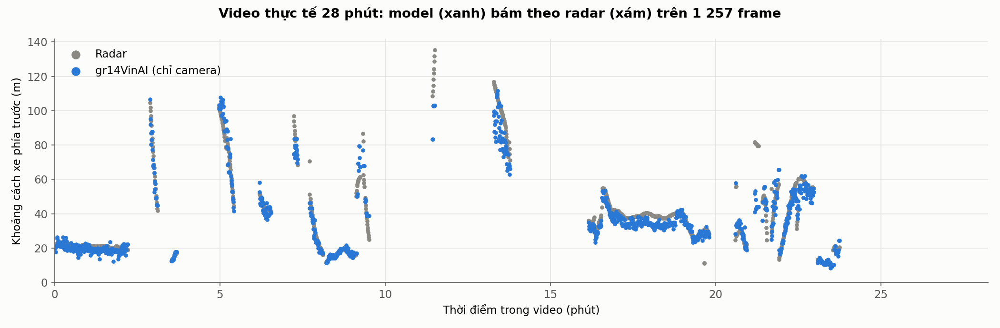
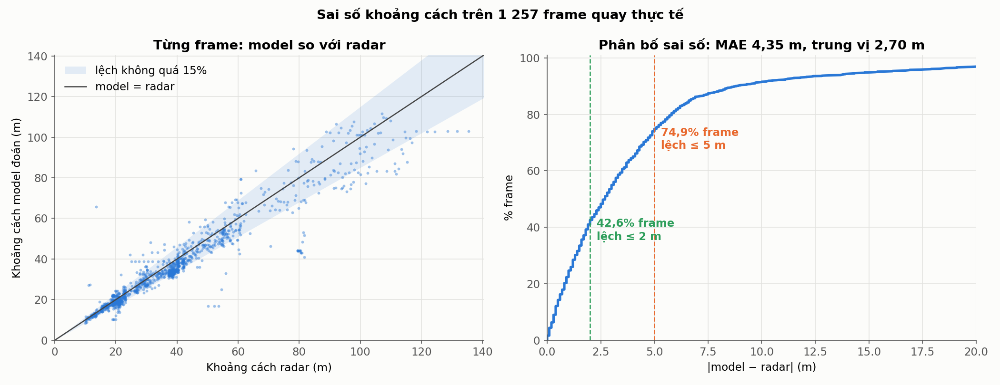
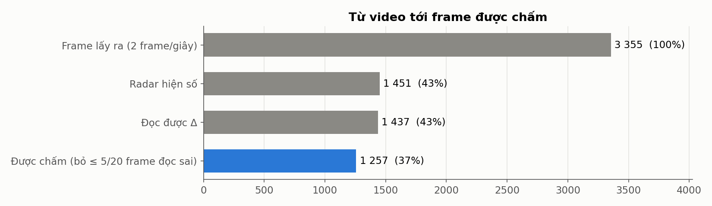
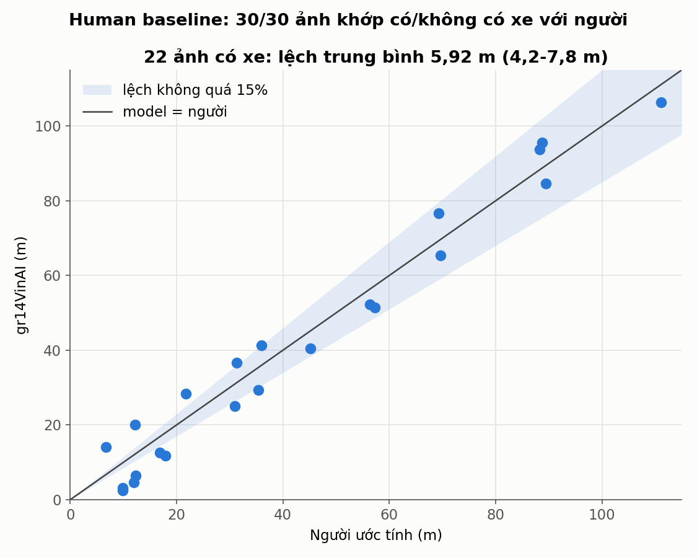
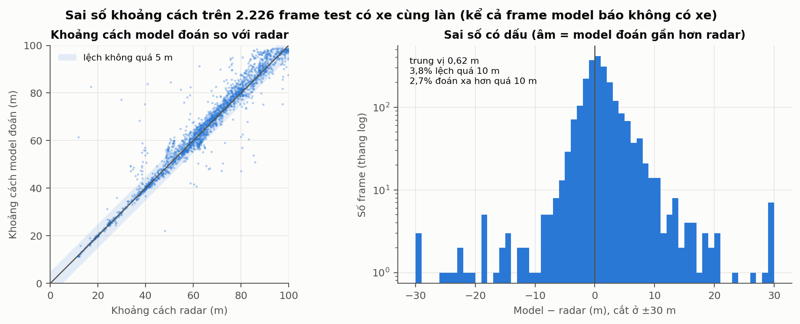

# Đánh giá gr14VinAI

Kết quả đánh giá model [gr14VinAI](../models/README.md): chạy thực tế ở Việt Nam so với radar, human baseline, và bộ dữ liệu test Comma2k19.

## 1. Đánh giá thực tế: Vinhomes Ocean Park 2 và cao tốc Hà Nội - Hải Phòng

Nhóm quay video trên đường nội khu Vinhomes Ocean Park 2 và cao tốc Hà Nội - Hải Phòng. Ứng dụng chạy gr14VinAI và hiện trên màn hình ba số: khoảng cách model, khoảng cách radar và Δ = model − radar. Lấy **2 frame mỗi giây**, đọc ba số bằng OCR; **sai số mỗi frame = |Δ|**.





- Một nửa số frame lệch không quá **2,7 m**; **83,0%** lệch không quá 15%, **74,9%** không quá 5 m, **42,6%** không quá 2 m.
- Model thường đoán **gần hơn** radar (Δ trung bình −2,62 m): với cảnh báo va chạm, đây là phía an toàn.


| Khoảng cách radar | Số frame | MAE | Trung vị | Lệch ≤ 2 m | Lệch ≤ 15% |
|---|---:|---:|---:|---:|---:|
| 10-20 m | 236 | **1,41 m** | **0,70 m** | **86,9%** | 89,8% |
| 20-40 m | 574 | 3,10 m | 2,70 m | 39,4% | 83,6% |
| 40-60 m | 275 | 4,35 m | 3,50 m | 29,8% | 88,0% |
| 60-80 m | 60 | 9,79 m | 6,75 m | 13,3% | 71,7% |
| 80-100 m | 69 | 13,76 m | 11,00 m | 7,2% | 60,9% |
| trên 100 m (ngoài tầm model) | 43 | 14,30 m | 15,30 m | 20,9% | 55,8% |

Ở 10-20 m, nơi cần cảnh báo nhất, model lệch trung vị 0,7 m. Chỉ tính radar trong 100 m (1.215 frame): MAE 4,00 m, trung vị 2,60 m. Trên 60 m sai số tăng rõ: đây là phần cần cải thiện tiếp.

**Frame nào được chấm**



1. Video 28 phút, 2 frame/giây: **3.355 frame**.
2. Radar không hiện số thì bỏ (không có đáp án): còn 1.451 frame, 1.437 frame đọc được Δ.
3. Frame OCR đọc sai (ba số không khớp: radar + Δ, làm tròn như màn hình, phải ra số model) bị bỏ, nhưng mỗi 20 frame liên tiếp bỏ nhiều nhất 5, ưu tiên frame lệch nhiều nhất. Bỏ 180, giữ 12 frame đọc sai: **1.257 frame được chấm**.

Dữ liệu: [measurements.xlsx](radar_vinhomeocp/measurements.xlsx) → [measurements.csv](radar_vinhomeocp/measurements.csv) (mọi frame), [field_frames_scored.csv](radar_vinhomeocp/field_frames_scored.csv) (frame được chấm), [field_metrics.json](radar_vinhomeocp/field_metrics.json).

---

## 2. Human baseline

30 ảnh đường Việt Nam ([human_baseline/anh/](human_baseline/anh/)). Một người đánh giá xem từng ảnh và ghi: có xe cùng làn phía trước không, nếu có thì cách bao nhiêu mét. gr14VinAI trả lời cùng 30 ảnh. Không có radar cho các ảnh này, nên đây là **so model với người**, không phải chấm độ chính xác.



- **Có/không có xe:** model và người khớp ở cả **30/30** ảnh (22 có xe, 8 không có xe).
- **Khoảng cách (22 ảnh có xe, từ 2,5 m tới 106 m):** lệch trung bình **5,92 m**, trung vị 5,90 m, ít nhất 4,2 m, nhiều nhất 7,8 m; 9/22 ảnh lệch không quá 15% so với người. Ở xe gần (dưới 20 m theo model) độ lệch 4-8 m là lớn so với khoảng cách.

Dữ liệu: [nguoi_danh_gia.csv](human_baseline/nguoi_danh_gia.csv) (người), [gr14VinAI.csv](human_baseline/gr14VinAI.csv) (model), [comparison_30_images.csv](human_baseline/comparison_30_images.csv) (ghép hai bên).

---

## 3. Trên bộ dữ liệu test (Comma2k19)




34 video test, 3.778 frame có nhãn radar. Trên mọi frame radar có xe (2.226 frame): MAE **2,73 m**, trung vị 1,56 m, F1 **0,946**. Trên 2.118 frame model và radar cùng thấy xe: MAE 2,55 m, 96,6% lệch không quá 15%. Phương pháp hình học (khung xe + mô hình camera lỗ kim) chỉ đạt F1 0,407, MAE 8,91 m. Golden dataset 300 case: gr14VinAI đạt 83,7%, hình học 32,7%. Chi tiết: [final_evaluation_report.md](final_evaluation_report.md).

---

## Trong thư mục có gì

| Vị trí | Nội dung |
|---|---|
| `final_evaluation_report.md` | báo cáo đánh giá đầy đủ (golden, so sánh, feedback, before/after) |
| `evaluation_protocol.md` | cách đo: request, environment, stopping criteria, scorer |
| `radar_vinhomeocp/` | dữ liệu chạy thực tế |
| `human_baseline/` | 30 ảnh, câu trả lời của người và của model |
| `inputs/` | golden dataset, lịch sử các vòng model, feedback người dùng |
| `results/` | số đo trên bộ dữ liệu test |
| `report/` | hình và script vẽ hình |

## Chạy lại

```
python eval/report/scripts/make_readme_figures.py   # xlsx -> csv, chấm thực tế, human baseline, hình field_* và human_baseline
```
