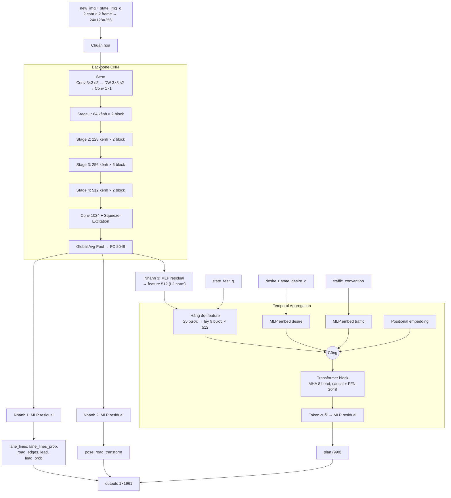
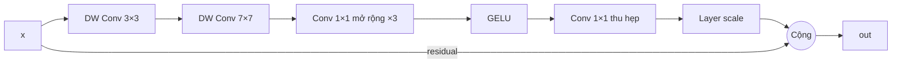

# Kiến trúc model `gr14VinAI.onnx`

> Kiến trúc tham khảo từ **EfficientNet**, **ResNet** và **Temporal Aggregation**.

Model dự đoán lái xe end-to-end: đầu vào là chuỗi ảnh camera, đầu ra là quỹ đạo, làn đường, xe phía trước, mép đường và pose.
~30M tham số, FP16, ONNX opset 20.

## Đầu vào / Đầu ra

| Tensor | Shape | Ý nghĩa |
|---|---|---|
| `new_img` | 2×6×128×256 | Frame mới của 2 camera (YUV 6 kênh) |
| `state_img_q` | 2×5×6×128×256 | Hàng đợi frame trước đó |
| `desire` | 8 | Lệnh điều hướng (đổi làn, rẽ…) |
| `traffic_convention` | 1×2 | Lái bên trái / bên phải |
| `state_desire_q` | 100×1×8 | Lịch sử desire |
| `state_feat_q` | 96×1×512 | Lịch sử feature ảnh |
| `outputs` | 1×1961 | pose 12, road_transform 12, lane_lines 528, lane_lines_prob 8, lead 144, lead_prob 3, road_edges 264, plan 990 |

Các `next_state_*` là hàng đợi đã được dịch (shift) để dùng cho bước tiếp theo.

## Luồng xử lý

1. **Ghép đầu vào:** lấy 2 frame của mỗi camera → 2×12 kênh → concat còn 24×128×256, rồi chuẩn hóa (trừ mean, chia std).
2. **Backbone CNN (EfficientNet + ResNet):**
   - Stem: Conv 3×3 stride 2 → depthwise 3×3 stride 2 → Conv 1×1, kích hoạt GELU.
   - 4 stage, kênh 64 → 128 → 256 → 512 (số block 2 / 2 / 6 / 2), downsample bằng depthwise 7×7 stride 2.
   - Mỗi block: depthwise 3×3 + 7×7 → Conv 1×1 mở rộng ×3 → GELU → Conv 1×1 thu hẹp → layer scale → **cộng residual (ResNet)**.
   - Head: Conv mở rộng lên 1024 kênh → **Squeeze-and-Excitation (EfficientNet)** → GELU → Global Average Pool → FC 2048.
3. **Vision heads (MLP residual):** từ vector 2048 tách 3 nhánh, mỗi nhánh là các khối FC 512↔1024 có skip connection:
   - Nhánh 1: lane_lines, lane_lines_prob, road_edges, lead, lead_prob.
   - Nhánh 2: pose, road_transform và vài output phụ.
   - Nhánh 3: feature 512 chiều được chuẩn hóa L2 và đưa vào hàng đợi temporal.
4. **Temporal Aggregation (policy):**
   - Hàng đợi 25 feature (24 cũ + 1 mới), lấy mẫu 9 bước thời gian → 9×512.
   - Desire (25 bước, max-pool theo nhóm 4) và traffic_convention được nhúng bằng MLP (SiLU) rồi cộng vào cùng **positional embedding**.
   - 1 khối Transformer: LayerNorm → Multi-Head Self-Attention (8 head × 64, causal mask) → FFN 2048 (GELU), có residual.
   - Lấy token cuối → MLP residual → **plan (990)** và desire_state (8).
5. **Đầu ra:** ghép các head thành vector 1961 chiều, đồng thời cập nhật 3 hàng đợi trạng thái.

## Sơ đồ

### Một block của backbone

