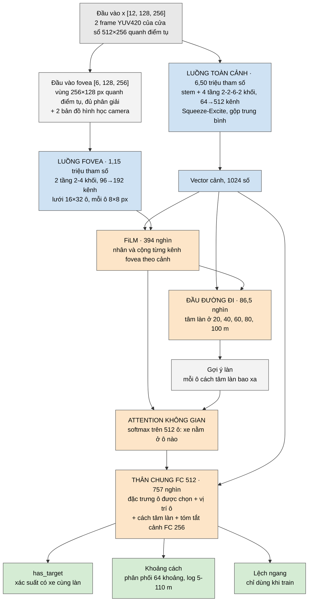

# gr14VinAI: kiến trúc model

gr14VinAI nhìn **hai frame camera liên tiếp** và trả lời hai câu: phía trước có xe cùng làn trong 100 m không, và nếu có thì cách bao nhiêu mét. Đây là một mạng tích chập hai luồng, **9.282.186 tham số**, train từ đầu trên dữ liệu của nhóm (Comma2k19, nhãn từ radar). Code mạng: [`model.py`](model.py); train, đánh giá, export: [`train.py`](train.py); đường ống ảnh và giao diện ONNX: [`common.py`](common.py). Kết quả đánh giá nằm ở [`../../eval/`](../../eval/).

## 1. Đầu vào

- Mỗi frame được cắt một cửa sổ **512×256 px quanh điểm tụ** của đường, giữ nguyên tiêu cự gốc của camera (910 px). Điểm tụ nằm ở (256; 47,6) trong cửa sổ (`common.read_yuv_frames`).
- Cửa sổ được lưu dạng YUV420 thành **6 mặt phẳng 128×256**: 4 mặt độ sáng Y lấy so le (chẵn/lẻ theo hàng và cột), 1 mặt U, 1 mặt V.
- Mạng nhận frame trước và frame hiện tại ghép lại: `x [B, 12, 128, 256]`, giá trị 0-255.

## 2. Sơ đồ



Màu: xám = đầu vào và phần tính sẵn (không tham số), xanh dương = hai luồng tích chập, cam = ghép thông tin, xanh lá = đầu ra. Tổng 9.282.186 tham số.

Thứ tự xử lý là: đoán làn đi đâu, dùng làn để tìm ô có xe, rồi mới đoán khoảng cách. Thứ tự này khớp với cách đặt nhãn: "cùng làn" được quyết định trước (xe cách tâm làn không quá 1,5 m), khoảng cách tính sau.

## 3. Từng thành phần

| Thành phần | Làm gì | Vì sao |
|---|---|---|
| Luồng toàn cảnh | Nhìn cả cửa sổ: đường thẳng hay cong, ánh sáng, mật độ xe. Kết thúc bằng một vector 1024 số | Quyết định "có xe cùng làn không" cần bối cảnh của cả đoạn đường |
| Luồng fovea | Chỉ nhìn vùng 256×128 px quanh điểm tụ nhưng ở đủ độ phân giải: 4 mặt Y được ghép lại thành ảnh gốc (pixel shuffle) | 99,8% số xe phía trước nằm trong vùng này; xe rộng trung vị khoảng 26 px, quá nhỏ với độ phân giải thô của luồng toàn cảnh |
| Hai bản đồ hình học | Hai kênh hằng, không có tham số: điểm mặt đường mà mỗi pixel nhìn thấy cách bao xa về phía trước và lệch ngang bao nhiêu, theo mô hình camera lỗ kim (cao 1,22 m) | Trên đường phẳng, hàng ảnh quyết định khoảng cách. Đưa công thức có sẵn vào để mạng chỉ phải học phần còn lại |
| FiLM | Từ vector cảnh sinh ra hệ số nhân và số cộng cho từng kênh của fovea | Cùng một hình trong fovea mang nghĩa khác nhau tuỳ cảnh, ví dụ khi đường cong |
| Đầu đường đi | Đoán tâm làn lệch trái bao nhiêu mét ở 20, 40, 60, 80, 100 m. Mỗi đơn vị đầu ra ứng với `8·(d/100)²` mét, vì độ lệch của khúc cua tăng theo bình phương khoảng cách | Khi chạy thật không biết trước xe sẽ đi đâu, nên mạng phải tự đoán làn |
| Attention không gian | Cho mỗi ô 8×8 px một điểm "xe ở đây", lấy đặc trưng và toạ độ theo trọng số đó | Khi train, attention được dạy trực tiếp bằng vị trí xe theo radar chiếu lên ảnh, nên không cần ai vẽ khung quanh xe |
| Đầu khoảng cách | Phân phối xác suất trên 64 khoảng chia theo thang log 5-110 m; đáp số là giá trị trung bình | Nhãn radar thỉnh thoảng nhảy sang xe khác; thang log phạt lệch 3 m ở 30 m ngang với lệch 9 m ở 90 m |
| Đầu lệch ngang | Xe lệch trái/phải bao nhiêu, chỉ dùng khi train | Ép mạng học đúng đại lượng quyết định nhãn "cùng làn" |

**Khối tích chập** dùng chung cho cả hai luồng (`model.Block`): conv depthwise 3×3, cộng thêm một nhánh phụ (conv depthwise 7×7 → conv 1×1 mở rộng gấp 3 lần → GELU → conv 1×1). Sau mỗi conv có BatchNorm. BatchNorm cuối của nhánh phụ khởi tạo bằng 0, nên lúc mới train mỗi khối chỉ là một conv 3×3; nhờ vậy chồng 12 khối vẫn train từ đầu được. Giảm độ phân giải bằng conv depthwise 7×7 bước 2.

**Lật gương lúc chạy** (`model.Mirrored`): mỗi frame được chạy hai lần, trên ảnh gốc và ảnh lật gương, rồi lấy trung bình. Đo trên validation, cách này chính xác hơn chạy một lần nhưng tốn gấp đôi tính toán. File ONNX đã có sẵn bước này bên trong.

## 4. Số tham số

Đếm từ checkpoint `gr14VinAI.pt`:

| Thành phần | Tham số |
|---|---:|
| Luồng toàn cảnh (`context`) | 6.503.808 |
| Luồng fovea (`fovea`) | 1.153.920 |
| Thân chung FC 512 (`trunk`) | 757.248 |
| FiLM (`film`) | 393.600 |
| Tóm tắt cảnh FC 256 (`scene`) | 262.400 |
| Ba đầu ra và attention (`distance`, `has_target`, `sideways`, `where`) | 124.677 |
| Đầu đường đi (`path`) | 86.533 |
| **Tổng** | **9.282.186** |

## 5. Các phiên bản trước

| Vòng | Kiến trúc | Tham số | Kết quả | Đo trên |
|---|---|---:|---|---|
| 1 | Một luồng, 12 khối MBConv | 916.562 | MAE 8,05 m, F1 0,794 | 10 video test ban đầu, nhãn hành lang thẳng |
| 2 | Một luồng, 23 khối MBConv | 5.064.598 | MAE 5,93 m, F1 0,859 | như trên |
| 3 | Hai luồng | 9.194.627 | MAE 4,42 m, F1 0,898 | như trên |
| Cuối | Hai luồng + đầu đường đi | 9.282.186 | MAE 2,73 m, F1 0,946 | 34 video test, nhãn bám theo đường |

Số các vòng cũ là số đã ghi lúc đo, trong [`../../eval/inputs/model_iteration_history.json`](../../eval/inputs/model_iteration_history.json); file model của các vòng đó không còn. Vòng cuối khác vòng 3 cả về dữ liệu lẫn nhãn, nên hai dòng cuối không so trực tiếp được. **Chưa có thí nghiệm tách riêng** đóng góp của fovea, bản đồ hình học, attention có hướng dẫn và đầu phân phối: các phần này được đưa vào cùng một lúc.

## 6. File ONNX

`gr14VinAI.onnx` có đúng tên, shape và kiểu input/output như model runtime của repo tổng, để runtime nạp được mà không phải sửa:

| | Tên | Shape, kiểu | Model dùng tới |
|---|---|---|---|
| input | `new_img` | [2, 6, 128, 256] uint8 | `[0]`: frame mới nhất. `[1]` (góc rộng) không dùng |
| input | `desire` | [8] float32 | không |
| input | `traffic_convention` | [1, 2] float32 | không |
| input | `state_img_q` | [2, 5, 6, 128, 256] uint8 | `[0, -1]`: frame ngay trước |
| input | `state_desire_q` | [100, 1, 8] float32 | không |
| input | `state_feat_q` | [96, 1, 512] float32 | không |
| output | `outputs` | [1, 1961] float32 | xem dưới |
| output | `next_state_img_q`, `next_state_desire_q`, `next_state_feat_q` | như input | truyền vào lần chạy sau |

`outputs` chia nhóm theo metadata `output_slices`: `pose` 0:12, `road_transform` 12:24, `lane_lines` 24:552, `lane_lines_prob` 552:560, `lead` 560:704, `lead_prob` 704:707, `road_edges` 707:971, `plan` 971:1961. Model chỉ điền:

- `lead_prob[0]`: logit của xác suất có xe cùng làn. Có xe khi xác suất ≥ **0,40** (ngưỡng chọn trên validation, ghi trong `gr14VinAI.json`).
- `lead[0]`: khoảng cách từ camera tới xe = khoảng cách theo radar (0-100 m) cộng 1,5 m.
- `lane_lines[1]` và `[2]`: mép trái và phải của làn mà model dùng để xét "cùng làn", cách tâm làn 1,5 m mỗi bên. Đây không phải vạch sơn trên đường. `lane_lines_prob` chỉ là cờ đánh dấu hai đường này (+10), không phải dự đoán.

**Mọi ô còn lại bằng 0**: `pose`, `road_transform`, `road_edges`, `plan`, vị trí ngang, vận tốc, gia tốc của xe phía trước, và mọi độ lệch chuẩn. Hệ quả: runtime nào tự hiệu chỉnh camera từ `pose`/`road_transform` thì phải dùng hiệu chỉnh cố định.

Đọc đầu ra bằng Python: `common.run_pair(sess, pair)` trả về (xác suất có xe, khoảng cách theo radar, độ lệch tâm làn).

## 7. Train và export

Cần thư mục `data/` của dự án (khoảng 67 GB, không nằm trong repo). `train.py` đọc và ghi model ở `model/` của thư mục cha (`test/model/`), nên phải chép `gr14VinAI.pt` vào đó, hoặc đặt biến `GR14_CKPT=<đường dẫn .pt>`.

```
python src_train/train.py prepare   # frame có nhãn của train/val/test -> data/cache       (một lần)
python src_train/train.py dense     # mọi frame của video train                        (một lần)
python src_train/train.py radar     # vật thể radar quanh mỗi frame                    (một lần)
python src_train/train.py curve     # nhãn "cùng làn" bám theo đường                   (một lần)
python src_train/train.py train     # -> model/gr14VinAI.pt (epoch tốt nhất trên validation)
python src_train/train.py eval      # số đo trên tập test
python src_train/train.py export    # -> model/gr14VinAI.onnx + gr14VinAI.json; kiểm ONNX trả lời giống PyTorch
```

Công thức của model cuối là `GR14_RECIPE=zoom+curve+balance`, `GR14_SEED=2` (mặc định trong code): phóng to ảnh quanh điểm tụ khi train (nhãn đổi theo), nhãn "cùng làn" bám theo đường, và lấy mẫu cân bằng theo (ngày, đêm) × khoảng cách. Tối ưu bằng AdamW (weight decay 0,05) với lịch OneCycle. Các video chạng vạng (24/354) không dùng để train và chấm.

Unit test: `python -m unittest test_gr14vinai` trong `src_train/`.

## 8. Giới hạn

- Mỗi cặp frame được xử lý độc lập, không có bộ nhớ theo thời gian, nên đầu ra có thể nhấp nháy. Việc làm mượt nằm ngoài mạng (`train.smooth`).
- Bản đồ hình học và cách chiếu radar lên ảnh giả định đường phẳng, camera cao 1,22 m và đã căn chỉnh. Camera đặt ở độ cao khác sẽ làm khoảng cách lệch.
- Chưa có ablation từng thành phần (mục 5).

## 9. Nguồn tham khảo

- **openpilot** (comma.ai, MIT): định dạng đầu vào (YUV420 6 mặt phẳng, hai frame) 
- **ConvNeXt** (Liu và cộng sự, 2022): nhánh phụ của khối tích chập (depthwise 7×7, mở rộng 1×1 gấp 3, GELU).
- **EfficientNet** (Tan và Le, 2019): Squeeze-Excite ở cuối luồng toàn cảnh, và các khối MBConv của vòng 1-2.
- **FiLM** (Perez và cộng sự, 2018): cách vector cảnh điều chỉnh đặc trưng fovea.
