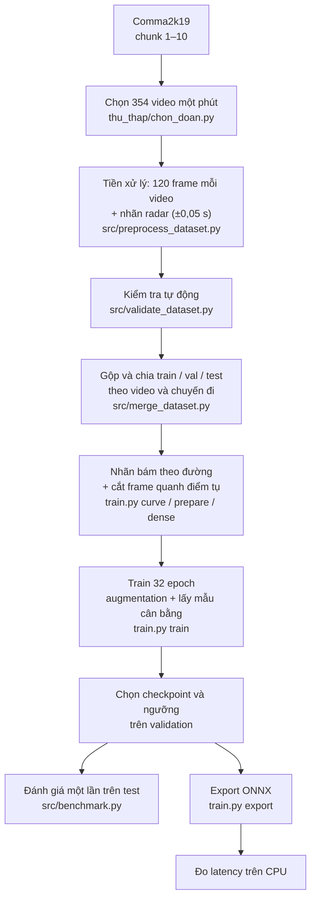
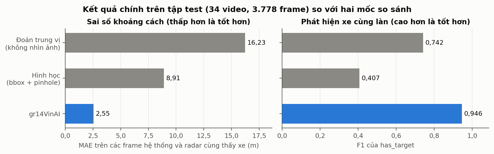

> Báo cáo này thuộc model ba đầu ra trong `src/distance_model.py` và `src/train_distance.py`. Các số đo/ảnh ở đây không phải kết quả của đồ thị 707 đầu ra được phục dựng trong `src/model.py`.

# 00. Tổng quan

Báo cáo này mô tả quy trình train gr14VinAI, một model chỉ dùng camera trước để trả lời hai câu hỏi: có xe cùng làn phía trước trong 100 m hay không, và xe đó cách bao xa. Trên tập test 34 video (3.778 frame), model đạt MAE 2,73 m và F1 0,946, tốt hơn rõ hai mốc so sánh. Hai điểm còn yếu là tốc độ (chưa kịp 20 FPS trên CPU laptop khi chạy liên tục) và phạm vi (chưa đánh giá ở chạng vạng, mưa, sương mù).

## 1. Đã làm gì

### 1.1. Bài toán

| Mục | Nội dung |
|---|---|
| Tên bài toán | Ước lượng khoảng cách tới xe phía trước cùng làn từ camera đơn |
| Loại dữ liệu | Video camera trước (1164 × 874 px, 20 FPS); radar chỉ dùng để tạo nhãn |
| Tác vụ | Phân loại nhị phân (`has_target`) và hồi quy (`distance_m`, 0–100 m), kèm một đầu ra phụ đoán tâm làn (`lane_left_m`) |
| Đầu vào của model | 2 frame liên tiếp, tensor `[1, 12, 128, 256]` |
| Dataset | Comma2k19 của comma.ai: 354 video một phút được chọn, trong đó 330 video ngày và đêm được dùng (264 train / 32 validation / 34 test) |
| Framework | PyTorch 2.7.1 (train), ONNX opset 17 và onnxruntime 1.30.0 (suy luận) |
| Code và kết quả | `src/`, `thu_thap/`, `results/`, `eval/`, `model/` |

"Cùng làn" nghĩa là xe nằm cách tâm làn không quá 1,5 m. Tâm làn bám theo đường xe mình sẽ đi, nên trên đoạn cong hành lang cong theo đường (chi tiết ở file 02 và 03).

### 1.2. Toàn bộ quy trình

*Hình 0.1: Sơ đồ pipeline từ dữ liệu gốc tới model đã đánh giá. Mỗi ô ghi script thực hiện bước đó.*

Sơ đồ cho thấy tập test chỉ xuất hiện ở một nhánh, sau khi checkpoint và ngưỡng đã được chọn trên validation. Nhờ vậy con số trên test không bị ảnh hưởng bởi các quyết định trong lúc train. Mỗi bước được giải thích ở một file riêng, theo đúng thứ tự này.

### 1.3. Metric đo thành công

| Metric | Đo trên | Dùng để làm gì |
|---|---|---|
| MAE (m) | Frame mà radar thấy xe cùng làn | Metric chính của khoảng cách |
| Sai số trung vị (m) | Như trên | Sai số ở frame điển hình, không bị vài frame lệch xa kéo lên |
| RMSE (m), tỉ lệ lệch ≤ 5 m và ≤ 10 m | Như trên | Xem phần đuôi của sai số |
| Precision, Recall, F1 | Mọi frame có nhãn, ngưỡng `has_target` chọn trên validation | Chất lượng của câu trả lời "có xe hay không" |
| Thời gian mỗi frame (ms) | File ONNX trên CPU, batch 1 | Có kịp 20 FPS của camera hay không (50 ms mỗi frame) |

### 1.4. Mục tiêu

`[CẦN ĐIỀN: mục tiêu định lượng đặt ra lúc bắt đầu, nếu có (ví dụ MAE ≤ ? m, F1 ≥ ?, số FPS tối thiểu)]`

Trong repo không có tài liệu nào ghi một con số mục tiêu đặt trước. Vì vậy báo cáo này so kết quả với ba mốc đo được:

- **Đoán trung vị:** luôn trả lời khoảng cách trung vị của tập train (61,5 m) và luôn nói "có xe". Đây là mức sàn của một hệ thống không nhìn ảnh.
- **Phương pháp hình học:** bounding box của một detector có sẵn cộng công thức camera lỗ kim.
- **50 ms mỗi frame:** camera quay 20 FPS, nên đây là giới hạn để chạy thời gian thực. Con số này suy ra từ dữ liệu, không phải mục tiêu được giao.

## 2. Vì sao chọn cách này

- **Vì sao chỉ dùng camera, còn radar làm nhãn.** Comma2k19 ghi đồng thời camera và radar. Radar cho khoảng cách chính xác mà không cần ai gán nhãn tay, nên có thể tạo hàng trăm nghìn nhãn từ video sẵn có. Model chỉ nhận ảnh, nên lúc chạy không cần radar.
- **Vì sao cần cả hai đầu ra.** Khoảng cách chỉ có nghĩa khi có xe cùng làn. Trong tập test, 41,1% số frame không có xe nào trong hành lang; nếu chỉ hồi quy khoảng cách thì model vẫn phải trả về một con số vô nghĩa ở các frame đó.
- **Vì sao dùng MAE và trung vị thay cho accuracy.** Khoảng cách là số liên tục, không có "đúng" hay "sai". MAE cho biết lệch trung bình bao nhiêu mét. Trung vị được báo kèm vì nhãn radar đôi khi nhảy sang xe khác, tạo ra vài frame lệch rất xa.
- **Vì sao dùng F1 cho `has_target`.** Hai lớp không cân bằng tuyệt đối (58,9% có xe trong tập test), và hai kiểu sai có hậu quả khác nhau: bỏ sót xe là lỗi an toàn, báo nhầm là lỗi gây phiền. Precision và recall được báo riêng, F1 dùng để chọn ngưỡng.
- **Vì sao "cùng làn" phải bám theo đường.** Trong tập train, 27,5% số xe cùng làn nằm ở chỗ tâm làn đã rời trục thẳng của xe mình quá 1,5 m. Một hành lang thẳng sẽ gán sai nhãn cho các frame đó.
- **Vì sao tách validation và test.** Checkpoint, ngưỡng `has_target` và mọi lựa chọn cách train đều quyết định trên validation. Tập test chỉ được chấm sau cùng, nên không được dùng khi tuning.

## 3. Kết quả chính

*Hình 0.2: Kết quả chính trên tập test so với hai mốc so sánh. Trái: MAE trên các frame mà hệ thống và radar cùng thấy xe. Phải: F1 của `has_target`.*

Hình cho thấy gr14VinAI lệch 2,55 m, so với 8,91 m của phương pháp hình học và 16,23 m của đoán trung vị; F1 là 0,946 so với 0,407 và 0,742. Nghĩa là model học được thứ mà một công thức hình học đơn giản không làm được, nhất là việc quyết định xe nào cùng làn (phương pháp hình học chỉ tìm ra 26,7% số xe). Vì chưa có mục tiêu định lượng đặt trước, biểu đồ này so với baseline thay cho so với mục tiêu; phần phân tích chi tiết nằm ở file 06.

MAE trong hình (2,55 m) tính trên 2.118 frame mà model báo có xe, để so công bằng với phương pháp hình học, vốn không có khoảng cách khi không tìm thấy xe. Các số chính thức của model tính trên toàn bộ 2.226 frame radar có xe:

| Chỉ số trên tập test | Giá trị |
|---|---:|
| MAE khoảng cách | 2,73 m |
| Sai số trung vị | 1,55 m |
| RMSE | 4,97 m |
| Lệch không quá 5 m / 10 m | 86,6% / 96,2% |
| Precision / Recall của `has_target` (ngưỡng 0,40) | 0,940 / 0,951 |
| Số tham số / file ONNX | 9.282.186 / 37,65 MB |
| Thời gian mỗi frame trên CPU laptop: đo ngắn / chạy liên tục | 30,25 ms / 54,61 ms |

Tóm tắt trong bốn dòng:

1. Khoảng cách: MAE 2,73 m, trung vị 1,55 m; 86,6% số frame lệch không quá 5 m.
2. Phát hiện xe cùng làn: F1 0,946; model bỏ sót 4,9% số frame có xe và báo nhầm ở 8,7% số frame không có xe.
3. Tốc độ: đo ngắn đạt 33 FPS, nhưng chạy liên tục chỉ khoảng 18 FPS, chưa kịp 20 FPS của camera.
4. Phạm vi: kết quả chỉ đúng cho ban ngày và ban đêm, trên cao tốc ở California; chạng vạng bị loại khỏi train và đánh giá.

Các hạn chế được trình bày đầy đủ ở file 06 và 08. Ba điểm cần nhớ khi đọc các con số trên: vùng dưới 20 m chỉ có 60 frame trong tập test; 9 video test ban đầu có rò rỉ theo chuyến đi (file 02); và các lần train khác seed lệch nhau khoảng 0,13 m MAE trên validation.

## Liên kết sang phần tiếp theo

File [01_thu_thap_du_lieu.md](01_thu_thap_du_lieu.md) mô tả 354 video này lấy từ đâu, được chọn theo tiêu chí nào và nhãn radar được kiểm soát chất lượng ra sao.
